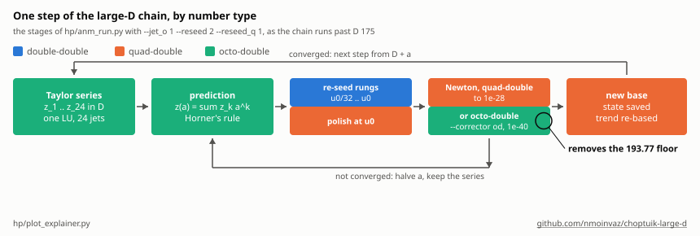
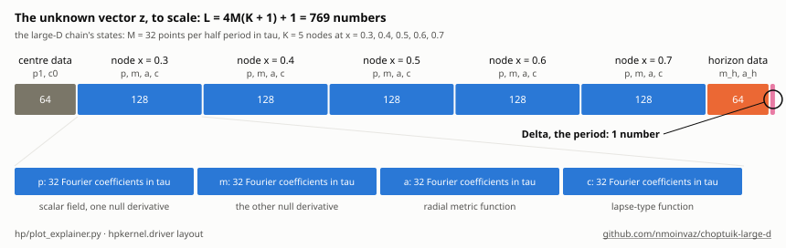
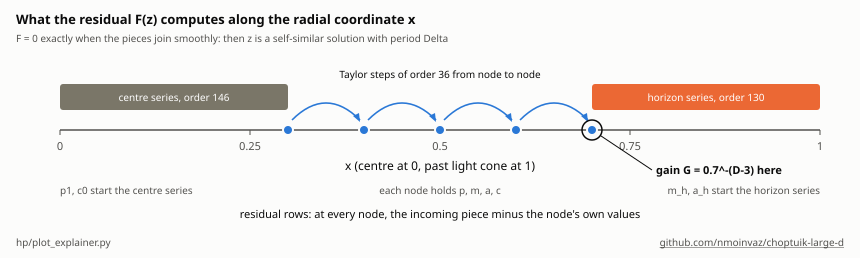
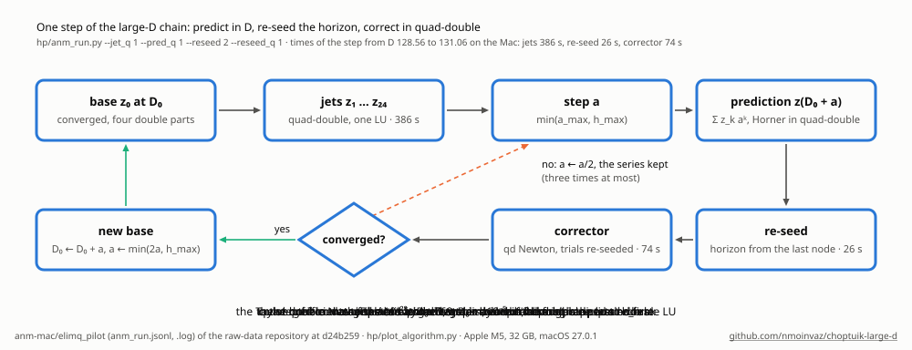
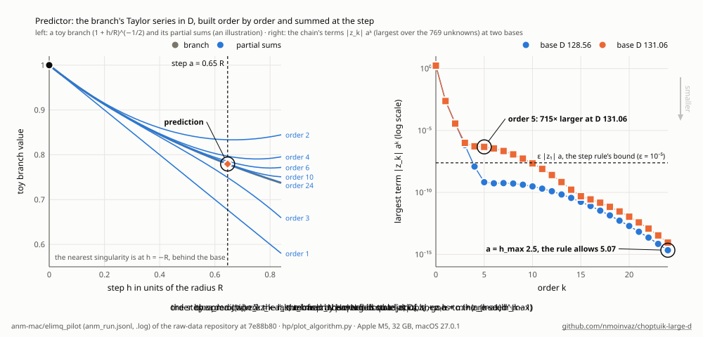
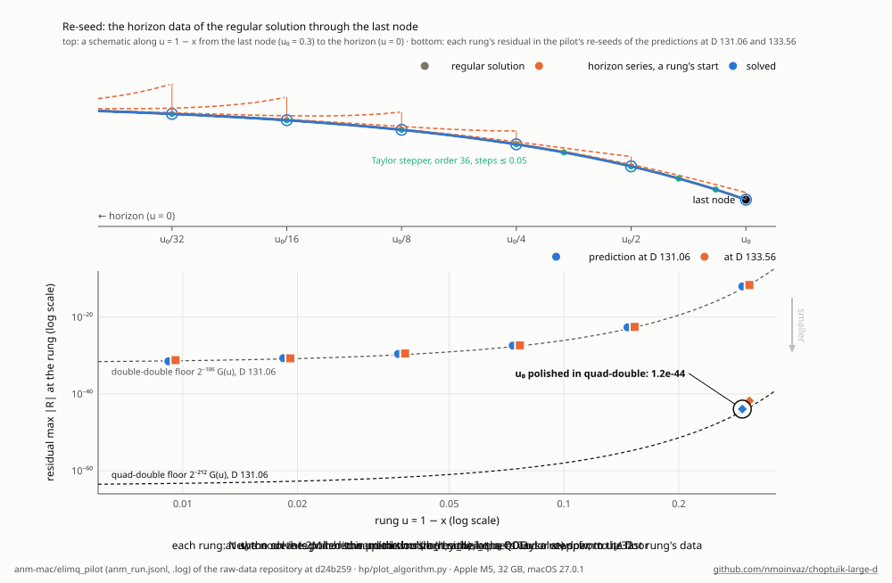
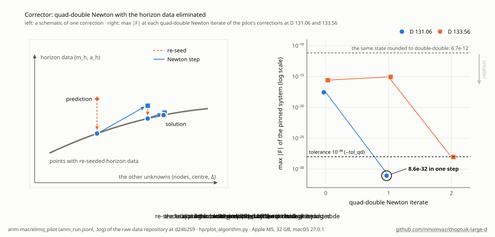
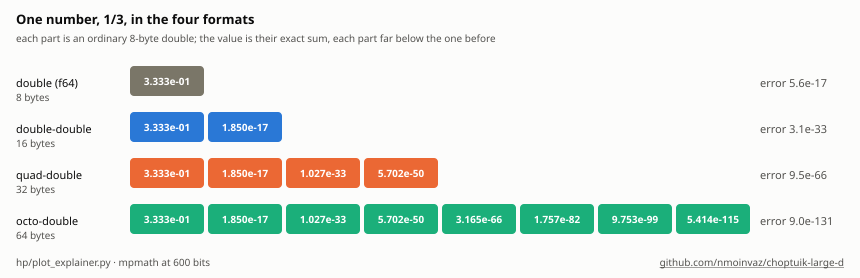
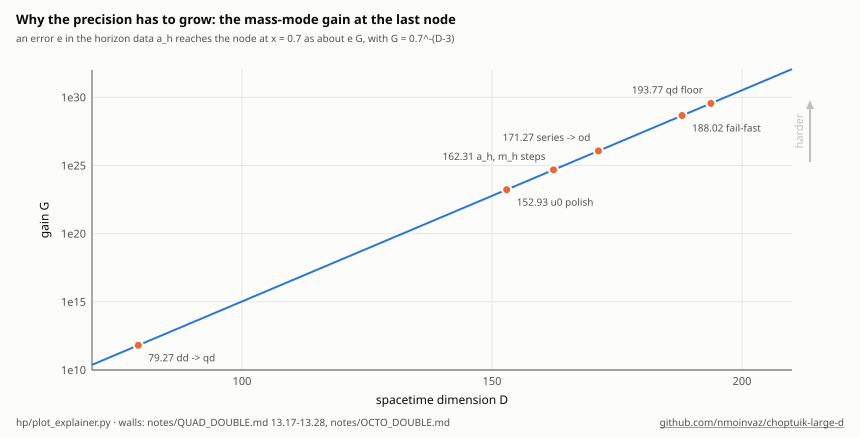

# How the solver works

This page explains how the points of Δ(D) are computed. It starts at a high level and works down to the number types and
their bytes. The physics is in the [README](README.md). The runs, checks and their numbers are in the notes linked from
each section.

## At a glance

The critical solution repeats itself, each time the scale shrinks by e^Δ. In the logarithmic time τ its fields are
periodic with period Δ, and the solver finds the fields and Δ together. Three ideas carry the whole computation.

1. **A solution is a root.** The fields and Δ are packed into a vector z of a few hundred numbers. A residual F(z) is
   zero exactly when z is a solution. Newton's method finds the root.
2. **The solution is continued in D.** From a solved point, the solution's Taylor series in D predicts the next point,
   and Newton corrects the prediction. Repeating that walks the chain up in D.
3. **The numbers grow longer with D.** One part of the problem amplifies errors by a factor G that grows exponentially
   in D. Each number is therefore stored as a sum of 2, 4 or 8 ordinary doubles, and the larger D gets, the more parts
   each stage needs.



## 1. The problem as data

### The unknowns

Every state of the solver is one vector z, laid out as in `hp/python/hpkernel/driver.py`:

- the data that start the series at the centre, x = 0 (p₁ and c₀);
- at each node in the radial coordinate x, the four fields p, m, a and c, each as M Fourier coefficients in τ over the
  half period;
- the data that start the series at the past light cone, x = 1, called the horizon data (m_h and a_h);
- Δ itself, last.

The length is L = 4M(K + 1) + 1 for K nodes. The large-D chain uses M = 32 and five nodes at x = 0.3 to 0.7, so L = 769.



### The residual

`residual(z)` returns L numbers. A series in x is started at the centre from p₁ and c₀, and another at the light cone
from m_h and a_h. Between the nodes the field equations are integrated by Taylor steps. τ-derivatives are exact on the
Fourier grid, and enter with the frequency ω = 2π/Δ. Each residual row is a mismatch: what arrives at a node from the
piece before it, minus the node's own values. One more row fixes the arbitrary shift in τ. All rows are zero exactly
when the pieces join smoothly, that is, when z is a self-similar solution with period Δ.



### Newton

Newton's method solves F(z) = 0 from a nearby guess. Each step computes the L × L Jacobian J (the derivative of every
row of F in every unknown), solves J dz = −F by an LU factorization and adds dz, halving it when it overshoots. It stops
when max |F| is below the tolerance. The Jacobian, the LU and the residual all run in the same multi-part arithmetic as
z.

## 2. Solving one point

[`hp/`](hp/) (crate `hpkernel`) works in double-double and, where the large-D chain needs it, in quad-double and octo-double, with its arithmetic from the crate [multidouble](https://github.com/nmoinvaz/multidouble).

The unknowns are the fields at a few nodes in x, the centre and horizon data, and Δ, each field on M collocation points
in τ over the half period. The residual shoots between the nodes: a series at the centre, Taylor steps of order 36
between the nodes (planned so that each step's truncation term is about 10⁻³²), and a series at the horizon, the two
series run until their tails fall below 10⁻³³. Newton solves it with the exact Jacobian from forward-mode duals[^1], or
with an f64 Jacobian and the residual kept in double-double. How it works in detail, its benchmarks and solve times, the
point spacing, a sample of the points and the error indicators against D are in
[notes/SOLVER_HP.md](notes/SOLVER_HP.md). Why the continuation stalls past D ≈ 73 (the weak directions, the
horizon-series wall, the drop-offs) is in [notes/LARGE_D_WALL.md](notes/LARGE_D_WALL.md), and the diagnosis in
[notes/QUAD_DOUBLE.md](notes/QUAD_DOUBLE.md), section 12.

The low-D side uses the same residual on a different grid. Near D = 3.04 the fields need M = 320 and 384 points per half
period and nodes from x = 0.000157 to 0.975. Newton there factors an f64 Jacobian and keeps the residual in
double-double (`newton_mixed`). Its procedures are in [notes/LOW_D.md](notes/LOW_D.md).

## 3. The continuation in D

Past D ≈ 73 the chain is carried in D by an exact Taylor continuation, the asymptotic numerical method[^2]
(`hp/anm_run.py`). It continues the pinned system, in which p₁'s harmonics 5–13 are held on a power-law trend in D
(notes/QUAD_DOUBLE.md 13.18). Each step has a predictor, an optional re-seed and a corrector, and a failed correction
halves the step, three times at most, keeping the series.



**Predictor.** At a converged base D₀ the branch's Taylor coefficients z₁, …, z₂₄ in h = D − D₀ come order by order from
one LU of the Jacobian. The right-hand side of order k is the jet of the lower orders, with the dimension entered into
the kernel as the jet's variable. The step a is where the series' last term falls to ε of its first, capped at h_max,
and the prediction Σ z_k aᵏ is summed by Horner's rule. The chain built its series in quad-double until D ≈ 175.
`--jet_o 1` builds the same series in octo-double (multidouble's `OJet`, `Ou` and `ODLu`; `hp/src/osolve.rs`). At D
148.74 the quad-double series keeps only 5–6 digits at orders 4–9, and near D 171–176 it collapsed
([notes/OCTO_DOUBLE.md](notes/OCTO_DOUBLE.md)).



**Re-seed.** The horizon data (m_h, a_h) enter through a series summed at the last node, where the mass mode amplifies
their errors by G = 0.7^−(D−3), about 10²⁰ at D = 131. `--reseed` replaces them by those of the regular solution through
the predicted last node: the node is integrated toward the horizon, and the horizon series is inverted on the rungs
u₀/32, …, u₀, each rung's Newton starting from the last rung's data and the last one polished in quad-double
(`hp/reseed.py`, [notes/RESEED.md](notes/RESEED.md)). Each rung's residual falls to the double-double floor 2⁻¹⁰⁶ G(u),
and the quad-double polish at u₀ to 2⁻²¹² G(u₀).



**Corrector.** Newton on the pinned system at D₀ + a. With `--reseed 2` every trial point is re-seeded first, so the
horizon data are eliminated. The chain runs it in quad-double (`--corrector qd`), to max |F| ≤ 10⁻²⁸. Past D ≈ 185 the
quad-double step goes wrong in the mass mode's weakest direction, and near D 194 its residual stalls at about 10⁻²⁸.
`--accept_stall_qd` then accepts a stall below a given level. `--corrector od` runs the corrector in octo-double instead
(`hp/octo_corrector.py`), which converges from the same prediction at D 194.27 to 1.8×10⁻⁴¹ in three steps
([notes/OCTO_DOUBLE.md](notes/OCTO_DOUBLE.md), sections 5–6).



The animations show the elimination pilot's measured values (`hp/plot_algorithm.py`). The design, its checks and the
runs are in [notes/QUAD_DOUBLE.md](notes/QUAD_DOUBLE.md), sections 13.15–13.28.

## 4. The number types

### One number as several doubles

| type | parts | bytes | digits | unit roundoff ε |
|---|---|---|---|---|
| double (f64) | 1 | 8 | about 16 | 1.1×10⁻¹⁶ |
| double-double | 2 | 16 | about 32 | about 10⁻³² |
| quad-double | 4 | 32 | about 64 | about 10⁻⁶⁴ |
| octo-double | 8 | 64 | about 127 | about 10⁻¹²⁸ |

A multi-part number is an unevaluated sum of ordinary doubles that do not overlap, each part far below the one before
it. The value is their exact sum.



The arithmetic rests on two error-free transformations, which recover exactly the bits that one rounded floating-point
operation loses:

```rust
// two_sum: s + e == a + b exactly; s is the rounded sum, e what the rounding lost
fn two_sum(a: f64, b: f64) -> (f64, f64) {
    let s = a + b;
    let bb = s - a;
    (s, (a - (s - bb)) + (b - bb))
}

// two_prod: p + e == a * b exactly, with the fused multiply-add
fn two_prod(a: f64, b: f64) -> (f64, f64) {
    let p = a * b;
    (p, a.mul_add(b, -p))
}

// a double-double sum: add the high parts exactly, fold in the low parts, renormalize
fn dd_add(a: (f64, f64), b: (f64, f64)) -> (f64, f64) {
    let (s, e) = two_sum(a.0, b.0);
    two_sum(s, e + a.1 + b.1)
}
```

Quad-double and octo-double chain the same steps over four and eight parts, so one of their operations costs tens to hundreds of f64 operations. The crate [multidouble](https://github.com/nmoinvaz/multidouble) implements them, scalar and in SIMD lanes (AVX-512, AVX2, SSE2, NEON), with Taylor jets (`Jet`, `QJet`, `OJet`) for the series in D. [SOFTWARE.md](SOFTWARE.md) describes the kernel's backends.

### Vectors as arrays of parts

A vector of L multi-part numbers is stored as one float64 array per part, not as an array of structs. This is why the
Python calls pass `residual_q(z0, z1, z2, z3)`, and why each state file (`.npz`) holds the arrays `zh, zl, z2, z3`, plus
`z4`–`z7` for octo-double states.

![A quad-double vector in memory: four contiguous float64 arrays of 769 doubles each, element i the sum of z0[i] to z3[i]](hp/explain_soa.svg)

For the chain's L = 769:

| object | double-double | quad-double | octo-double |
|---|---|---|---|
| one state z | 12.3 KB | 24.6 KB | 49.2 KB |
| the Jacobian J, 769 × 769 | 9.0 MiB | 18.0 MiB | 36.1 MiB |

## 5. Why the precision grows with D

The horizon data enter through a series summed at the last node, x = 0.7. There an error e in a_h shows up as about e·G,
with G = 0.7^−(D−3). G is 1.7×10²³ at D 152.93, 4.8×10²⁴ at 162.31 and 3.6×10²⁹ at 193.77, and it grows 1.43 times per
unit of D.



The Jacobian sees the same spread of scales. Near D 194 its LU pivots run from about 10⁻¹³ to 10²⁷, a condition number
near 10⁴⁰. An LU in arithmetic of unit roundoff ε gets the weakest direction wrong once ε times the condition number
nears 1. In quad-double that product is about 10⁻²⁴, and past D ≈ 185 the quad-double Newton step is wrong in that
direction (by 45% at D 188.02). In octo-double it is about 10⁻⁸⁸. The Taylor series meets the same limit, its error
growing like ε·G², which is why the quad-double series collapsed near D 171–176.

Each stage uses the shortest type that is still accurate enough, because every extra part multiplies the cost:

| stage | type now (past D ≈ 175) | why |
|---|---|---|
| Taylor series and prediction | octo-double | its error grows like ε·G² |
| re-seed rungs | double-double | each rung's own gain is smaller than G |
| re-seed polish at u₀ | quad-double | it carries the full gain G |
| corrector | quad-double, or octo-double with `--corrector od` | the LU's weakest direction |
| segment plan, residual printouts | double-double | bookkeeping |

The chain's walls and what moved it past each:

| D | wall | fix |
|---|---|---|
| about 79 | the double-double corrector's floor | quad-double states and corrector |
| about 87 | the double-double series' accuracy | quad-double jets (`--jet_q`) |
| about 128 | the prediction rounded to double-double | the prediction summed in quad-double (`--pred_q`) |
| 152.93 | the u₀ polish stopped too early | it refactors its Jacobian, and the step's solution is the projected iterate |
| 162.31 | the polish started far from the root | least-squares steps in a_h and m_h before Newton, with a divergence guard |
| 171–176 | the quad-double series collapsed | octo-double series and prediction |
| 188.02 | a failed attempt hung for over an hour | the attempt stops when its start cannot be projected |
| 193.77 | the quad-double corrector's floor | `--accept_stall_qd`, and the octo-double corrector |

## Where the code is

| file | what it does |
|---|---|
| `hp/src/model.rs` | the residual's blocks: centre and horizon series, Taylor steps, the segment plan |
| `hp/src/qsolve.rs` | the quad-double residual, jet, Jacobian and Newton step |
| `hp/src/osolve.rs` | the octo-double residual, jet, Jacobian and Newton step |
| `hp/python/hpkernel/driver.py` | set-up, the layout of z, `newton_qd`, state files |
| `hp/anm_run.py` | the large-D chain: series, prediction, re-seed, corrector, save |
| `hp/reseed.py` | the re-seed and the projection (`Reseeder`, `ElimQ`) |
| `hp/pinning.py` | the pinned system's held harmonics (`PinnedSolver`, `PinnedQ`) |
| `hp/octo_corrector.py` | the octo-double corrector (`PinnedO`, `newton_od`, `ElimO`) |
| `hp/lowD_taylor_leg.py`, `hp/anm_lowd.py` | the low-D leg and its series |
| `hp/plot_explainer.py`, `hp/plot_algorithm.py` | the diagrams on this page |

[^1]: R. E. Wengert, Commun. ACM 7, 463 (1964) (forward-mode automatic differentiation).
[^2]: B. Cochelin, Comput. Struct. 53, 1181–1192 (1994); L. Guillot, B. Cochelin and C. Vergez, Int. J. Numer. Methods Eng. 119, 261–280 (2019), doi:10.1002/nme.6049 *(partly verified: secondary listings, notes/LOW_D_SPEEDUP.md)*.
