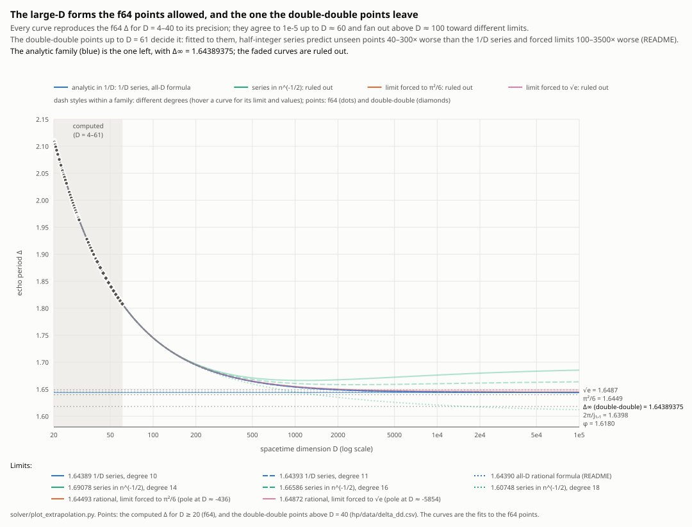
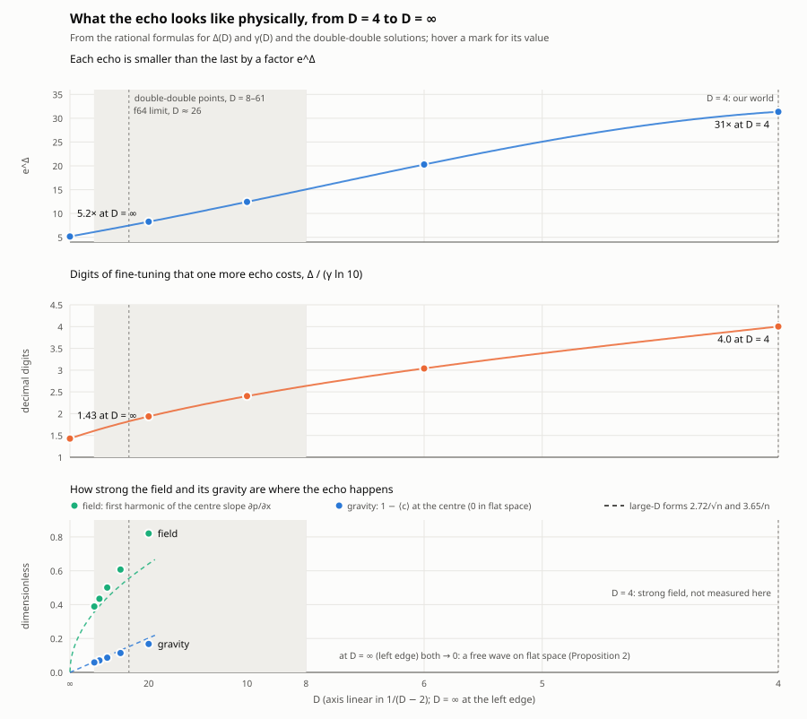
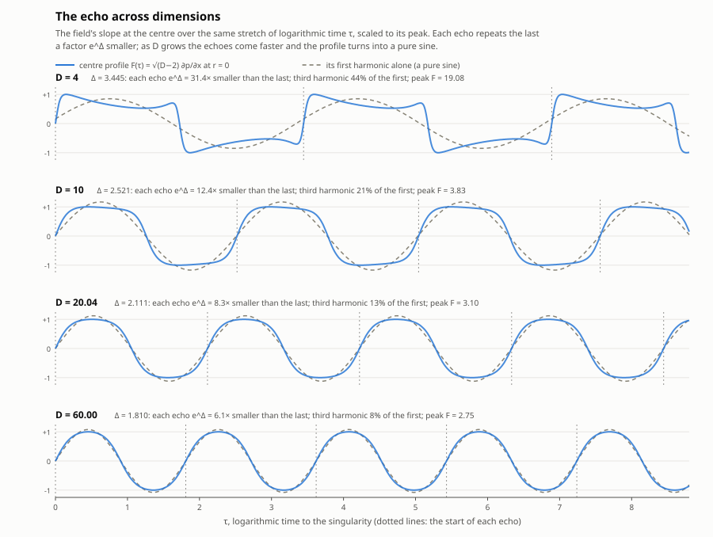
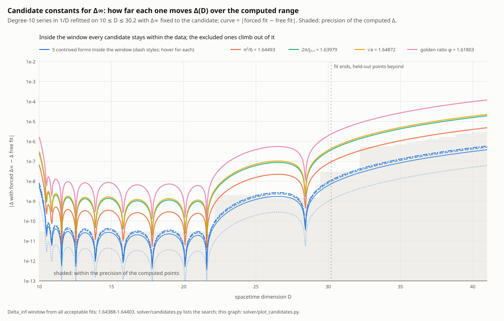
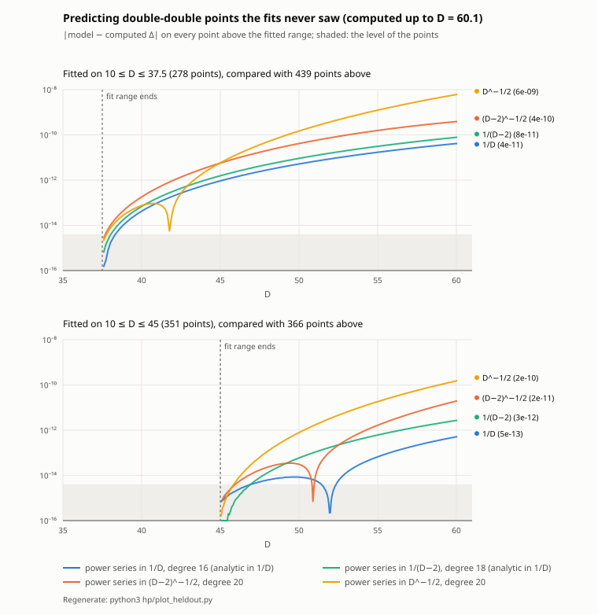
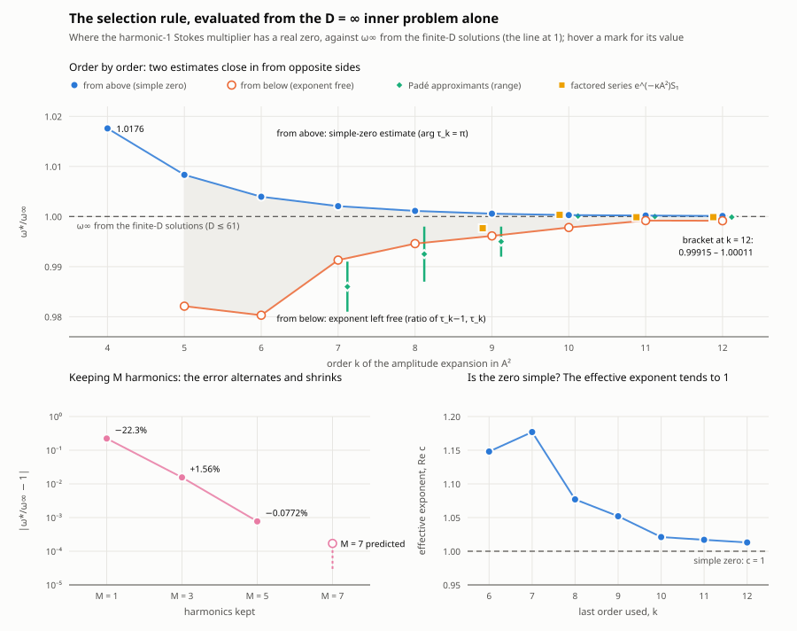
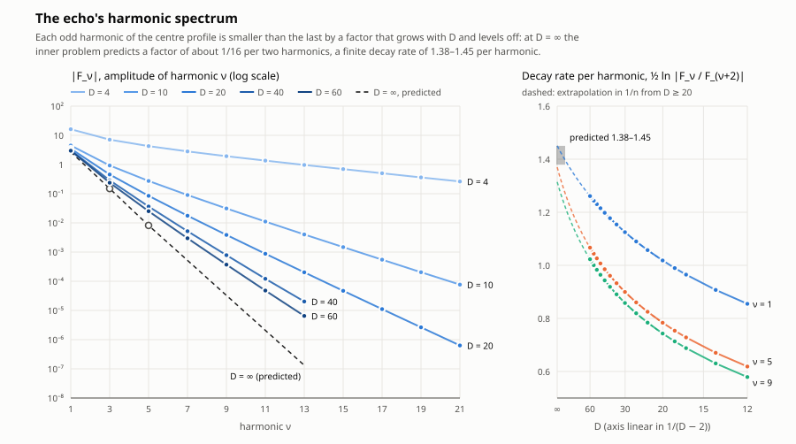
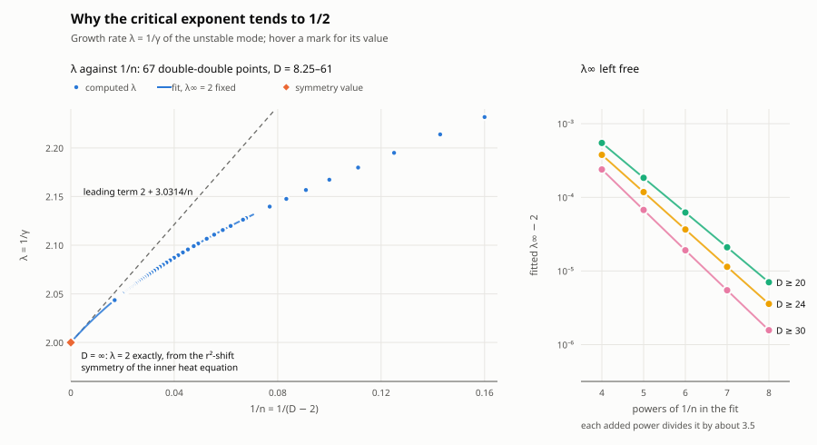

# dss-residual-kernel

**Critical collapse in D dimensions: the echo period and critical exponent, from numerics to first principles.**
Paper (draft, arXiv style, not yet reviewed): [paper/dss_large_D.pdf](paper/dss_large_D.pdf)

When a collapsing shell of scalar field is tuned exactly to the threshold between dispersing and forming a black hole,
it approaches a universal solution, Choptuik's critical solution, which repeats itself on ever smaller scales: each
"echo" is a copy of the last, shrunk by a factor e^Δ. Just above the threshold, the black hole's size scales like
(p − p*)^γ in the tuning parameter p (its mass like (p − p*)^{(D−3)γ}; in four dimensions both exponents are γ). The
echo period Δ and the critical exponent γ are universal numbers, the same for any initial data, but they depend on the
number of spacetime dimensions D, and no formula for them is known. In D = 4, Δ ≈ 3.445 and γ ≈ 0.374.

Choptuik discovered critical collapse in four dimensions in 1993[^1]. The scaling was soon explained by
the critical solution's single unstable mode, γ = 1/λ[^2], and the solution was computed directly as a periodic
eigenvalue problem, with Δ now known to ten digits in four dimensions[^3]; a computer-assisted proof shows that the
D = 4 solution exists[^10]. Other dimensions were studied numerically for 3.5 ≤ D ≤ 14[^4], and near D = 4 to about six
digits[^5]. At large D, the leading-order equations (which are the D = ∞ inner problem used here), their heat-equation
character and an estimate γ = 1/2 came first[^6], followed by continuously self-similar solutions[^7] and analytic
echoing solutions, with the leading-order freedom of the period and the conjecture Δ → 0[^8]. A recent review is
Gundlach, Hilditch and Martín-García[^9]. This work builds on all of these, and on published proof templates[^11].

This project asks three questions:

1. **What are Δ(D) and γ(D),** to high precision across dimensions, and is there a formula for them?
2. **What happens as D → ∞?** It has been conjectured that the echo period shrinks to zero; does it, or does it tend
   to a finite limit?
3. **Can that limit be derived from first principles,** from the equations at D = ∞ alone rather than by extrapolating
   computed values, and eventually proved?

In brief: one rational formula in 1/(D − 2) fits all D ≥ 4; Δ tends to a finite limit, Δ∞ = 1.64389375, and γ to 1/2;
a selection rule derived at D = ∞ reproduces Δ∞ to about 10⁻⁴ without using the finite-D solutions, and an exact symmetry
explains γ∞ = 1/2. A proof of the selection rule is in progress ([PROOF.md](PROOF.md)); in a one-harmonic model case, a
computer-assisted proof shows that the selection condition has exactly one simple zero (Theorem A(M = 1), assuming
Braaksma's summability theorem).

What is new: not found in the literature searched ([notes/LIT_REVIEW.md](notes/LIT_REVIEW.md)):
- Δ(D) to D = 61 at about 15 digits, and the finite limit Δ∞ = 1.64389375 against the Δ → 0 conjecture;
- a single formula for Δ(D) and γ(D) for all D ≥ 4 (an empirical rational fit; the only earlier fit, Bland et al.'s
  exponential for γ, has a different form and limit);
- Propositions 1–4: the 1/D expansion never fixes the period; the closed-form light-cone obstruction; its reading as a
  Stokes multiplier;
- the selection rule (Conjecture 1) and the value Δ∞ = 1.6439 ± 0.0002 it gives from the D = ∞ equations alone;
- the symmetry argument of Proposition 5 for γ∞ = 1/2 in the discretely self-similar solution;
- the computer-assisted certificate in the one-harmonic model.

How: Choptuik's solution is computed as a periodic boundary-value problem in self-similar variables. An f64 solver in
[`solver/`](solver/), with a Rust kernel for its residual (this crate), covers D = 3.6–40, and a separate double-double
(about 32-digit) solver in [`hp/`](hp/) reaches D = 61. The theory (the large-D expansion, its Stokes multipliers and
the inner problem at D = ∞) is in the Large-D section, with the scripts that check each step. The physics is in this
file; the software is described at the end. The computations, derivations and text were produced by Claude (Anthropic)
under Nathan Moinvaziri's direction and have not yet been reviewed by an expert
([How this work was done](#how-this-work-was-done)).

Headline results:

- **One formula for all D ≥ 4.** A rational function of 1/(D-2) gives Δ and γ within the precision of the
  computed points up to D = 30, and Δ to 6×10⁻⁸ up to D = 61 ([The formula](#the-formula), [Values](#values)).
- **The large-D limit.** Δ is computed at 857 points from D = 8.25 to 61.03; the points fit smooth curves to about 4×10⁻¹⁵
  (estimated error per point about 10⁻¹⁶ to D = 60.1, a few 10⁻¹⁵ above). The points support, but do not prove, that Δ is analytic in 1/D; then
  Δ∞ = 1.64389375 ± 1.5×10⁻⁸ (ω∞ = 2π/Δ∞ = 3.82213589 ± 4×10⁻⁸; the spread over 48 fit choices, which synthetic
  data with a known limit confirm), and γ∞ = 1/2 to about 5×10⁻⁷ (γ computed in double-double at 67 points, D = 8.25–61).
  γ∞ = 1/2 is explained, given the selection rule below and the uniqueness of the unstable mode: at D = ∞ an unstable
  mode with λ = 2 is generated by an exact symmetry, a shift of r², of Rozali and Way's large-D equations
  ([Proposition 5](#proposition-5-the-unstable-mode-at-infinite-d-is-exact), [GAMMA.md](GAMMA.md)).
  Given analyticity, nine constants tested as closed forms for Δ∞ are excluded
  ([Closed forms tested and excluded](#closed-forms-tested-and-excluded)).
- **Why the 1/D expansion cannot give it.** The 1/D expansion of the field equations can be carried to all orders for any
  period (Proposition 1), so Δ, and likewise γ, are selected by effects smaller than every power of 1/D. Without
  gravity the obstruction at the light cone is a closed-form coefficient C(n,s) (Proposition 2), which is the Stokes
  multiplier of a mode born far outside the light cone (Propositions 3–4). The working hypothesis is that the selection
  rule is the vanishing of the Stokes multipliers of an n-free inner problem; its higher-harmonic conditions already
  predict the shape of the echo, F₃/F₁ = 0.055 against 0.055 extrapolated from the data, and with three harmonics
  the full set of conditions gives Δ = 1.619, 1.5% below Δ∞, and with five harmonics Δ = 1.64516, 0.077% above (one
  harmonic: 29% above): the offset alternates in sign and shrinks fifteen- to twentyfold per harmonic pair. Without truncation, an
  amplitude expansion to twelve orders brackets the selected ω between 0.99915 and 1.00011 ω∞ (best estimates
  0.9999–1.0001), at amplitude 2.720 (measured: 2.70–2.72). So the conjectured rule gives Δ∞ = 1.6439 ± 0.0002
  from the D = ∞ equations alone, against 1.64389375 from the solutions; the rule itself is not yet
  proved ([Large D](#large-d-what-the-1d-expansion-can-and-cannot-see)).
- **Relation to published work.** Agreement with the accepted values at D = 4 and at the maximum of Δ near D = 3.756;
  a 6×10⁻⁵ difference at D = 5 that the published higher-resolution data trace to resolution; and the published
  conjecture Δ → 0 as D → ∞ is not
  supported: a power-law approach to 0 (exponent at least 0.01) is excluded, a logarithmic one disfavoured
  ([Relation to published work](#relation-to-published-work)).

Contents

- [Results](#results)
  - [The formula](#the-formula)
  - [Values](#values)
  - [What the numbers mean physically](#what-the-numbers-mean-physically)
  - [Closed forms tested and excluded](#closed-forms-tested-and-excluded)
  - [Relation to published work](#relation-to-published-work)
- [Evidence](#evidence)
  - [The double-double solver](#the-double-double-solver-hp)
  - [Is the period analytic in 1/D?](#is-the-period-analytic-in-1d)
  - [Reproduce](#reproduce)
- [Large D: what the 1/D expansion can and cannot see](#large-d-what-the-1d-expansion-can-and-cannot-see)
  - [How the solution scales with D](#how-the-solution-scales-with-d)
  - [Proposition 1: the 1/n expansion never fixes the period](#proposition-1-the-1n-expansion-never-fixes-the-period)
  - [Proposition 2: the leading-order problem, solved exactly](#proposition-2-the-leading-order-problem-solved-exactly)
  - [Proposition 3: what gravity does to the non-analytic piece](#proposition-3-what-gravity-does-to-the-non-analytic-piece)
  - [Proposition 4: late orders of the leading-order series](#proposition-4-late-orders-of-the-leading-order-series)
  - [The inner problem at large x](#the-inner-problem-at-large-x)
  - [Proposition 5: the unstable mode at infinite D is exact](#proposition-5-the-unstable-mode-at-infinite-d-is-exact)
  - [Other matter at large D](#other-matter-at-large-d)
  - [What is known about the selection, and what is open](#what-is-known-about-the-selection-and-what-is-open)
  - [References](#references)
- [How this work was done](#how-this-work-was-done)
- [Software: the Rust kernel](#software-the-rust-kernel)
  - [Backends](#backends)
  - [Use](#use)
  - [Double-double residual](#double-double-residual)
  - [Exact Jacobian and growth-mode matrix](#exact-jacobian-and-growth-mode-matrix)
  - [Build and test](#build-and-test)
  - [Performance](#performance)
  - [Layout](#layout)
  - [Limits](#limits)
- Companion files
  - [AGENTS.md](AGENTS.md): conventions for the AI sessions that run computations here
  - [PROOF.md](PROOF.md): a roadmap for proving the selection rule (Conjecture 1): layers, precedents, staged plan, with
    parts in [proof/](proof/) (the M-harmonic selection theorem; the entire-function certificate)
  - [GAMMA.md](GAMMA.md): why γ∞ = 1/2: the inner problem as a nonlinear heat equation, whose r²-shift symmetry gives λ = 2

## Results


The echo period Δ(D) and critical exponent γ(D), computed with the f64 solver in [`solver/`](solver/) (its residual is the
Rust kernel of [Software](#software-the-rust-kernel)) and the double-double solver in [`hp/`](hp/).
The dashed curves are one rational formula in 1/(D−2) for every D ≥ 4 (below), fitted on the f64 points
4 ≤ D ≤ 30.2 whose integration-step error has been extrapolated out ("step-converged"), with the solver's near-null
directions resolved and enough Fourier modes in time at low D;
hollow points are held out of the fit, and the green diamonds are double-double points up to D = 61, which it matches
to 6×10⁻⁸. As D → ∞, γ → 1/2 (imposed in the γ fit) and Δ → Δ∞ = 1.64389375 ± 0.000000015 if Δ is analytic in 1/D
(from the double-double points; both limits are discussed [below](#the-formula)). Details are in
[`solver/CONTEXT.md`](solver/CONTEXT.md). Regenerate with `cd solver/data && python3 ../plot_delta.py`.

### The formula

For massless scalar critical collapse in D = n + 2 spacetime dimensions, the echo period Δ and the critical
exponent γ of Choptuik's discretely self-similar solution (Choptuik, PRL 70, 9 (1993)) are fitted, for every
D ≥ 4 and within the tolerances in the table below, by

```math
\Delta(D) = \frac{a_0 + a_1 \varepsilon + a_2 \varepsilon^2 + \cdots + a_8 \varepsilon^8}{1 + b_1 \varepsilon + b_2 \varepsilon^2},
\qquad
\gamma(D) = \frac{\tfrac{1}{2} + e_1 \varepsilon + e_2 \varepsilon^2 + \cdots + e_7 \varepsilon^7}{1 + f_1 \varepsilon + f_2 \varepsilon^2},
\qquad
\varepsilon = \frac{1}{n} = \frac{1}{D-2},
```

with these coefficients:

| k | $`a_k`$ (Δ, numerator) | $`b_k`$ (Δ, denominator) | $`e_k`$ (γ, numerator) | $`f_k`$ (γ, denominator) |
|---|---|---|---|---|
| 0 | +1.6438975180 | 1 | +0.5 (fixed) | 1 |
| 1 | +4.0378045077 × 10¹ | +1.8251453626 × 10¹ | +1.8083629635 × 10¹ | +3.7683686025 × 10¹ |
| 2 | +2.5233285989 × 10² | +6.8182050167 × 10¹ | +1.5241588758 × 10² | +3.4245505235 × 10² |
| 3 | +2.0673502321 × 10² |  | −5.2341588541 × 10¹ |  |
| 4 | −3.5709850575 × 10² |  | +9.9259594505 |  |
| 5 | +3.1347320996 × 10² |  | −9.8386450353 × 10¹ |  |
| 6 | −4.1891374574 × 10² |  | +7.4529506074 × 10¹ |  |
| 7 | +3.2695252782 × 10² |  | −4.8272358903 × 10¹ |  |
| 8 | −1.6050467699 × 10² |  |  |  |

Eleven numbers for Δ and nine for γ, with no singularity at any physical D (the denominators vanish only
at D = −3.2, −11.0 and D = −13.3, −20.4). Fitted on every computed point 4 ≤ D ≤ 30.2 (`solver/formula_all.py`;
`solver/rational_fit.py` searches the forms: for Δ one numerator term beyond the smallest adequate form makes it
ten times tighter), they reproduce each point within its own precision:

| D | Δ: formula − computed | precision of the points | γ: formula − computed | precision of the points |
|---|---|---|---|---|
| 4 – 4.3 | 5×10⁻¹⁰ | 3×10⁻⁷ | 3.4×10⁻⁷ | 5×10⁻⁷ |
| 4.3 – 20 | ≤ 4.3×10⁻⁹ | 3×10⁻¹¹ – 4×10⁻⁹ (up to 4×10⁻¹⁰ at D ≈ 8–10) | ≤ 3.3×10⁻⁸ | ≤ 7×10⁻⁸ |
| 20 – 30 | ≤ 1×10⁻⁸ | ≤ 3×10⁻⁸ | ≤ 2.3×10⁻⁹ | ~ 10⁻⁷ (assigned 10⁻⁹, but the fits' $`\chi^2/\mathrm{dof}`$ is about 7000 against it) |
| 30.2 – 61, never seen by the fit | ≤ 6×10⁻⁸ | ≤ 10⁻¹⁴ (double-double) | ≤ 5×10⁻⁷ up to D = 35.8 | |

An independent double-double computation ([below](#the-double-double-solver-hp)) agrees with the formula to
2.7×10⁻⁹ or better on 8.25 ≤ D ≤ 21, 7.5×10⁻⁹ up to D = 30, and 5.8×10⁻⁸ from there to
D = 61, which the fit never saw. It also shows that the f64 points at D ≈ 8–10 (23 Fourier modes in time)
sit up to 4×10⁻¹⁰ above the true values (from 1.3×10⁻¹¹ to 3.7×10⁻¹⁰ on 8.25–9.9; within
3×10⁻¹¹ on 10–15.2 and about 6×10⁻¹¹ on 15.6–21), so their quoted 3×10⁻¹¹ was optimistic
there; that is below the formula's tolerance and does not change it.

At D = 4 the formula gives Δ = 3.4454524 and γ = 0.3739610, the accepted four-dimensional values
([Relation to published work](#relation-to-published-work)).
Near D = 4 the points themselves set the limit: the solution needs many Fourier modes in time there, and Δ(4)
moves by −4.3×10⁻⁴, −3.4×10⁻⁵ and −2.8×10⁻⁶ from 23 to 31 to 39 to 47 modes, so the points
below D = 5 are extrapolations in the mode count. Above D ≈ 36 the computed γ scatter by up to
6×10⁻⁵ around both this formula and the power series below, which agree with each other; the growth-rate solve
is not reliable there. Below D = 4 the formula is not fitted; Δ(D) turns over there. The cubic through the
47-mode points at D = 3.70, 3.75, 3.76, 3.80 (`solver/data/scan_down_kc47.jsonl`) puts the maximum at D = 3.75570,
Δ = 3.466774 (a quartic with D = 3.9 added: the same to 2×10⁻⁶ in D, 3×10⁻⁸ in Δ), in agreement to 2×10⁻⁶ with
Ecker, Ecker, Grumiller & Jechtl 2026 ([below](#relation-to-published-work)); the rational formula, extended
outside its range, peaks at D = 3.75558, Δ = 3.466781.

As D → ∞ (ε → 0):

```math
\Delta(D) = a_0 + \frac{a_1 - a_0 b_1}{n} + \cdots \approx 1.6439 + \frac{10.37}{n} + \cdots,
\qquad
\gamma(D) = \frac{1}{2} + \frac{e_1 - f_1/2}{n} + \cdots \approx \frac{1}{2} - \frac{0.758}{n} + \cdots
```

```math
\Delta_\infty = 1.64389375 \pm 0.000000015,
\qquad
\omega_\infty = \frac{2\pi}{\Delta_\infty} = 3.82213589 \pm 0.00000004,
\qquad
\gamma_\infty = \frac{1}{2} .
```

γ∞ = 1/2 is imposed in both γ fits (their constant term is fixed), not derived. Unconstrained fits of the f64 γ on
D ≥ 8–12 give γ∞ = 0.4996–0.4998. The double-double γ (`hp/gamma_dd.py`: the exact growth-mode matrix M(λ) in
double-double and the root of det M(λ); 67 points, D = 8.25–61, about 10⁻¹² for D = 16–58, matching the f64 values to
10⁻⁸–10⁻¹²; `hp/data/gamma_dd.jsonl` and `hp/data/local/gamma_dd.jsonl`) pins it much more tightly. In free fits in
powers of 1/n, λ∞ − 2 (λ = 1/γ) falls by a factor of about 3.5 with each added power: on D ≥ 30, 2.4×10⁻⁴, 6.7×10⁻⁵,
1.9×10⁻⁵, 5.5×10⁻⁶ and (1.6 ± 2.2)×10⁻⁶ for four to eight powers (`cd hp && python3 gamma_compare.py data/gamma_dd.jsonl data/local/gamma_dd.jsonl`), with no sign of levelling
off; fixing λ∞ = 2 fits better with the same number of parameters. So γ∞ = 1/2 to about 5×10⁻⁷, and λ = 2 + 3.0324/n − 34.3/n² + …
(γ = 1/2 − 0.7581/n + …). The rational γ formula is within 10⁻⁹ of these points for D ≤ 30 and off by 1.0×10⁻⁷ at
D = 61, where it extrapolates. 1/2 is also the value conjectured in the literature
([below](#relation-to-published-work)), and like Δ∞ it is not fixed at any finite order of the 1/n expansion
([Proposition 5](#proposition-5-the-unstable-mode-at-infinite-d-is-exact)).

Δ∞ comes from fits of all the double-double points ([Is the period analytic in 1/D?](#is-the-period-analytic-in-1d),
where the fits, their residuals and the error bar are given). The f64 points gave 1.64395 ± 0.00008, and this
formula's own limit is a₀ = 1.643898, 4×10⁻⁶ high, which its fitting range could not see. The coefficients of one fit
are not physical constants (they are correlated); only the function is.

**The limit rests on an assumption, which the double-double points now support.** Δ∞ = 1.64389375 holds if Δ(D) is analytic in 1/D at
D = ∞: no half-integer powers $`n^{-1/2}`$, no $`\log n`$, and no new scale far beyond the computed range. The f64
data could not test that. Formulas with those features reproduce every f64 point from D = 4 to 40 (fit and held
out) just as well: a series in $`n^{-1/2}`$ gives limits from 1.607 to 1.691 depending on its degree; adding one
$`n^{-1/2}`$ or $`\log n / n`$ term to the 1/D series moves the limit to 1.6437–1.6448; and the rational form with
its limit forced to π²/6 or $`\sqrt e`$ fits too, by placing a pole at D ≈ −440 or −5900, a slow bend
that starts in the hundreds. All of these agree with the formula above to 10⁻⁵ up to D ≈ 60 and fan out
above D ≈ 100. The double-double points up to D = 61 test it and favour the analytic form strongly; the held-out
tests, and why analyticity is still an assumption, are in [Is the period analytic in 1/D?](#is-the-period-analytic-in-1d).



`solver/plot_extrapolation.py` draws the graph; the faded curves are the ones the double-double points rule out.

<details>
<summary>Power series in 1/D for D ≥ 10 (the earlier form)</summary>

```math
\Delta(D) = \Delta_\infty + \sum_{k=1}^{10} \frac{c_k}{D^k},
\qquad
\gamma(D) = \frac{1}{2} + \sum_{k=1}^{10} \frac{g_k}{D^k},
\qquad
\Delta(D) \approx 1.64389 + \frac{10.37}{D} - \frac{28.4}{D^2} + \frac{239}{D^3} - \cdots
```

Fitted on 10 ≤ D ≤ 30.2 (`solver/formula.py`); it reproduces the points there to
1.6×10⁻⁸ (Δ) and 2.3×10⁻⁹ (γ; the γ points themselves are good to about 10⁻⁷). The coefficients grow about ninefold per order with
alternating signs: a singularity near D ≈ −9 on the negative axis, which the rational form represents by the
zero of its denominator at D = −11.0. That singularity
limits the series to $`D \gtrsim 10`$ and forbids cutting it short (five terms are off by 4×10⁻³ at D ≥ 20).

| k | $`c_k`$ (for Δ) | $`g_k`$ (for γ) |
|---|---|---|
| 0 | +1.6438931360 | +0.5 (fixed) |
| 1 | +1.0374964007 × 10¹ | −7.5854191958 × 10⁻¹ |
| 2 | −2.8355347834 × 10¹ | +8.2843462006 |
| 3 | +2.3900833130 × 10² | −1.2603029673 × 10² |
| 4 | −2.2446858552 × 10³ | +1.8446582182 × 10³ |
| 5 | +2.0424472078 × 10⁴ | −2.5165496284 × 10⁴ |
| 6 | −1.6230686158 × 10⁵ | +2.8434887038 × 10⁵ |
| 7 | +1.0037347608 × 10⁶ | −2.4157799331 × 10⁶ |
| 8 | −4.4127962953 × 10⁶ | +1.4042658549 × 10⁷ |
| 9 | +1.2046388629 × 10⁷ | −4.9128734266 × 10⁷ |
| 10 | −1.5266460427 × 10⁷ | +7.7494021741 × 10⁷ |

</details>

### Values

| D | Δ | γ |
|---|---|---|
| 4 | 3.4454524 | 0.3739610 |
| 5 | 3.2217019 | 0.4131269 |
| 6 | 3.0094832 | 0.4300795 |
| 7 | 2.8427532 | 0.4399912 |
| 8 | 2.711790054444 | 0.4467164 |
| 10 | 2.521078919562 | 0.4555879 |
| 12 | 2.389188553641 | 0.4614056 |
| 15 | 2.253098407194 | 0.4673656 |
| 20 | 2.112080154580 | 0.4737107 |
| 30 | 1.964957899258 | 0.4807927 |
| 40 | 1.888568197910 | 0.484776 |
| 50 | 1.841659503007 | 0.48736 |
| 60 | 1.809889459975 | |
| 70 | 1.78693476494 | |
| 100 | 1.7450264844 | 0.49313 |
| 1000 | 1.65424086 | 0.4992 |
| ∞ | 1.64389375 ± 0.000000015 | 1/2 (assumed) |

Δ for D = 10–60 is double-double, interpolated to 10⁻¹⁴ from [`hp/data/delta_dd.csv`](hp/data/delta_dd.csv)
where D is not itself a computed point; Δ(8) is the solver's separate check run at D = 8 (Newton to
$`\lvert F\rvert = 5\times10^{-31}`$, checks table below), which is not in the data file. Δ for D = 4–7 and γ up to
D = 40 are from the f64 solver, within the precision of its points; γ(50), γ(100) and γ(1000) are the
rational formula's values (the solver was not run there, and its γ is unreliable above D ≈ 36).
Δ(70) and Δ(100) are extrapolations that every model fitting the double-double points agrees on,
to 10⁻¹¹ and 2×10⁻⁸ (the half-integer series included). D = 1000 and ∞ assume analyticity in
1/D; the half-integer series differ there by 3×10⁻⁶ and more.

The physics figure below and the candidate test use these values; the double-double points behind them are described in
[The double-double solver](#the-double-double-solver-hp).

### What the numbers mean physically



The same two numbers, read as physics (`solver/plot_physics.py`):

- **Each echo is a factor $`e^{\Delta}`$ smaller than the last:** 31 at D = 4, 12 at D = 10, 5.2 at D = ∞. In higher
  dimensions the echoes come closer together in scale.
- **One more echo costs $`\Delta/(\gamma\ln 10)`$ digits of fine-tuning.** A collapse whose initial strength p is tuned to
  $`\lvert p - p^*\rvert`$ makes about $`\gamma\ln(1/\lvert p - p^*\rvert)/\Delta`$ echoes before it either forms a black hole or disperses,
  so each extra echo needs $`\lvert p - p^*\rvert`$ smaller by $`e^{\Delta/\gamma}`$: 4.0 digits at D = 4, 2.4 at D = 10, 1.43 at D = ∞.
- **The field and its gravity weaken as D grows:** the centre slope of the field falls like $`2.72/\sqrt n`$ and the
  departure of spacetime from flat at the centre like 3.65/n (double-double solutions, D = 20–60). At D = ∞ the
  echo is a free wave on flat space, which on its own cannot echo (Proposition 2); the selection of Δ is gravity's
  doing even there ([Large D](#large-d-what-the-1d-expansion-can-and-cannot-see)).

The phenomenon is the same at every D ≥ 4: the same echoing structure and a smooth Δ(D), with one unstable mode
as in four dimensions (assumed here: only that mode's growth rate is computed, not the full spectrum). Only the numbers
change.



**The echo itself.** The figure shows the field's slope at the centre, F(τ) = √(D−2)·∂p/∂x at r = 0, over the same stretch of
logarithmic time τ for D = 4, 10, 20 and 60, each scaled to its peak (dashed: its first harmonic alone; dotted lines: the
start of each echo). At D = 4 the echo is far from a sine: almost a square wave, with a third harmonic 44% of the first,
and each echo 31× smaller than the one before. As D grows the echoes come faster (Δ = 2.52, 2.11, 1.81 at D = 10, 20, 60:
12×, 8.3×, 6.1× per echo) and the profile turns into a pure sine: the third harmonic falls to 8% of the first at D = 60,
and the D = ∞ theory predicts 5.5%. The D = 4 profile is from the f64 solver (39 harmonics, Δ within 3×10⁻⁶ of the best
value); the others are double-double solutions (`solver/plot_echo.py`, data from `solver/echo_data.py`).

### Closed forms tested and excluded

Nine constants were tried as the limit, first on the f64 points and then on the double-double points: five that a
product search placed inside the window of the f64 estimate (about nine such coincidences are expected by chance in that
search) and four classical constants. None of them passes the second test, so none of them is
Δ∞, given that Δ is analytic in 1/D (which the double-double points support,
[below](#is-the-period-analytic-in-1d)).

The closest sits 1.3×10⁻⁵ from the limit, about 840 times its uncertainty, and forcing any of them makes the fit
predict the unseen points at least 100 times worse. Nor is Δ∞ a product of two of the listed constants with rational
prefactor i/j (i, j ≤ 12) and exponents ±1/2, ±1, ±2: none of those 514 332 expressions lies in the double-double
window, where about 0.02 would be expected by chance, so this null has little power. At eight known digits no
integer-relation search could support a closed form; whether Δ∞ has one is open
([notes/REFEREE_SIM.md](notes/REFEREE_SIM.md) §4), and the D → ∞ limit of the equations is the way to find out.

<details>
<summary>The two tests, the table, the influence function and the search</summary>

- **f64 test** (D ≤ 39.5, `solver/candidates.py`): each candidate forced as c₀ in 12 fits (variable 1/D,
  1/(D-1), 1/(D-2); degree 9 and 10; lower cut D ≥ 10 or 12). The table gives $`\chi^2/\mathrm{dof}`$ of the best
  and the worst of the 12 (0.62 is the unconstrained fit) and the rms error on the held-out f64 points, 30.2 < D ≤ 39.5.
  Five candidates passed it; four were already excluded.
- **Double-double test** (made on the points then available, up to D = 59.8; `hp/dd_candidates.py 45 --dmax=59.8`
  repeats it on today's file, where later runs from the second machine have added a few points in the same range, so
  counts can differ by one or two): each candidate forced as the limit of a power series in 1/D fitted on
  10 ≤ D ≤ 45 at degree 14 to 26, and compared with the 351 cleaned points from 45 to 59.8 that the fit never
  saw. The table gives the best of those degrees and how many times worse it is than the free fit (4.7×10⁻¹³
  at degree 16 on this range; held out to 60.1 the same fit gives 5.2×10⁻¹³, [below](#is-the-period-analytic-in-1d)).

| Candidate | Value | − double-double limit | f64 test: $`\chi^2/\mathrm{dof}`$; held-out rms | Double-double test: held-out error (× free) | Verdict |
|---|---|---|---|---|---|
| none (free fit) | 1.64389375 ± 0.000000015 | | 0.62 .. 3.4; 1.5×10⁻⁶ | 4.7×10⁻¹³ | |
| $`\frac{5}{7}\sqrt{G}\, j_{0,1}`$ | 1.6439747 | +8.1×10⁻⁵ | 0.62 .. 8.6; 1.4×10⁻⁶ | 6.2×10⁻¹¹ (130×) | **ruled out** (passed the f64 test) |
| $`\frac{7}{5}\,(\ln 2)^{-2}\,\pi^{-1/2}`$ | 1.6440014 | +1.1×10⁻⁴ | 0.62 .. 18; 1.3×10⁻⁶ | 1.1×10⁻¹⁰ (220×) | **ruled out** (passed the f64 test) |
| $`\frac{7}{2}\sqrt{\ln 2/\pi}`$ | 1.6440152 | +1.2×10⁻⁴ | 0.62 .. 26; 1.2×10⁻⁶ | 1.3×10⁻¹⁰ (270×) | **ruled out** (passed the f64 test) |
| $`\frac{9}{8}\sqrt{j_{2,1}/j_{0,1}}`$ | 1.6440207 | +1.3×10⁻⁴ | 0.62 .. 30; 1.2×10⁻⁶ | 1.4×10⁻¹⁰ (290×) | **ruled out** (passed the f64 test) |
| $`\frac{10}{9}\sqrt{j_{0,1}/\ln 3}`$ | 1.6439063 | +1.3×10⁻⁵ | 0.62 .. 118; 1.6×10⁻⁶ | 5.4×10⁻¹¹ (110×) | **ruled out** (passed the f64 test) |
| π²/6 = ζ(2) | 1.6449341 | +1.0×10⁻³ | 3.6 .. 13000; 2.9×10⁻⁶ | 1.7×10⁻⁹ (3500×) | **ruled out** by both |
| $`2\pi/j_{1,1}`$ | 1.6397880 | −4.1×10⁻³ | 67 .. 3×10⁵; 1.8×10⁻⁵ | 7.0×10⁻⁹ (15000×) | **ruled out** by both |
| $`\sqrt{e}`$ | 1.6487213 | +4.8×10⁻³ | 82 .. 3×10⁵; 1.8×10⁻⁵ | 8.1×10⁻⁹ (17000×) | **ruled out** by both |
| $`\varphi = (1+\sqrt5)/2`$ | 1.6180340 | −2.6×10⁻² | 2500 .. 10⁷; 1.0×10⁻⁴ | 4.4×10⁻⁸ (92000×) | **ruled out** by both |

The f64 test could not separate the first five: they move Δ(D) by less than 10⁻⁶ for D ≤ 40, below the
precision of those points. The double-double points can. A
forced fit can only bend toward its candidate by spending degrees, so it improves with degree (the table gives each
one's best) until it reaches the level where the free fits overfit too (about 5×10⁻¹¹ at degree 24–26), which is
still about 100 times the free fit's best.



The graph is from the f64 test. It shows, for every candidate, how much fixing Δ∞ to it changes the fitted Δ(D) over the computed
range ($`|\text{forced fit} - \text{free fit}|`$, log scale), against the precision of the computed points (shaded).
The five forms inside the window stay at the level of the data; π²/6 sits 10–100 times above it at
D = 10–30, and $`2\pi/j_{1,1}`$, $`\sqrt e`$ and φ climb further out. Every curve has the same shape: forcing the
limit is a linear constraint on a weighted least-squares fit, so forced minus free is (candidate − free limit) times one
influence function h(D) with h(∞) = 1. It is ~ 10⁻⁷ where the points are known to about 3×10⁻¹¹
(D ≤ 22; up to 4×10⁻¹⁰ at D ≈ 8–10), rises where their error bars step up (D = 22, 29.5), and climbs toward 1 past the data:
h(40) = 3.8×10⁻³, h(100) = 0.17, h(1000) = 0.85. Regenerate with
`cd solver/data && python3 ../plot_candidates.py`.

G is Catalan's constant and $`j_{\nu,k}`$ the k-th zero of the Bessel function $`J_\nu`$. The five that passed the f64
test are all that a search finds in the f64-era window 1.64388–1.64403 (about ± 8×10⁻⁵ around the f64 estimate) among products $`r\, b_1^{p_1} b_2^{p_2}`$
(r = i/j with i, j ≤ 12; $`p = \pm\tfrac12, \pm1, \pm2`$; b from π, e, $`\sqrt2`$, $`\sqrt3`$, $`\ln 2`$, $`\ln 3`$, Euler's
γ, ζ(3), φ, G and Bessel zeros: $`j_{0,1}, j_{0,2}, j_{1,1}, j_{1,2}, j_{2,1}, j_{3/2,1}, j_{5/2,1}`$ and $`y_{0,1}`$, as in
`solver/candidates.py`), 2π/(r b) and $`r \ln b`$. The same search finds nothing in the double-double window
1.6438936–1.6438939 (deliberately ±1.5×10⁻⁷, 15 times the stated error, so that a constant just outside
the error bar would still show), nor in one about 27 times wider (1.643890–1.643898).

</details>

### Relation to published work

From a literature search (October 2026); the references are listed at the end of the [Large D](#references) section.

- **D = 4.** Δ = 3.445452402(3) (Martín-García & Gundlach, PRD 68, 024011 (2003); see also Gundlach, PRD 55, 695
  (1997)) and γ = 0.373961 ± 10⁻⁶ (Ecker, Ecker, Grumiller & Jechtl 2026, who also give Δ = 3.445453). The formula's
  3.4454524 and 0.3739610 agree to about 10⁻⁸ and 10⁻⁷.
- **The maximum below D = 4.** Ecker et al. 2026, Eq. (70): D = 3.755726 ± 10⁻⁶, Δ = 3.466772 ± 10⁻⁶. The 47-mode
  points here give D = 3.75570, Δ = 3.466774 (agreement to about 2×10⁻⁶).
- **D = 5: a resolution effect in the published value.** Ecker et al. 2026 give Δ = 3.22176, γ = 0.41322, which are
  5.8×10⁻⁵ and 9.3×10⁻⁵ above the values here. Our Δ(5) = 3.2217019446 comes from two independent codes: the f64
  solver at 31, 39 and 47 Fourier modes (3.221701945 ± 7×10⁻¹¹ extrapolated) and the double-double solver at
  M = 48 and 64 collocation points (3.22170194461806, 3.22170194462672), which agree to 10⁻¹¹
  (`hp/compare/dd_D5.py`, log in `hp/compare/dd_D5.log`). Their published data
  ([github.com/EckerChristian/CriticalSpacetimeCrystal](https://github.com/EckerChristian/CriticalSpacetimeCrystal),
  compared by `hp/compare/cmp_ecker.py`) show their D = 5 value still moving by −1.66×10⁻⁴ between 256 and 512 modes,
  toward ours, in the range above D ≈ 4.8 where their paper notes that the light-cone expansion order has to be
  increased. Their offset from our values grows smoothly with D, from 2.7×10⁻⁷ at D = 4 (within their stated ±10⁻⁶;
  ours matches Martín-García & Gundlach to 7×10⁻⁹) to 5×10⁻⁴ at D = 5.5. Their γ list has no points for
  4.79 < D < 5.49, the range where they report that their perturbation method fails, so their γ(5) is not a direct
  computation in the published data; ours, 0.41312694 (stable to 10⁻⁷ across resolutions), agrees with Bland &
  Kunstatter's 0.4131 ± 0.0001. No difference of convention: at D = 3.7 the two agree to 8×10⁻⁸.
- **Below D = 4.** γ extrapolated from the 47-mode points (γ(3.7) = 0.34865) suggests $`\gamma(3.5) \lesssim 0.33`$, against
  0.349 ± 0.003 from Bland et al. (2005). The points here below D = 4 are under-resolved in the Fourier modes; this is
  an open check.
- **Large D.** Ecker, Ecker & Grumiller (2026) and Ecker et al. (2026) conjecture Δ → 0 as D → ∞; Bland's 2007
  PhD thesis (University of Manitoba) hypothesizes Δ∞ = 5/2, which the data exclude (Δ(14) = 2.29 and
  decreasing). The double-double points give a finite Δ∞ = 1.64389375 if Δ is analytic in 1/D. Up to D = 61
  they show no sign of a turn toward 0, but they cannot exclude non-analytic behaviour beyond the data. γ∞ = 1/2
  agrees with the conjectures there; it is not new.
- **Earlier formulas.** No earlier formula for Δ(D) was found ([notes/LIT_REVIEW.md](notes/LIT_REVIEW.md),
  addendum). For γ, Bland et al. (2005) fitted γ ≈ 0.466(1 − e^{−0.408 D}) on 3.5 ≤ D ≤ 14, a different form whose
  limit, 0.466, is not 1/2. Sorkin and Oren (2005) read their D ≤ 11 values as γ reaching a maximum and Δ a minimum
  around D = 11–13; the points here show neither, as Δ decreases and γ increases monotonically to D = 61. Taves and
  Kunstatter (2011) give values for D = 4–8 without a formula. Kol's 2π/Δ = √((10 − D)/(D − 2)) (2005) is for the
  black-string merger, not for scalar collapse. The rational formula here is an empirical fit, a ratio of polynomials
  with 11 fitted coefficients for Δ and 9 for γ, not a law derived from the equations. What it adds is one function for all D ≥ 4 that matches
  the points to their precision and predicts the double-double points it never saw up to D = 61.
- **The large-D theory.** That at leading order any periodic profile with any period solves the equations is in
  Ecker, Ecker & Grumiller 2026 (Proposition 1). The free wave equation in similarity coordinates was analysed in 3+1 by
  Donninger (2008), which contains the D = 4 case of Proposition 2; its light-cone coefficient follows from Gauss's
  connection formula once the mode equation is recognised as hypergeometric. Proposition 4 is an instance of standard
  late-order (Dingle) analysis. The inner equations are, up to a change of variables, Rozali and Way's leading-order
  large-D system (2018), whose heat-equation character they noted; Proposition 5 is the discretely self-similar
  counterpart of their estimate γ = 1/2. Ecker, Ecker & Grumiller's next-to-leading-order condition is discussed next.

#### Relation to Ecker, Ecker & Grumiller

Ecker, Ecker & Grumiller (PRL 136, 191401 (2026), [arXiv:2601.14358](https://arxiv.org/abs/2601.14358)) use the same gauge in
their large-D expansion: their f = α/a is our c, with f = 1 at the self-similarity horizon x = 1 for all τ.
At leading order they find the same freedom as Proposition 1: any periodic profile
$`\beta(\tau) = \Pi(0,\tau) \approx \sqrt{2/n}\,F(\omega\tau)`$, with any period. At next order they require f ≤ 1 near the horizon at the zeros of β, which
gives β'' + 3β' = 0 there (their Eq. (20)); in our variables, ω²F'' + 3ω F' = 0 at the zeros of F.

The inequality f ≤ 1 holds for every regular solution, whatever the period. From $`x b_x = b(p^2+m^2) - (n-1)b(b-1)`$ with
b(0) = 1, b can never drop below 1, since at b = 1 the slope is p²+m² ≥ 0; then $`x c_x = (n-1)c(b-1) \ge 0`$, so
c ≤ c(1) = 1. Its apparent violation at next-to-leading order comes from truncating a perfect square in a window of
width O(1/n) around each zero. In the formal family of Proposition 1,

```math
b - 1 = 2\varepsilon^2x^2F(\theta-\delta\theta)^2 + 2\varepsilon^4\omega^2x^4F'^2 + \ldots, \qquad \delta\theta(x) = -\varepsilon\omega x^2\,\frac{3F'+\omega F''}{2F'} .
```

Their next-to-leading-order term is the cross term, which shifts the field's zero; the square term arrives one order
later. The discriminant 16ω²x⁶F'⁴ is positive for every F and ω. The double-double solutions bear this out:

- They violate Eq. (20) completely: (ω²F''+3ω F')/(3ω F') = 0.98–1.06 at D = 12–60, since F is nearly
  antisymmetric about its zeros.
- The zero line of p - m tilts as δθ(x) predicts: measured over predicted at x = 1 is 0.69, 0.78, 0.84, 0.88 at
  D = 20, 30, 45, 60, and the agreement is about 1% for x ≤ 0.3.
- The maximum of c at the centre approaches 1 - (ε³/2) ω²F'², their Eq. (22) in this scaling (ratio 0.36
  rising to 0.86 from D = 20 to 60).

So Eq. (20) does not select Δ, and Proposition 1 stands. Lai and Wen
([arXiv:2610.04960](https://arxiv.org/abs/2610.04960)) adopt the same next-to-leading-order condition as selecting the
period; the argument above applies to that use too.

Their conjecture Δ → 0 comes with no rate. Fitted on 10 ≤ D ≤ 45 and compared with 45 < D ≤ 61:

- a power-law approach to 0 ($`D^{-p}`$ times a series in 1/D, p ≥ 0.01) misses the held-out points by 6×10⁻⁸ or
  more, against 7×10⁻¹³ for the analytic series;
- a series in $`1/\ln D`$ with zero limit misses them by 1.3×10⁻¹¹ and still gives Δ ≈ 0.88 at D = 10³⁰;
- adding a $`c/\ln D`$ term to the analytic series gives c ≈ 4×10⁻⁷ and leaves the limit at 1.6438937.

A power-law approach to 0 is excluded; a logarithmic one is disfavoured but cannot be excluded from D ≤ 61 alone.
Scripts: [`solver/eeg20/`](solver/eeg20/).

## Evidence

### The double-double solver (`hp/`)

Above D ≈ 26 the f64 points lose precision: the period is selected by an effect that weakens exponentially with
D, so rounding at 10⁻¹⁶ in the residual moves Δ by 10⁻⁷–10⁻⁶ at D = 30–40 (through the sensitivity
$`\max\lvert\partial\Delta/\partial F\rvert`$ of the table below), and points far above D = 40 are out of
reach. [`hp/`](hp/) (crate `hpkernel`) is a separate solver built for that regime, to settle the large-D behaviour
with computed points rather than an assumed form. Its points are used in [The formula](#the-formula) (agreement and
Δ∞), [Values](#values), the [candidate test](#closed-forms-tested-and-excluded), the
[analyticity tests](#is-the-period-analytic-in-1d) and the large-D scaling ([How the solution scales with D](#how-the-solution-scales-with-d)).

- **Arithmetic:** double-double (hi + lo, about 32 digits)[^15] on 8-lane vectors: one AVX-512 register per lane group, two
  AVX2 registers, or a portable array, chosen at compile time (`hp/build.sh` builds with `-C target-cpu=native`).
  Error-free two-sum and FMA two-product; sums of products accumulated Sum2-style[^16].
- **No fixed-step error:** Taylor series in x (order 36, step points planned once per D so the truncation term is
  10⁻³²), centre and horizon series run until their tails are below 10⁻³³, and collocation in τ on the
  half period (p, m odd harmonics, a, c even harmonics in τ) with no spectral truncation of the products.
- **Exact Jacobian:** forward-mode duals[^17] over double-double, double-double LU for Newton, a transpose solve that gives
  $`\partial\Delta/\partial F`$ at every point, and a Levenberg–Marquardt fallback.
- **Continuation in D:** prediction by the cubic through the last four converged points (a tangent from the
  Jacobian is wrong in the weak directions, below), Newton with the weakest directions deflated, and from D = 35 on
  the centre data's τ-harmonics above 13 frozen (below). 32 collocation points in τ, nodes at
  x = 0.3, 0.4, …, 0.7 (the node checks in the table below moved the first node closer to the centre); 30–50 s per
  point on two cores up to D = 60. The tolerance on $`\lvert F\rvert`$ goes from 10⁻²⁵ at D = 35 to 10⁻²² at D = 56,
  following the residual floor, which rises about 1.4-fold per unit of D. Above D = 60.1, on the second machine, it
  was relaxed to 3×10⁻¹⁹ for part of the climb ($`\lvert F\rvert`$ up to 2.9×10⁻¹⁹ there).

<details>
<summary>Checks of the solver</summary>

| Check | Result |
|---|---|
| double-double $`+, \times, \div`$ against mpmath | 1.3–1.6×10⁻³² relative |
| horizon series against 40-digit mpmath | 2×10⁻³² |
| Jacobian against double-double differences | agrees to the difference truncation |
| Newton at D = 8 | quadratic, $`\lvert F\rvert = 5\times10^{-31}`$ in 4 steps |
| Δ(7), Δ(7.75) against the 39-mode references (±3×10⁻¹¹) | +3.1×10⁻¹², −2.8×10⁻¹² |
| 32 / 48 / 64 collocation points in τ, D = 7–17 | Δ agrees to 10⁻¹⁶ |
| first node at x = 0.02 / 0.05 / 0.1, D = 16.75 | Δ identical to 10⁻¹⁶ |
| 32 / 48 collocation points in τ, D = 40 | Δ agrees to 9×10⁻²² |
| harmonics frozen above 13 / above 15, D = 40 | Δ agrees to 3×10⁻¹⁷ |
| second machine (Windows, i7-1185G7, own build), D = 59.84–60.05 | agrees with the cloud points to 2–4×10⁻¹⁶ |
| the 94 points above D = 60.1 (32 of them at 60.95–61.026: 25 from the second machine, 7 from the cloud) against the 1/D fit on D ≤ 60.1 (degree 18) | agree to 2.6×10⁻¹⁵ |

</details>

<details>
<summary>A sample of the computed points</summary>

A sample of the computed points (all of them, from D = 8.25 up, are in
[`hp/data/delta_dd.csv`](hp/data/delta_dd.csv)), with the residual and the largest entry of $`\partial\Delta/\partial F`$, the factor by which a residual error moves Δ:

| D | Δ | $`\lvert F\rvert`$ | $`\max\lvert\partial\Delta/\partial F\rvert`$ |
|---|---|---|---|
| 8.25 | 2.683434296073424 | 5×10⁻³¹ | 1.2×10² |
| 12 | 2.389188553640616 | 8×10⁻³¹ | 5.9×10² |
| 16 | 2.218342998377885 | 4×10⁻³⁰ | 6.8×10³ |
| 21.19141 | 2.087734162683867 | 4×10⁻²⁹ | 2.0×10⁵ |
| 25.07972 | 2.023511166632091 | 1×10⁻²⁸ | 2.1×10⁶ |
| 29.98475 | 1.965111240898741 | 1×10⁻¹⁵ \* | 8.0×10⁷ |
| 35.35323 | 1.918943717094251 | 4×10⁻²⁷ | 7.0×10⁸ |
| 40.02007 | 1.888451664490614 | 2×10⁻²⁶ | 9.6×10⁹ |
| 44.96341 | 1.862784197662323 | 9×10⁻²⁶ | 1.3×10¹¹ |
| 50.00749 | 1.841631133202264 | 1×10⁻²⁴ | 1.5×10¹² |
| 54.99609 | 1.824394337272626 | 6×10⁻²⁴ | 1.2×10¹³ |
| 60.00195 | 1.809884258001715 | 2×10⁻²³ | 8.9×10¹³ |

\* From D = 27 to 35.2, before the freezing, points were accepted once the linearised correction to Δ,
$`-\partial\Delta/\partial F \cdot F`$, was below 10⁻¹⁴ with the weak directions held on their trend; their residual
sits in those directions.

</details>

What the solver has shown:

- **The weak directions.** The near-null directions of the Jacobian that stalled the f64 solver (called "junk" in the
  code and notes) are a ladder of high τ-harmonics of the centre data, one pair per odd harmonic k, with
  singular values falling about like $`e^{-0.7k}`$
  (10⁻¹⁰ at k = 7 down to 7×10⁻¹⁸ at k = 31 at D = 21; the weakest is 10⁻²⁴ at D = 35). They
  are outgoing waves near the centre that barely reach the matching point, and they belong to the boundary-value problem
  itself: moving the first node or the matching point leaves them unchanged. Their own effect on Δ is tiny
  (≤ 10⁻¹² per unit amplitude for k ≥ 17), but second-order errors leak into them amplified by 1/σ,
  so Newton's basin shrinks with D; at D = 8, 80 points in τ already fail to converge. From D = 35 the solver
  pins the centre data's harmonics above 13 at zero and drops their matching on the horizon side: the weakest singular
  value rises from 10⁻²⁴ to 10⁻¹⁷ and plain Newton converges again. The cut moves Δ by 5×10⁻¹⁵ at
  D = 35 and 3×10⁻¹⁷ at D = 40; a cut at 11 does not converge at D = 40.
- **How fast the selection weakens.** $`\max\lvert\partial\Delta/\partial F\rvert`$ grows about 1.8 times per unit of D below
  D = 27, 1.7 at 35–45, 1.6 at 45–56 and 1.5 at 56–61, to 9×10¹³ at D = 60 (table), and the
  residual floor rises about 1.4-fold per unit. Their product, a
  worst case that ignores the direction of F, bounds the error in Δ by 10⁻¹⁴ at D = 45 and 2×10⁻⁹ at
  D = 60. The linearised estimate $`-\partial\Delta/\partial F \cdot F`$, which accounts for it, stays between
  10⁻²¹ and 10⁻¹⁷ from D = 35.3 to 60.1 and reaches 3×10⁻¹⁵ above, where the tolerance was relaxed.
- **How good the values are.** The points themselves fit smooth curves to about 4×10⁻¹⁵ (degree 18–20) all the way to
  D = 60.1, not 10⁻²⁰. Points between
  D = 27 and 35.2, solved before the freezing, carry a few 10⁻¹⁵ from the weak directions; about 25 of them sit
  visibly off their neighbours and `hp/dd_fits_mp.py --clean` drops them (26 on today's file with `--dmax=60.1`). The frozen points from 35.35 to 37 carry the cut's ≤ 5×10⁻¹⁵, which falls off
  with D. Elsewhere up to D = 60.1 the error is about 10⁻¹⁶; the 94 points above 60.1, solved to the looser
  tolerance, carry up to about 3×10⁻¹⁵.
- **The f64 points.** Against the double-double values they are within about 6×10⁻¹¹ at D = 15.6–21 (quoted
  3×10⁻¹¹), typically 3.6×10⁻⁹ and at most 6.4×10⁻⁹ (D = 24.5) at 22–29.3 (quoted
  1.5–2×10⁻⁹), 1.8×10⁻⁸ at 30.1 and
  7×10⁻⁸ at 34.2, and 0.6–2.1×10⁻⁶ high from 35 to 40.3 (quoted 1–3×10⁻⁶). How well the
  rational formula holds against these points is in [The formula](#the-formula).

### Is the period analytic in 1/D?

Yes, as far as the points up to D = 61 can tell. Each model below is a polynomial in one variable, fitted at 60 digits
on the cleaned double-double points 10 ≤ D ≤ 45 (or ≤ 37.5) and compared with every point above, up to
D = 60.1, which it never saw. The table and the figure use the points up to D = 60.1, the data when they were made
(`hp/dd_fits_mp.py 10 45 --clean --dmax=60.1`, and `10 37.5 --clean --dmax=60.1` for the fourth column, on today's file).
The 94 points above 60.1, solved to a looser tolerance, are tested separately: they lie within 2.6×10⁻¹⁵ of the
degree-18 fit on D ≤ 60.1 (checks table above).



| Model | max residual on 10 ≤ D ≤ 45 | worst error on 45 < D ≤ 60.1 | fitted on D ≤ 37.5: worst error up to 60.1 | limit |
|---|---|---|---|---|
| 1/D, degree 16 | 4.1×10⁻¹⁵ | 5.2×10⁻¹³ | 4.2×10⁻¹¹ | 1.64389375 |
| 1/D, degree 18 | 4.0×10⁻¹⁵ | 1.8×10⁻¹² | 1.5×10⁻¹⁰ | 1.64389377 |
| 1/(D-2), degree 18 | 4.0×10⁻¹⁵ | 2.8×10⁻¹² | 7.9×10⁻¹¹ | 1.64389377 |
| $`(D-2)^{-1/2}`$, degree 20 | 3.9×10⁻¹⁵ | 2.0×10⁻¹¹ | 3.9×10⁻¹⁰ | 1.636 |
| $`D^{-1/2}`$, degree 20 | 3.8×10⁻¹⁵ | 1.6×10⁻¹⁰ | 6.2×10⁻⁹ | 1.547 |

Every model fits its range to the level of the points, so the fit alone decides nothing; the unseen points do. Fitted
on D ≤ 45, the 1/D series predicts Δ fifteen units of D ahead to 5×10⁻¹³, about 100 times the
noise of the points, while the series in half-integer powers miss by 40 to 300 times more. Their limits also jump with
the degree (1.636 to 1.694 for $`(D-2)^{-1/2}`$ and 1.54 to 2.75 for $`D^{-1/2}`$ at degree 20–24 on all the points to D = 60), so they
give no usable Δ∞. Adding one non-analytic term ($`D^{-1/2}`$, $`D^{-3/2}`$, $`\ln D / D`$, $`\ln D / D^2`$ or
$`e^{-D/4}`$) to the degree-16 series changes neither the prediction (1.6–5×10⁻¹³ at D = 60) nor the limit
(1.64389375), and the term's coefficient is not determined: $`D^{-1/2}`$ gets 3×10⁻⁵ at degree 14 and
1×10⁻⁷ at degree 16 (`hp/dd_fits_mp.py 10 45 --clean --mixed --dmax=60.1`).

Fitted on all the cleaned points, power series in 1/D of degree 16–20 and in 1/(D-2) of degree 18–20 (the ones that fit
to the noise; 1/(D-2) at degree 16 leaves 3×10⁻¹³) fit the points from D = 10 to 61.03 to 4.2×10⁻¹⁵
(8.6×10⁻¹⁵ for 1/D at degree 16, 1.5×10⁻¹⁴ for 1/(D-2) at degree 18) and give limits from 1.643893744 to 1.643893752 on
10 ≤ D ≤ 60.1 (`hp/dd_fits_mp.py 10 1e9 --clean --dmax=60.1`) and from 1.643893745 to 1.643893752 on all 823
cleaned points to D = 61.03. Over 48 choices of model (1/D, 1/(D-2)), degree (the two lowest that reach the noise),
lower and upper fit ends (D ≥ 10, 12, 15; D ≤ 60.1, 61.03) and cleaning on or off, the limit ranges over
1.643893744–1.643893763 (`hp/dinf_budget.py`), so Δ∞ = 1.64389375 ± 0.000000015; fitting on D ≤ 45 alone pins it only to
2.5×10⁻⁷. The analytic form is the natural default (the large-D expansion of the equations has no other scale, and the
only structure the data show is a singularity on the negative D axis, near D ≈ −9 to −11), and nothing in the points
up to D = 61 asks for anything else. But it is not proven: the period is selected by an exponentially small effect
that the 1/D expansion never sees, and Ecker, Ecker and Grumiller conjecture Δ → 0
([above](#relation-to-ecker-ecker--grumiller)). A proof needs the D → ∞ equations themselves.

A planted-truth test checks that bar ([`hp/planted_dinf.py`](hp/planted_dinf.py), log in
[`hp/data/planted_dinf.log`](hp/data/planted_dinf.log)). Synthetic Δ(D) with a known limit was put on the real D grid,
with noise and junk points like the real ones. Five extra structures were added, from a pole far away to a
complex pole pair and a log branch point near the data, plus one term outside the fitted model class. All six went
through exactly the same 48-fit procedure, and in all six the known limit lands inside the reported range. The
range's centre sits 0.79–0.88×10⁻⁸ above it every time, so the bar is honest, but the quoted centre is probably
biased high by about 10⁻⁸. One of the pre-set criteria failed in every case: the cleaning step missed one of the 20
planted junk points, the one placed at its 10⁻¹⁵ threshold. That is a limit of the cleaning, not of the bar.

Data range: the cloud runs reach D = 60.06 (and a few points at 60.96–60.97); the climb above that was done
mostly on a second machine (runs in [`hp/data/local/`](hp/data/local/), coordinated through [`comms.txt`](comms.txt)),
to D = 61.03. It was stopped there because the steps in D had shrunk to 0.0015–0.005 and further points add
little to Δ∞; why the steps shrink, and the solver options used (`hp/scan_hp.py --junk_hold`,
`--junk_trend`, `--corrector dnp`), are in [`solver/notes.md`](solver/notes.md).

These limits are the Δ∞ quoted in [The formula](#the-formula) and [Values](#values).

### Reproduce

`./reproduce.sh` reruns the headline numbers and prints PASS / FAIL / SKIP for each check, with the expected value
next to the computed one: the data and the Values table, the rational formula, Δ∞ from five analytic fits on all
cleaned points, the held-out test (fit on D ≤ 45, predict 45–61), and the theory checks of Propositions 1–3, the
Stokes constant C(n,s) and both inner-multiplier methods (14 checks; about 6 minutes on a busy 2-core machine, 2–3 on
an idle laptop;
`--full` adds the Proposition 4 check). It needs numpy, scipy, mpmath and sympy. python-flint (the Borel–Darboux check)
and the compiled double-double kernel (the checks on saved solutions; build it with `hp/build.sh`, which needs Rust and
maturin) are optional and skipped if missing. The saved solutions in `hp/data/states/` (53 states, about one per unit of D
from 8.25 to 60, about 1 MB) are what the profile scripts read (`hp/states.py`). `hp/dinf_budget.py` tabulates how Δ∞
moves with model, degree, fit range, cleaning and data snapshot.

## Large D: what the 1/D expansion can and cannot see

The double-double points fix Δ∞ = 1.64389375 numerically. This section asks where the number comes from
in the equations. The answer so far: **the period is not determined at any finite order of the 1/D expansion of
the field equations** (within the natural ansatz of Proposition 1: integer powers of 1/n with the measured scalings),
so the period is selected by effects smaller than every power of 1/D. Finding that selection rule is open; the last
part of the section lists what is known about it.

The results, in order:

- [Proposition 1](#proposition-1-the-1n-expansion-never-fixes-the-period): the 1/n expansion can be carried to all
  orders for any period and any time profile, so it never selects the period.
- [Proposition 2](#proposition-2-the-leading-order-problem-solved-exactly): without gravity the problem is solved by
  hypergeometric functions, and the solution is never analytic at the light cone; the obstruction is a coefficient
  C(n,s) in closed form.
- [Proposition 3](#proposition-3-what-gravity-does-to-the-non-analytic-piece): gravity rescales the non-analytic piece by an
  n-independent factor that never vanishes (about 40 over the tested interval), so inside 0 < x < 1 it cannot cancel it
  on the way to the light cone.
- [Proposition 4](#proposition-4-late-orders-of-the-leading-order-series): a proof (Euler integral, Watson's lemma, Darboux's method) that the
  divergence of the 1/n series without gravity is that piece; its singulant, exponent and constant are derived and
  checked numerically, which identifies C(n,s) as the Stokes multiplier of a mode born at x = ∞.
- [The inner problem at large x](#the-inner-problem-at-large-x): near $`x \sim \sqrt n`$ the equations lose n altogether;
  without gravity they reduce to Kummer's equation, whose Stokes constant gives C(n,s) asymptotically (times a power of n
  and a phase). With gravity, the working hypothesis is that this multiplier vanishing is the selection rule (Conjecture 1);
  computed without truncation to twelve orders in the amplitude, it selects ω within about 10⁻⁴ of ω∞.
- [Proposition 5](#proposition-5-the-unstable-mode-at-infinite-d-is-exact): in s = r²/(2n) the inner problem is a
  nonlinear heat equation, and its shift symmetry in r² gives an exact unstable mode with λ = 2, which explains
  γ∞ = 1/2.

Everything below uses the scaling measured on the double-double solutions in
[How the solution scales with D](#how-the-solution-scales-with-d), and the results are checked against those solutions
where possible.

Notation: n = D - 2, ε = 1/n, ω = 2π/Δ. The solution depends on two variables: x, the
self-similar radius (radius over time to the singularity, normalized so that the past light cone of the singularity is at
x = 1; the code and the solver sections call that surface the "horizon"), and $`\tau = -\ln(-t)`$, the logarithm of the
time to the singularity, or the phase θ = ωτ of the echoing (period 2π). p and m are the
derivatives of the scalar field along the two radial null directions (scaled), a is the radial metric function
(b = a²), and c is the lapse-type function that sets the light cones (the past light cone is where x = c). The
equations are the ones at the top of [`hp/src/model.rs`](hp/src/model.rs), with $`G = (n-1)\,c\,(b-1)`$:

```math
x c_x = (n-1)\,c\,(b-1), \qquad
x b_x = b\,(p^2+m^2) - (n-1)\,b\,(b-1),
```
```math
x(x-c)\,p_x = -\omega x\,p_\theta + G p - c p + \tfrac{n}{2}\,c\,(p+m), \qquad
x(x+c)\,m_x = -\omega x\,m_\theta - G m + c m - \tfrac{n}{2}\,c\,(p+m),
```

on 0 ≤ x ≤ 1, with only odd harmonics of θ in p, m and only even ones in b, c ("odd" and "even" for
functions of θ refer to harmonics below; for polynomials in x they refer to parity in x), regular at the centre
x = 0, analytic at the past light cone x = 1, and c(1) = 1 (the gauge that puts the light cone at x = 1).

### How the solution scales with D

Measured on the double-double solutions at D = 12–60 (`hp/largeD_scaling.py`, `hp/largeD_F.py`):

- $`p \approx x\,F(\theta)/\sqrt n`$ near the centre, and p + m is smaller than p by another factor of order 1/n;
- c = 1 - O(1/n), and b - 1 = (p²+m²)/(n-1) to about 3%;
- near the light cone c stays within 10⁻³ of 1, so x - c ≈ x - 1 there;
- the centre series has the exact symmetry m(x) = p(-x).

The profile $`F = \sqrt n\, \partial_x p\,(x = 0)`$ converges as D grows:

| D | first harmonic of F | third / first | fifth / first | $`n\,(1 - \langle c(0)\rangle)`$ | $`\langle F^2\rangle`$ |
|---|---|---|---|---|---|
| 20 | 3.480 | 0.130 | 0.024 | 3.021 | 6.162 |
| 30 | 3.212 | 0.105 | 0.016 | 3.201 | 5.218 |
| 40 | 3.086 | 0.093 | 0.012 | 3.304 | 4.804 |
| 50 | 3.011 | 0.085 | 0.0097 | 3.372 | 4.568 |
| 60 | 2.962 | 0.080 | 0.0085 | 3.421 | 4.416 |
| ∞ (extrapolated) | ≈ 2.72 | | | ≈ 3.65 | ≈ 3.7 |

The last two columns approach the same limit, as Proposition 1 predicts (c = 1 - ε F² (1-x²) + …).

### Proposition 1: the 1/n expansion never fixes the period

Write $`p = \varepsilon^{1/2} P`$, $`m = \varepsilon^{1/2} M`$, S = P + M, $`\Delta_P = P - M`$, and expand
$`S = \sum_{k \ge 1} \varepsilon^k S_k`$, $`\Delta_P = \sum_{k \ge 0} \varepsilon^k D_k`$,
$`c = 1 - \sum_{k\ge1} \varepsilon^k G_k`$, $`b = 1 + \sum_{k \ge 2} \varepsilon^k B_k`$,
$`\omega = \sum_k \varepsilon^k \omega_k`$. The sum and difference of the p and m equations become

```math
x\,c\,\partial_x \Delta_P - c\,\Delta_P = x^2 \partial_x S + \omega x\,\partial_\theta S - \tfrac{1-\varepsilon}{\varepsilon}\, c\,(b-1)\,\Delta_P ,
\qquad
S = \varepsilon\,\frac{x^2 \partial_x \Delta_P - x c\,\partial_x S + \omega x\,\partial_\theta \Delta_P}{c\,(1-\varepsilon)\,b} .
```

The ansatz (integer powers of ε, $`p, m \propto \varepsilon^{1/2}`$, c - 1 = O(ε), b - 1 = O(ε²)) is the
scaling measured in the table above; Proposition 1 and its consequence hold within it. The scaling is forced by one
measured fact, c − 1 = O(1/n) (gravity weak; n(1 − ⟨c(0)⟩) → 3.65): E2 gives b − 1 ≈ (p² + m²)/(n − 1); E1 then gives
c − 1 = O(n(b − 1)) = O(p²), so c − 1 = O(1/n) requires p = O(n^{−1/2}); and the O(n) terms of E3–E4 force
p + m = O(p/n), the measured p + m = O(n^{−3/2}). Integer powers of ε beyond the overall ε^{1/2} are an assumption
(analyticity in 1/n), consistent with the held-out tests on Δ(D) but not implied by them.

**Proposition 1.** Let F(θ) be any smooth 2π-periodic function with odd harmonics only, ω₀ ≠ 0 (the
hypothesis only excludes the static case; the proof does not use it),
ω₁, ω₂, … any numbers and K₁(θ), K₂(θ), … any smooth odd-harmonic functions.
Then there is exactly one formal solution with D₀ = 2xF in which, at every order,
$`S_k`$ is an even polynomial in x starting at x², $`D_k - xK_k`$ is an odd polynomial starting at x³, and $`G_k`$
and $`B_{k+1}`$ are even polynomials (B starting at x²) with $`G_k(1) = 0`$. Every order is regular at the centre and
analytic at the light cone, and m(x) = p(-x) holds order by order.

The leading-order part of this freedom, any periodic profile with any period, is in Ecker, Ecker and Grumiller[^8]; the
all-orders statement was not found in the literature searched.

<details>
<summary>Proof of Proposition 1</summary>

*Proof.* By induction on k, with the structure above as the hypothesis for all orders below k. Write E for even
polynomials in x with smooth periodic coefficients.

1. $`B_{k+1}`$: The b equation at order k+1 gives $`B_{k+1}`$ algebraically (its coefficient is (n-1)b ≈ 1/ε)
   from $`x\partial_x B_k`$, (1+B) (P²+M²) and (1-ε)(1+B)B at lower orders. Since $`P^2 + M^2 = (S^2 + \Delta_P^2)/2`$
   with $`S \in x^2E`$ and $`\Delta_P \in xE`$, every term is in x²E.
2. $`G_k`$: The c equation at order k+1 reads $`-x\,\partial_x G_k = [(1-\varepsilon)\,c\,(b-1)]_{k+1} \in x^2 E`$.
   Dividing by x leaves only odd powers $`x^{2j-1}`$, j ≥ 1, so $`G_k = -\sum_j r_{2j} x^{2j}/(2j) + \text{const}`$ is an even
   polynomial with no $`\log x`$. The constant is fixed by $`G_k(1) = 0`$.
3. $`S_k`$: The numerator $`x^2\partial_x\Delta_P - xc\,\partial_x S + \omega x\,\partial_\theta\Delta_P`$ maps
   $`\Delta_P \in xE`$, $`S \in x^2E`$ into x²E. The denominator is 1 + O(ε) with coefficients in E, so its inverse is
   a power series in ε with coefficients in E. Hence $`S_k \in x^2 E`$.
4. $`D_k`$: The sum equation at order k is $`x\,\partial_x D_k - D_k = R_k`$, where $`R_k`$ collects
   $`x^2\partial_x S_k + \omega x\,\partial_\theta S_k \in x^3E`$, terms $`c\,(b-1)\,\Delta_P \in x^3E`$, and terms
   $`G_i\,(x\,\partial_x D_j - D_j)`$. The last are in x³E because $`x\partial_x - 1`$ annihilates $`xK_j`$. So $`R_k`$ is odd and starts
   at x³, and $`D_k = x\int R_k\,x^{-2}\,dx = \sum_{j \ge 1} R_{k,2j+1}\, x^{2j+1}/(2j) + xK_k`$. The only obstruction,
   a term x¹ in $`R_k`$ that would produce $`x \log x`$ (not allowed at the centre), never occurs.
5. Symmetry: S even and $`\Delta_P`$ odd in x is the same as p(-x) = m(x).
6. Harmonic content: if P, M (so $`S, \Delta_P`$) contain only odd harmonics of θ and B, G only even ones at the
   lower orders, every step above preserves it (products of two odd-harmonic factors are even-harmonic, of an odd and an
   even one odd-harmonic, and $`\partial_\theta`$ keeps the harmonic), so the next order has it too.

Polynomials are analytic everywhere, so the light-cone condition is automatic, and c(1) = 1 holds by construction.
Nothing in the construction constrains F, ω₀ or the $`\omega_k`$. $`\square`$

</details>

The first orders, from `solver/largeD_expand.py` (sympy; third order by default, `largeD_expand.py 4` for the fourth):

```math
P_0 = xF, \quad B_2 = 2x^2F^2, \quad G_1 = F^2\,(1-x^2), \quad S_1 = 2x^2\,(F + \omega_0 F'),
\quad D_1 = x^3\,(\omega_0^2 F'' + 3\omega_0 F' + 2F - 2F^3) + xK_1 .
```

*Check.* `solver/largeD_formal_check.py` substitutes the expansion (through S₃, G₃, B₄) into the exact equations,
with F taken from the D = 60 solution. The relative residual of every equation falls like n⁻³ for
n = 50, …, 800, both for ω₀ = 2π/1.64389 and for a wrong ω₀ = 2π/1.4. The expansion is right
to that order, and it does not care what the period is.

**Consequence.** If Δ(D) is analytic in 1/D, as the double-double points support, it has a 1/D expansion, but its
coefficients cannot be computed order by order from the field equations (within the ansatz above). The selection works
through terms smaller than any power of 1/n.

*Comparison.* Ecker, Ecker & Grumiller (PRL 136, 191401 (2026)) derive a next-to-leading-order condition on the period
(their Eq. (20)). It turns out not to select Δ, and Proposition 1 stands; see
[Relation to published work](#relation-to-ecker-ecker--grumiller).

### Proposition 2: the leading-order problem, solved exactly

At leading order the equations are linear (the scalar wave equation on flat space in self-similar form, c = b = 1).
For one harmonic $`e^{i\mu\theta}`$, put s = iμω.

**Proposition 2.**[^12][^13] The solution regular at the centre is, up to a constant,

```math
p - m = x\;{}_2F_1\!\left(\tfrac{1+s}{2},\,\tfrac{2+s}{2};\,\tfrac{n+1}{2};\,x^2\right),
\qquad
p + m = \frac{x(1-x^2)\,\partial_x(p-m) - (1+sx^2)\,(p-m)}{x\,(s-n+1)} .
```

Near the light cone it contains the non-analytic branch $`(1-x^2)^{\,n/2-1-s}`$ with the coefficient

```math
C(n, s) = \frac{\Gamma\!\left(\frac{n+1}{2}\right)\,\Gamma\!\left(s + 1 - \frac n2\right)}{\Gamma\!\left(\frac{1+s}{2}\right)\Gamma\!\left(\frac{2+s}{2}\right)} ,
```

which is finite and non-zero for every real ω ≠ 0, odd μ and n ≥ 2. So no time-periodic self-similar
solution of the linear problem is analytic at the light cone, in any dimension D ≥ 4.

<details>
<summary>Proof of Proposition 2</summary>

*Proof.* With c = b = 1 the difference equation gives $`(n - 1)\,(p+m) = x^2\,\partial_x(p-m) - x\,\partial_x(p+m) + s x\,(p-m)`$,
and the sum gives $`x\,\partial_x(p-m) - (p-m) = x^2\,\partial_x(p+m) + sx\,(p+m)`$. Eliminating p+m gives

```math
x^2(1-x^2)\,y'' + x\,\big(n - 2 - 2(s+1)x^2\big)\,y' - \big(n - 2 + s(s+1)x^2\big)\,y = 0 , \qquad y = p - m ,
```

and with $`y = x\,w(z)`$, z = x², this is Gauss's equation $`z(1-z)w'' + [\kappa - (\alpha+\beta+1)z]\,w' - \alpha\beta\,w = 0`$ with
α = (1+s)/2, β = (2+s)/2, κ = (n+1)/2. Its exponents are 0, 1-κ at z = 0 (so y ~ x or $`x^{2-n}`$; for n > 2
regularity, and for n = 2 parity (y = p - m is odd in x because m(x) = p(-x), while x⁰ is even), picks
$`{}_2F_1(\alpha,\beta;\kappa;z)`$) and 0, κ-α-β = n/2 - 1 - s at z = 1. The connection formula (Abramowitz & Stegun 15.3.6)

```math
{}_2F_1(\alpha,\beta;\kappa;z) = \frac{\Gamma(\kappa)\Gamma(\kappa-\alpha-\beta)}{\Gamma(\kappa-\alpha)\Gamma(\kappa-\beta)}\,{}_2F_1(\alpha,\beta;\alpha+\beta-\kappa+1;1-z)
+ (1-z)^{\kappa-\alpha-\beta}\,\frac{\Gamma(\kappa)\Gamma(\alpha+\beta-\kappa)}{\Gamma(\alpha)\Gamma(\beta)}\,{}_2F_1(\kappa-\alpha,\kappa-\beta;\kappa-\alpha-\beta+1;1-z)
```

holds because κ - α - β is not an integer (s is imaginary and non-zero). The second coefficient is C(n,s). The
Gamma function has no zeros, and its arguments α, β, α+β-κ are not poles because their imaginary parts
are μω/2, μω/2, μω ≠ 0. $`\square`$

</details>

*Check.* At 40 digits (mpmath), the formula satisfies the original first-order equations to 10⁻⁴⁰ for n = 18–1000. For the
fundamental at ω = ω∞, $`\lvert C\rvert = 0.0121,\ 0.0114,\ 0.0124,\ 0.0192,\ 0.0405`$ at n = 18, 38, 58, 200, 1000.
It grows like $`\sqrt n`$ ($`\lvert C\rvert/\sqrt n = 0.00128`$ at n = 1000, tending to
$`2\pi\,2^{-1/2}e^{-\pi\omega}/\lvert\Gamma(\alpha)\Gamma(\beta)\rvert = 0.00126`$), small only through the factor of order $`e^{-\pi\mu\omega/2}`$.

The free wave equation in similarity coordinates has been analysed in 3+1 dimensions before, which contains the D = 4
case[^12], and the coefficient follows from Gauss's connection formula for the hypergeometric function[^13]. What
Proposition 2 adds is the closed-form light-cone coefficient for every D and harmonic.

**What this means.** At leading order the self-similar oscillation is a free scalar wave, and a free wave cannot be
both regular at the centre and analytic at the light cone. The non-analytic piece $`(1-x^2)^{n/2-1-s}`$ is smaller than any
power of 1/n at every fixed x < 1, which is why Proposition 1 never sees it. Gravity, through the O(1/n) couplings,
has to cancel its coefficient harmonic by harmonic. That cancellation is what must select Δ and the profile F.
The next two subsections show that gravity cannot do it while the wave travels to the light cone inside 0 < x < 1,
and point to where it has to happen instead.

### Proposition 3: what gravity does to the non-analytic piece

The non-analytic piece is a fast WKB mode: in the exact solution of Proposition 2 it is
$`x^{2-n}(1-x^2)^{n/2-1-s}`$, which varies on the scale 1/n. Linearize the field equations around the formal solution
of Proposition 1 and look for perturbations of that kind.

**Proposition 3.** Let F(θ) and ω be given and c = 1 - ε F²(1-x²) + O(ε²), as in
Proposition 1. Put

```math
\delta p = e^{-n\Phi(x)}\,\big(A(x,\theta) + O(1/n)\big), \qquad
\delta m = e^{-n\Phi(x)}\,\Big(\frac{1-x}{1+x}\,A(x,\theta) + O(1/n)\Big), \qquad
\Phi(x) = \ln x - \tfrac12 \ln(1-x^2) .
```

This solves the linearized equations on 0 < x < 1 to the order shown if and only if

```math
x(1-x^2)\,\partial_x A - 2\omega x^2\,\partial_\theta A = \big(1 + x - 2x^2F(\theta)^2\big)\,A ,
```

that is, along the characteristics $`\theta = \theta_0 + \omega\ln(1-x^2)`$,

```math
A = A_0(\theta_0)\,\frac{x}{1-x}\,\exp\!\Big(-\int_0^x \frac{2t\,F\big(\theta_0 + \omega\ln(1-t^2)\big)^2}{1-t^2}\,dt\Big) .
```

<details>
<summary>Proof of Proposition 3</summary>

*Proof.* Substitute into the linearized equations. The terms of order n come from $`x(x\mp c)\,\partial_x`$ acting on
$`e^{-n\Phi}`$ and from $`\tfrac n2 c\,(\delta p+\delta m)`$. With B the amplitude of δ m they read

```math
-x(x-1)\,\Phi'\,A = \tfrac12 (A+B), \qquad -x(x+1)\,\Phi'\,B = -\tfrac12 (A+B) .
```

A non-zero solution needs x(1-x²) Φ' = 1, which gives Φ, and then B = A(1-x)/(1+x). At order 1 the
corrections (a₁, b₁) satisfy a linear system with the same singular matrix,

```math
\frac12\begin{pmatrix} \dfrac{1-x}{1+x} & -1 \\[4pt] 1 & -\dfrac{1+x}{1-x} \end{pmatrix}
\begin{pmatrix} a_1 \\ b_1 \end{pmatrix} = \begin{pmatrix} R_p \\ R_m \end{pmatrix},
```

whose left null vector is (1+x, -(1-x)). The right-hand sides collect $`x(x\mp1)\,\partial_x`$ of A and B, the
$`\omega x\,\partial_\theta`$ terms, the $`\mp c`$ terms, and the gravity terms from c = 1 - ε G₁ inside
$`x(x\mp c)\,n\Phi'`$ and $`\tfrac n2 c`$. The perturbations of b and c, and G δ p, are smaller by 1/n and drop
out. Solvability, $`(1+x)R_p - (1-x)R_m = 0`$, multiplied by (1+x)/2, is the transport equation; with
G₁ = F²(1-x²) the gravity terms add up to −2x²F²A. A first-order equation integrates along its characteristics,
and $`\int (1+x)/(x(1-x^2))\,dx = \ln\big(x/(1-x)\big)`$ gives the prefactor. $`\square`$

</details>

Without gravity, a harmonic $`A = \alpha(x)e^{i\mu\theta}`$ gives $`\alpha = x(1-x)^{-1}(1-x^2)^{-s}`$ and
$`\delta p - \delta m = 2x^{2-n}(1-x^2)^{n/2-1-s}`$: exactly the second solution of Proposition 2, with its exponents at the
centre and at the light cone.

*Check.* `solver/largeD_fast_transport.py` integrates the linearized equations (b = 1, c = 1 - F²(1-x²)/n,
$`F = 2.72\sin\theta + 0.22\sin3\theta`$, ω = ω∞, 64 points in θ) from x = 0.9 to 0.72, starting
from the WKB data, and compares the result with the transported A:

| n | 100 | 200 | 400 | 800 | 1600 |
|---|---|---|---|---|---|
| relative error, no gravity (F = 0 in c) | 5.6×10⁻² | 2.9×10⁻² | 1.5×10⁻² | 7.5×10⁻³ | 3.8×10⁻³ |
| relative error, with gravity | 0.57 | 0.26 | 0.13 | 0.062 | 0.031 |
| relative error, full background (b, G, p of Proposition 1, with δ b, δ c) | 0.62 | 0.28 | 0.135 | 0.066 | 0.032 |

All fall like 1/n. Over this interval gravity multiplies the fast mode by about 40. The last row is
`solver/largeD_fast_transport_full.py`. `solver/largeD_transport_sympy.py` repeats the derivation symbolically from the
exact equations with δ b and δ c kept: they come out at order $`\varepsilon^{3/2}e^{-n\Phi}`$, the half-integer orders vanish,
the leading order gives B = A(1-x)/(1+x), a₁, b₁ drop out of the projection, and the projected order-1 equation is
−2/(1+x) times the transport equation.

**Consequences.**

1. Gravity acts on the non-analytic piece at order 1, not at order 1/n, through a factor that contains every power of
   F². Near the light cone the characteristic winds through all phases, F² averages, and the factor behaves like
   $`(1-x^2)^{\langle F^2\rangle}`$: the light-cone exponent becomes $`n/2 - 1 - s + \langle F^2\rangle`$. The exact local analysis at
   x = 1 agrees: there $`x - c = -(1-x)\,(1 - c_x(1))`$ with $`c_x(1) = G(1)`$ (because c(1) = 1), m enters only one power
   later, and periodicity in θ gives the exponent $`(n/2 - 1 - s + \langle G(1)\rangle)/(1 - \langle G(1)\rangle)`$. On the double-double
   solutions (`hp/largeD_exponent.py`; $`\lvert c_x(1) - G(1)\rvert \le 1.7\times10^{-14}`$):

   | D | 20 | 30 | 40 | 50 | 60 | ∞ (fit in 1/n) |
   |---|---|---|---|---|---|---|
   | $`n\langle G(1)\rangle/2`$ | 2.038 | 2.435 | 2.678 | 2.844 | 2.964 | 3.59–3.70 |
   | $`\langle F^2\rangle`$ | 6.162 | 5.218 | 4.804 | 4.568 | 4.416 | 3.70–3.73 |
   | exponent shift, real part | 2.63 | 2.95 | 3.12 | 3.23 | 3.30 | |

   The two agree only in the limit (both extrapolate to about 3.70); at finite D the 1/n corrections are large. With
   a shift of about 3.7 at D = ∞, an expansion in the amplitude of the wave is not a route to the selection.
2. The factor never vanishes. Gravity rescales the fast mode along each characteristic, but it cannot cancel it on the
   way to the light cone; the light-cone coefficient is zero only where the mode is never created.
3. Every characteristic $`\theta = \theta_0 + \omega\ln(1-x^2)`$ reaches the centre, and there the fast mode is the singular
   branch $`x^{2-n}`$ (the second solution of Proposition 2). A solution regular at x = 0 therefore has A₀ = 0 on every
   characteristic: at any order of this WKB expansion it carries no fast mode on 0 < x < 1. (A size argument,
   $`e^{-n\Phi}`$ being exponentially large for $`x < 1/\sqrt2`$, would not exclude an exponentially small A₀; regularity
   does.) The non-analytic piece comes from a Stokes phenomenon, which the next subsection locates.

### Proposition 4: late orders of the leading-order series

A divergent series records the exponentially small terms it switches on in its late orders[^14]: if the switched-on
term is $`n^{-g}e^{-n\chi(x)}`$, the coefficients behave like $`y_k \sim K\,Q(x)\,\Gamma(k-g)/\chi(x)^{k-g}`$. At leading order this can
be checked exactly, because the 1/n expansion of $`x\,{}_2F_1`$ from Proposition 2 is explicit. `solver/largeD_linear_late.py`
computes it to order 122 at 90 digits and reads χ and g off consecutive ratios of $`y_k`$:

| x | χ measured (orders 100–120) | Φ(x) - iπ/2 | g measured |
|---|---|---|---|
| 0.6 | −0.27 − 1.57i to −0.30 − 1.58i | −0.288 − 1.571i | scattered |
| $`1/\sqrt2`$ | 0.0069 - 1.5703i | −1.571i | −0.52 − 4.50i |
| 0.8 | 0.291 - 1.5704i | 0.288 - 1.571i | −0.55 − 4.27i |
| 0.9 | 0.728 - 1.5694i | 0.725 - 1.571i | −0.47 − 4.26i |

So the singulant is χ(x) = Φ(x) - iπ/2 to the accuracy of 120 orders (for 0.066 < x < 0.998; see Proposition 4). The exponent read off two ratios carries
a 1/k error; with the constant below fixed, the data are consistent with $`g = -(s + \tfrac12) = -0.5 - 3.82i`$ exactly, the
power $`n^{s+1/2}`$ that C(n,s) carries for large n. Below $`x = 1/\sqrt2`$ the readings scatter. The next singulant,
Φ + iπ/2, has the same modulus but a small weight (8×10⁻⁵ at x = 0.5, $`e^{-\pi\omega} \approx 6\times10^{-6}`$ at $`1/\sqrt2`$,
$`e^{-2\pi\omega}`$ as x → 1); the two-ratio estimator amplifies it by about $`k\,\lvert e^{i\varphi}-1\rvert^2`$, and at x = 0.6, k ≥ 110 the
direct series also loses 70–84 of its 90 digits to cancellation. The prefactor and the constant are predicted too (next
subsection); the full form, with χ = τ₀, is the one stated in Proposition 4 below. `solver/largeD_dingle_K.py` divides
the measured $`y_k`$ (orders 92–122) by that form and extrapolates in 1/k:

| x | 0.6 | $`1/\sqrt2`$ | 0.8 | 0.9 | 0.95 |
|---|---|---|---|---|---|
| $`K_{\text{measured}}/K`$ | 1.08 + 0.06i | 1.01 - 0.10i | 0.9936 + 0.0022i | 1.0006 - 0.0002i | 1.0010 - 0.0015i |

(the first two columns carry the estimator's interference). The singulant, the exponent and the constant are proved:

**Proposition 4 (late orders of the leading-order series).**[^14] Let 0 < x < 1, Φ = ln x − ½ ln(1 − x²),
$`\tau_\ell = \Phi - i\pi(\ell+\tfrac12)`$, and let $`y = x\,{}_2F_1(\alpha,\beta;\kappa;x^2)`$ with κ = (n+1)/2, α = (1+s)/2, β = (2+s)/2,
$`y \sim \sum_k y_k\varepsilon^k`$, ε = 1/n. If $`\lvert\Phi\rvert < (\sqrt3/2)\pi`$ (equivalently 0.066 < x < 0.998), then

```math
y_k = K\,x^2(1-x^2)^{-1-s}\,\frac{\Gamma(k+s+\frac12)}{\tau_0^{\,k+s+\frac12}}\,\big(1 + O(1/k)\big), \qquad K = e^{-i\pi(1+s)}\,\frac{2^{-s-1/2}}{\Gamma(\alpha)\Gamma(\beta)} .
```

The $`\ell = -1`$ singularity contributes at the same rate but with a k-independent relative weight of 8×10⁻⁵ (x = 0.5) to
5×10⁻⁸ (x = 0.95). If $`\lvert\Phi\rvert > (\sqrt3/2)\pi`$ the late orders are governed instead by the x-independent singularities ±iπ.

<details>
<summary>Proof of Proposition 4 (Euler integral, Watson's lemma, Darboux's method)</summary>

1. *Euler integral.* For Re κ > Re β (n > 1),
   $`{}_2F_1 = \frac{\Gamma(\kappa)}{\Gamma(\beta)\Gamma(\kappa-\beta)}\int_0^1 t^{\beta-1}(1-t)^{\kappa-\beta-1}(1-zt)^{-\alpha}\,dt`$. With $`1 - t = e^{-2\tau}`$ and κ = (1 + 1/ε)/2,
   $`y = x\,P(\kappa)\cdot 2\int_0^\infty e^{-\tau/\varepsilon}G(\tau)\,d\tau`$, where $`G = e^{(2\beta-1)\tau}(1-e^{-2\tau})^{\beta-1}(1-z+ze^{-2\tau})^{-\alpha}`$,
   P = Γ(κ)/(Γ(β)Γ(κ−β)) and z = x².
2. *Singularities of G.* Write $`G = \tau^{\beta-1}H`$. H is analytic except where $`1 - z + ze^{-2\tau} = 0`$, i.e. $`\tau = \tau_\ell`$ (each a
   simple zero, so $`H \propto (1-\tau/\tau_\ell)^{-\alpha}`$ there), and at the branch points τ = iπm, m ≠ 0, of $`(1-e^{-2\tau})^{\beta-1}`$. On τ > 0,
   $`1 - z + ze^{-2\tau} > 1 - z > 0`$ and $`\lvert G\rvert \le Ce^{\tau}`$, so Watson's lemma gives
   $`2\int_0^\infty e^{-\tau/\varepsilon}G \sim 2\sum_m H_m\Gamma(m+\beta)\varepsilon^{m+\beta}`$, with $`H = \sum_m H_m\tau^m`$.
3. *Darboux.* The radius of convergence of $`\sum H_m\tau^m`$ is $`R = \min(\lvert\tau_0\rvert, \pi)`$. If $`\lvert\tau_0\rvert < \pi`$, the only singularities on
   $`\lvert\tau\rvert = R`$ are τ₀ and $`\tau_{-1}`$, both of type $`(1-\tau/\tau_\ell)^{-\alpha}`$, so
   $`H_m = \sum_{\ell=0,-1} h_\ell\,\frac{\Gamma(m+\alpha)}{\Gamma(\alpha)\,m!}\,\tau_\ell^{-m}\,(1+O(1/m))`$ with $`h_\ell = \lim_{\tau\to\tau_\ell}H(\tau)(1-\tau/\tau_\ell)^{\alpha}`$
   (continued along the ray from 0).
4. *Prefactor.* $`P(\kappa)(2\varepsilon)^{\beta}(1+\varepsilon)^{-\beta}\Gamma(\beta) = 1 + \sum_j p_j\varepsilon^j`$, from Binet's expansion of
   ln Γ(κ) − ln Γ(κ−β), whose Borel transform is singular only at τ = iπm; $`(1+\varepsilon)^{\beta}`$ converges.
5. *Product.* If $`A = \sum a_k\varepsilon^k`$ has Borel radius $`\rho_A`$ and $`B = \sum b_j\varepsilon^j`$ has $`\rho_B > \rho_A`$, then
   $`(AB)_k = b_0a_k(1+O(1/k))`$, since $`\lvert b_ja_{k-j}/a_k\rvert \lesssim (\rho_A/\rho_B)^j\,j!(k-j)!/k!`$. Here b₀ = 1 and the powers
   $`\varepsilon^{\pm\beta}`$ cancel: $`y_k = \frac{x\,2^{1-\beta}}{\Gamma(\beta)}\,\Gamma(k+\beta)H_k\,(1+O(1/k))`$.
6. *Combining.* $`\Gamma(k+\alpha)\Gamma(k+\beta)/\Gamma(k+1) = \Gamma(k+s+\tfrac12)(1+O(1/k))`$. Evaluating h₀ in closed form (with
   $`e^{2\tau_0} = z/(z-1)`$ the factors reduce to $`x^2(1-x^2)^{-1-s}`$ times K) gives the statement. If $`\lvert\tau_0\rvert > \pi`$, then R = π
   and step 3 applies to ±iπ instead. ∎

This proof replaces an earlier derivation by a pole sum in κ and Poisson summation, which left five gaps. Its
exactness was checked numerically: `solver/largeD_linear_poles.py` gives the pole sum equal to the direct series to
10⁻⁴⁹–10⁻⁹¹ at x = 0.3, 0.5, 0.6, k ≤ 60, and `solver/largeD_linear_poisson.py` splits it into the singulant tower at
x = 0.5, k = 30 within 10⁻¹⁹. The integral representation holds for every 0 < x < 1, and the explicit constants settle
which singularity dominates.

</details>

*Check* (`solver/largeD_prop4/`: `euler_late.py`, `kcheck.py`, `switch2.py`). At x = 0.9, $`y_k`$/prediction − 1 extrapolates to
(−0.9 − 2.3i)×10⁻³ over k = 100–122; the derived constant equals K to 1 + 3.65/k at x = 0.5, 0.8, 0.9; and at x = 0.999 and
0.9999 the measured singulant is −3.135i → −iπ, not Φ − iπ/2, as the statement predicts. Closer to the light cone than
x = 0.998 the late orders are dominated by the x-independent singularities ±iπ, which come from the Γ-function
prefactor and the endpoint factor $`(1-e^{-2\tau})^{\beta-1}`$; their exponentials $`e^{\mp i\pi n}`$ are pure phases, not exponentially
small terms, so they do not affect the Stokes-line argument below, which concerns the $`\tau_\ell`$.

What this says:

- $`e^{-n\chi} = e^{in\pi/2}\,x^{-n}(1-x^2)^{n/2}`$ is the fast mode of Proposition 3, and $`x^2(1-x^2)^{-1-s}`$ is its transported
  amplitude at F = 0. The divergence of the 1/n series and the non-analytic piece are the same object.
- χ vanishes only at x = ∞ (Φ(∞) = iπ/2 on this branch): the fast mode is born at the outer singular point
  of the equations, not in 0 ≤ x ≤ 1.
- Its Stokes line ($`\mathrm{Im}\,\chi = 0`$, $`\mathrm{Re}\,\chi > 0`$) is the real axis x > 1 approached from above, where
  $`\chi = \ln\big(x/\sqrt{x^2-1}\big)`$. On 0 < x < 1, $`\mathrm{Im}\,\chi = -\pi/2`$, so nothing is switched on there (as
  Consequence 3 requires). The Stokes line ends at the light cone, so a loop around x = 1 crosses it, and that is where
  the branch $`(1-x^2)^{n/2-1-s}`$ and its coefficient C(n,s), the Stokes multiplier, come from. ($`\mathrm{Im}\,\chi = 0`$ also on the
  imaginary axis, but there $`\mathrm{Re}\,\chi < 0`$, so it does not switch this exponential.)
- Directly: the 1/n series truncated near its smallest term reproduces the exact $`x\,{}_2F_1`$ inside 0 < x < 1 to far
  below the size the singular branch would have there (`solver/largeD_linear_truncation.py`): at x = 0.9, n = 60 the
  smallest difference is 4×10⁻⁴⁰ against $`\lvert C\rvert\times\text{branch} = 7\times10^{-21}`$; at x = 0.8, n = 40, 10⁻²³ against
  2×10⁻⁷. So the regular solution carries no fast mode inside the light cone.

With gravity this suggests a **working hypothesis**, stated precisely:

**Conjecture 1 (selection at D = ∞).** For n = D − 2 let $`F_n(\theta) = \sqrt n\,\partial_xp(0,\theta)`$ and $`\omega_n = 2\pi/\Delta(D)`$ be the profile and
frequency of the critical solution. Assume (H1) $`F_n \to F_\infty`$ uniformly on a strip $`\lvert\mathrm{Im}\,\theta\rvert < \sigma`$ for some σ > 0 and
ω_n → ω∞ > 0 (the data give σ ≈ 1.4, the harmonic decay rate), and (H2) the formal family of Proposition 1 with data
(F_n, ω_n, K_k) is the asymptotic expansion of the solution uniformly on δ ≤ x ≤ 1 − δ (checked: residuals ∝ n⁻³ through
third order). Then $`S_\nu(F_\infty, \omega_\infty) = 0`$ for every odd ν, where $`S_\nu`$ are the fast-type Stokes multipliers of the inner
problem of the next subsection. Conversely, a zero of S at which the Jacobian with respect to (F, ω), modulo the phase, is
invertible should continue to critical solutions for all large n.

<details>
<summary>The argument for the conjecture, and where rigour fails</summary>

The inner problem resums the outer series' top-degree terms (checked to 2×10⁻¹³ through order 10); the outer series'
light-cone exponential is fixed by the inner singularity at x = ∞ (exact in the linear case: the outer late-order
constant of Proposition 4 is the inner Weber Stokes constant); the switched exponential reaches the light cone through
an invertible map; and analyticity at the light cone forces C = 0, hence S = 0.

The invertible map S ↦ C is, at leading order in 1/n, a composition of three maps: (1) inner–outer matching on
1 ≪ x ≪ √n, where the inner fast mode $`e^{-1/(2\xi^2)}\xi^{2\langle F^2\rangle}e^{\Pi(\theta)}S(\theta_0)`$, θ₀ = θ − 2ω ln ξ, matches the outer WKB mode
$`e^{-n\Phi}A`$ on the branch above the real axis x > 1 (there Φ = ln(x/√(x² − 1)) + iπ/2); (2) the outer transport of
Proposition 3 along x > 1 with real θ, which has real coefficients while εx²F² ≪ 1 and acts along real characteristics as
multiplication by a non-vanishing function composed with a shift, so it is invertible on Fourier sequences of at most
exponential growth; (3) the half-monodromy at the regular singular point x = 1, continuing the singular Floquet branch
$`(1-x)^{\Lambda}\varphi(\theta - \omega'\ln(1-x))`$ (ω' = ω/(1 − ⟨G(1)⟩)) from x > 1 to x < 1, which multiplies harmonic μ by
$`e^{-i\pi\Lambda}e^{\pm\pi\mu\omega'}`$, a diagonal map with non-zero entries. So C ≡ 0 ⇔ S ≡ 0 at leading order. In the linear case this is
exact (Proposition 2 and the large-n form of C(n,s), with the constant proved in Proposition 4).

Where rigour fails: (a) Borel summability of the nonlinear series is not proved; the outer nonlinear late orders also
carry x-independent singularities of modulus about 0.13, driven by high harmonics, and one must show that these give
only ambiguities in the free data (F's harmonics, $`K_k`$), not light-cone branches (in the linear case the analogous
x-independent singularities ±iπ are harmless pure phases, which is suggestive but not a proof). (b) Uniformity in the
harmonic index: the weights $`e^{\pi\lvert\mu\rvert\omega/2}`$ grow like e^{6.0|μ|} while F's harmonics decay only like e^{−1.4|μ|}, so an O(1/n)
relative error in a high harmonic is amplified when it mixes into low harmonics through $`e^{\Pi}`$; the leading-order
equivalence holds harmonic by harmonic, but the n at which it becomes accurate may grow with the number of harmonics
(the same mechanism that defeated fixed-M truncation); a proof needs a function-space formulation, e.g. on the strip
$`\lvert\mathrm{Im}\,\theta\rvert < \sigma`$ with σ < 1.4 and the weights in a dual norm. (c) Uniformity at x = 1: the outer WKB amplitude is
singular there (A ∝ (1 − x)⁻¹) and must be matched to the Frobenius solution on 1/n ≪ |1 − x| ≪ 1; the exponents agree
(Λ = n/2 − 1 − s + ⟨F²⟩ + O(1/n) on both sides), but the matching has not been written out.

Status of these gaps ([PROOF.md](PROOF.md)): for a model truncated to M harmonics the selection theorem is written out
lemma by lemma ([proof/C_selection.md](proof/C_selection.md)). Gap (c) reduces to Olver's error control, and the inner
half of gap (a) to Braaksma's summability theorem; the outer half's two hypotheses on where Borel singularities lie are
checked numerically (none within 0.48π of the positive real axis). The matching error is O(1/n) (the inner equations'
corrections come in integer powers of 1/n), the matching factor is explicit, and the outer jump equals that factor times
[S + O(1/n)] given an inner fixed point. What remains is two contraction arguments with explicit constants: the inner fixed
point on the matching domain and the global continuation, both on published templates (Xie–Tanveer;
Baldomá–Fontich–Guardia–Seara). Gap (b) is narrower than stated above ([proof/B_tail.md](proof/B_tail.md)). Stated
without harmonics, the condition is S(θ₀) ≡ 0 on the real label circle and uses F only on the real line; the weights
$`e^{\pi\lvert\nu\rvert\omega/2}`$ are the linear connection coefficients of each label harmonic and cancel in every tuning
equation. The data agree: the tuning ratio is the same for every ν to six digits (|q|A² = 0.0633), and the
neighbour-family amplitudes fall by 10⁴–10⁸ per harmonic pair instead of growing. The weights do come back under naive
Galerkin truncation (σ₆ from a five-harmonic projection is −1371 against −0.0003 − 0.0011i), so a tail lemma must be
stated for the jump-conditioned truncation (`hier.py --schur`). The tail it must bound looks provable: about 4–6 in r₁
above M = 5 and 0.2–0.35 above M = 7, against about 4 needed for a 10⁻³ box. A computer-assisted certificate of the inner
zero has a concrete route ([proof/A_certify.md](proof/A_certify.md), [proof/D_entire.md](proof/D_entire.md)), and for the
one-harmonic model it is done. **Theorem A(M = 1)** ([proof/A_certify.md](proof/A_certify.md) §12.6): assuming
Braaksma's 1-summability theorem (the one fact taken from the literature), the one-harmonic selection condition has
exactly one zero in the box (2.5421480475, 0.7769940136) ± 10⁻⁹ in (A, ω/ω∞), it is simple, and it lies at
A ∈ [2.54214804761338, 2.54214804761975], ω/ω∞ ∈ [0.776994013607438, 0.776994013612010]. The proof is
computer-assisted in ball arithmetic:
- a validated Lohner integrator and Krawczyk's test certify one jump component at one radius (§9, redone on a lower
  path in §11);
- an independent review checked it ([proof/A_review.md](proof/A_review.md)), and a separate C++ implementation with CAPD
  confirms it and certifies a box ten times larger (§10);
- lemma 6a shows that this component vanishing means the whole jump vanishes (§11);
- lemma 6b shows that the computed solution is the Borel sum: near ξ = 0 by a start-value contraction (§11), and on the
  annulus 0.0624 ≤ |ξ| ≤ 0.2 by a covering with 178 validated Taylor discs (§12).

The disc covering has not yet been independently re-implemented. The model is the one-harmonic truncation, not the full
selection condition. The
first coefficient σ₁ of the untruncated condition is also enclosed rigorously (±3.5×10⁻⁵).

Evidence beyond the linear case: the conditions $`S_\nu = 0`$ for |ν| ≥ 3 alone predict the echo's shape as
extrapolated from the solutions, and the predicted finite harmonic decay rate of about 1.4 agrees with the data,
consistent with (H1) (both in the amplitude expansion, [next subsection](#the-inner-problem-at-large-x)).

</details>

### The inner problem at large x

Near x = ∞ the large-n expansion is not uniform: at $`x \sim \sqrt n`$, ε x²F² = O(1), so c - 1 = O(1)
(gravity is no longer weak); $`p \approx \varepsilon^{1/2}xF = O(1)`$; and $`e^{-n\Phi} \to e^{\mp in\pi/2}e^{-n/(2x^2)}`$, so fast and slow
modes are no longer separated. Put $`\xi = x/\sqrt n`$, y = p - m (unscaled, as in Propositions 2 and 4; `Dd` in the scripts), $`\sigma = \sqrt n\,(p+m)`$, b - 1 = η/n, and
$`L = \xi^2\partial_\xi + \omega\xi\,\partial_\theta`$. The difference and sum of the p, m equations and the b, c equations give, at
leading order,

```math
L\,y = c\,\sigma, \qquad
L\,\sigma = c\,\xi\,\partial_\xi{y} + c\,\big(\tfrac12 y^2 - 1\big)\,{y}, \qquad
\xi\,\partial_\xi c = \tfrac12\,c\,{y}^2 , \qquad \eta = \tfrac12 y^2 .
```

No large parameter is left: this problem is the same for every n. Up to a change of variables it is Rozali and Way's
leading-order large-D system[^6] (see Proposition 5). (Derivation: in the difference equation the terms
of order $`\sqrt n`$ are $`x^2\partial_x{y}`$, $`\omega x\,\partial_\theta{y}`$ and n c (p+m); in the sum, the order-1 terms are
$`x^2\partial_x(p+m)`$, $`x c\,\partial_x{y}`$, $`\omega x\,\partial_\theta(p+m)`$ and $`(G - c)\,y`$ with G = cη; the b equation becomes
algebraic, η = p² + m².)

- **It resums the outer expansion.** Its formal solution regular at ξ = 0, $`y = \sum_j d_j\xi^{2j+1}`$,
  $`\sigma = \sum_j s_j\xi^{2j+2}`$, $`c = \sum_j g_j\xi^{2j}`$ with d₀ = 2F, g₀ = 1, has g₁ = F², s₀ = 2(F + ω F'),
  d₁ = ω²F'' + 3ω F' + 2F - 2F³: the top-degree coefficients of G₁, S₁, D₁ of Proposition 1. `solver/largeD_inner.py`
  runs the recursion and finds $`d_k`$, $`-g_k`$, $`s_{k-1}`$ equal to the top-degree coefficients of the outer $`D_k`$, $`G_k`$, $`S_k`$
  to 2×10⁻¹³ at orders 1–10 ($`F = 2.72\sin\theta`$, ω = ω∞).
- **Without gravity it is Kummer's equation, and C(n,s) is asymptotically its Stokes constant.** With c = 1 and one harmonic, the regular
  solution is $`y = 2\xi\,{}_2F_0\big(\alpha, \beta; ; 2\xi^2\big)`$, i.e. $`d_j = 2^j(\alpha)_j(\beta)_j/j!\;d_0`$, and the second solution
  carries $`e^{-1/(2\xi^2)}`$, the outer fast mode $`e^{-n/(2x^2)}`$. The Stokes line of $`{}_2F_0(\cdot;2\xi^2)`$ is real ξ, i.e. real
  x > 1, and its Stokes constant is proportional to 1/(Γ(α)Γ(β)) (DLMF §2.11 and §13.7 for the
  Stokes phenomenon of $`{}_2F_0`$, i.e. Kummer's U). Matching gives the constant K above and the large-n form of
  C(n,s) displayed after this list.
- **The selection rule as an inner problem (working hypothesis).** With gravity the rule becomes: the fast-type Stokes multipliers of the formal
  inner solution vanish, one complex condition per odd harmonic μ. The unknowns are F's odd harmonics (less one phase)
  and ω, so the count balances, and the problem contains F and ω only (the free functions $`K_k`$ of
  Proposition 1 multiply x, the lowest degree, so they never reach the top-degree terms the inner problem resums). This
  formulation is derived from the matching above but not yet proved.
- **What the inner series shows with gravity.** On the Stokes line the inner variable is real and the fast characteristic
  is $`\theta_0 + 2\omega\ln\xi`$, also real, so the multiplier needs F on the real θ axis only. (In the outer labels the same
  characteristic carries a shift -iπω; that is branch bookkeeping between 0 < x < 1 and x > 1, and it is the phase
  $`e^{-i\pi\Lambda}`$ in C below.) Without gravity, harmonic 1 of the inner series grows at ratio/j → 2 (the Borel singularity at
  $`\zeta = \tfrac12`$, dual to 1/ξ²). With gravity ($`F = 2.72\sin\theta`$, 60 orders) the growth is dominated by high harmonics,
  ratio/j 6.8, 4.9, 4.2 at j = 10, 30, 50. That growth is not a second singularity: it is the same fast singularity at
  $`\zeta = \tfrac12`$ (Borel variable u = ξ²) carried by the higher harmonics, whose exponents have large imaginary parts
  ($`\lvert\mathrm{Im}\,g\rvert \approx 8.45`$ for the ν = ±3 modes of the M = 3 truncation; untruncated it would be
  3ω∞ = 11.47) and whose constants are 10⁴ times larger; at M = 3 the four modes at
  $`\zeta = \tfrac12`$ alone fit the series to 2.5×10⁻⁸. Gravity couples the ±μ fast modes, so the multiplier is
  a matrix over harmonics. *Caveat:* those M = 3 constants come from fits that pin each mode's corrections with
  `solver/inner_borel/inner_fastmode.py`, whose correction terms were later found wrong from the third order on for M > 1
  (off by 3×10⁻³ at m = 3); the M = 1 values are unaffected (they agree with free fits to 8 digits). The exponents
  are reliable: the truncated ones converge to the untruncated $`g_\nu`$ as M grows (to 10⁻⁷ at M = 11,
  `solver/inner_borel/inner_Mconv2.py`). Whether the constants converge in M is undetermined: free fits stop pinning
  them from M = 7 on (modes with $`(\nu\omega)^2 \gtrsim j`$ are not yet asymptotic, and their constants are $`e^{\pi\lvert\nu\rvert\omega/2}`$
  larger), and a heuristic estimate of the gravity mixing at $`\mathrm{Im}\,\theta \approx \pi\omega/2`$ suggests that truncation would
  need M of order 10⁴, which favours the untruncated amplitude expansion below.

The large-n form of the light-cone coefficient, from the matching in the second bullet (Λ = n/2 - 1 - s is the
light-cone exponent of Proposition 2):

```math
C(n,s) = -2\pi i\,\frac{2^{-s-1/2}}{\Gamma(\alpha)\Gamma(\beta)}\,(n+1)^{s+1/2}\,e^{-i\pi\Lambda}\,\big(1 + O(s^2/n)\big), \qquad \Lambda = \tfrac n2 - 1 - s .
```

`solver/largeD_stokes_C.py`: the ratio of the two sides is 1.00014 at n = 10⁵ for μ = 1 (1.0013 for μ = 3), with
$`n\,(\text{ratio} - 1) \to 13.9 - 7.6i`$, of the size of $`\lvert s^2\rvert = 14.6`$. At D = 20–60 the ratio is still about 2.1–1.27 for
μ = 1: the asymptotics need μ²ω² ≪ n. So, asymptotically for large n, the light-cone coefficient of
Proposition 2 is the n-independent Stokes constant $`2^{-s-1/2}/(\Gamma(\alpha)\Gamma(\beta))`$ of a $`{}_2F_0`$ times $`(n+1)^{s+1/2}`$
and a phase.

**First computation with gravity** (harmonics $`\lvert\mu\rvert \le M`$), by two independent implementations that share no
code: *lateral solutions* (`solver/inner_stokes/`: the inner equations integrated from just above and just
below the Stokes line and differenced) and *Borel–Darboux* (`solver/inner_borel/`, ball arithmetic with python-flint: the
late orders of the inner series fitted with the predicted fast-mode exponents).

- *Both checked without gravity.* Lateral: the jump divided by $`2\pi i\,2^{-s-1/2}/(\Gamma(\alpha)\Gamma(\beta))`$ times the linear fast solution is
  1.000000000002 - 7×10⁻¹²i, the same at two matching radii (`solver/inner_stokes/lateral_np.py check`). Darboux:
  the constant d₀/(Γ(α)Γ(β)) to 6×10⁻²⁷ from 200 orders (`solver/inner_borel/inner_stokes.py linear`;
  despite its name this script belongs to the Borel–Darboux implementation).
- *The fast mode with gravity, in the inner region* (derived): with $`\delta y = e^{-1/(2\xi^2)}a`$, the order-ξ⁻² terms cancel and
  $`\xi\,\partial_\xi a + 2\omega\,\partial_\theta a = 2F^2a`$, the large-x limit of Proposition 3. So the multiplier is a function of the
  characteristic label, $`S(\theta_0) = \sum_\nu S_\nu e^{i\nu\theta_0}`$, multiplying $`e^{-1/(2\xi^2)}\xi^{2\langle F^2\rangle}e^{\Pi(\theta)}`$ with
  $`\Pi = \omega^{-1}\!\int(F^2 - \langle F^2\rangle)`$. The extra power $`\xi^{2\langle F^2\rangle}`$ is seen in the computed jumps. In Borel terms
  the singularity stays at $`\zeta = \tfrac12`$ and the Dingle exponents become $`g_\nu = -(\tfrac12 + i\nu\omega) + \langle F^2\rangle`$ (the convention
  of g in Proposition 4, where $`g = -(s + \tfrac12)`$ without gravity; the late orders grow like $`\Gamma(j - g_\nu)`$), each mode spread over
  harmonics ν + 2k by $`e^{\Pi}`$; Darboux fits with these exponents leave residuals of 5×10⁻⁸ (M = 1).
- *Harmonic truncation is not a controlled approximation* (derived and seen). The linear multipliers grow like
  $`S_\nu \propto F_\nu\,e^{\pi\lvert\nu\rvert\omega/2}`$ ($`1/\lvert\Gamma(\alpha)\Gamma(\beta)\rvert \approx 47`$ for ν = 1, 4.4×10⁶ for ν = 3), so
  S(θ₀) involves F continued to $`\mathrm{Im}\,\theta = \mp\pi\omega/2 \approx \mp6`$, and a harmonic generated only by the
  nonlinearity already carries a jump 10²–10⁴ times that of harmonic 1.
- *One harmonic* ($`F = A\sin\theta`$): the multiplier has a genuine, isolated zero at A = 2.542148, ω = 2.969777
  (Δ = 2.11571). Both methods find it: lateral (`solver/inner_stokes/zero_M1.py`, the same at three matching radii) and
  Darboux (`solver/inner_borel/inner_zero.py`, Newton converging quadratically, $`\lvert S\rvert = 3\times10^{-14}`$ at 220 orders; it is the only
  clean zero for 0.5 ≤ A ≤ 3, 0.5 ≤ ω/ω∞ ≤ 1.5). The amplitude is 6.5% below F₁ ≈ 2.72; ω is 22% below
  ω∞. Adding harmonic 3 destroys that zero (lateral residual 4.6×10⁶ at the one-harmonic zero with harmonic 3
  added); a first search without de-mixing (`solver/inner_stokes/zero_M3.py`) found only an unphysical zero
  (ω = 0.198 ω∞, F₃/F₁ = 0.65). (Δ = 2.1157 is close to Δ(20) = 2.1121, almost certainly a coincidence.) So one
  harmonic does not select ω∞.
- *More harmonics* (`solver/inner_stokes/inner_np.py`, `staged.py`, `continue_M.py`). Starting the lateral sum on the ray
  $`\arg\xi^2 = \pi/2 + \pi/8`$ from the series computed in scaled form removes the amplification along the arc: without gravity
  the jumps of harmonics 1–9 come out as 1.00000000 times their exact values, in double precision, about 1 s per
  evaluation (`inner_np.py checklin 9`). With gravity the residuals are de-mixed (multiplied by $`e^{-\Pi}`$ and taken on the
  label θ₀), which leaves the zeros unchanged but gives each condition its own weight. At the one-harmonic zero, solving
  only the harmonic-3 condition gives F₃/F₁ = 0.074; the harmonic-1 condition is then violated, so that zero does not
  survive harmonic 3.
- *Three harmonics: the full selection* (`solver/inner_stokes/nested.py`, `full_M.py`, `m3_diag.py`). Solving
  S₁ = S₃ = 0 jointly for (A, ω, F₃) is badly conditioned (Jacobian singular values 6×10⁹, 5×10⁹, 23, 0.4): the
  de-mixing leaves a leakage of the harmonic-3 condition into the harmonic-1 one about 10⁴ times r₃ itself (about
  $`e^{\pi\omega}`$ times the finite-ξ de-mixing error), so the joint solve stops on false near-zeros where a small S₃
  cancels S₁. Solved nested instead (S₃ = 0 for F₃ to 10⁻¹¹ at fixed A and ω, then Newton on (A, ω) for S₁ = 0,
  a 2×2 problem of condition about 2, converging quadratically), there is one zero. It is the same from two
  different starts and at three matching radii (ξ₁ = 0.175, 0.2, 0.225; it moves by less than 10⁻⁷):
  A = 2.7265, ω = 1.0156 ω∞ (Δ = 1.6186), F₃/F₁ = 0.0530 + 0.0041i, ⟨F²⟩ = 3.727. The shape is that of the
  D = ∞ solution (extrapolated from the data: A ≈ 2.70–2.72, |F₃/F₁| ≈ 0.050–0.058, ⟨F²⟩ ≈ 3.65–3.7), and ω is
  1.56% above ω∞, against 22% below with one harmonic.
- *Five harmonics* (`solver/inner_stokes/hier.py`). At M = 5 the couplings are larger still (∂r₅/∂B₅ ≈ 2×10⁸,
  ∂r₃/∂B₅ ≈ 10¹³, ∂r₁/∂B₅ ≈ 10¹⁷), and the nested solve's homotopy stalled. A hierarchical solve works: S_M = 0
  innermost, then S_{M−2}, …, S₃, and S₁ = 0 for (A, ω) outermost, each level a damped 2×2 Newton step judged by step
  size; each condition with ν ≥ 5 is first solved at a small radius where its jump is linear and then polished at
  ξ₁ = 0.2, where it is resolved about 10⁸ times better. At fixed (2.72, ω∞) it reproduces the amplitude expansion's
  harmonics, which share no code with it: F₃/F₁ = 0.05486 + 0.00541i and F₅/F₁ = 0.00309 + 0.00054i against
  0.05482 + 0.00543i and 0.00310 + 0.00056i (the differences are of the size of the omitted F₇). The harmonic-1
  residual there is 6.5 + 1.8i, against −59 − 99i at M = 3 (and 271 + 329i, 74 − 311i at ω = 1.05, 0.95 ω∞). The full
  selection, run to its noise floor on the 8-thread machine (four outer Newton steps, |r₁| 0.25 → 0.05; A and ω steady to
  4×10⁻⁵ and 8×10⁻⁶ over the last steps), gives **A = 2.71858, ω = 0.99923 ω∞ (Δ = 1.64516, 0.077% above Δ∞)**. So the
  offset in ω goes −22%, +1.56%, −0.077% for M = 1, 3, 5: it alternates in sign and shrinks fifteen- to twentyfold per
  added pair of harmonics. Aitken's extrapolation of the three gives ω/ω∞ = 1.0003, though three terms are a thin basis.
  At M = 7 double precision itself becomes the limit: near the zeros, one ulp of B₇ moves r₁ at ξ₁ = 0.2 by 200–250,
  which at ∂r₁/∂(ω/ω∞) ≈ 7×10³ is a floor of 0.3–3% on ω, far above the expected M = 7 correction. `hier.py --schur`
  removes it: after the first inner solve it takes the Jacobian K of all residuals with respect to the higher harmonics
  (finite steps of thousands of ulps, still linear) and uses $`r_l - K_{lH}K_{HH}^{-1}r_H`$, i.e. r_l as if the higher
  harmonics sat exactly on their zeros. At M = 5 it changes r₁ by 0.02 (the old floor) and leaves F₃/F₁, F₅/F₁ unchanged
  to six digits. Re-running the full M = 5 selection with it takes |r₁| from the old floor 0.05 to 8×10⁻⁷ and moves ω/ω∞ by
  only 2.6×10⁻⁶, to 0.999228 (A = 2.718579). At M = 7 each nested solve costs as much as a whole M = 5 level, so the
  full selection is slow; `--predict` (linear prediction of the higher levels' zeros from K) and `--floor` (stop each nested
  solve at 3× that level's measured noise floor) cut the nested solves after the first to a median of 1–3 residuals at
  levels 5 and 7 and 27 at level 3, and reproduce the M = 5 zero to 2×10⁻⁷ in about a third of the evaluations. M = 7 is
  still out of reach: on the 8-thread machine its first cold level-5 solve, which runs on a single worker, had not finished
  after 5 hours (`logs/hier_M7_fixA_floor*.log`), so the truncation sequence stops at M = 5.

**Without truncation: the amplitude expansion** (`solver/inner_amp/`).

*The inner problem is a Weber (parabolic-cylinder) problem* (derived). With t = 1/ξ and the characteristic coordinate
$`\phi = \theta + \omega\ln t`$, $`L = -\partial_t`$ at fixed φ, and eliminating σ gives

```math
y'' + \Big(c^2t - \frac{c'}{c}\Big)\,y' + c^2\Big[\omega\,\partial_\phi y + \big(1 - \tfrac12 y^2\big)\,y\Big] = 0, \qquad t\,c' + \omega\,\partial_\phi c = -\tfrac12\,c\,y^2
```

($`' = \partial_t`$ at fixed φ): along each characteristic, a softening anharmonic oscillator with friction c²t. Without
gravity, $`w = t^{-s}y`$ obeys Hermite's equation $`w'' + tw' + (1+s)\,w = 0`$, and $`w = e^{-t^2/4}v`$ gives Weber's
$`v'' + (\tfrac12 + s - \tfrac14t^2)\,v = 0`$. By the duplication formula $`2^{-s-1/2}/(\Gamma(\alpha)\Gamma(\beta)) = 1/(\sqrt{2\pi}\,\Gamma(1+s))`$
(checked numerically for ν = 1, 3), so the large-n coefficient is

```math
C(n,s) \approx -\,i\,\frac{\sqrt{2\pi}}{\Gamma(1+s)}\,(n+1)^{s+1/2}\,e^{-i\pi\Lambda},
```

Weber's classical Stokes constant $`\sqrt{2\pi}/\Gamma(-\nu_W)`$ with $`\nu_W = -1-s`$.

- *Every harmonic exact.* Put $`F = A\sin\theta + \sum_{\nu\ge3} f_\nu(A)\,e^{i\nu\theta}`$ (+ c.c.). Harmonic μ first appears at
  order $`A^{\lvert\mu\rvert}`$, so keeping $`\lvert\mu\rvert \le K`$ at each order in A is exact: no truncation error, unlike fixed M
  (`amp_series.py` matches `solver/largeD_inner.py` to 2–4×10⁻¹⁶ at orders 0–3). The late orders of each harmonic are
  normalized by its exact linear form Γ(α + j - δ/2) Γ(β + j - δ/2), $`\delta = \langle F^2\rangle`$, and de-mixed by
  $`e^{-\Pi}`$; without that, harmonics ≥ 5 never reach their asymptotic regime (corrections ~(νω)²/j), which is
  probably part of why fixed-M truncation misbehaves.
- *The higher-harmonic conditions predict F∞'s shape* (computed; compared with data). Tuning $`f_\nu`$ order by order
  so that $`S_\nu = 0`$ for $`\lvert\nu\rvert \ge 3`$ (residuals ≤ 10⁻⁹ of the linear sizes), at A = 2.72 and ω = ω∞,
  gives $`\lvert F_3/F_1\rvert = 0.055`$ and $`\lvert F_5/F_1\rvert = 0.0031`$ (the f₃ series converges: 0.0855, 0.0131, 0.0016). The double-double
  solutions at D = 20–60, extrapolated in 1/n (`hp/largeD_Fratios.py`, polynomials of degree 2–3), give
  $`\lvert F_3/F_1\rvert \to 0.0552`$–0.0549 and $`\lvert F_5/F_1\rvert \to 0.0034`$–0.0032 (degree 1: 0.058, 0.0041). This is the first number the
  D = ∞ selection rule has produced that can be checked against the solutions, and it agrees to the precision of the
  extrapolation.
- *Leading structure and a prediction* (conjectured). The tuned ratios are $`f_{\nu+2}/f_\nu \approx q(\omega)\,A^2`$ with q nearly the same
  for every ν (at ω∞: q = 0.00850 + 0.00114i, 0.00851 + 0.00085i, 0.00852 + 0.00082i for ν = 1, 3, 5;
  roughly 1/q ≈ 8ω² - 4iω - 1.3), so $`F \approx 2\,\mathrm{Re}\big[F_1e^{i\theta}/(1 - qA^2e^{2i\theta})\big]`$ with singularities at
  $`\lvert\mathrm{Im}\,\theta\rvert \approx \tfrac12\ln\big(1/\lvert q\rvert A^2\big) \approx 1.4`$, well inside πω/2 ≈ 6. If so, F∞ is not entire, and
  the harmonic decay rate (1.02 at D = 60, growing) levels off near 1.4 instead of growing like $`\tfrac14\ln n`$. The data
  support this: the measured ratios $`\lvert F_{\nu+2}/F_\nu\rvert`$, ν = 1, …, 9, are 0.080, 0.106, 0.118, 0.125, 0.129 at D = 60 and
  extrapolate (degree 3 in 1/n) to 0.055, 0.059, 0.065, 0.069, 0.072: finite, close to each other and to $`\lvert q\rvert A^2 \approx 0.063`$,
  i.e. a decay rate of 1.3–1.45 per harmonic. The extrapolations are not fully converged (they still fall by 0.003–0.004
  from degree 2 to 3).
- *The harmonic-1 condition* (`solver/inner_amp/amp_flint_par.py --fit phys`, python-flint at 640 bits;
  `zero_selection.py`, `arg_crossing.py`). With the higher harmonics tuned, $`S_1/S_1^{(1)} = 1 + \sigma_1A^2 + \sigma_2A^4 + \ldots`$. The
  late orders of harmonic ν at order k contain every neighbour family ν′ with |ν′| ≤ k (they enter through the label
  θ₀ at relative order 1/j), and the fits must include them all. A first basis with only ν′ − ν = ±2, ±4, ±6
  (`amp_flint.py`) is good through σ₄, biases σ₅ by 7×10⁻⁷, and from order 13 on mis-tunes the higher harmonics, which
  wrecked σ₆–σ₈. With all families, at ω∞, J = 750 and 1000 agree to about 10⁻¹⁹:
  σ₁ = 0.74358457992 + 0.52447485276i, σ₂ = 0.11879383784 + 0.39807457035i, σ₃ = −0.05397185243 + 0.11658742432i,
  σ₄ = −0.02886475753 + 0.01077835879i, σ₅ = −0.00555413676 − 0.00280595708i,
  σ₆ = −2.7853745790×10⁻⁴ − 1.0776628405×10⁻³i, σ₇ = 1.0223846436×10⁻⁴ − 1.4905053530×10⁻⁴i
  (`data/sigF_w1.0000_K15_J750_phys.json`, `_J1000_phys.json`).
- *At ω∞ the harmonic-1 condition has a nearly real zero at the measured amplitude.* The coefficients τ_k of $`\ln S_1`$
  in x = A² have arg τ_k/π = 0.878, 0.944, 0.978, 0.986, 0.992, 0.995 for k = 2–7, approaching π, as a real zero x₀
  requires (then $`\tau_k \to -1/(k\,x_0^k)`$; a complex x₀ would turn them with k). Padé approximants [1/5] to [5/1] of
  $`(\ln S_1)'`$ put the zero at A₀ = 2.728–2.756 with Im A₀ = −0.013 to −0.027 (residues 1.05–1.22, ideally 1), and the
  ratio estimates from τ₅/τ₆ and τ₆/τ₇ give 2.744 − 0.026i and 2.748 − 0.013i. The D = ∞ amplitude measured from the
  solutions is 2.70–2.72, so the zero lies within about 1% of it.
- *Across ω: where the zero is exactly real.* Two families of estimates approach from opposite sides (σ₁–σ₁₂ at ω/ω∞ =
  0.99, 1.00, 1.01, K = 25, `scan25phys/`; σ₁–σ₁₁ at the same ω, K = 23, `scan23phys/`; σ₁–σ₁₀ at the same ω, K = 21, `scan21phys/`; σ₁–σ₉ at the same ω, K = 19, `scan19phys/`; σ₁–σ₈ at five ω, 0.98–1.02, `scan17phys/`; σ₁–σ₇ at seven ω, 0.97–1.03,
  `scan15phys/`; earlier coarser scans agree to 10⁻⁴):

| Order k | arg τₖ = π crossing (from above) | ratio τₖ₋₁/τₖ real (from below) | effective exponent c at ω∞ |
|---|---|---|---|
| 5 | 1.0083 | 0.9821 | |
| 6 | 1.0040 | 0.9803 | 1.148 − 0.159i |
| 7 | 1.0021 | 0.9913 | 1.177 − 0.095i |
| 8 | 1.0011 | 0.9946 | 1.077 − 0.059i |
| 9 | 1.0006 | 0.9961 | 1.052 − 0.044i |
| 10 | 1.0003 | 0.9978 | 1.021 − 0.026i |
| 11 | 1.00020 | 0.99919 | 1.017 − 0.012i |
| 12 | 1.00011 | 0.99915 | 1.013 − 0.012i |

  The arg = π criterion assumes x₀ is a simple zero, $`\tau_k \to -1/(k\,x_0^k)`$; the coefficients behave as
  $`-c/(k\,x_0^k)`$ with an effective exponent c (last column, from three consecutive orders) that falls toward 1 as
  orders are added (1.177, 1.077, 1.052, 1.021, 1.017, 1.013), so x₀ is a simple zero and the departure of c from 1 is contamination
  by singularities beyond it. That makes the crossings from above the asymptotically correct estimator. Their distance
  shrinks by a factor of about 0.4–0.6 per order (to 1.00011 at k = 12, still falling), and Aitken's extrapolations
  of consecutive triples scatter around 1 at the 10⁻⁴ level (0.99976 to 1.00017 for the last six). The ratio estimates,
  which let c float, come up from below (0.9978, 0.9992, 0.9992 at k = 10–12). Padé approximants of $`(\ln S_1)'`$ put Im A₀ = 0 at ω/ω∞ = 0.981–0.991 with
  seven coefficients, 0.987–0.998 with eight, 0.992–0.998 with nine, and with ten they straddle ω∞: 0.9949–1.0034, the
  mutually consistent [2/7], [6/3] and [4/5] at 0.9995, 1.0000 and 1.0007; with eleven, all nine approximants cross
  between 0.9975 and 1.0008, eight of them within 0.9992–1.0008 (mean 0.9999); with twelve, the five central
  approximants ([3/8] to [7/4]) agree at 0.99987–0.99991, and at ω∞ they are real to |Im A₀| ≈ 1.4×10⁻⁴, at
  A₀ = 2.7195–2.7198.
- *Where that leaves it.* At twelve orders the bracket is 0.99915–1.00011 (eleven: 0.9992–1.0002, ten: 0.9978–1.0003,
  nine: 0.9961–1.0006, eight: 0.9946–1.0011). Inside it the simple-zero crossings are still falling through 1.00011,
  and the twelve-coefficient Padé approximants agree at 0.9999. A third estimator agrees: S₁ is numerically an entire
  function of A² of exponential type, and the series of G = e^{−κ̄A²}S₁ (same zeros, no cancellation) puts the real zero
  at 0.99988 at twelve orders, A₀ = 2.7194, isolated from the other zeros ([proof/D_entire.md](proof/D_entire.md)). The five-harmonic truncation gives 0.999228 and its
  sequence alternates (0.777, 1.0156, 0.999228; Aitken 1.0003). So the selection rule of Conjecture 1 picks
  ω/ω∞ = 0.9999–1.0001 (the bracket is the cautious range), at amplitude A₀ = 2.720 (the solutions: 2.70–2.72):
  **Δ∞ = 1.6439 ± 0.0002 from the D = ∞ inner equations alone**, with no input from the finite-D solutions, against
  1.64389375 from them. Whether the remaining 10⁻⁴ (the Padé value sits 1.1×10⁻⁴ below 1) closes needs more orders.
  Order 13 at J = 750 does not converge (its error estimate, 10⁻⁹–2.5×10⁻⁸, is the size of σ₁₃ itself, while σ₁–σ₁₂ stay
  at 10⁻²⁰; `scan27phys/`, kept for reference): it needs a longer late-order window (J ≥ 1000, about 10 hours per ω on the
  8-thread machine). The rule itself is still a conjecture (hypotheses H1–H2,
  gaps (a)–(c)). Tightening the number needs more orders, approximants that model the competing singularity
  explicitly (differential or algebraic approximants), or M = 7, which evaluates the multiplier at real amplitude with
  no series to resum (being fixed).
- *Shape.* The shape predictions at A = 2.72 are F₃/F₁ = 0.0551, F₅/F₁ = 0.00314 (data: above), and the D = ∞
  relation evaluated at each D's own amplitude and ω tracks the measured F₃/F₁ at D = 20–60 to within 0.004–0.006
  (0.126, 0.099, 0.087, 0.080, 0.075 against 0.130, 0.105, 0.093, 0.085, 0.080; `harm_pred.py`, heuristic).



**The selection rule from the inner problem alone** (`solver/plot_selection.py`). Top: where the harmonic-1 multiplier
has a real zero, order by order in the amplitude expansion. The simple-zero estimates (arg τ_k = π) come down from above,
the floating-exponent estimates come up from below, and the shaded bracket between them narrows onto the line at 1, which
is ω∞ from the finite-D solutions; the Padé approximants (ranges) and the factored series land inside it. Bottom left:
keeping M harmonics, the error alternates in sign and shrinks fifteen- to twentyfold per pair, with the M = 7 prediction.
Bottom right: the effective exponent of the zero tends to 1, a simple zero, which is why the estimates from above are the
asymptotically correct ones.



**The prediction against the spectrum** (`solver/plot_spectrum.py`). Left: the amplitude |F_ν| of each odd harmonic (log
scale) for D = 4 to 60, darker for larger D, with the D = ∞ prediction dashed (F₃ and F₅ computed; beyond that the
leading-order ratio |q|A² ≈ 0.063, conjectured). Right: the decay rate per harmonic, ½ ln|F_ν/F_ν₊₂|, against 1/(D−2), with
extrapolations from D ≥ 20. The rate grows from about 0.4 at D = 4 to about 1.0 at D = 60 and levels off: for ν = 1 it
extrapolates to 1.45, on the predicted 1.38–1.45; for ν = 5 and 9 to 1.34–1.37 and 1.29–1.31, still rising with the fit
degree, so approaching the predicted band but not converged. (From D = 35 the double-double runs pin harmonics above 13 to
zero, so the D = 40 and 60 lines stop at ν = 13.)

### Proposition 5: the unstable mode at infinite D is exact

Proposition 1 holds for perturbations too, so the growth rate λ = 1/γ, like ω, is selected beyond all orders, by the
same kind of fast-mode multiplier: the 1/n expansion of growing perturbations $`e^{\lambda\tau}`$ of the formal solution
gives no condition on λ, since Proposition 1's parity induction goes through with every τ-derivative of a perturbation
replaced by $`\lambda + \omega\partial_\theta`$ (`solver/inner_pert/expand_pert.py`, sympy, through order 2). In the
inner problem, though, three growth rates are exact, from symmetries: λ = 0 (a shift of θ; `pert_check.py`, to
6×10⁻³⁰), λ = 1 (a shift of the time of the singularity, $`\delta Z = (\xi\partial_\xi + \omega\partial_\theta)Z`$;
`pert_check2.py`, with gravity, to 10⁻¹⁷⁷), the D = ∞ limit of the solver's gauge mode $`1 - \langle G(1)\rangle`$, and
λ = 2, the one the data show (λ∞ = 2 to about 10⁻⁶ from the double-double γ, `hp/gamma_dd.py`;
[The formula](#the-formula)), which this proposition derives. Write the inner problem in physical inner variables:
ρ = r/√n and the time t, so that ξ = ρ/(−t), $`L = \rho\,\partial_t`$ at fixed ρ and
$`\xi\partial_\xi = \rho\partial_\rho`$ at fixed t, and put

```math
s = \frac{\rho^2}{2} = \frac{r^2}{2n}, \qquad y = \sqrt{s}\,Y, \qquad \sigma = \sqrt2\,s\,S .
```

**Proposition 5.**[^6] (i) In these variables the inner equations are

```math
Y_t = c\,S, \qquad S_t = c\,\Big(Y_s + \frac{Y^3}{4}\Big), \qquad c_s = \frac{c\,Y^2}{4},
```

a nonlinear heat equation in which s = r²/(2n) plays the role of time and t that of space. This is Rozali and Way's
leading-order flat-space system[^6] (their Sec. 2.2) in other variables (proof below). They contain no explicit s
or t, so they are invariant under s-translation, t-translation, the scaling (t, s, Y, S) → (at, a²s, Y/a, S/a²) and the
reparametrizations t → T(t), c → T′c.

(ii) Let (y, σ, c)(ξ, θ) be a discretely self-similar inner solution with frequency ω, regular at ξ = 0, with
y = 2Fξ + O(ξ³) and c = 1 + F²ξ² + O(ξ⁴). Let P(θ) be the periodic solution of P + ωP′ = −2F², and
$`X = \xi\partial_\xi + \omega\partial_\theta`$. Then

```math
\delta y = e^{2\tau}\Big(\frac{\xi y_\xi - y}{\xi^2} + P\,Xy\Big), \qquad
\delta\sigma = e^{2\tau}\Big(\frac{\xi \sigma_\xi - 2\sigma}{\xi^2} + P\,X\sigma\Big), \qquad
\delta c = e^{2\tau}\Big(\frac{c_\xi}{\xi} + (P + \omega P')\,c + P\,Xc\Big)
```

solves the inner equations linearized about it: an exact perturbation with growth rate λ = 2. It is regular at ξ = 0
(δy odd and δc even in ξ), it keeps c = 1 at the centre (δc = 0 at ξ = 0), and its leading profile is
δy = 2f ξ e^{2τ} + O(ξ³) with

```math
f = (2 + \omega\partial_\theta)(F + \omega F') - 2F^3 + P\,(F + \omega F') .
```

(iii) Wherever the fast-type Stokes multipliers of the background are defined (Borel summability, gap (a) below), the
multipliers of this perturbation are obtained from the background's by a linear map, and vanish when they vanish. So if
the D = ∞ critical solution is selected by Conjecture 1, λ = 2 is one of its exact growth rates.

<details>
<summary>Proof of Proposition 5</summary>

*Proof.* (i) Substitute. With ρ∂_ρ = 2s∂_s, the explicit factors of ρ cancel; `solver/inner_pert/heat_form.py` does it
in sympy, with residual 0. No coefficient depends on s or t, which gives the translations. Under the scaling every
term of each equation picks up the same power of a. Under t → T(t), Y and S are scalars and ∂_t picks up T′, which
c → T′c absorbs.

*The same system as Rozali and Way's.* Their metric is −(1−δ)A dt² + dr²/A + r² dΩ², with τ = √D t, A = 1 − A₀/D and
δ = δ₀ at leading order. Their leading-order equations ∂_r δ₀ = −2r(∂_τφ₀)² and
∂_r φ₀ = r(1−δ₀)^{−1/2} ∂_τ[(1−δ₀)^{−1/2} ∂_τφ₀] are posed in r = O(1) at times of order 1/√D, which is the inner region.
With their (r, τ) identified with our (ρ, t) and their 1 − δ₀ with our c², they read φ_s = c⁻¹∂_t(c⁻¹φ_t) and
c_s = φ_t²/c in s = ρ²/2. Then Y = 2φ_t/c and S = Y_t/c satisfy the three equations above identically
(`solver/inner_pert/rw_map.py`, sympy). The cubic term's coefficient 1/4 is not adjusted: it comes out of the map.

(ii) A generator of weight k under the scaling, acting on a self-similar solution, gives a perturbation $`\propto e^{k\tau}`$.
With τ = −ln(−t), ∂_t at fixed ρ is $`e^{\tau}(\partial_\tau + \xi\partial_\xi)`$, which is $`e^\tau X`$ on a DSS background, and
∂_s = ρ⁻¹∂_ρ = $`e^{2\tau}\xi^{-2}\,\xi\partial_\xi`$ at fixed t. So s-translation, $`\delta Y = Y_s`$, $`\delta S = S_s`$,
$`\delta c = c_s`$, gives the first terms: for instance $`\sqrt{s}\,\partial_s(y/\sqrt{s}) = \rho^{-2}(\rho y_\rho - y)`$. At ξ = 0 it changes c by
$`\lim c_\xi/\xi = 2F^2`$ per unit $`e^{2\tau}`$, which the normalization c(t, 0) = 1 forbids. The infinitesimal
reparametrization t → t − η(t) with $`\eta = e^{\tau}P(\theta)`$ moves the scalars by $`\eta\,\partial_t = e^{2\tau}P X`$ and c by
that plus $`\eta' c = e^{2\tau}(P + \omega P')\,c`$. At ξ = 0, where Xc = 0, the two changes of c cancel exactly when
P + ωP′ = −2F². Harmonic by harmonic this reads $`(1 + i\nu\omega)P_\nu = -2(F^2)_\nu`$, and 1 + iνω ≠ 0, so P exists, is unique
and is as smooth as F². A symmetry maps solutions to solutions, so its generator solves the linearized equations.
Regularity: with $`y = \sum_j d_j\xi^{2j+1}`$ and $`c = \sum_m g_m\xi^{2m}`$, the s-translation part is
$`\sum_{k\ge0} 2(k+1)\,d_{k+1}\,\xi^{2k+1}`$ for y and $`\sum_{m\ge0} 2(m+1)\,g_{m+1}\,\xi^{2m}`$ for c, and X preserves parity in ξ.
The leading coefficient is 2d₁ + 2P(F + ω F'), with d₁ = ω²F'' + 3ω F' + 2F - 2F³
([The inner problem at large x](#the-inner-problem-at-large-x)).

(iii) Write the perturbation as δZ = 𝒟Z, where 𝒟 is a first-order differential operator in (ξ, θ) whose coefficients
(ξ⁻², ξ⁻¹, P(θ), P′(θ), constants, times $`e^{2\tau}`$) are analytic away from ξ = 0. The formal solution regular at
ξ = 0 with a given leading profile and δc(0) = 0 is unique (the same recursion as for the background), so the formal
series of δZ is 𝒟 applied to the background's. Lateral Borel–Laplace sums commute with differentiation and with
multiplication by convergent series, so the jump of δZ across the Stokes line is 𝒟 applied to the background's jump,
which is zero when the background's multipliers vanish. $`\square`$

**Check** (`solver/inner_pert/pert_check3.py 45 11`). The perturbation recursion of `pert.py` includes gravity, imposes
δc(0) = 0 and builds in nothing about symmetries. Run at λ = 2 from the profile f above, it reproduces the predicted
coefficients to 10⁻¹⁸⁰ relative in every harmonic that the Galerkin truncation resolves, for
F = 2.72 sin θ + 0.15 sin 3θ, through j = 11 at 45 harmonics. With λ = 1.9 or 2.1 the same f misses by 7.5% already at
the third order.

</details>

*Consequences.* The mode is physical, not gauge: the time reparametrization is pure gauge, and t-translation (λ = 1)
shifts the accumulation time, but s-translation shifts r², and r is the areal radius. A supercritical evolution therefore
forms its horizon at $`r_{\rm BH}^2 \propto p - p^*`$, so $`r_{\rm BH} \propto (p - p^*)^{1/2}`$ and γ = 1/2. This is Rozali and Way's
estimate (arXiv:1807.10283), which came from the divergence of their oscillating solutions; here it is the discretely
self-similar counterpart, exact at D = ∞ under the conditions of the corollary below.

**Corollary.** Suppose Conjecture 1 holds, the D = ∞ critical solution has no unstable mode other than λ = 2 and the
gauge mode λ = 1, and λ(D) is continuous at 1/n = 0. Then γ∞ = 1/2.

At finite D the outer region and the 1/n corrections to the inner equations depend on r explicitly, so the symmetry is
broken and the mode survives as an ordinary unstable mode with λ = 2 + O(1/n). The data give λ = 2 + 3.0324/n
(γ = 1/2 − 0.758/n). Still open:
- that λ = 2 is the only physical unstable mode at D = ∞;
- the coefficient 3.0324, which needs the O(1/n) inner equations: by first-order perturbation theory it is
  $`-S_{1/n}/\partial_\lambda S`$ at λ = 2, with S the perturbation's fast-mode multiplier.

The one-harmonic model's root, λ = 1.765, is not a counterexample, for two reasons: its background is not the D = ∞
solution, and Galerkin truncation does not commute with the gauge step, which multiplies by P(θ). More in
[GAMMA.md](GAMMA.md).

### Other matter at large D

Does the mechanism behind γ∞ = 1/2 carry over to other matter? A literature survey
([matter/LITERATURE.md](matter/LITERATURE.md)) found no large-D study of critical collapse for any matter other than the
real scalar. A symbolic analysis
([matter/STRUCTURE.md](matter/STRUCTURE.md), scripts `solver/matter/struct_*.py`) works out the large-D structure of
several models. The deciding term is a centrifugal or potential term V/r² in the field equation: in the inner variable
s = r²/(2n) it becomes V/(2ns), so a V of order n leaves an order-one 1/s term that breaks the s-translation of
Proposition 5.

| model | D = ∞ inner problem | s-translation | prediction for γ∞ |
|---|---|---|---|
| real scalar | autonomous heat system | yes | 1/2 (Proposition 5; data: 1/2 to 5×10⁻⁷) |
| complex scalar, axion–dilaton | the same heat system | yes | 1/2; computed for the axion–dilaton to D = 80: 1/2 to about 3×10⁻⁶ |
| scalar multiplet with angular momentum ℓ ≥ 1 | heat equation plus ℓφ/(2s) | broken | not fixed by any symmetry; generically ≠ 1/2 (ℓ = 1 computed to D = 9: not yet decided) |
| Yang–Mills (type II) | the ℓ = 1 multiplet's | broken | the ℓ = 1 value |
| wave maps (σ-model), coupling η | a sin 2u/(4s) term, η-dependent | broken | η-dependent; the ℓ = 1 value as η → ∞ (its CSS branch ends at D ≈ 8.5, so only the DSS branch can test this) |

The model equations, the D = ∞ inner problems and the symmetry search are derived and checked symbolically. The
predictions for γ∞ are conjectures, tested numerically as follows.

**Axion–dilaton and complex scalar** ([matter/CSS.md](matter/CSS.md)). The critical solution rotates in phase and is
continuously self-similar (CSS), so it solves ordinary differential equations. The D = 4 values are reproduced:
ω = 1.176952724 and γ = 0.2641066 for the axion–dilaton (Hamadé, Horne and Stewart), and ω = 1.9154447 and γ = 0.3871055
for the free complex scalar (Hirschmann and Eardley). Followed to D = 80, the axion–dilaton's γ rises from 0.264 to 0.490.
Free fits put λ∞ − 2 at 10⁻⁵ and falling about threefold per added power of 1/n, and fits with λ∞ = 2 imposed fit better
at every order: γ = 1/2 − 0.900/n + …, against 1/2 − 0.758/n for the real scalar. As predicted, the solution has the real
scalar's large-D structure: weak gravity inside the light cone and an n-free inner region at x ~ √n whose equations,
with the target curvature included, have no explicit s, so the r²-shift gives λ = 2. A winding-number count finds a single
unstable mode besides the gauge mode at D = 4, 10, 20 and 40. The selection rule passes a second, truncation-free test:
the D = ∞ Stokes zero gives ω∞ = 3.1998939 for the axion–dilaton and 3.9789695 for the free complex scalar, and the
finite-D frequencies extrapolate to 3.1994 and 3.9784 (agreement about 1.5×10⁻⁴). Clark and Pimentel's large-D CSS
solution, whose radius exponents go to 0, is a different solution: a real scalar with no regular centre and no analytic
light cone. So the γ∞ = 1/2 mechanism needs a regular centre, an analytic light cone and the inner scaling, as well as no
1/r² term.

**Scalar multiplet with ℓ = 1** ([matter/ELL.md](matter/ELL.md)). The repository's DSS solver, adapted to the ℓ-multiplet
and checked against the main solver at ℓ = 0 (Δ to 10⁻¹⁴), reproduces the published D = 4 values: Δ = 0.4598611 and
γ = 0.118900, against 0.460 ± 0.002 and 0.119 ± 0.001 (Olabarrieta, Ventrella, Choptuik and Unruh 2007). Followed up in D:

| D | 4 | 5 | 6 | 7 | 8 | 9 |
|---|---|---|---|---|---|---|
| Δ | 0.4598611 | 0.7833439 | 0.9115281 | 0.9639878 | 0.9837905 | 0.988205 |
| γ | 0.118900 | 0.215509 | 0.265565 | 0.295733 | 0.316203 | 0.331286 |

Beyond D = 9 the period is selected ever more weakly (|dΔ/dF| ≈ 4×10⁵, a level the ℓ = 0 solution reaches only near
D = 21), and continuation needs steps of 0.05 in D, so the run stops there. Six points do not decide γ∞: free fits put
λ∞ anywhere from 0.55 to 3.95, and fixing λ∞ = 2 fits as well. Compared with ℓ = 0 at the same D, λ₁ − λ₀ falls roughly
like 5.6/n, and windowed fits of its limit bracket λ₁∞ − 2 heuristically in 0.09–0.31 (γ ≈ 0.43–0.48). That leans toward
the predicted γ∞ ≠ 1/2, but it is not a result. Δ peaks near 0.988 at D ≈ 9 and then falls, so its limit looks finite
and below the ℓ = 0 value of 1.6439. Settling γ∞ needs ℓ = 1 out to D ≈ 15–20, which needs the double-double solver's
tools (frozen harmonics, nonlinear elimination). At ℓ = 2, an evolution gives Δ = 0.1193 at D = 4 (published
0.119 ± 0.003), but the periodic solve did not converge.

**σ-model, self-similar (CSS) branch** ([matter/SIGMA.md](matter/SIGMA.md)). The D-dimensional equations are checked
against Bizoń and Wasserman's at D = 4, and the D = 4 values are reproduced: λ ≈ 5.14, γ ≈ 0.18, and the horizon
thresholds. Continued in D at fixed coupling η = 0.14, γ rises from 0.188 at D = 4 to 0.513 at a fold at D = 8.544,
where the branch ends. In flat space it collapses onto a singular cone (u ≡ π/2) as D → 8, with λ → 2. So this branch
never reaches large D and cannot test γ∞: its γ ends near 1/2 for a different reason. The test of the prediction needs
the σ-model's DSS branch, which has not been computed. A by-product supports the selection rule in a second model: at
η = 0.14 the zero of the D = ∞ Stokes multiplier for the CSS ground state, A₀ = 1.9225686, matches the finite-D ground
state extrapolated to D = ∞, 1.9226 ± 0.0003.

### What is known about the selection, and what is open

- **The expansion diverges.** `solver/largeD_late_orders.py` runs the recursion of Proposition 1 numerically to order 36,
  as polynomials in x with coefficients sampled in θ. It reproduces sympy at orders 1–2 to 10⁻¹¹, and roundoff
  harmonics are projected out. For $`F = 2.72\sin\theta`$ and ω = ω∞, the terms grow factorially (ratio of
  successive orders ≈ 7–$`8.6\,k`$), dominated by ever-higher harmonics. The rate depends on the amplitude and on
  ω. This is the setting of exponential asymptotics: the series is divergent and its Borel-type remainders carry the
  selection.
- **The weak directions look like the selection, measured.** The near-null directions of the Jacobian (the "junk"
  directions of the solver sections) are variations of F's high harmonics, which Proposition 1 leaves free, so their
  singular values plausibly measure how strongly the hidden condition pins each harmonic; that identification has not
  been checked directly. For harmonics k = 7, 9, 11, 13 they fall between D = 20 and 60 about like
  $`n^{-10.5}, n^{-14}, n^{-17.5}, n^{-21}`$, roughly $`n^{-1.6k}`$; data at n = 18–58 cannot tell such power laws from the
  exponential weakening seen in $`\max\lvert\partial\Delta/\partial F\rvert`$.
- **F's singularities recede, to a finite distance.** The decay rate of F's harmonics grows from 0.58 at D = 12 to
  1.02 at D = 60, which first suggested $`\tfrac14\ln n`$ growth and an entire F∞. The harmonic ratios extrapolate instead to
  a finite rate, as the amplitude expansion of the inner problem predicts ([above](#the-inner-problem-at-large-x)), so
  F∞ is likely not entire.
- **The nonlinear late orders are dominated by something else.** In the nonlinear recursion the ratio of successive
  orders grows like 7k–8.6k (a singulant of modulus about 0.13), against $`\lvert\chi\rvert \ge \pi/2`$ for the fast mode, so the fast
  singulant is not directly visible. `solver/largeD_late_structure.py` characterizes the dominant growth: the rate is the
  same at x = 0.25, 0.5, 0.75, 1 (at x = 0.25 it is carried by the x³ coefficient; the top-degree share at x = 1
  falls to 0.008 by order 27), and the dominant harmonic grows like 0.55k, almost independently of the amplitude
  (13, 15, 17 at order 25 for A = 1.36, 2.72, 5.44) and of ω, while the rate does depend on them (about 6, 8.5,
  12 for those amplitudes, 25 at 2ω). An x-dependent singulant of either eikonal branch is ruled out: a heat-like
  slow-branch singulant would give a rate that depends on x, a fast one $`\lvert\chi\rvert \ge \pi/2`$. The divergence lives in the free data
  (θ-harmonics of F and the $`K_k`$), consistent with an x-independent Borel singularity per harmonic that moves
  towards 0 as the harmonic grows. Its ambiguities are exponentially small changes of F's high harmonics, like the
  solver's weak directions, not light-cone terms. (In the inner series the analogous fast high-harmonic growth turned out
  to be the fast singularity itself, carried by harmonics with large exponents; whether the same holds for this outer
  growth is not settled.)
- **The critical exponent, and why γ∞ = 1/2: [Proposition 5](#proposition-5-the-unstable-mode-at-infinite-d-is-exact).**
  λ = 1/γ is also selected beyond all orders; in the inner problem λ = 0, 1 and 2 are exact, from symmetries, and the
  λ = 2 mode, from the r²-shift of the inner heat equation, explains γ∞ = 1/2. Open: that it is the only unstable mode
  at D = ∞, and the 1/n coefficient 3.0324.
- **Open:** the D = ∞ selection rule itself. Without gravity the multiplier is C(n,s) (Proposition 2), asymptotically a
  $`{}_2F_0`$ Stokes constant (the inner problem), and propagation inside the light cone cannot change whether it
  vanishes (Proposition 3). With gravity, their vanishing with three and five harmonics, and without truncation,
  selects ω ever closer to ω∞ (to about 10⁻⁴ without truncation, at twelve orders), with the measured shape
  ([above](#the-inner-problem-at-large-x)). What remains is to converge these further (M = 7; the amplitude series beyond its twelve computed orders
  across ω), to see whether the harmonic-1 condition lands exactly on ω∞, and to prove the working hypothesis that this is the
  selection rule. That would be an equation for ω∞ and F∞ alone, from which Δ∞ would follow to any precision.
- **Assumed, not checked: the branch stays critical.** The growth rate is a local root of the growth-mode determinant near
  its predicted value; other unstable modes were not searched for, and no collapse has been evolved above D = 14. If the
  DSS branch acquired a second unstable mode at large D, or a continuously self-similar solution (Clark and Pimentel,
  [arXiv:2504.10590](https://arxiv.org/abs/2504.10590)) took over the threshold, 1/λ would not be the critical exponent.



**Why γ∞ = 1/2** (`solver/plot_gamma.py`). Left: λ = 1/γ against 1/n for the 67 double-double points, with a fit that
fixes λ∞ = 2, carried to D = ∞, where λ = 2 is exact (the r²-shift symmetry of the inner heat equation,
[GAMMA.md](GAMMA.md)); dashed, the leading term 2 + 3.03/n. Right: with λ∞ left free, the fitted λ∞ − 2 falls about
3.5-fold with each added power of 1/n, toward 0, for three fit ranges.

### References

- M. W. Choptuik, PRL 70, 9 (1993).
- T. Koike, T. Hara and S. Adachi, PRL 74, 5170 (1995), [gr-qc/9503007](https://arxiv.org/abs/gr-qc/9503007).
- C. Gundlach, PRD 55, 695 (1997), [gr-qc/9604019](https://arxiv.org/abs/gr-qc/9604019).
- J. M. Martín-García and C. Gundlach, PRD 68, 024011 (2003), [gr-qc/0304070](https://arxiv.org/abs/gr-qc/0304070).
- J. Bland et al., CQG 22, 5355 (2005), [gr-qc/0507088](https://arxiv.org/abs/gr-qc/0507088).
- D. Garfinkle, C. Cutler and G. C. Duncan, PRD 60, 104007 (1999), [gr-qc/9908044](https://arxiv.org/abs/gr-qc/9908044).
- E. Sorkin and Y. Oren, PRD 71, 124005 (2005), [hep-th/0502034](https://arxiv.org/abs/hep-th/0502034).
- B. Kol, *Choptuik scaling and the merger transition*, JHEP 10 (2006) 017,
  [hep-th/0502033](https://arxiv.org/abs/hep-th/0502033).
- M. Rozali and B. Way, *Gravitating scalar stars in the large D limit*, JHEP 11 (2018) 106,
  [arXiv:1807.10283](https://arxiv.org/abs/1807.10283).
- C. R. Clark and G. L. Pimentel, *Black hole critical collapse in infinite dimensions: continuous self-similar
  solutions*, JHEP 11 (2025) 017, [arXiv:2504.10590](https://arxiv.org/abs/2504.10590).
- S.-H. Lai and W.-Y. Wen, *Polyakov backreaction in large D discretely self-similar collapse*,
  [arXiv:2610.04960](https://arxiv.org/abs/2610.04960).
- T. Taves and G. Kunstatter, *Higher dimensional Choptuik scaling in Painlevé–Gullstrand coordinates*,
  [arXiv:1105.0878](https://arxiv.org/abs/1105.0878).
- M. Reiterer and E. Trubowitz, *Choptuik's critical spacetime exists*, Commun. Math. Phys. 368, 143 (2019),
  [arXiv:1203.3766](https://arxiv.org/abs/1203.3766).
- J. Bland and G. Kunstatter, PRD 75, 101501 (2007), [hep-th/0702226](https://arxiv.org/abs/hep-th/0702226); J. Bland,
  *Dimension dependence of the critical phenomena in gravitational collapse of massless scalar field*, PhD thesis,
  University of Manitoba (2007), [hdl:1993/20437](http://hdl.handle.net/1993/20437).
- R. Donninger, J. Evol. Equ. 9, 511 (2009), [arXiv:0809.5177](https://arxiv.org/abs/0809.5177).
- R. Emparan and C. P. Herzog, *The large D limit of Einstein's equations*, RMP 92, 045005 (2020),
  [arXiv:2003.11394](https://arxiv.org/abs/2003.11394).
- C. Gundlach, D. Hilditch and J. M. Martín-García, *Critical phenomena in gravitational collapse* (2025),
  [arXiv:2507.07636](https://arxiv.org/abs/2507.07636).
- C. Ecker, F. Ecker and D. Grumiller, PRL 136, 191401 (2026), [arXiv:2601.14358](https://arxiv.org/abs/2601.14358).
- C. Ecker, F. Ecker, D. Grumiller and T. Jechtl, SciPost Phys. 20, 176 (2026), [arXiv:2602.10185](https://arxiv.org/abs/2602.10185).
- R. B. Dingle, *Asymptotic Expansions: Their Derivation and Interpretation*, Academic Press (1973).
- NIST Digital Library of Mathematical Functions, §2.11 and §13.7 ([dlmf.nist.gov](https://dlmf.nist.gov)).

## How this work was done

Nathan Moinvaziri chose the problem, set the direction at each step and ran the long computations on his own machine.
The code, the computations, the derivations, the proofs and the text in this repository were produced by Claude,
Anthropic's AI model, working as a set of coordinated agents (cloud sessions and a session on that machine), with the
commits marked as co-authored. He has not checked the mathematics himself.

What has been checked, and how:

- **Numerics:** two independent solvers (f64 and double-double) agree where they overlap; two machines with separate builds
  agree to 2–4×10⁻¹⁶; every fit table reproduces from the data with the command given next to it.
- **Derivations:** Propositions 1–3 and the inner equations were re-derived by separate agents that had not written them
  (sympy where possible); the inner Stokes multiplier was computed by two implementations that share no code.
- **Against the literature:** agreement with the published values at D = 4 and at the maximum of Δ
  ([Relation to published work](#relation-to-published-work)).
- **A referee pass** by an agent that had not seen the work, whose findings were applied.
- **The computer-assisted certificate:** an independent code review re-derived every input of its final test and found
  no error, and narrowed the claim to what is proved ([proof/A_review.md](proof/A_review.md)); a second implementation
  in C++ with CAPD, sharing no integration or test code, confirms it (§10 of [proof/A_certify.md](proof/A_certify.md)). Eight deliberately
  broken versions of the final test fail or pass exactly as predicted (`solver/proof/mutation_controls.py`).
- **The Δ∞ error bar:** a planted-truth test with known limits ([above](#is-the-period-analytic-in-1d)).
- **Quoted numbers:** `check_numbers.py` ties 34 headline numbers to their source files, and a self-test shows each
  check would catch a one-digit change.
- **References and novelty:** every citation was checked against publisher or arXiv records
  ([notes/REF_CHECK.md](notes/REF_CHECK.md)), and every novelty claim against the closest prior papers, read rather than
  recalled ([notes/LIT_REVIEW.md](notes/LIT_REVIEW.md)).

No human expert has reviewed it. The results should be read with that in mind, and corrections are welcome.

## Software: the Rust kernel

Rust port of the multiple-shooting[^18] residual `F(z)` used to compute Choptuik's discretely self-similar critical solution in D = n + 2 dimensions. It covers the centre series, the RK4 shooting segments and the horizon series on the Python solver's spectral layout (941 unknowns in the production configuration; [`solver/`](solver/)), and is
called from Python through PyO3 as a drop-in for `S.residual`, the Python reference residual.

### Backends

The build targets the architecture's baseline, so one wheel runs on any CPU of that architecture. The instruction set is detected at runtime, and each residual block runs inside a `#[target_feature]` entry point for it.

| Backend | Kernels | Instruction set | f64 lanes |
|---|---|---|---|
| `avx512` | explicit intrinsics | AVX-512F | 8 |
| `avx2` | explicit intrinsics | AVX2 + FMA | 4 |
| `neon` | explicit intrinsics | aarch64 Advanced SIMD | 2 |
| `auto` | plain loops, compiler-vectorised | best available | – |
| `baseline` | plain loops | SSE2 on x86_64 | – |

Every backend performs the same operations in the same order, so all of them give bitwise identical results. The tests check this on each backend the CPU supports.

```
backend="simd" (default)
   │
   ├── AVX-512F ............ avx512
   ├── AVX2 + FMA .......... avx2
   ├── aarch64 ............. neon
   └── none ................ RustResidual falls back to "auto"
```

`available_backends()` lists what this CPU can run, and `auto:avx2` style names pick plain loops for a given instruction set. Setting `RUSTKERNEL_ISA=avx2` (or `baseline`) caps the instruction set for the whole process, which turns AVX-512 off without a rebuild.

### Use

```python
from spec_long import make_long
from spec_c import freeze_steps
from rustkernel import RustResidual

S = freeze_steps(make_long(23, D - 2, nodes=[0.02, 0.05, 0.1, 0.16, 0.23, 0.3, 0.4, 0.5, 0.6], Ks=60), z[-1])
R = RustResidual(S)                           # parity-folded layout, 2 threads, best SIMD backend
F = R(Zb)                                     # (B, 941) -> (B, 941), same as S.residual(Zb)
F = R(Zb, backend="avx2")                     # force a backend for this call
F = R(Zb, dedup=True)                         # block reuse for finite-difference batches
Fc = R.residual_complex(Zb.astype(complex))   # complex-step derivatives
Fh, Fl = R.residual_dd(z_hi, z_lo)            # double-double residual (~32 digits)
F0, J = R.jacobian(z)                         # exact Jacobian, (941, 941)
M = R.mode_matrix(z, lam)                     # growth-mode matrix, as DSSSpec.mode_matrix(z, lam)
R5 = RustResidual(S, match_node=5)            # segments beyond node 5 integrate inward (see below)
```

`match_node=m` moves the point where the centre and horizon integrations meet to node m: segments
b ≤ m integrate outward (node b−1 → b), segments b > m inward (node b → b−1), so the horizon data are
carried towards the centre instead of the centre data towards the horizon. The unknowns and the solution
are the same; only the conditioning of the matching rows changes. The default (`None`) is the last node,
identical to the Python reference.

### Double-double residual

Above D ≈ 26 the f64 residual can no longer pin Δ ([The double-double solver](#the-double-double-solver-hp)).
`residual_dd` evaluates the same residual in double-double arithmetic
(`scalar::DD`: hi + lo with two-sum / FMA two-product, about 32 digits) on plain loops. At D = 30 the
residual's rounding noise (the maximum over the residual's entries) drops from 1.3e-11 (f64) to about 1e-27, at 8–9×
the cost of the SIMD f64 residual in that measurement (15 ms per double-double evaluation; a different configuration
from the Performance table's synthetic one).

### Exact Jacobian and growth-mode matrix

`jacobian` and `mode_matrix` differentiate the residual in forward mode with a dual-number scalar[^17]
(`scalar::Dual`): one evaluation of block b per unknown that block depends on, run on rayon threads.
The value part reproduces the f64 residual bit for bit; the tangent is the exact derivative, with no
finite-difference step.

`mode_matrix(z, lam)` is the linearisation for perturbations ~ exp(lam τ): every τ-derivative of the
perturbation gains `+ lam`, as in `DSS.D` and `DSS.solve_periodic` with `lam` set. Its determinant
changes sign at the growth rate of the unstable mode, and the critical exponent is γ = 1/λ.

Checked against the Python reference (`spec_c.jacobian_cs`, `spec_c.mode_matrix_cs`) at D = 24.235:

| | Python | Rust | Agreement |
|---|---|---|---|
| Jacobian | 3.5 s | 0.16 s | 1.7e-10 relative |
| M(λ) | 3.0 s | 0.25 s | 1e-10 relative |
| Growth rate λ (det root) | ~4 min per D | ~3.5 s per D | 5e-10 at D = 11.06, 13.98, 24.24 |

The double-double kernel (`hp/`) has the same construction: with the growth rate `Ctx::lam` set, `jacobian` returns
the exact mode matrix M(λ) in double-double (Δ held fixed, phase row dropped), and `Solver.mode_matrix` and
`Solver.mode_det` (sign and ln|det| from a double-double LU) expose it to Python; at λ = 0 the residual and Jacobian
are bit-identical to before. `hp/gamma_dd.py` brackets the root of det M(λ) around the formula's value and refines it
with brentq; above D = 35 it drops the weak directions with the kfreeze-13 cut, without which they bias λ by about
10⁻⁹ at D = 60. `hp/gamma_batch.py` runs every saved state on N processes (resumable), and `hp/gamma_compare.py` (given both
`gamma_dd.jsonl` files as arguments) compares with the f64 values and the formula.


### Build and test

Python side: numpy, scipy, mpmath, sympy and python-flint (`pip install python-flint`; needed by `check_numbers.py`,
`solver/proof/`, `solver/inner_amp/` and `solver/inner_borel/`).

```sh
pip install .                     # maturin build, enables the python feature
cargo test --release              # backend equivalence tests, no Python needed
python tests/test_bindings.py     # bindings test, after pip install .
./build.sh main                   # wheel into dist/, plus ablation variants with ./build.sh all
hp/build.sh                       # double-double solver, built for this machine's instruction set
```

### Performance

One residual of a synthetic production-sized configuration (`tests/test_bindings.py --time`), single thread, on an i7-1185G7.

| Build | Backend | ms per residual |
|---|---|---|
| runtime dispatch | `avx512` | 0.84 |
| runtime dispatch | `auto:avx512` | 0.83 |
| runtime dispatch | `avx2` | 1.05 |
| runtime dispatch | `auto:avx2` | 1.17 |
| runtime dispatch | `baseline` | 28.2 |
| `-C target-cpu=native` (earlier build, before runtime dispatch) | `simd` | 0.86 |
| `-C target-cpu=native` (earlier build, before runtime dispatch) | `auto` | 1.50 |

`baseline` is slow because x86_64 without FMA turns every fused multiply-add into a libm call, which keeps it bitwise identical to the other backends. Only pre-2013 x86 CPUs land there.

The double-double solver's Newton step (`hp/`): a blocked LU[^19] that skips exact zeros (panels of 32 columns, parallel
trailing update; 18–34× faster than the dense LU on one thread) and batched solves (`Solver.lu_solve_many`) for the
deflation subspace bring one D-step from 15.4 to 9.5 s on one thread and from 10.1 to 5.5 s on two (D = 20, L = 1153),
with every output bitwise identical; on 8 threads the estimate is about 2.3 s against 6.5 s. The step is now almost all
Jacobian (its columns already run in parallel); tangents that share one primal pass would save about 1.7×, not
implemented. Continuation in D stays sequential, since each step starts from the previous solution inside Newton's
basin; past D = 61 it costs about 22 hours per unit of D.

### Layout

```
src/
├── lib.rs          crate root: module list (the Python bindings come with the python feature)
├── model.rs        residual blocks, centre and horizon series, RK4, LU, plain-loop backend,
│                   forward-mode linearization (Jacobian, growth-mode matrix)
├── scalar.rs       f64 / Complex64 / Dual / DD scalar trait, 64-byte aligned field type
├── dispatch.rs     runtime instruction-set detection and target_feature entry points
├── avx512.rs       hand-written AVX-512 backend
├── simd/
│   ├── mod.rs      lane-generic kernels shared by AVX2 and NEON
│   ├── avx2.rs     4-lane AVX2 + FMA
│   └── neon.rs     2-lane NEON
├── python.rs       PyO3 bindings (python feature)
└── tests.rs        bitwise backend equivalence
python/rustkernel/  Python wrapper, RustResidual
tests/              bindings test
hp/                 double-double solver (crate hpkernel)
├── src/v8.rs       8-lane f64 vector: AVX-512 / AVX2 / portable
├── src/dv.rs       8-lane double-double, Sum2 dot accumulator
├── src/lane.rs     value and forward-mode dual lanes
├── src/model.rs    centre series, Taylor stepping, horizon series, residual, Jacobian
├── src/linalg.rs   double-double LU, transpose solve, Gram matrix
├── python/hpkernel/driver.py   grid, seeds, Newton, deflated Newton, Levenberg-Marquardt, re-noding
├── src/dd.rs       scalar double-double (constants, set-up)
├── src/field.rs    tau fields on the half grid, folded spectral derivative
├── src/lib.rs      crate root
├── src/python.rs   PyO3 bindings (Solver)
├── build.sh        builds the crate for this machine's instruction set
├── scan_hp.py      continuation in D
├── export_dd.py    collects the runs' points into data/delta_dd.csv
├── dd_fits_mp.py   large-D model fits at 60 digits, held-out errors, predictions (--dmax for a data snapshot)
├── dd_candidates.py  candidate constants forced as the limit, held-out test (--dmax as above)
├── plot_heldout.py heldout.svg (python3 plot_heldout.py --dmax=60.1: the points up to D = 60.1)
├── data/delta_dd.csv   every double-double point: D, Delta (hi + lo), |F|, max dDelta/dF
├── data/local/     the second machine's runs (scan_up*.jsonl), folded into delta_dd.csv by export_dd.py
└── data/seeds/     saved solver states to restart continuation from
hp/largeD_*.py      large-D scaling of the solutions (profiles, F(theta), harmonic content, light-cone exponent)
comms.txt           task log between the cloud and the second machine
AGENTS.md           conventions for the AI sessions that run computations here (which scripts to use, thread budget, comms)
paper/              the paper (main.tex, built as dss_large_D.pdf with make; figures/ holds the PDF figures)
PROOF.md            roadmap for a proof of the selection rule (computer-assisted inner zero; analytic selection theorem)
GAMMA.md            why gamma_inf = 1/2 (solver/inner_pert/heat_form.py: the heat-equation form; rw_map.py: it is Rozali-Way's
                    system; pert_check3.py: the exact lambda = 2 mode)
matter/             other matter models at large D (LITERATURE.md: survey; STRUCTURE.md: large-D structure and predictions;
                    scripts in solver/matter/)
notes/              audits and assessments: REF_CHECK.md (bibliography), LIT_REVIEW.md (novelty claims), REFEREE_SIM.md
                    (simulated referees), BOOTLOOPS.md (the BootLoops toolkit); proof/FORMAL.md (Lean formalization)
solver/proof/       feasibility numbers for the proof roadmap (feasibility.py: sigma ratios, conditioning, tail size;
                    entire_cert.py: S_1 as an entire function of A^2, the factored series and certificate margins;
                    exact_sigma.py: sigma_1 rigorously enclosed by an exact telescoped formula (no fit);
                    fast_eigenvalues.py: the outer system's fast eigenvalues, Lemma B2; certify_M1.py, lin_check.py,
                    series_arb.py, residual_poly.py, pm_dryrun.py, fixed_point.py, krawczyk.py, validated_int.py: the
                    M = 1 certificate in ball arithmetic (one jump component's zero certified in a 1e-9 box);
                    review/: the independent review's test scripts R1-R8 (proof/A_review.md);
                    capd_check/: the independent C++/CAPD re-check (build.sh pins CAPD; A_certify.md section 10);
                    mutation_controls.py: deliberately broken versions of the final test;
                    lemma6_*.py: lemma 6a, the start-value lemma near the real axis, the lower-path certificate,
                    and the tube sweep (superseded); lemma6b1_*.py: lemma 6b1 by validated Taylor discs and the
                    covering check (A_certify.md section 12);
                    tail_harmonics.py, reconcile.py, amp_trunc.py, family_amps.py: the harmonic-tail analysis;
                    outer_borel.py, inner_corrections.py, lightcone_exponents.py: checks for the selection theorem)
proof/              the proof roadmap's parts (A_certify.md: the computer-assisted certificate, prototyped at M = 1;
                    A_review.md: its independent review (both lemmas it asked for are since proved);
                    B_tail.md: gap (b), the harmonic tail;
                    C_selection.md: the selection theorem for M harmonics, lemma by lemma;
                    D_entire.md: the entire-function route to a certified inner zero)
solver/README.md    the Python solver, scans and fits; solver/CONTEXT.md (summary), solver/notes.md (lab notebook)
solver/formula_all.py  the rational formulas (README coefficient table): cd solver/data && python3 ../formula_all.py
solver/rational_fit.py the search over rational forms; solver/formula.py the 1/D power series
solver/candidates.py   the f64 candidate-constant test: cd solver/data && python3 ../candidates.py
solver/plot_delta.py, plot_extrapolation.py, plot_candidates.py  delta.svg, extrapolation.svg, candidates.svg
                       (cd solver/data && python3 ../plot_delta.py, and likewise)
reproduce.sh, reproduce.py    one-command check of the headline numbers (PASS/FAIL/SKIP; --full adds Proposition 4)
check_numbers.py              ties the numbers quoted in the README, paper and proof notes to their source files
                              (--selftest: every check must reject a one-unit shift; --full: the Delta_inf fit grid)
hp/states.py                  where saved solutions are read from (hp/data/states, else the runs' directory)
hp/planted_dinf.py            planted-truth test of the Delta_inf error bar (log in hp/data/planted_dinf.log)
hp/dd_fits.py                 an earlier, double-precision version of the large-D fits (dd_fits_mp.py supersedes it)
hp/pinning.py                 pin-to-trend for the weak p1 harmonics (used by scan_hp.py --pin, --predictor lagrange_dd)
hp/compare_interp.py, hp/compare_old.py   the f64 data set against the double-double scans
hp/data/states/               53 double-double solutions, about one per unit of D from 8.25 to 60, for the profile scripts
hp/dinf_budget.py             error budget for Delta_inf: model x degree x fit range x cleaning x snapshot
hp/gamma_dd.py                gamma(D) in double-double: root of det M(lambda) (gamma_batch.py --procs N; gamma_compare.py;
                              results in hp/data/gamma_dd.jsonl, 28 points D = 10-61,
                              and hp/data/local/gamma_dd.jsonl, all 67 points D = 8.25-61)
solver/plot_physics.py        physics.svg: e^Delta, fine-tuning digits per echo, field and gravity strength vs D
solver/plot_echo.py           echo.svg: the echo at D = 4, 10, 20, 60 (data: solver/echo_data.py -> solver/data/echo_spectrum.npz)
solver/plot_spectrum.py       spectrum.svg: the echo's harmonic spectrum and decay rates against the D = infinity prediction
solver/plot_selection.py      selection.svg: the selection rule order by order (bracket, truncation sequence, exponent)
solver/plot_gamma.py          gamma.svg: lambda = 1/gamma against 1/n with the lambda = 2 limit, and the free fits
solver/simplify_math.py       converts trivial inline math in README.md to Unicode (GitHub renders at most ~1400 expressions)
solver/largeD_expand.py       the 1/n expansion symbolically (sympy, Proposition 1)
solver/largeD_formal_check.py the expansion substituted into the exact equations (residual ~ n^-3 for any omega)
solver/largeD_late_orders.py  the same recursion numerically to high order (divergence of the series)
solver/largeD_fast_transport.py  the fast WKB mode with gravity against direct integration (Proposition 3)
solver/largeD_linear_late.py  late orders of the exact leading-order 1/n series (singulant Phi - i pi/2)
solver/largeD_dingle_K.py     their Dingle constant against the inner 2F0 prediction
solver/largeD_stokes_C.py     C(n,s) as the 2F0 Stokes constant times n^(s+1/2) and a phase
solver/largeD_inner.py        the inner problem at x ~ sqrt(n): formal series, check against the outer top degrees
solver/inner_stokes/          the inner Stokes multiplier by lateral solutions (lateral_np.py check|scan, zero_M1.py, zero_M3.py);
                              the M-harmonic selection by nested solve (nested.py M = 3, full_M.py, fixedA.py) and, for
                              M >= 5, by hierarchical solve (hier.py M A wf [--fixA] [--procs 2]); conditioning (m3_diag.py)
solver/inner_borel/           the same by Borel-Darboux in ball arithmetic (python-flint): inner_stokes.py linear|grav, inner_zero.py
solver/eeg20/                 the comparison with Ecker-Ecker-Grumiller's Eq. (20) (window identity, tilt, max c, Delta -> 0 fits)
solver/inner_amp/             the inner multipliers by an amplitude expansion with every harmonic exact (amp_series.py check, stokes_amp2.py;
                              amp_flint.py wf K J in ball arithmetic; amp_flint_par.py, the same 26x faster with --procs N;
                              scan_omega.py for an N-process scan in omega; zero_selection.py; arg_crossing.py, where
                              across omega the zero becomes real, order by order)
solver/inner_pert/            growing modes of the inner problem (exact lambda = 0, 1 modes; one-harmonic root) and free gamma fits
hp/largeD_Fratios.py          harmonic ratios F_{nu+2}/F_nu of the double-double solutions, extrapolated to D = infinity
hp/compare/                   D = 5 by double-double (dd_D5.py) and the comparison with Ecker et al.'s published data (cmp_ecker.py)
solver/largeD_transport_sympy.py  Proposition 3 derived symbolically from the exact equations (b, c perturbed too)
solver/largeD_fast_transport_full.py  the transport check with the full O(1/n) background
solver/largeD_linear_poles.py  Proposition 4: the late orders as an exact sum over the poles in kappa
solver/largeD_linear_poisson.py  Proposition 4: Poisson summation of the pole sum (the singulant tower)
solver/largeD_prop4/          Proposition 4's proof checked: late-order prediction (euler_late.py), constant K (kcheck.py), switch near x = 1 (switch2.py)
solver/largeD_linear_truncation.py  optimally truncated series against the exact solution (no fast mode inside x < 1)
solver/largeD_late_structure.py  where the nonlinear late-order growth lives (x, harmonic, amplitude)
```

### Limits

- The Python solver, scans and fits live in `solver/` (see `solver/README.md`).
- `jacobian` and `mode_matrix` use plain loops (no explicit SIMD) and the parity-folded layout's
  generic path; the residual itself uses the SIMD backends.
- Only the long-horizon-series variant with frozen RK4 step counts is ported.
- Complex-step evaluation uses plain loops, without explicit SIMD.
- The kernel is compiled for three sizes of the parity-folded τ grid, nh ≤ 40, 72 and 96 lanes (`Ctx<40>`, `Ctx<72>`,
  `Ctx<96>`; nh = N/2 with N = 4⌈(3kc + 2)/4⌉), so kc ≤ 63; kc 49–63 run padded to 96 lanes. Larger kc needs another
  size (for example `Ctx<128>` with `MAXV = 16` in `src/avx512.rs`). Adding the 96-lane size left the 40- and
  72-lane results bitwise identical (residuals on all backends and thread counts, and the exact Jacobian).

[^1]: M. W. Choptuik, PRL 70, 9 (1993).
[^2]: T. Koike, T. Hara and S. Adachi, PRL 74, 5170 (1995), [gr-qc/9503007](https://arxiv.org/abs/gr-qc/9503007).
[^3]: C. Gundlach, PRD 55, 695 (1997), [gr-qc/9604019](https://arxiv.org/abs/gr-qc/9604019); J. M. Martín-García and
    C. Gundlach, PRD 68, 024011 (2003), [gr-qc/0304070](https://arxiv.org/abs/gr-qc/0304070).
[^4]: D. Garfinkle, C. Cutler and G. C. Duncan, PRD 60, 104007 (1999); E. Sorkin and Y. Oren, PRD 71, 124005 (2005);
    J. Bland et al., CQG 22, 5355 (2005); J. Bland and G. Kunstatter, PRD 75, 101501 (2007); J. Bland, PhD thesis,
    University of Manitoba (2007); T. Taves and G. Kunstatter, [arXiv:1105.0878](https://arxiv.org/abs/1105.0878).
[^5]: C. Ecker, F. Ecker, D. Grumiller and T. Jechtl, SciPost Phys. 20, 176 (2026),
    [arXiv:2602.10185](https://arxiv.org/abs/2602.10185).
[^6]: M. Rozali and B. Way, JHEP 11 (2018) 106, [arXiv:1807.10283](https://arxiv.org/abs/1807.10283).
[^7]: C. R. Clark and G. L. Pimentel, JHEP 11 (2025) 017, [arXiv:2504.10590](https://arxiv.org/abs/2504.10590).
[^8]: C. Ecker, F. Ecker and D. Grumiller, PRL 136, 191401 (2026), [arXiv:2601.14358](https://arxiv.org/abs/2601.14358).
[^9]: C. Gundlach, D. Hilditch and J. M. Martín-García, *Critical Phenomena in Gravitational Collapse* (2025),
    [arXiv:2507.07636](https://arxiv.org/abs/2507.07636).
[^10]: M. Reiterer and E. Trubowitz, Commun. Math. Phys. 368, 143 (2019), [arXiv:1203.3766](https://arxiv.org/abs/1203.3766).
[^11]: I. Baldomá, M. J. Capiński, M. Guardia and T. M. Seara, J. Nonlinear Sci. 33 (2023),
    [arXiv:2206.13840](https://arxiv.org/abs/2206.13840); I. Baldomá, E. Fontich, M. Guardia and T. M. Seara,
    [arXiv:1201.5152](https://arxiv.org/abs/1201.5152); X. Xie and S. Tanveer, Arch. Ration. Mech. Anal. 166, 219 (2003).
[^12]: R. Donninger, J. Evol. Equ. 9, 511 (2009), [arXiv:0809.5177](https://arxiv.org/abs/0809.5177).
[^13]: NIST Digital Library of Mathematical Functions, §15.8 (Gauss's connection formulas),
    [dlmf.nist.gov/15.8](https://dlmf.nist.gov/15.8).
[^14]: R. B. Dingle, *Asymptotic Expansions: Their Derivation and Interpretation*, Academic Press (1973); S. J. Chapman,
    J. R. King and K. L. Adams, Proc. R. Soc. Lond. A 454, 2733 (1998).
[^15]: T. J. Dekker, Numer. Math. 18, 224 (1971), doi:10.1007/BF01397083 (double-length arithmetic from pairs of
    floating-point numbers, with the exact two-product).
[^16]: T. Ogita, S. M. Rump and S. Oishi, SIAM J. Sci. Comput. 26, 1955 (2005), doi:10.1137/030601818.
[^17]: R. E. Wengert, Commun. ACM 7, 463 (1964) (forward-mode automatic differentiation).
[^18]: D. D. Morrison, J. D. Riley and J. F. Zancanaro, Commun. ACM 5, 613 (1962), doi:10.1145/355580.369128.
[^19]: E. Anderson et al., *LAPACK Users' Guide*, 3rd ed., SIAM (1999) (the getf2 and blocked getrf factorizations).
