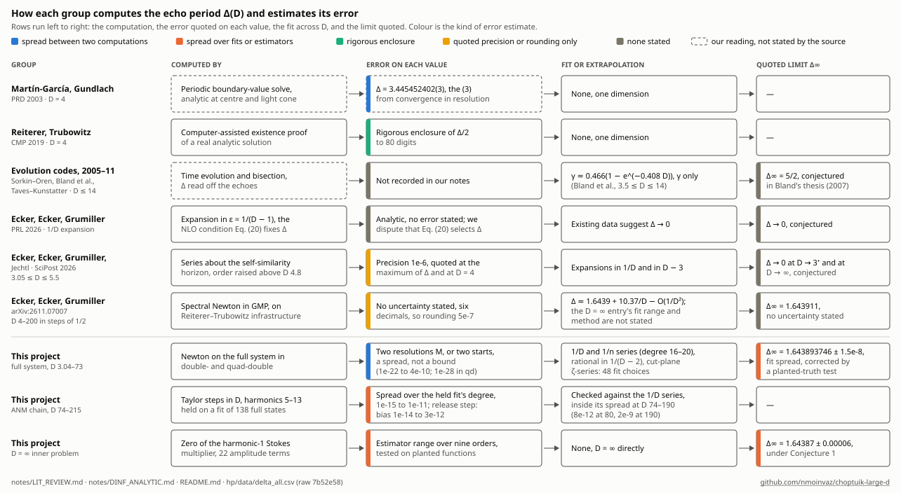
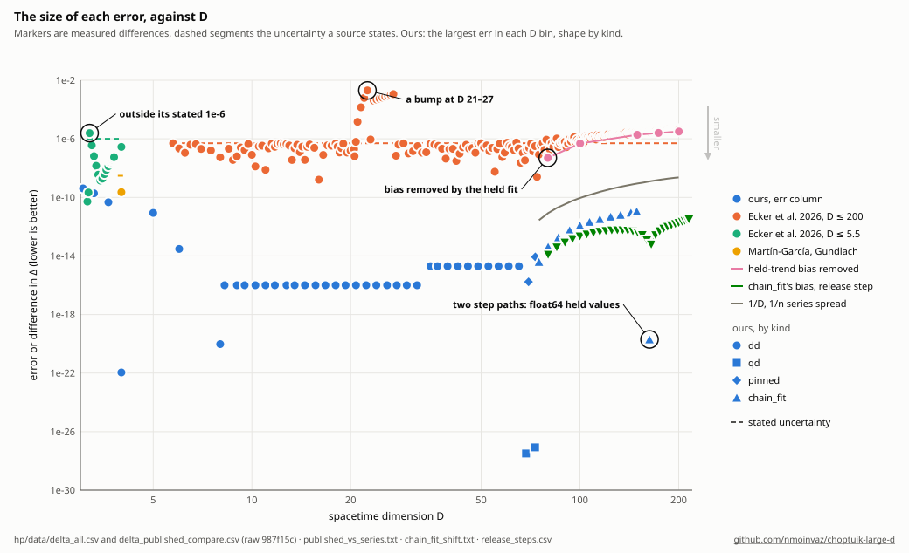

# The held harmonics' bias

Above D = 73 the full system cannot be solved directly, so the large-D chain holds harmonics 5–13 of p1 at
extrapolated values and solves the rest. An error in those held values biases Δ. This note is how that bias was found,
measured, removed, and measured again, with pointers to where each result is recorded. The details live in
[QUAD_DOUBLE.md](QUAD_DOUBLE.md) 13.25 and 13.29 and [HELD_HARMONICS.md](HELD_HARMONICS.md).

Where it stands, as numerical evidence:

- The chain (kind chain_fit, `hp/data/delta_all.csv`) holds the harmonics on a 1/n fit of the full-system states and
  reaches D = 215.
- Its bias, measured by a full-system step, is +1.2e-14 at D 80, at most +5.7e-13 up to 160 and −3.1e-12 at 215.
  The trend-held chain before it was biased by −5e-8 at 80 and −3.2e-6 at 200.
- The step returns planted biases of harmonic 5 to 1e-5 of themselves, but between two held fits it removes only
  93–99% of the difference. So it is a measurement of the bias, not yet a correction.

## How each group estimates its error

Colour is the kind of error estimate, and a dashed box is our reading of a method the source does not state.
`hp/plot_error_methods.py` draws both charts and prints their numbers.

## The size of each error

The pink line is the bias of the trend-held chain, removed by the held fit. The green triangles are chain_fit's own
bias, the step's |dΔ|. They lie below the series' spread (gray), so only the step resolves chain_fit's bias.

## What each error bar is

| kind | what it is | where it is used |
|---|---|---|
| dM | change from the next lower resolution M, a spread | double-double full system, D ≤ 67.77 |
| starts | two starts with their own Taylor plans, a spread | quad-double full system, 68.5–73 |
| pins | pin 7 against pin 5, two systems, a spread | pinned runs, 67.77–73.27 |
| runs | two step paths (T139), a spread | chain_fit, where no fit spread exists |
| fits | held fits of degree 6 and 10 against 8 (T140), a spread | chain_fit, 74–150 |
| step | the junk-frozen full-system step's dΔ, a linear estimate of the bias | chain_fit, every 5 in D (not in err) |

None is a bound. The largest available is the row's err (`hp/export_delta_all.py`).

## Progression

| # | method | what it showed | where |
|---|---|---|---|
| 1 | Full system, double- then quad-double, to D 73 | No held harmonics, nothing to bias | QUAD_DOUBLE 12, 13.25 |
| 2 | Pinned runs (T73, T75) with one full-system Newton step | Bridged 67.8–73.3 | 13.25 |
| 3 | ANM chain, harmonics held on T75's power-law trend, to 214.9 | Smooth Δ, but low against the 1/D series | 13.17–13.24 |
| 4 | 1/D and 1/n series of the full-system points, extrapolated | Gap −5.3e-8 at 80 growing to −3.2e-6 at 200 | 13.29 |
| 5 | First-order correction from the full states' fit | The whole gap, to first order | HELD_HARMONICS |
| 6 | Release the held harmonics, quad- then octo-double Newton | Fails along a near-null direction | 13.19, 13.29 (T136) |
| 7 | Freeze the 4 weakest Δ-free (junk) directions, take one step (T137) | Bias +5.03e-8 at 79.77, +3.23e-6 at 200.27, within 0.5–2% of the series | 13.29 |
| 8 | Hold the harmonics on the 1/n fit instead (T138, chain_fit) | Shift equals series − chain to the last digit; chain to 215 | 13.25, 13.29 |
| 9 | Second step path (T139) | 2e-22 to 2e-20, the held values' float64 walk | 13.25 |
| 10 | Rerun on fits of degree 6 and 10 (T140) | Spread 1.4e-15 at 74 to 1.1e-11 at 150, one fit on each side | 13.25 |
| 11 | Step 7 on chain_fit's states, every 5 in D (T141, T143, T145) | Bias 1e-14 to 3e-12, smooth, sign change between 160 and 165 | 13.29, `release_steps.csv` |
| 12 | Planted test: move harmonic 5's cosine, re-solve, step (T144, T146) | Ratio 1 to 1e-5 at 80 and 100; the re-solve fails from 150 | 13.29 |
| 13 | Planted test with no re-solve: step on the degree-6 and degree-10 states (T147) | Removes 93–99%, a one-signed remainder: fails the 2% criterion | 13.29, `release_pairs.csv` |

Each refinement answered the one before it:

- The trend's bias (3) was invisible until an independent reference, the series (4), was extrapolated.
- The series rests on an extrapolation over a factor of three in D, so the bias needed a measurement that uses
  neither a fit nor the series. Releasing the harmonics (6) was that measurement, and it failed.
- Freezing the junk (7) made the measurement work, and it agreed with the series.
- With the bias located in the held values, holding them on a better fit (8) removed it. The step (11) then
  showed what was left, a millionfold smaller.
- The spreads (9, 10) say how far chain_fit moves with its own choices. The planted tests (12, 13) say how far the step
  can be trusted. The second test is stricter, and the step does not pass it.

## Open

- **The remainder in 13.** Moves of single held coefficients (T148, T149) will show whether the step misses a
  harmonic other than 5 or loses part of the response to the frozen junk.
- **Above D 130.** No planted test reaches there. On the trend-held chain the step agreed with the exact shift to
  0.5–2% (13.29), at biases a million times larger than chain_fit's.
- **Resolution.** The chain runs at M = 32 only. At D 80 its state, resampled to M = 48 in τ and solved again in
  quad-double (`hp/resolution_check.py`, converged to |F| 1.4e-38), moves Δ by −2.4e-25 (raw 98604b2,
  `resolution-mac/scan_chainfit_D80.log`), so resolution is far below the bias there. Above D 80 the check needs the
  horizon block re-seeded at the new M: without it the start residual grows from 1.7e-9 at 80 to 2e15 at 200.

- **Range.** The chain stops at 215, where the octo-double corrector's weakest pivot reaches 7e-16
  (`T138-win2/chain_od.log`). T150 reruns it with the junk frozen in the corrector, toward D 400.
  The crawl past the wall (I19-win2, D = 214.6 to 215.03, 7 rows of delta_all.csv) accepted its steps with 4 junk
  directions frozen. Reloaded with the crawl's options and no step, 1 of its 7 saved states and 1 of 3 saved
  predictions converge again, and those two give the crawl's Δ and correction to the printed digits. The other 8 stop
  at 10⁻¹⁸ to 10⁻²², with no junk direction frozen (#268; raw `I268-win2/`). So the octo-double convergence there is
  not reproduced from the saved files, while no run contradicts the Δ rows. A rerun of the crawl's first step is #287.
  The chains with the harmonics held on fits of degree 6 and 10 stopped at D = 214.75 and 214.5 (#215): their attempts
  at D = 215.0 start at residuals of 10⁻⁹ and accept no step.
