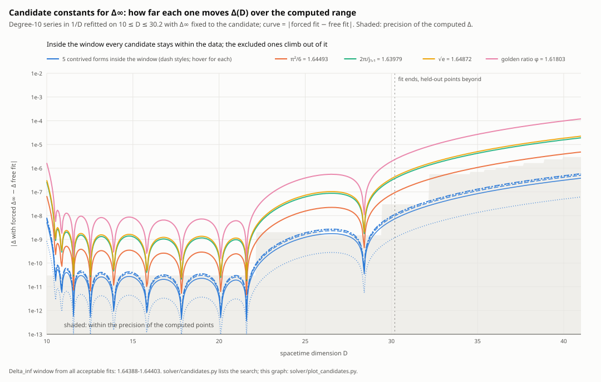

# Closed forms tested and excluded: the tests, the table and the search

Moved verbatim from README.md (commit ea42b3e, lines 540–591) on 2026-11-04, in the reorganization of
[README_PLAN.md](README_PLAN.md); the README keeps a pointer where each block stood. Links were made relative to this folder.

The two tests, the table, the influence function and the search

- **f64 test** (D ≤ 39.5, `solver/candidates.py`): each candidate forced as c₀ in 12 fits (variable 1/D,
  1/(D-1), 1/(D-2); degree 9 and 10; lower cut D ≥ 10 or 12). The table gives $`\chi^2/\mathrm{dof}`$ of the best
  and the worst of the 12 (0.62 is the unconstrained fit) and the rms error on the held-out f64 points, 30.2 < D ≤ 39.5.
  Five candidates passed it; four were already excluded.
- **Double-double test** (`hp/dd_candidates.py 45 --dmax=59.8` on today's file): each candidate forced as the limit of a power series in 1/D fitted on
  10 ≤ D ≤ 45 at degree 14 to 26, and compared with the 352 cleaned points from 45 to 59.8 that the fit never
  saw. The table gives the best of those degrees and how many times worse it is than the free fit (4.8×10⁻¹³
  at degree 16 on this range; held out to 60.1 the same fit gives 5.6×10⁻¹³, [below](../README.md#is-the-period-analytic-in-1d)).

| Candidate | Value | − double-double limit | f64 test: $`\chi^2/\mathrm{dof}`$; held-out rms | Double-double test: held-out error (× free) | Verdict |
|---|---|---|---|---|---|
| none (free fit) | 1.643893746 ± 0.000000015 | | 0.62 .. 3.4; 1.5×10⁻⁶ | 4.8×10⁻¹³ | |
| $`\frac{5}{7}\sqrt{G}\, j_{0,1}`$ | 1.6439747 | +8.1×10⁻⁵ | 0.62 .. 8.6; 1.4×10⁻⁶ | 6.3×10⁻¹¹ (130×) | **ruled out** (passed the f64 test) |
| $`\frac{7}{5}\,(\ln 2)^{-2}\,\pi^{-1/2}`$ | 1.6440014 | +1.1×10⁻⁴ | 0.62 .. 18; 1.3×10⁻⁶ | 1.1×10⁻¹⁰ (230×) | **ruled out** (passed the f64 test) |
| $`\frac{7}{2}\sqrt{\ln 2/\pi}`$ | 1.6440152 | +1.2×10⁻⁴ | 0.62 .. 26; 1.2×10⁻⁶ | 1.3×10⁻¹⁰ (280×) | **ruled out** (passed the f64 test) |
| $`\frac{9}{8}\sqrt{j_{2,1}/j_{0,1}}`$ | 1.6440207 | +1.3×10⁻⁴ | 0.62 .. 30; 1.2×10⁻⁶ | 1.4×10⁻¹⁰ (300×) | **ruled out** (passed the f64 test) |
| $`\frac{10}{9}\sqrt{j_{0,1}/\ln 3}`$ | 1.6439063 | +1.3×10⁻⁵ | 0.62 .. 118; 1.6×10⁻⁶ | 5.3×10⁻¹¹ (110×) | **ruled out** (passed the f64 test) |
| π²/6 = ζ(2) | 1.6449341 | +1.0×10⁻³ | 3.6 .. 13000; 2.9×10⁻⁶ | 1.7×10⁻⁹ (3500×) | **ruled out** by both |
| $`2\pi/j_{1,1}`$ | 1.6397880 | −4.1×10⁻³ | 67 .. 3×10⁵; 1.8×10⁻⁵ | 7.0×10⁻⁹ (15000×) | **ruled out** by both |
| $`\sqrt{e}`$ | 1.6487213 | +4.8×10⁻³ | 82 .. 3×10⁵; 1.8×10⁻⁵ | 8.1×10⁻⁹ (17000×) | **ruled out** by both |
| $`\varphi = (1+\sqrt5)/2`$ | 1.6180340 | −2.6×10⁻² | 2500 .. 10⁷; 1.0×10⁻⁴ | 4.4×10⁻⁸ (92000×) | **ruled out** by both |

The f64 test could not separate the first five: they move Δ(D) by less than 10⁻⁶ for D ≤ 40, below the
precision of those points. The double-double points can. A
forced fit can only bend toward its candidate by spending degrees, so it improves with degree (the table gives each
one's best) until it reaches the level where the free fits overfit too (about 5×10⁻¹¹ at degree 24–26), which is
still about 100 times the free fit's best.

The graph is from the f64 test. It shows, for every candidate, how much fixing Δ∞ to it changes the fitted Δ(D) over the computed
range ($`|\text{forced fit} - \text{free fit}|`$, log scale), against the precision of the computed points (shaded).
The five forms inside the window stay at the level of the data; π²/6 sits 10–100 times above it at
D = 10–30, and $`2\pi/j_{1,1}`$, $`\sqrt e`$ and φ climb further out. Every curve has the same shape: forcing the
limit is a linear constraint on a weighted least-squares fit, so forced minus free is (candidate − free limit) times one
influence function h(D) with h(∞) = 1. It is ~ 10⁻⁷ where the points are known to about 3×10⁻¹¹
(D ≤ 22; up to 4×10⁻¹⁰ at D ≈ 8–10), rises where their error bars step up (D = 22, 29.5), and climbs toward 1 past the data:
h(40) = 3.8×10⁻³, h(100) = 0.17, h(1000) = 0.85. Regenerate with
`cd solver/data && python3 ../plot_candidates.py`.

G is Catalan's constant and $`j_{\nu,k}`$ the k-th zero of the Bessel function $`J_\nu`$. The five that passed the f64
test are all that a search finds in the f64-era window 1.64388–1.64403 (about ± 8×10⁻⁵ around the f64 estimate) among products $`r\, b_1^{p_1} b_2^{p_2}`$
(r = i/j with i, j ≤ 12; $`p = \pm\tfrac12, \pm1, \pm2`$; b from π, e, $`\sqrt2`$, $`\sqrt3`$, $`\ln 2`$, $`\ln 3`$, Euler's
γ, ζ(3), φ, G and Bessel zeros: $`j_{0,1}, j_{0,2}, j_{1,1}, j_{1,2}, j_{2,1}, j_{3/2,1}, j_{5/2,1}`$ and $`y_{0,1}`$, as in
`solver/candidates.py`), 2π/(r b) and $`r \ln b`$. The same search finds nothing in the double-double window
1.6438936–1.6438939 (deliberately ±1.5×10⁻⁷, 15 times the stated error, so that a constant just outside
the error bar would still show), nor in one about 27 times wider (1.643890–1.643898).

