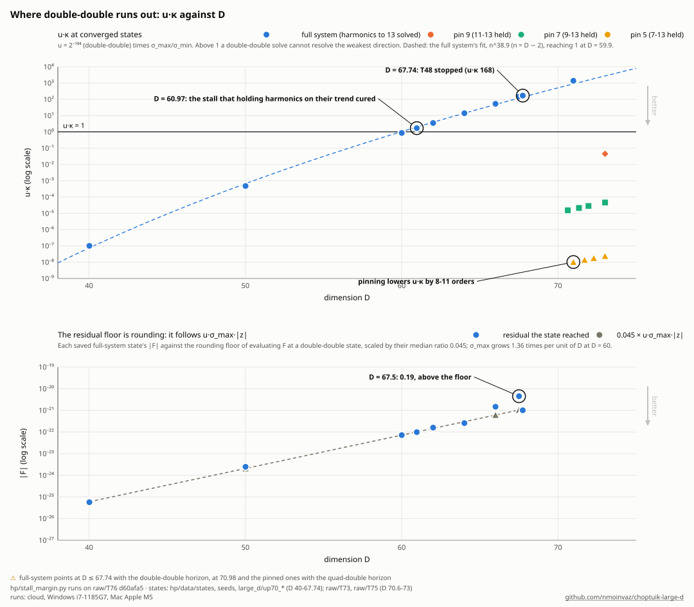

# Why the continuation stalls at large D: the weak directions, the drop-offs and the horizon-series wall

Moved verbatim from README.md (commit ea42b3e, lines 829–882, 931–977) on 2026-11-04, in the reorganization of
[README_PLAN.md](README_PLAN.md); the README keeps a pointer where each block stood. Links were made relative to this
folder.

**Why the steps collapse** (`hp/plot_newton_stall.py`, which reads T73's records from folder `T73` of the [raw-data repository](https://github.com/nmoinvaz/choptuik-large-d-raw): run
`git clone https://github.com/nmoinvaz/choptuik-large-d-raw ../choptuik-large-d-raw` first). Top, a model rather than data: the residual along one weak direction,
F(t) = F₀ − σt + ½ct², and Newton's straight line F₀ − σt. Newton jumps to the line's zero, t = F₀/σ, which is far
out when the slope σ is small, and by then the curvature has added cF₀²/(2σ²). The step lowers the residual only
while cF₀/σ² < 2, that is while the residual Newton starts from is below 2σ²/c. At cF₀/σ² = 2.5 it lands at 1.25 F₀,
and line search ends at the curve's lowest point, 0.8 F₀: the stall. The weak directions' σ falls as D rises (below),
so that bound shrinks, and a shorter step in D hands Newton a smaller starting residual; that is why a run's step
dives before it stops. Bottom, the data: each run's step in D is smallest at the stalls, 0.00235 at D = 35.20, 0.00086
at 60.96 and 0.00010 at 67.75. Above D = 70 the median step is back to 0.0146 in T73, which holds the weakest
harmonics at the predictor's values and corrects Δ for that with one Newton step of the full system. At D = 62–64,
where T48's seeds can be rebuilt from its saved states (`hp/stall_margin.py --attempts`), every step whose seed
residual was at most 1.4×10⁻⁵ (62) or 2.2×10⁻⁵ (64) converged and every larger one failed. Behind the basin is a
precision limit: past D ≈ 60 double-double cannot resolve the weakest direction at all (below, "Why the solver
stalls").

**Where the drop-offs are, and where the next ones would be** (`hp/plot_dropoffs.py`, from the same T76 records as the
next figure). The step collapses at a wall, and the two walls have different causes. At 60.96, with harmonics to 13,
it is precision: u·κ, the unit roundoff times the Jacobian's condition number, was 1.7 at the stall (the fit below puts
u·κ = 1 at 59.9, 1.7 at 60.7; its scatter is ±0.4 in D). At 35.2, with every harmonic kept, u·κ was only 0.010 at
35.02 (`T101-mac/stall_up6.jsonl`, 2026-11-03): that wall was the residual floor of 10⁻¹⁴ to 10⁻¹⁶ which the
undetermined junk directions set, with the basin measure of the stall detector, κ = cF₀/σ² along the weakest direction
(harmonic 31), at 26 against its limit of 2. T48 ran past the precision wall to 67.78 with the harmonics held on their
trend (u·κ = 168 at 67.74). The other dips are not walls: at 45.3 a cloud run stopped with its sensitivity and residual
floor unchanged and the next run continued at once, and below D = 27 the dips are the f64 solver's own limits
([solver/CONTEXT.md](../solver/CONTEXT.md)). With the
same slope, u·κ reaches 1 at D = 79 with harmonics 11–13 held, 94 with 9–13 held and 113 with 7–13 held, and at
372 for the full system in quad-double; the pinned runs stopped before that, at 73.3 and 78.1, at the horizon block
([notes/QUAD_DOUBLE.md](QUAD_DOUBLE.md) 12.4 and 12.7). So the walls belong to the formulation and the arithmetic,
not to the solution: Δ(D) is smooth through every one of them, and each wall moved when the method changed.

**What the horizon block's wall is** (`hp/plot_pole_basin.py`, from `hp/pole_test.py` on the stored states;
[notes/QUAD_DOUBLE.md](QUAD_DOUBLE.md) 13.6). The horizon series' radius for horizon data a fraction δ off the
solution is R = R₀ + C ln(1/δ)/(D − 3) with C ≈ 0.9 at every D from 40 to 73 (left). That C is read at the states'
100 series orders and rises with the order count, to 0.947–0.958 at 250 (QUAD_DOUBLE.md 13.6's addendum). So Newton
can only step from an iterate within exp(−(u₀ − R₀)(D − 3)/C) of the solution (right): 3×10⁻¹² at D 73 with the
last node at 0.7, where
the pinned run stopped, and 5×10⁻³¹ at D 200, below double-double's resolution. The walls at 73.3 and 78.1 lie on
these lines. A series that must converge across u₀ cannot carry the branch to 200 in any layout; the collocation
block of section 13 there replaces it.

**Where double-double runs out** (`hp/plot_stall_kappa.py`, from the stall detector's runs in folder `T76` of the
raw-data repository:
run `git clone https://github.com/nmoinvaz/choptuik-large-d-raw ../choptuik-large-d-raw` first). Top: u·κ, double-double's unit roundoff times the Jacobian's
condition number, at converged states. The full system's rises like n^38.9 and crosses 1 at D = 59.9, just before the
stall at 60.96; at 67.74, where T48 stopped, it is 168. The pinned systems the runs solve sit 8 to 11 orders lower
(1.0×10⁻⁸ with harmonics 7–13 held at D = 70.98, 1.5×10⁻⁵ with 9–13 held at 70.63), which is why they still converge;
the single full-system step that corrects for the pin is still taken at the full system's u·κ. Bottom: the residual each
saved full-system state reached against u·σ_max·|z|, scaled by their median ratio 0.045, the rounding floor of
evaluating F at a double-double state.

What the solver has shown:

- **The weak directions.** The near-null directions of the Jacobian that stalled the f64 solver (called "junk" in the
  code and notes) are a ladder of high τ-harmonics of the centre data, one pair per odd harmonic k, with
  singular values falling about like $`e^{-0.7k}`$
  (10⁻¹⁰ at k = 7 down to 7×10⁻¹⁸ at k = 31 at D = 21; the weakest is 10⁻²⁴ at D = 35). They
  are outgoing waves near the centre that barely reach the matching point, and they belong to the boundary-value problem
  itself: moving the first node or the matching point leaves them unchanged. Their own effect on Δ is tiny
  (≤ 10⁻¹² per unit amplitude for k ≥ 17), but second-order errors leak into them amplified by 1/σ,
  so Newton's basin shrinks with D; at D = 8, 80 points in τ already fail to converge. From D = 35 the solver
  pins the centre data's harmonics above 13 at zero and drops their matching on the horizon side: the weakest singular
  value rises from 10⁻²⁴ to 10⁻¹⁷ and plain Newton converges again. The cut moves Δ by 5×10⁻¹⁵ at
  D = 35 and about 10⁻¹⁵ at D = 40–60 (freeing harmonic 15 changes Δ by +1.5, −1.1 and −1.2×10⁻¹⁵ at D = 40, 50 and 60,
  with full Newton steps), which moves Δ∞ by at most 5.5×10⁻¹⁰ ([notes/NUMERICS_REVIEW.md](NUMERICS_REVIEW.md)).
  A cut at 11 does not converge at D = 40.
- **How fast the selection weakens.** $`\max\lvert\partial\Delta/\partial F\rvert`$ grows about 1.8 times per unit of D
  below D = 27, 1.7 at 35–45, 1.6 at 45–56 and 1.5 at 56–61, to 9×10¹³ at D = 60 (table), and the residual floor rises
  about 1.4-fold per unit. Their product, a worst case that ignores the direction of F, bounds the error in Δ by 10⁻¹⁴
  at D = 45 and 2×10⁻⁹ at D = 60. The linearised estimate $`-\partial\Delta/\partial F \cdot F`$, which accounts for it,
  stays between 10⁻²¹ and 10⁻¹⁷ from D = 35.3 to 60.1 and reaches 3×10⁻¹⁵ above, where the tolerance was relaxed. The
  falling per-unit factors are those of a power law, not an exponential: once the harmonic set is fixed (D = 40–61,
  harmonics above 13 frozen) $`\max\lvert\partial\Delta/\partial F\rvert`$ is $`n^{21.7}`$ to 2% in ln, while
  $`e^{n/2} n^p`$ misses by 15–17% (`solver/beyond_lc/sens_fit.py`). The fast mode that carries the selection,
  $`e^{-n\Phi}`$ with $`\Phi = \ln x - \tfrac12\ln(1 - x^2)`$, has modulus 1 on $`\mathrm{Re}\,x^2 = \tfrac12`$, which
  crosses the real axis at x = 1/√2. The solver matches at 0.7, where it is of order one, and moving the last node
  changes $`\max\lvert\partial\Delta/\partial F\rvert`$ by $`e^{n[\Phi(x_m) - \Phi(0.7)]}`$, over 13 orders of magnitude
  with no fitted parameter (`solver/beyond_lc/hp_node_test.py`). What grows is the high-harmonic ladder below
  ([notes/BEYOND_LIGHT_CONE.md](BEYOND_LIGHT_CONE.md)); the residual floor's 1.4-fold rise per unit of D is the growth
  of the Jacobian's largest singular value (next item).
- **Why the solver stalls: double-double runs out of precision.** `hp/stall_margin.py` measures the Jacobian J at a
  solved point: its weakest singular directions, its largest singular value σ_max (from the dense double-double
  Jacobian) and the condition number κ = σ_max/σ_min. Its runs are in folder `T76` of the raw-data repository and `hp/stall_summary.py`
  prints the numbers below; its controls are two planted problems with known answers and two mutations. From
  D = 40 to 67.74, with n = D − 2, the weakest direction is always p1's harmonic 13, the highest the solver keeps;
  σ_min falls like n^−20.8 (to 4% at 9 points) and σ_max grows like n^18.1. Since ∂Δ/∂F is a row of J⁻¹,
  σ_min ≤ 1/max|∂Δ/∂F| (proved), and in fact σ_min·max|∂Δ/∂F| stays between 6.5 and 9.5×10⁻⁹, so the sensitivity
  in the CSV tracks the weakest direction. The product u·κ, with u = 2⁻¹⁰⁴ double-double's unit roundoff, grows
  like n^38.9 and reaches 1 at D = 59.9 (numerical evidence): it is 1.7 at the stall at 60.96 and 168 at 67.74,
  where T48 stopped. A backward-stable solve's error relative to the solution is about u·κ[^21], so beyond D ≈ 60 a
  double-double Newton step's error along the weakest direction can be as large as the step, and the convergence
  theorem for inexact Newton methods, which needs each solve's relative residual to stay uniformly below 1[^22], no
  longer applies. Every remedy so far takes those directions out of the solve: holding them on their trend,
  deflating them, and T73's pin, which lowers u·κ at D = 71 from 1.4×10³ to 1.5×10⁻⁵ (harmonics 9–13 held) and
  1.0×10⁻⁸ (7–13 held). The residual the runs reach is 0.04–0.05 × u·σ_max·|z| (|z| ≈ 19.5) at every state from
  D 40 to 64 (0.11 and 0.2 at 66.0 and 67.5), the rounding floor of evaluating F at a double-double z; σ_max grows
  1.36 times per unit of D at D = 60.

## The octo-double wall near D 232–242

The octo-double chains refuse steps near D 242.5 (win2's crawlJ and its probes) and, on one of two held fits, at
D 231.13 → 232.13 (win_d10; win_d6 accepted the same step). Raw folders below are in the raw-data repository; each
item names its issue.

**Where the first move goes.** Every first Newton move of a corrector attempt lies on the four weakest directions of
the pinned system: share 1.0 for accepted and refused attempts alike, at D 242.5 and at D 232.13 (`hp/dz0_weak.py`,
#499 and #513; `I499-mac/` at ea4cd55e and fe30a3c6). Its rebuild check passes on every attempt, and its control,
the kernel rebuilt at D + 10⁻⁶, fails on every attempt.

**The weak rows are not the obstacle.** On the affine subspace z0 + Vc of those four directions the weak residual is
B(c − a) + ½Q(c, c) + T(c, c, c)/6, with a the first move's coefficients.
- Q = UᵀF″(vⱼ, vₖ) at k = 4 stays below the differences' h² truncation down to h = 10⁻³³ (≲ 6.4×10⁻⁶; #528,
  `I528-mac/` at 625997f9). #529's entries of 2.75×10⁴ and 5.4×10⁴ were formed at k = 5, with the unconverged fifth
  direction (`I529-win2/` at dcde13a4).
- The weak subspace is four-dimensional with a clean gap: σ₅ lies at least 1.2×10⁶ above σ₄ at both attempts, though
  its own value does not converge (1.2–7.1×10⁻¹⁹ over 16 to 256 iterations; #529).
- The cubic term is resolved: max|UᵀF‴| is 1.63×10³³ at D 242.55 and 4.46×10³¹ at D 232.13, the same at h = 10⁻²³ and
  10⁻²⁴ to 3×10⁻¹⁸.
- At D 242.55 the affine map's root nearest the move is real, at about half of |a|, where its residual is 0.4% of
  |B a|. It is not a root of the system (below). At D 232.13 the root is the linear guess (4×10⁻⁹ and 3×10⁻¹¹ of |B a|), and win_d10 refused there anyway.
- A corrector that first puts the weak part on that root (`hp/weak_corrector.py`, #499; `I499-mac/` at 19958783)
  is refused like newton_od. The control reproduces the attempt's sequence, 9.04×10⁻³⁶ → 7.27×10⁻²⁶ → 3.63×10⁻²⁶ →
  3.18×10⁻²⁶ with no trial accepted. The weak-first start stands at 2.02×10⁻²⁶ and stops at 1.35×10⁻²⁶.

**The jump after the first move is quadratic in the move and sits in the strong rows.** The residual after the move is
7.27×10⁻²⁶ for a move of 8.32×10⁻³⁰ and 2.02×10⁻²⁶ for one of 4.45×10⁻³⁰. Their ratio, 3.60, is the square of the
moves' ratio, 3.50, so max|F| ≈ 1.0×10³³ |c|². At both points the weak rows' residual is of the order of
|B a| = 9.8×10⁻⁵⁶, 30 orders below, so this residual is in the strong rows.

A third point comes from newton_od's first step from the weak-first start (`I499-mac/` at af80d7a1). That step again
lies entirely on the weak directions (2-norm 3.69×10⁻³⁰, 3.0×10⁻⁵⁶ off them). The law predicts 1.43×10⁻²⁶ after it,
and the run reached 1.35×10⁻²⁶.

With the strong rows solved the feedback cancels the cubic (#528, [REDUCED_CUBIC.md](REDUCED_CUBIC.md)). The
strong-row term of the reduced coefficient T − 3S (Kuznetsov's form, [LIT_REVIEW.md](LIT_REVIEW.md), #527) has
3max|S| = max|T| to four digits, and max|T − 3S| = 1.6×10⁻¹⁹max|T|, below the differences' resolution. On the
strong-solved manifold the weak residual is affine to 2.7×10⁻²⁵ of |B a|, and its root is the first move itself, c = a.
Three chord steps through the start's LU then leave max|F| = 2.0×10⁻⁵¹ at the refused attempt. The root at half of |a|
leaves 0.18 |B a| there. In the start's frame the first move's rest moves the weak residual only from 0.0044 to 0.0041
of |B a|: #499's 0.52 used U and B from the LU of newton_od's last trial point. Along rays out to 10⁵|a| (#677,
[REDUCED_CUBIC.md](REDUCED_CUBIC.md) 9), at these two starts, at D 232.13 and at #603's class A start 248.63 → 249.39,
the strong-solved weak residual is affine with slope B + L, plus a quadratic of 10⁻²⁹ to 10⁻²⁸ |B a| (|c|/|a|)², and
at #677's float precision no cubic or quartic is resolved (with the parts kept to 30 digits, #698 resolves the
cubic). 3max|S| = max|T| at all four. At c = a it leaves 7.9×10⁻⁷ |B a| at the class A
start, set by L, the coupling through the start's own strong correction, and max|F| there is 5.4×10⁻⁶⁶. Numerical
evidence at four starts. #674 tests the corrector.
The weak left vectors live on the last matching, half on the Taylor arrival at the last node and half on the horizon
series there, with that node's state cancelled; within it, on the harmonics the freeze keeps matched (#694,
[REDUCED_CUBIC.md](REDUCED_CUBIC.md) 10). None of their rows is affine, and Q and T − 3S are cancellations between the
horizon series' rows. The Δ axis lies in span(V) to 0.9995. This fits "only the last node is felt" (below).
Followed further along a/|a| by #677's chord (#698, [REDUCED_CUBIC.md](REDUCED_CUBIC.md) 11), the map at REF stays
quadratic to 3×10⁻¹⁸ and has a resolved cubic, 19.2 |B a|/|a| per unit |c|², of the size its quadratic implies.
Neither the chord (beyond about 10⁻¹⁸) nor Newton with a refactored LU (at 10⁻⁶) reaches |c| of 10⁻³, and the chord's
pair test in its linear regime puts a fold of the strong block near |c| ≈ 5×10⁻¹⁷ (REF) and 10⁻¹⁷ (class A),
inferred from a two-direction model.

**Where the weakness lives in the layout.** Raw singular values are not comparable across layouts, since a node's
rows carry its own gain. With rows and columns equilibrated (`hp/near_null_eq.py`, #502; `I502-mac/` at 811bbed3), the
0.3–0.8 layout lifts σ₁ by 7.6×10⁴ (1.88×10⁻⁶¹ to 1.42×10⁻⁵⁶). That is the reverse of the raw reading, 2.55×10⁻²⁷ to
8.43×10⁻³⁸ (#493). One node moved at a time at D 242.36 (#537; `I537-win2/` at 923c87c1):

| move | shift of ln σ₃, raw | equilibrated | fast mode between nodes | G^p |
|---|---|---|---|---|
| first node 0.3 → 0.35 | 0.00 | 0.00 | +41 | 0 |
| last node 0.7 → 0.72 | −8.96 | −2.20 | −13.7 | positive |

All four σ shift together, and neither model holds. The −13.7 is n[Φ(0.72) − Φ(0.7)], the node law that matched
max|∂Δ/∂F| over 13 orders at D 40–61 (above). At D 242.36 the raw shift is 65% of it.

Only the last node is felt (`I543-win2/` and `I544-win2/` at adbf158f, `I553-win2/` and `I554-win2/` at 145084e7):
- Moving any interior node by 0.02, or the first node to 0.25, changes no σ (below 0.001 in ln, equilibrated). The
  five-node layout ending at 0.80 gives #502's six-node 0.3–0.8 values to within 0.037 (#544, #543).
- No law a + b x or a + b ln x in the last node's position x holds (#543), and the fit's prediction for 0.8, written
  before the comparison, missed.
- The weakest direction changes at x = 0.7428 (#553): below it is the harmonic-3 pair, and above it the pure Delta
  direction. The Delta direction's raw σ there is near 10⁻³⁷ and is not the norm of J's Delta column (#553).
- The weakest equilibrated σ is smallest at 0.74 (4.0×10⁻⁶³) and still rising at 0.92 (2.04×10⁻⁴², 19 orders above
  0.70). The rise is J's scale, whose largest entry falls like x^−(D−3), from 2.4×10³⁷ at 0.70 to 9.3×10⁸ at 0.92
  (#554). #559 extends the ladder to 0.98.
- At x = 0.80 the Delta direction's raw σ falls with D: 1.59×10⁻³⁷, 1.24×10⁻³⁷ and 8.74×10⁻³⁸ at D 232.63, 237.13 and
  242.36, about 6% per unit of D, while the other weak σ stay within 0.3% (#560; `I560-win2/` at 12e71363).

**Why the 0.8 layout's polish failed.** At the re-noded 0.3–0.8 start of D 242.36, the polish's first step is of order
1 (|dz| 1.73), almost all on v₄. It is the start's horizon residual, 1.62×10⁻³⁴, divided by σ₄ = 1.77×10⁻³⁴ (#501;
`I501-mac/` at 650c9bf8). The outer layout is better conditioned, but its start is not accurate enough for its weakest
direction. #562 refines the start's horizon rows before the polish.

**The freeze projector's rounding.** The frozen rows apply the kfreeze projector to p1. Until #523 hp formed it in
double-double, and every chain state was solved on those rounded rows. With the exact projector (main since #523,
c2be1be, error 1.15×10⁻¹³²) the chain's states are 1.6–1.7×10⁻³⁴ off their rows in the horizon p rows k ≤ 3, at every D
from 215 to 242.36. On the rounded rows they are at 5×10⁻³⁶ to 8×10⁻³⁸.
- At the 0.975 start, three of the four weak σ come from that rounding: 7.4×10⁻³⁵, 7.4×10⁻³⁵ and 1.84×10⁻³⁴ on main,
  against 2.8×10⁻³⁹ to 1.9×10⁻³⁷ with the exact projector (#562; `I562-mac/` at 690c41a9). The raw σ near 10⁻³⁴ of the
  outer-layout ladders above carry it.
- At D 252.25 the 0.975 layout's first Newton step, 2.1×10⁻², lies 94% on one weak direction (σ₁ = 4.7×10⁻⁴⁰), and
  it is the same at three starts whose max|F| differs by 3×10²⁰. The residual's component on that direction is
  u₁ᵀF = 8.68725×10⁻⁴¹ at all three, carried by the two blocks that meet at the last node (n3>n4 and horizon>n4),
  so it is the mismatch of the two arrivals there and not any start's gap (#688; `I688-dh370/` at 0ad4eb2e).
- The pinned step to the exact rows lies on the four weak directions (share 1.0000), and its Δ part grows by about 0.8
  in ln per unit of D (#589; `I589-mac/` at 420f201a):

| D | first order (the step's Δ part) | measured (exact − rounded, both polishes converged) | ratio |
|---|---|---|---|
| 215.00 | −4.537×10⁻¹⁹ | −4.547×10⁻¹⁹ | 1.002 |
| 225.13 | −7.818×10⁻¹⁶ | −7.757×10⁻¹⁶ | 0.992 |
| 235.13 | −3.557×10⁻¹² | −3.531×10⁻¹² | 0.993 |
| 240.03 | −2.04×10⁻¹⁰ | not reached: the polish on the exact rows stalls after its first step (#595) | |
| 242.36 | +2.15×10⁻⁹ | not reached: the polish on the exact rows does not converge (#562) | |

The measured shifts are #595's (`I595-mac/` at 2b818f6f, `hp/delta_diff.py`). Each is a direct polish of the chain's
state on both projectors, and their difference cancels the reload's own offset. So the first-order figure holds to
1% wherever it was tested, though no state lay inside its chord window: the window measures the start, not Newton's
basin. On the rounded rows, too, #562's homotopy traces stayed straight in Δ far past their chord windows.

**The table's error bars.** From D 225.13 on, the chain_fit rows of `hp/data/delta_all.csv` come from the rerun on
main's exact projector (#603; commit 9c34843c), so they carry no projector term. Below D 225.13 the rows solve the
rounded rows, and the shift there, at most 7.8×10⁻¹⁶ (`hp/data/projector_shift.csv`), is below the fits term, which
sets their err (`hp/export_delta_all.py`). Until 9c34843c the rounded rows ran to D 242.57, and the shift was their
largest err from D 232.63 on (4.3×10⁻¹³ there, 2.6×10⁻⁹ at D 242.57, err_kind "projector first order").

**The weak σ oscillate in D.** The equilibrated σ₁ and σ₂ oscillate with a period that shortens as D falls: 2.715 at
D 232.6, 2.525 at 221.6 and 2.440 at 212.8 (#525; `I525-win2/` at 5037ec07). σ₃ and σ₄ have periods of 2.13–2.14
over D 210–215.6.
A drift quadratic in D fits the 51 states D 210–237 to 0.0060 and 0.0052 in ln for σ₁ and σ₂ (#533; `I533-win2/` at
f01f08fe). One of its four hold-outs misses the 0.014 bound (0.0173). It predicts σ₁'s period over D 204–209.6 as
2.404 (sd 0.021, noise only), which #535 tests.

**The held fit's share in one step.** Swapping the held fits between the degree-6 and degree-10 chains for the step
D 229.13 → 230.13 moves Δ by ±1.175×10⁻¹³, equal and opposite. That is 0.506% of the 2.32×10⁻¹¹ gap between the chains
(#514; `I514-win/` at d2208e68).

**The horizon pole is not an apparent horizon.** The variables B = 1/a² and C = c a² keep the pole of
[QUAD_DOUBLE.md](QUAD_DOUBLE.md) 13.6 (`hp/pole_bc.py`, #538; `I538-mac/` at 651f29e6).
- p, m, B and C all have the radius of a. Their log-slope in ln(1/δ) is 0.997–1.000 of 13.6's at D 40–73, and 0.93 at
  D 242.36.
- B stays at 0.90–0.98 near the radius, so no trapped sphere forms there. That contradicts 13.1's reading of the pole
  as g_rr → ∞ at an apparent horizon. The law itself holds.
- The zero of x − c, where the p-equation is singular, is the nearest singularity at moderate D and small δ, and not
  at D 242.36:
  - A real-axis march of the perturbed solution (`hp/pole_march.py`, #545; `I545-mac/` at 6e935ad8) finds no breakdown
    at the radius. For δ > 0 at D 40 and 73, x − c rises to between −0.01 and −0.03 and turns back 1–6% beyond R,
    with a field peak there. For δ < 0 nothing happens on the axis.
  - The nearest zero of x − c from Padé approximants of the series (`hp/pole_sonic.py`, #592; `I592-mac/` at 5e4ec5b6)
    lies within 3% of R at D 40 and 73 for |δ| = 10⁻⁸, and 4–13% beyond R at larger δ. At D 242.36 it lies 15–157%
    beyond R.
  - Numerical evidence. Past R the series' own accuracy limits the reading. At D 73 and 242.36 the double-double series
    and the kernel's Taylor steps disagree far above the march's conditioning (#545), and #591 compares the series with
    an octo-double one.
- 13.6's C depends on the series' order count: 0.918, 0.935 and 0.942 at 100, 130 and 160 orders at D 40. #546 quotes
  it with that range.

## The chain's series past D 236: true coefficients, and a singularity that comes near only past D 252 (#634)

#603's chain on the exact projector builds, at each base D₀, the octo-double series z(D₀ + a) = Σ z_k a^k to N = 24
(`anm_run.py --jet_o 1`). From D 236 on, |z_5| to |z_8| grow 20 to 1000 times, while |z_1| to |z_4| stay smooth. Two
readings fit the norms. One is noise in those orders. The other is a singularity of z(D) in the complex D plane coming
near the real axis, which would bound the chain and explain its refusals at a ≈ 1. From D 225 to 245 neither holds.
The middle orders are the series' true coefficients to 16 digits or more of their size. The nearest singularity stays
more than 5.5 from every base by every estimator used, and the refusals are the corrector's. The chain's later records
show that singularity coming nearer from D 252 on. `hp/jet_singularity.py` (its docstring gives every command and
criterion) wrote `hp/data/jet_634.json` from the raw-data repository at 29946938, folders `I634-mac/` and
`I603-win2/`. All of it is numerical evidence.

### The corrector confirms the middle orders

The chain stores each prediction before its re-seed (`pred_pin3_D*.npz`), and `jet_singularity.py preds` compares it,
row by row, with the converged state at the same D. All 27 predictions err by 1.1×10⁻³¹ to 1.7×10⁻²⁹ at a ≥ 0.93, and
by 2.5×10⁻³⁶ to 2.0×10⁻³⁵ at a ≤ 0.61. The middle orders' terms max |z_k| a^k (k = 5 to 8) are 5.9×10⁻¹⁴ to
4.35×10⁻¹³ at a ≥ 0.93, so each prediction lies within 1/(2.6×10¹⁶) of them. Its control, `--mutate scale5`, adds
|z_5| a^5 to each prediction's Δ and fails. Noise as large as the growth would put about 10⁻¹³ into every prediction.
The largest error is Δ's own entry at most a = 1 steps, and it is the truncation at N = 24.

### The series under moved precision and a moved base

`jet_singularity.py jet` forms a base's series as the chain does, through `anm_run.py`'s `coefficients_o` and
`coefficients_q`. Its od series at D 245.14 equals #603's record at orders 0 to 8 bit for bit. The 24-order series that
`anm_run.py --save_jet 2` builds at D 236.63 equals the record at all 25 orders and both pivots. So this Mac's build of
main 3c35f0c reproduces win2's series exactly.

At D 245.14 the largest entry of each of z_5 to z_8 is Δ's own. The table gives each variant's change,
max|z_k′ − z_k| / max|z_k|, at orders 1 and 5 to 8 (N = 8, `I634-mac/jets/`).

| k | Δ_k | noise injected, 10⁻⁸⁰ of max\|b_k\| | base at max\|F\| 1.6×10⁻⁶⁰ | base at 5.0×10⁻⁶¹ | base at 1.6×10⁻³² | quad-double series |
|---|---|---|---|---|---|---|
| 1 | −1.69×10⁻⁴ | 4.4×10⁻¹⁹ | 9.9×10⁻³⁴ | 2.6×10⁻³⁴ | 9.9×10⁻⁶ | 6.5×10¹⁷ |
| 5 | 1.876×10⁻¹² | 3.3×10⁻¹¹ | 5.3×10⁻²⁶ | 1.7×10⁻²⁶ | 5.3×10² | 3.9×10¹³⁹ |
| 6 | 8.79×10⁻¹³ | 3.2×10⁻¹¹ | 1.0×10⁻²⁵ | 3.6×10⁻²⁶ | 1.0×10³ | 3.2×10¹⁶⁸ |
| 7 | 1.69×10⁻¹³ | 3.4×10⁻¹¹ | 1.7×10⁻²⁵ | 6.0×10⁻²⁶ | 1.7×10³ | 6.7×10¹⁹⁷ |
| 8 | 6.73×10⁻¹⁵ | 3.6×10⁻¹¹ | 5.7×10⁻²⁵ | 2.2×10⁻²⁵ | 5.7×10³ | 7.0×10²²⁷ |

- **The quad-double series cannot represent this one.** It is wrong by 6.5×10¹⁷ at order 1 and about 10³⁰ more at each
  order, the quad-double unit times G² of [OCTO_DOUBLE.md](OCTO_DOUBLE.md) far past 1. So the precision comparison
  rests on the injection, not on a second precision.
- **Rounding.** Noise injected into every order's right-hand side at 10⁻⁸⁰ of its size moves z_5 to z_8 by about
  3×10⁻¹¹. The quad-double column calibrates the rounding at order 1. Quad-double rounds like an injection of
  1.5×10⁻⁴⁴, so octo-double, 2⁻²¹² finer, rounds like one of about 2×10⁻¹⁰⁸. That would move z_5 to z_8 by
  8×10⁻³⁹ at most. It is an estimate, not a bound, since it assumes a linear response and takes the rounding's size
  from order 1.
- **The base.** The base is moved by J⁻¹r, r random. With max|r| = 10⁻⁷⁴ the move is 5.6×10⁻⁴⁸ (seed 1) or 1.8×10⁻⁴⁸
  (seed 2), almost all along Δ. Its residual, quadratic in the move, is the chain's acceptance level. At max|r| =
  10⁻⁶⁰ the move is 5.6×10⁻³⁴ and the residual 1.6×10⁻³². The change follows the residual, not the move. From that
  base to seed 1 the residual falls by 10²⁸, and so does the change, while the move falls by 10¹⁴. So a base
  converged to max|F| ≤ 10⁻⁶⁰ has z_5 to z_8 right to 6×10⁻²⁵ of their size. #603's accepted steps converged to
  2.85×10⁻⁹⁶ to 2.6×10⁻⁶².
- **The base polished.** `anm_run.py --tol_od 1e-80` takes the stored base at D 245.14 from max|F| 2.0×10⁻⁶⁷ to
  7.9×10⁻⁹³ in two Newton steps, a move of 9.3×10⁻⁵³. Its z_5 to z_8 differ from the stored base's by 1.0×10⁻³¹ at
  most, as the residual's share predicts.

At D 236.63 the driver's od series equals `anm_run.py`'s 24-order series in every part of every entry at orders 0
to 8. J⁻¹r with max|r| = 10⁻⁷⁴ moves that base by 1.2×10⁻⁵¹ and leaves max|F| at 9.4×10⁻⁶⁹. It changes z_5 to
z_8 by 1.1×10⁻³⁵ at most, and the quad-double series is wrong by 1.6×10¹⁵ at order 1. At D 243.64 the od series equals
#603's record at orders 0 to 8 bit for bit, the largest entry of z_5 to z_8 is again Δ's, and the quad-double series
is wrong by 1.4×10¹⁶ at order 1. The largest change of z_5 to z_8 per unit of the base's residual grows from
1.2×10³³ at D 236.63 to 3.7×10³⁵ at D 245.14.

### Where the series is singular

The estimator passed its planted controls before it read any real series (`jet_singularity.py planted`; its criteria
are fixed in the docstring). It recovers conjugate pole pairs at |s| = 1 and 2.5 to within 3% in |s| and 3° in
argument, and a square-root pair at 1.5 to within 10%. It reports no stable pole within 4 for background and noise
alone, for noise shaped like the records' |z_k| at D 245.14, and for an entire oscillating component, 5 seeds each.
Its control, `--mutate drop_pole`, fails. Two changes were made while the plants failed, before any real series. A
Froissart-doublet filter at 1% dropped the genuine pole, whose residue is small. Poles inside the disc of convergence
are now cut, at 0.85 of the root-test radius (Cauchy–Hadamard).

The records give no argument, but to D 245.14 their root test does not shrink. Over orders 12 to 24 of the records'
|z_k| it is 7.1 to 7.9 at the 13 bases from D 225.13 to 236.63, and 7.3 to 9.7 at the 14 bases from D 237.13 to
245.14. At a singularity within 1 of the base, |z_24| would be at least |z_5|. At D 245.14 it is 2.3×10⁻²⁸ against
1.9×10⁻¹².

At D 236.63 the 24-order series locates it.
- Of the 24 rows with the largest |z_8|, 17 have a stable Padé pole, at |s| = 8.3 to 9.7 (median 8.75) and arguments
  59° to 113° (median 86.6°).
- Those rows' root tests give 7.4 to 10.2.
- Δ's own series has no stable pole within 50, and its root test gives 7.4.
- From order 7 on, Δ's coefficients follow the signs −, −, +, + of an argument near ±90°.

So the nearest singularity lies near D 237.1 ± 8.7i, about 9 off the real axis. That is 9 steps of a = 1 and three
times the step bound a_max. The ranges are spreads over rows and approximants, not error bars.

At D 245.14 only 16 orders were affordable here. `anm_run.py --save_jet 2` built them, and they equal the record's 17
norms. For the same 24 rows, they give stable Padé poles at |s| = 5.6 to 7.0 (median 6.7), arguments 9° to 107°
(median 42°), and root tests of 6.1 to 8.0. Read at its first 16 orders, D 236.63's series gives 5.3 to 6.3 (median
5.7) at a median of 88°, where its 24 orders give a median of 8.75. So 16 orders put |s| about a third low. At equal
order count the distance does not shrink, from a median of 5.7 to 6.7. The argument turns, from about 88° to about
42°, so the singularity seen from D 245.14 lies ahead of the base and nearer the axis. Its place needs the 24 orders.

From D 225.13 to 245.14 the middle orders grow because that singularity's share grows, not because it comes nearer.
|z_24| grows 46 times over that range at a root-test radius that does not shrink, and the bound
a_max = (ε|z_1|/|z_24|)^(1/23) sees that share through |z_24|.

#603's chain went on past D 245.64, and its records show more (records only, raw `I603-win2/` at d2948f5b, the bases
to D 253.53). The root test over orders 12 to 24 stays 7.2 to 8.5 to D 251.89. Then it falls, to 6.5 at D 252.25,
6.0 at D 252.61 and 5.3 to 5.6 from D 253.07 to 253.53. The component reaches the low orders there. From D 245.64 to
253.53, |z_4| grows from 1.9×10⁻¹¹ to 4.8×10⁻⁷, |z_3| from 4.0×10⁻⁹ to 2.1×10⁻⁶ and |z_2| from 1.1×10⁻⁶ to
4.9×10⁻⁶. So from D 252 on the singularity does come nearer, while the accepted steps fall to 0.11 to 0.18. Where
it lies, and whether it reaches the real axis, needs 24-order series at those bases.

#685 (dh370; raw `I685-dh370/` abed955c, `table685.txt` from `table685.py`) built them with `anm_run.py --save_jet 2`
at five of #603's bases from D 252.25 to 253.71. Each equals #603's record in all 25 norms and both pivots, a Linux
build against win2's Windows run, while a neighbouring base's record matches none. The planted estimator passes and
its `drop_pole` control fails. Three tracks of singularities lie within a factor 1.2 of each other in distance.

| track | D* | seen at | drift per unit D₀ (Re, Im) |
|---|---|---|---|
| A | 255.71 + 4.99i | all five bases, in Δ's own Padé poles | −0.04, −0.04 |
| B | 252.31 + 5.80i | 252.25 to 253.07, in 23 to 25 of the 24 largest rows | +0.10, −0.43 (3 points) |
| C | 259.20 + 2.88i | 253.07 to 253.71 | −0.41, −0.28 (3 points) |

**Δ's own Padé poles hold one singularity fixed at D* = 255.71 + 4.99i at all five bases.** The root test agrees with
A's distance to 3–7% at each base, read after the fact. Δ's two-term recurrence fit reads otherwise. Its D* moves from
255.29 + 4.63i to 256.99 + 2.70i and would reach the axis at D₀ ≈ 255.8. But its window spread, 0.6 to 3.2, is as
large as that drift, and its planted controls held one pair near the front, not three. A planted series with A, B and
C fixed in D, seen from the same five bases (#711, `jet_singularity.py planted --case T3`; raw `I711-mac/` d396e4e5),
makes the recurrence fit's Im D* fall by 2.96 and touch the axis, while nothing moves. **So the recurrence fit's drift
toward the axis is what three fixed singularities produce, and by the rule fixed before the run it is dropped.** Padé
recovers all three pairs when their terms are balanced at order 12, but it misses the nearest one when the farthest
dominates the low orders, so the plant fails its own criterion and the Padé reading is not certified by it either.
Track A predicts that the root test bottoms near 5.0 at D₀ ≈ 255.7 and rises after, which series past D 255 test (#712).

With the plan made again at the state (#686, dh370; raw `I686-dh370/` bc9add86), the series at D 252.25 and 252.61
put the nearest singularity at the same D* to 10⁻⁴, inside its spread over the approximants (0.010 and 0.094). Their
coefficients move by up to 6% between the two plans, at orders 7 and 13. So, by #686's rule, the singularity is the
solution's and not the plan's. Its control, D* moved by 0.5, reads as the plan's at both bases. This tests the plan
only: the new plan's base polish did not converge, and the series were formed at the stored state (pinned max|F|
3×10⁻³⁶). Another M or layout was not run, since the octo-double solver is built for M = 32 only (#735).

### The refusals are the corrector's

The corrector's first Newton move is the prediction's error to first order. At the accepted steps it equals the
prediction's distance from the converged state, for example 1.60×10⁻³¹ against 1.65×10⁻³¹ at D 226.13.
`jet_singularity.py refusals` reads every attempt in #603's log.

| attempts | first move | start max\|F\| | max\|F\| after the first move |
|---|---|---|---|
| accepted at a > 0.9 (13) | 1.1×10⁻³¹ to 1.7×10⁻²⁹ | 2.6×10⁻³⁴ to 1.4×10⁻³³ | 5.0×10⁻³⁰ to 2.8×10⁻²⁵ |
| refused, base D 236.13, a = 1 | 7.7×10⁻³¹ | 2.7×10⁻³⁴ | 4.0×10⁻²⁸ |
| refused, base D 238.54, a = 0.977 | 1.2×10⁻³⁰ | 2.1×10⁻³⁴ | 1.1×10⁻²⁸ |
| refused, base D 240.12, a = 0.763 | 4.9×10⁻³³ | 4.0×10⁻³⁶ | 1.1×10⁻³² |
| refused, base D 244.64, a = 1 | 6.2×10⁻³⁰ | 2.6×10⁻³³ | 1.4×10⁻²⁴ |

The refused predictions were as accurate as the accepted ones, and each error is Δ's entry, since the move's Δ part
equals the move. At a > 0.9 the move is 0.01 to 0.6 of |z_24| a^24, the truncation at N = 24. The middle orders'
terms there, 7×10⁻¹⁴ to 4×10⁻¹³, are summed to that accuracy. So the refusals are not the predictor's, neither its
truncation nor its middle orders. They are the corrector's, in the step after its first move, where the residual
rises quadratically in the strong rows ("The jump after the first move" above). The residuals after the first move
overlap. 6.8×10⁻²⁷ was accepted from D 242.71, and 4.0×10⁻²⁸ was refused from D 236.13.
