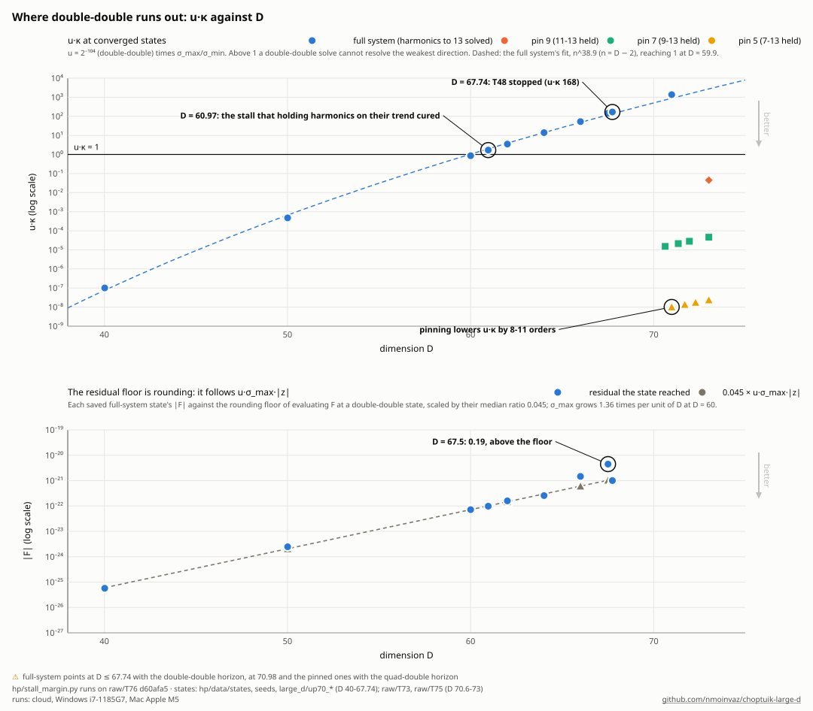

# Why the continuation stalls at large D: the weak directions, the drop-offs and the horizon-series wall

Moved verbatim from README.md (commit ea42b3e, lines 829–882, 931–977) on 2026-11-04, in the reorganization of
[README_PLAN.md](README_PLAN.md); the README keeps a pointer where each block stood. Links were made relative to this
folder.


**Why the steps collapse** (`hp/plot_newton_stall.py`, which reads T73's records from folder `T73` of the [raw-data repository](https://github.com/nmoinvaz/choptuik-large-d-raw): run
`git clone https://github.com/nmoinvaz/choptuik-large-d-raw ../choptuik-large-d-raw` first). Top, a model rather than data: the residual along one weak direction,
F(t) = F₀ − σt + ½ct², and Newton's straight line F₀ − σt. Newton jumps to the line's zero, t = F₀/σ, which is far
out when the slope σ is small, and by then the curvature has added cF₀²/(2σ²). The step lowers the residual only
while cF₀/σ² < 2, that is while the residual Newton starts from is below 2σ²/c. At cF₀/σ² = 2.5 it lands at 1.25 F₀,
and line search ends at the curve's lowest point, 0.8 F₀: the stall. The weak directions' σ falls as D rises (below),
so that bound shrinks, and a shorter step in D hands Newton a smaller starting residual; that is why a run's step
dives before it stops. Bottom, the data: each run's step in D is smallest at the stalls, 0.00235 at D = 35.20, 0.00086
at 60.96 and 0.00010 at 67.75. Above D = 70 the median step is back to 0.0146 in T73, which holds the weakest
harmonics at the predictor's values and corrects Δ for that with one Newton step of the full system. At D = 62–64,
where T48's seeds can be rebuilt from its saved states (`hp/stall_margin.py --attempts`), every step whose seed
residual was at most 1.4×10⁻⁵ (62) or 2.2×10⁻⁵ (64) converged and every larger one failed. Behind the basin is a
precision limit: past D ≈ 60 double-double cannot resolve the weakest direction at all (below, "Why the solver
stalls").


**Where the drop-offs are, and where the next ones would be** (`hp/plot_dropoffs.py`, from the same T76 records as the
next figure). The step collapses at a wall, and the two walls have different causes. At 60.96, with harmonics to 13,
it is precision: u·κ, the unit roundoff times the Jacobian's condition number, was 1.7 at the stall (the fit below puts
u·κ = 1 at 59.9, 1.7 at 60.7; its scatter is ±0.4 in D). At 35.2, with every harmonic kept, u·κ was only 0.010 at
35.02 (`T101-mac/stall_up6.jsonl`, 2026-11-03): that wall was the residual floor of 10⁻¹⁴ to 10⁻¹⁶ which the
undetermined junk directions set, with the basin measure of the stall detector, κ = cF₀/σ² along the weakest direction
(harmonic 31), at 26 against its limit of 2. T48 ran past the precision wall to 67.78 with the harmonics held on their
trend (u·κ = 168 at 67.74). The other dips are not walls: at 45.3 a cloud run stopped with its sensitivity and residual
floor unchanged and the next run continued at once, and below D = 27 the dips are the f64 solver's own limits
([solver/CONTEXT.md](../solver/CONTEXT.md)). With the
same slope, u·κ reaches 1 at D = 79 with harmonics 11–13 held, 94 with 9–13 held and 113 with 7–13 held, and at
372 for the full system in quad-double; the pinned runs stopped before that, at 73.3 and 78.1, at the horizon block
([notes/QUAD_DOUBLE.md](QUAD_DOUBLE.md) 12.4 and 12.7). So the walls belong to the formulation and the arithmetic,
not to the solution: Δ(D) is smooth through every one of them, and each wall moved when the method changed.


**What the horizon block's wall is** (`hp/plot_pole_basin.py`, from `hp/pole_test.py` on the stored states;
[notes/QUAD_DOUBLE.md](QUAD_DOUBLE.md) 13.6). The horizon series' radius for horizon data a fraction δ off the
solution is R = R₀ + C ln(1/δ)/(D − 3) with C ≈ 0.9 at every D from 40 to 73 (left). That C is read at the states'
100 series orders and rises with the order count, to 0.947–0.958 at 250 (QUAD_DOUBLE.md 13.6's addendum). So Newton
can only step from an iterate within exp(−(u₀ − R₀)(D − 3)/C) of the solution (right): 3×10⁻¹² at D 73 with the
last node at 0.7, where
the pinned run stopped, and 5×10⁻³¹ at D 200, below double-double's resolution. The walls at 73.3 and 78.1 lie on
these lines. A series that must converge across u₀ cannot carry the branch to 200 in any layout; the collocation
block of section 13 there replaces it.



**Where double-double runs out** (`hp/plot_stall_kappa.py`, from the stall detector's runs in folder `T76` of the
raw-data repository:
run `git clone https://github.com/nmoinvaz/choptuik-large-d-raw ../choptuik-large-d-raw` first). Top: u·κ, double-double's unit roundoff times the Jacobian's
condition number, at converged states. The full system's rises like n^38.9 and crosses 1 at D = 59.9, just before the
stall at 60.96; at 67.74, where T48 stopped, it is 168. The pinned systems the runs solve sit 8 to 11 orders lower
(1.0×10⁻⁸ with harmonics 7–13 held at D = 70.98, 1.5×10⁻⁵ with 9–13 held at 70.63), which is why they still converge;
the single full-system step that corrects for the pin is still taken at the full system's u·κ. Bottom: the residual each
saved full-system state reached against u·σ_max·|z|, scaled by their median ratio 0.045, the rounding floor of
evaluating F at a double-double state.

What the solver has shown:

- **The weak directions.** The near-null directions of the Jacobian that stalled the f64 solver (called "junk" in the
  code and notes) are a ladder of high τ-harmonics of the centre data, one pair per odd harmonic k, with
  singular values falling about like $`e^{-0.7k}`$
  (10⁻¹⁰ at k = 7 down to 7×10⁻¹⁸ at k = 31 at D = 21; the weakest is 10⁻²⁴ at D = 35). They
  are outgoing waves near the centre that barely reach the matching point, and they belong to the boundary-value problem
  itself: moving the first node or the matching point leaves them unchanged. Their own effect on Δ is tiny
  (≤ 10⁻¹² per unit amplitude for k ≥ 17), but second-order errors leak into them amplified by 1/σ,
  so Newton's basin shrinks with D; at D = 8, 80 points in τ already fail to converge. From D = 35 the solver
  pins the centre data's harmonics above 13 at zero and drops their matching on the horizon side: the weakest singular
  value rises from 10⁻²⁴ to 10⁻¹⁷ and plain Newton converges again. The cut moves Δ by 5×10⁻¹⁵ at
  D = 35 and about 10⁻¹⁵ at D = 40–60 (freeing harmonic 15 changes Δ by +1.5, −1.1 and −1.2×10⁻¹⁵ at D = 40, 50 and 60,
  with full Newton steps), which moves Δ∞ by at most 5.5×10⁻¹⁰ ([notes/NUMERICS_REVIEW.md](NUMERICS_REVIEW.md)).
  A cut at 11 does not converge at D = 40.
- **How fast the selection weakens.** $`\max\lvert\partial\Delta/\partial F\rvert`$ grows about 1.8 times per unit of D
  below D = 27, 1.7 at 35–45, 1.6 at 45–56 and 1.5 at 56–61, to 9×10¹³ at D = 60 (table), and the residual floor rises
  about 1.4-fold per unit. Their product, a worst case that ignores the direction of F, bounds the error in Δ by 10⁻¹⁴
  at D = 45 and 2×10⁻⁹ at D = 60. The linearised estimate $`-\partial\Delta/\partial F \cdot F`$, which accounts for it,
  stays between 10⁻²¹ and 10⁻¹⁷ from D = 35.3 to 60.1 and reaches 3×10⁻¹⁵ above, where the tolerance was relaxed. The
  falling per-unit factors are those of a power law, not an exponential: once the harmonic set is fixed (D = 40–61,
  harmonics above 13 frozen) $`\max\lvert\partial\Delta/\partial F\rvert`$ is $`n^{21.7}`$ to 2% in ln, while
  $`e^{n/2} n^p`$ misses by 15–17% (`solver/beyond_lc/sens_fit.py`). The fast mode that carries the selection,
  $`e^{-n\Phi}`$ with $`\Phi = \ln x - \tfrac12\ln(1 - x^2)`$, has modulus 1 on $`\mathrm{Re}\,x^2 = \tfrac12`$, which
  crosses the real axis at x = 1/√2. The solver matches at 0.7, where it is of order one, and moving the last node
  changes $`\max\lvert\partial\Delta/\partial F\rvert`$ by $`e^{n[\Phi(x_m) - \Phi(0.7)]}`$, over 13 orders of magnitude
  with no fitted parameter (`solver/beyond_lc/hp_node_test.py`). What grows is the high-harmonic ladder below
  ([notes/BEYOND_LIGHT_CONE.md](BEYOND_LIGHT_CONE.md)); the residual floor's 1.4-fold rise per unit of D is the growth
  of the Jacobian's largest singular value (next item).
- **Why the solver stalls: double-double runs out of precision.** `hp/stall_margin.py` measures the Jacobian J at a
  solved point: its weakest singular directions, its largest singular value σ_max (from the dense double-double
  Jacobian) and the condition number κ = σ_max/σ_min. Its runs are in folder `T76` of the raw-data repository and `hp/stall_summary.py`
  prints the numbers below; its controls are two planted problems with known answers and two mutations. From
  D = 40 to 67.74, with n = D − 2, the weakest direction is always p1's harmonic 13, the highest the solver keeps;
  σ_min falls like n^−20.8 (to 4% at 9 points) and σ_max grows like n^18.1. Since ∂Δ/∂F is a row of J⁻¹,
  σ_min ≤ 1/max|∂Δ/∂F| (proved), and in fact σ_min·max|∂Δ/∂F| stays between 6.5 and 9.5×10⁻⁹, so the sensitivity
  in the CSV tracks the weakest direction. The product u·κ, with u = 2⁻¹⁰⁴ double-double's unit roundoff, grows
  like n^38.9 and reaches 1 at D = 59.9 (numerical evidence): it is 1.7 at the stall at 60.96 and 168 at 67.74,
  where T48 stopped. A backward-stable solve's error relative to the solution is about u·κ[^21], so beyond D ≈ 60 a
  double-double Newton step's error along the weakest direction can be as large as the step, and the convergence
  theorem for inexact Newton methods, which needs each solve's relative residual to stay uniformly below 1[^22], no
  longer applies. Every remedy so far takes those directions out of the solve: holding them on their trend,
  deflating them, and T73's pin, which lowers u·κ at D = 71 from 1.4×10³ to 1.5×10⁻⁵ (harmonics 9–13 held) and
  1.0×10⁻⁸ (7–13 held). The residual the runs reach is 0.04–0.05 × u·σ_max·|z| (|z| ≈ 19.5) at every state from
  D 40 to 64 (0.11 and 0.2 at 66.0 and 67.5), the rounding floor of evaluating F at a double-double z; σ_max grows
  1.36 times per unit of D at D = 60.

## The octo-double wall near D 232–242

The octo-double chains refuse steps near D 242.5 (win2's crawlJ and its probes) and, on one of two held fits, at
D 231.13 → 232.13 (win_d10; win_d6 accepted the same step). Raw folders below are in the raw-data repository; each
item names its issue.

**Where the first move goes.** Every first Newton move of a corrector attempt lies on the four weakest directions of
the pinned system: share 1.0 for accepted and refused attempts alike, at D 242.5 and at D 232.13 (`hp/dz0_weak.py`,
#499 and #513; `I499-mac/` at ea4cd55e and fe30a3c6). Its rebuild check passes on every attempt, and its control,
the kernel rebuilt at D + 10⁻⁶, fails on every attempt.

**The weak rows are not the obstacle.** On the affine subspace z0 + Vc of those four directions the weak residual is
B(c − a) + ½Q(c, c) + T(c, c, c)/6, with a the first move's coefficients.
- Q = UᵀF″(vⱼ, vₖ) at k = 4 stays below the differences' h² truncation down to h = 10⁻³³ (≲ 6.4×10⁻⁶; #528,
  `I528-mac/` at 625997f9). #529's entries of 2.75×10⁴ and 5.4×10⁴ were formed at k = 5, with the unconverged fifth
  direction (`I529-win2/` at dcde13a4).
- The weak subspace is four-dimensional with a clean gap: σ₅ lies at least 1.2×10⁶ above σ₄ at both attempts, though
  its own value does not converge (1.2–7.1×10⁻¹⁹ over 16 to 256 iterations; #529).
- The cubic term is resolved: max|UᵀF‴| is 1.63×10³³ at D 242.55 and 4.46×10³¹ at D 232.13, the same at h = 10⁻²³ and
  10⁻²⁴ to 3×10⁻¹⁸.
- At D 242.55 the affine map's root nearest the move is real, at about half of |a|, where its residual is 0.4% of
  |B a|. It is not a root of the system (below). At D 232.13 the root is the linear guess (4×10⁻⁹ and 3×10⁻¹¹ of |B a|), and win_d10 refused there anyway.
- A corrector that first puts the weak part on that root (`hp/weak_corrector.py`, #499; `I499-mac/` at 19958783)
  is refused like newton_od. The control reproduces the attempt's sequence, 9.04×10⁻³⁶ → 7.27×10⁻²⁶ → 3.63×10⁻²⁶ →
  3.18×10⁻²⁶ with no trial accepted. The weak-first start stands at 2.02×10⁻²⁶ and stops at 1.35×10⁻²⁶.

**The jump after the first move is quadratic in the move and sits in the strong rows.** The residual after the move is
7.27×10⁻²⁶ for a move of 8.32×10⁻³⁰ and 2.02×10⁻²⁶ for one of 4.45×10⁻³⁰. Their ratio, 3.60, is the square of the
moves' ratio, 3.50, so max|F| ≈ 1.0×10³³ |c|². At both points the weak rows' residual is of the order of
|B a| = 9.8×10⁻⁵⁶, 30 orders below, so this residual is in the strong rows.

A third point comes from newton_od's first step from the weak-first start (`I499-mac/` at af80d7a1). That step again
lies entirely on the weak directions (2-norm 3.69×10⁻³⁰, 3.0×10⁻⁵⁶ off them). The law predicts 1.43×10⁻²⁶ after it,
and the run reached 1.35×10⁻²⁶.

With the strong rows solved the feedback cancels the cubic (#528, [REDUCED_CUBIC.md](REDUCED_CUBIC.md)). The
strong-row term of the reduced coefficient T − 3S (Kuznetsov's form, [LIT_REVIEW.md](LIT_REVIEW.md), #527) has
3max|S| = max|T| to four digits, and max|T − 3S| = 1.6×10⁻¹⁹max|T|, below the differences' resolution. On the
strong-solved manifold the weak residual is affine to 2.7×10⁻²⁵ of |B a|, and its root is the first move itself, c = a.
Three chord steps through the start's LU then leave max|F| = 2.0×10⁻⁵¹ at the refused attempt. The root at half of |a|
leaves 0.18 |B a| there. In the start's frame the first move's rest moves the weak residual only from 0.0044 to 0.0041
of |B a|: #499's 0.52 used U and B from the LU of newton_od's last trial point. Along rays out to 10⁵|a| (#677,
[REDUCED_CUBIC.md](REDUCED_CUBIC.md) 9), at these two starts, at D 232.13 and at #603's class A start 248.63 → 249.39,
the strong-solved weak residual is affine with slope B + L, plus a quadratic of 10⁻²⁹ to 10⁻²⁸ |B a| (|c|/|a|)², and
at #677's float precision no cubic or quartic is resolved (with the parts kept to 30 digits, #698 resolves the
cubic). 3max|S| = max|T| at all four. At c = a it leaves 7.9×10⁻⁷ |B a| at the class A
start, set by L, the coupling through the start's own strong correction, and max|F| there is 5.4×10⁻⁶⁶. Numerical
evidence at four starts. #674 tests the corrector.
The weak left vectors live on the last matching, half on the Taylor arrival at the last node and half on the horizon
series there, with that node's state cancelled; within it, on the harmonics the freeze keeps matched (#694,
[REDUCED_CUBIC.md](REDUCED_CUBIC.md) 10). None of their rows is affine, and Q and T − 3S are cancellations between the
horizon series' rows. The Δ axis lies in span(V) to 0.9995. This fits "only the last node is felt" (below).
Followed further along a/|a| by #677's chord (#698, [REDUCED_CUBIC.md](REDUCED_CUBIC.md) 11), the map at REF stays
quadratic to 3×10⁻¹⁸ and has a resolved cubic, 19.2 |B a|/|a| per unit |c|², of the size its quadratic implies.
Neither the chord (beyond about 10⁻¹⁸) nor Newton with a refactored LU (at 10⁻⁶) reaches |c| of 10⁻³, and the chord's
pair test in its linear regime puts a fold of the strong block near |c| ≈ 5×10⁻¹⁷ (REF) and 10⁻¹⁷ (class A),
inferred from a two-direction model.

**Where the weakness lives in the layout.** Raw singular values are not comparable across layouts, since a node's
rows carry its own gain. With rows and columns equilibrated (`hp/near_null_eq.py`, #502; `I502-mac/` at 811bbed3), the
0.3–0.8 layout lifts σ₁ by 7.6×10⁴ (1.88×10⁻⁶¹ to 1.42×10⁻⁵⁶). That is the reverse of the raw reading, 2.55×10⁻²⁷ to
8.43×10⁻³⁸ (#493). One node moved at a time at D 242.36 (#537; `I537-win2/` at 923c87c1):

| move | shift of ln σ₃, raw | equilibrated | fast mode between nodes | G^p |
|---|---|---|---|---|
| first node 0.3 → 0.35 | 0.00 | 0.00 | +41 | 0 |
| last node 0.7 → 0.72 | −8.96 | −2.20 | −13.7 | positive |

All four σ shift together, and neither model holds. The −13.7 is n[Φ(0.72) − Φ(0.7)], the node law that matched
max|∂Δ/∂F| over 13 orders at D 40–61 (above). At D 242.36 the raw shift is 65% of it.

Only the last node is felt (`I543-win2/` and `I544-win2/` at adbf158f, `I553-win2/` and `I554-win2/` at 145084e7):
- Moving any interior node by 0.02, or the first node to 0.25, changes no σ (below 0.001 in ln, equilibrated). The
  five-node layout ending at 0.80 gives #502's six-node 0.3–0.8 values to within 0.037 (#544, #543).
- No law a + b x or a + b ln x in the last node's position x holds (#543), and the fit's prediction for 0.8, written
  before the comparison, missed.
- The weakest direction changes at x = 0.7428 (#553): below it is the harmonic-3 pair, and above it the pure Delta
  direction. The Delta direction's raw σ there is near 10⁻³⁷ and is not the norm of J's Delta column (#553).
- The weakest equilibrated σ is smallest at 0.74 (4.0×10⁻⁶³) and still rising at 0.92 (2.04×10⁻⁴², 19 orders above
  0.70). The rise is J's scale, whose largest entry falls like x^−(D−3), from 2.4×10³⁷ at 0.70 to 9.3×10⁸ at 0.92
  (#554). #559 extends the ladder to 0.98.
- At x = 0.80 the Delta direction's raw σ falls with D: 1.59×10⁻³⁷, 1.24×10⁻³⁷ and 8.74×10⁻³⁸ at D 232.63, 237.13 and
  242.36, about 6% per unit of D, while the other weak σ stay within 0.3% (#560; `I560-win2/` at 12e71363).

**Why the 0.8 layout's polish failed.** At the re-noded 0.3–0.8 start of D 242.36, the polish's first step is of order
1 (|dz| 1.73), almost all on v₄. It is the start's horizon residual, 1.62×10⁻³⁴, divided by σ₄ = 1.77×10⁻³⁴ (#501;
`I501-mac/` at 650c9bf8). The outer layout is better conditioned, but its start is not accurate enough for its weakest
direction. #562 refines the start's horizon rows before the polish.

**The freeze projector's rounding.** The frozen rows apply the kfreeze projector to p1. Until #523 hp formed it in
double-double, and every chain state was solved on those rounded rows. With the exact projector (main since #523,
c2be1be, error 1.15×10⁻¹³²) the chain's states are 1.6–1.7×10⁻³⁴ off their rows in the horizon p rows k ≤ 3, at every D
from 215 to 242.36. On the rounded rows they are at 5×10⁻³⁶ to 8×10⁻³⁸.
- At the 0.975 start, three of the four weak σ come from that rounding: 7.4×10⁻³⁵, 7.4×10⁻³⁵ and 1.84×10⁻³⁴ on main,
  against 2.8×10⁻³⁹ to 1.9×10⁻³⁷ with the exact projector (#562; `I562-mac/` at 690c41a9). The raw σ near 10⁻³⁴ of the
  outer-layout ladders above carry it.
- At D 252.25 the 0.975 layout's first Newton step, 2.1×10⁻², lies 94% on one weak direction (σ₁ = 4.7×10⁻⁴⁰), and
  it is the same at three starts whose max|F| differs by 3×10²⁰. The residual's component on that direction is
  u₁ᵀF = 8.68725×10⁻⁴¹ at all three, carried by the two blocks that meet at the last node (n3>n4 and horizon>n4),
  so it is the mismatch of the two arrivals there and not any start's gap (#688; `I688-dh370/` at 0ad4eb2e).
- The pinned step to the exact rows lies on the four weak directions (share 1.0000), and its Δ part grows by about 0.8
  in ln per unit of D (#589; `I589-mac/` at 420f201a):

| D | first order (the step's Δ part) | measured (exact − rounded, both polishes converged) | ratio |
|---|---|---|---|
| 215.00 | −4.537×10⁻¹⁹ | −4.547×10⁻¹⁹ | 1.002 |
| 225.13 | −7.818×10⁻¹⁶ | −7.757×10⁻¹⁶ | 0.992 |
| 235.13 | −3.557×10⁻¹² | −3.531×10⁻¹² | 0.993 |
| 240.03 | −2.04×10⁻¹⁰ | not reached: the polish on the exact rows stalls after its first step (#595) | |
| 242.36 | +2.15×10⁻⁹ | not reached: the polish on the exact rows does not converge (#562) | |

The measured shifts are #595's (`I595-mac/` at 2b818f6f, `hp/delta_diff.py`). Each is a direct polish of the chain's
state on both projectors, and their difference cancels the reload's own offset. So the first-order figure holds to
1% wherever it was tested, though no state lay inside its chord window: the window measures the start, not Newton's
basin. On the rounded rows, too, #562's homotopy traces stayed straight in Δ far past their chord windows.

**The table's error bars.** From D 225.13 on, the chain_fit rows of `hp/data/delta_all.csv` come from the rerun on
main's exact projector (#603; commit 9c34843c), so they carry no projector term. Below D 225.13 the rows solve the
rounded rows, and the shift there, at most 7.8×10⁻¹⁶ (`hp/data/projector_shift.csv`), is below the fits term, which
sets their err (`hp/export_delta_all.py`). Until 9c34843c the rounded rows ran to D 242.57, and the shift was their
largest err from D 232.63 on (4.3×10⁻¹³ there, 2.6×10⁻⁹ at D 242.57, err_kind "projector first order").

**The weak σ oscillate in D.** The equilibrated σ₁ and σ₂ oscillate with a period that shortens as D falls: 2.715 at
D 232.6, 2.525 at 221.6 and 2.440 at 212.8 (#525; `I525-win2/` at 5037ec07). σ₃ and σ₄ have periods of 2.13–2.14
over D 210–215.6.
A drift quadratic in D fits the 51 states D 210–237 to 0.0060 and 0.0052 in ln for σ₁ and σ₂ (#533; `I533-win2/` at
f01f08fe). One of its four hold-outs misses the 0.014 bound (0.0173). It predicts σ₁'s period over D 204–209.6 as
2.404 (sd 0.021, noise only), which #535 tests.

**The held fit's share in one step.** Swapping the held fits between the degree-6 and degree-10 chains for the step
D 229.13 → 230.13 moves Δ by ±1.175×10⁻¹³, equal and opposite. That is 0.506% of the 2.32×10⁻¹¹ gap between the chains
(#514; `I514-win/` at d2208e68).

**The horizon pole is not an apparent horizon.** The variables B = 1/a² and C = c a² keep the pole of
[QUAD_DOUBLE.md](QUAD_DOUBLE.md) 13.6 (`hp/pole_bc.py`, #538; `I538-mac/` at 651f29e6).
- p, m, B and C all have the radius of a. Their log-slope in ln(1/δ) is 0.997–1.000 of 13.6's at D 40–73, and 0.93 at
  D 242.36.
- B stays at 0.90–0.98 near the radius, so no trapped sphere forms there. That contradicts 13.1's reading of the pole
  as g_rr → ∞ at an apparent horizon. The law itself holds.
- The zero of x − c, where the p-equation is singular, is the nearest singularity at moderate D and small δ, and not
  at D 242.36:
  - A real-axis march of the perturbed solution (`hp/pole_march.py`, #545; `I545-mac/` at 6e935ad8) finds no breakdown
    at the radius. For δ > 0 at D 40 and 73, x − c rises to between −0.01 and −0.03 and turns back 1–6% beyond R,
    with a field peak there. For δ < 0 nothing happens on the axis.
  - The nearest zero of x − c from Padé approximants of the series (`hp/pole_sonic.py`, #592; `I592-mac/` at 5e4ec5b6)
    lies within 3% of R at D 40 and 73 for |δ| = 10⁻⁸, and 4–13% beyond R at larger δ. At D 242.36 it lies 15–157%
    beyond R.
  - Numerical evidence. Past R the series' own accuracy limits the reading. At D 73 and 242.36 the double-double series
    and the kernel's Taylor steps disagree far above the march's conditioning (#545), and #591 compares the series with
    an octo-double one.
- 13.6's C depends on the series' order count: 0.918, 0.935 and 0.942 at 100, 130 and 160 orders at D 40. #546 quotes
  it with that range.

## The chain's series past D 236: true coefficients, and a singularity that comes near only past D 252 (#634)

#603's chain on the exact projector builds, at each base D₀, the octo-double series z(D₀ + a) = Σ z_k a^k to N = 24
(`anm_run.py --jet_o 1`). From D 236 on, |z_5| to |z_8| grow 20 to 1000 times, while |z_1| to |z_4| stay smooth. Two
readings fit the norms. One is noise in those orders. The other is a singularity of z(D) in the complex D plane coming
near the real axis, which would bound the chain and explain its refusals at a ≈ 1. From D 225 to 245 neither holds.
The middle orders are the series' true coefficients to 16 digits or more of their size. The nearest singularity stays
more than 5.5 from every base by every estimator used, and the refusals are the corrector's. The chain's later records
show that singularity coming nearer from D 252 on. `hp/jet_singularity.py` (its docstring gives every command and
criterion) wrote `hp/data/jet_634.json` from the raw-data repository at 29946938, folders `I634-mac/` and
`I603-win2/`. All of it is numerical evidence.

### The corrector confirms the middle orders

The chain stores each prediction before its re-seed (`pred_pin3_D*.npz`), and `jet_singularity.py preds` compares it,
row by row, with the converged state at the same D. All 27 predictions err by 1.1×10⁻³¹ to 1.7×10⁻²⁹ at a ≥ 0.93, and
by 2.5×10⁻³⁶ to 2.0×10⁻³⁵ at a ≤ 0.61. The middle orders' terms max |z_k| a^k (k = 5 to 8) are 5.9×10⁻¹⁴ to
4.35×10⁻¹³ at a ≥ 0.93, so each prediction lies within 1/(2.6×10¹⁶) of them. Its control, `--mutate scale5`, adds
|z_5| a^5 to each prediction's Δ and fails. Noise as large as the growth would put about 10⁻¹³ into every prediction.
The largest error is Δ's own entry at most a = 1 steps, and it is the truncation at N = 24.

### The series under moved precision and a moved base

`jet_singularity.py jet` forms a base's series as the chain does, through `anm_run.py`'s `coefficients_o` and
`coefficients_q`. Its od series at D 245.14 equals #603's record at orders 0 to 8 bit for bit. The 24-order series that
`anm_run.py --save_jet 2` builds at D 236.63 equals the record at all 25 orders and both pivots. So this Mac's build of
main 3c35f0c reproduces win2's series exactly.

At D 245.14 the largest entry of each of z_5 to z_8 is Δ's own. The table gives each variant's change,
max|z_k′ − z_k| / max|z_k|, at orders 1 and 5 to 8 (N = 8, `I634-mac/jets/`).

| k | Δ_k | noise injected, 10⁻⁸⁰ of max\|b_k\| | base at max\|F\| 1.6×10⁻⁶⁰ | base at 5.0×10⁻⁶¹ | base at 1.6×10⁻³² | quad-double series |
|---|---|---|---|---|---|---|
| 1 | −1.69×10⁻⁴ | 4.4×10⁻¹⁹ | 9.9×10⁻³⁴ | 2.6×10⁻³⁴ | 9.9×10⁻⁶ | 6.5×10¹⁷ |
| 5 | 1.876×10⁻¹² | 3.3×10⁻¹¹ | 5.3×10⁻²⁶ | 1.7×10⁻²⁶ | 5.3×10² | 3.9×10¹³⁹ |
| 6 | 8.79×10⁻¹³ | 3.2×10⁻¹¹ | 1.0×10⁻²⁵ | 3.6×10⁻²⁶ | 1.0×10³ | 3.2×10¹⁶⁸ |
| 7 | 1.69×10⁻¹³ | 3.4×10⁻¹¹ | 1.7×10⁻²⁵ | 6.0×10⁻²⁶ | 1.7×10³ | 6.7×10¹⁹⁷ |
| 8 | 6.73×10⁻¹⁵ | 3.6×10⁻¹¹ | 5.7×10⁻²⁵ | 2.2×10⁻²⁵ | 5.7×10³ | 7.0×10²²⁷ |

- **The quad-double series cannot represent this one.** It is wrong by 6.5×10¹⁷ at order 1 and about 10³⁰ more at each
  order, the quad-double unit times G² of [OCTO_DOUBLE.md](OCTO_DOUBLE.md) far past 1. So the precision comparison
  rests on the injection, not on a second precision.
- **Rounding.** Noise injected into every order's right-hand side at 10⁻⁸⁰ of its size moves z_5 to z_8 by about
  3×10⁻¹¹. The quad-double column calibrates the rounding at order 1. Quad-double rounds like an injection of
  1.5×10⁻⁴⁴, so octo-double, 2⁻²¹² finer, rounds like one of about 2×10⁻¹⁰⁸. That would move z_5 to z_8 by
  8×10⁻³⁹ at most. It is an estimate, not a bound, since it assumes a linear response and takes the rounding's size
  from order 1.
- **The base.** The base is moved by J⁻¹r, r random. With max|r| = 10⁻⁷⁴ the move is 5.6×10⁻⁴⁸ (seed 1) or 1.8×10⁻⁴⁸
  (seed 2), almost all along Δ. Its residual, quadratic in the move, is the chain's acceptance level. At max|r| =
  10⁻⁶⁰ the move is 5.6×10⁻³⁴ and the residual 1.6×10⁻³². The change follows the residual, not the move. From that
  base to seed 1 the residual falls by 10²⁸, and so does the change, while the move falls by 10¹⁴. So a base
  converged to max|F| ≤ 10⁻⁶⁰ has z_5 to z_8 right to 6×10⁻²⁵ of their size. #603's accepted steps converged to
  2.85×10⁻⁹⁶ to 2.6×10⁻⁶².
- **The base polished.** `anm_run.py --tol_od 1e-80` takes the stored base at D 245.14 from max|F| 2.0×10⁻⁶⁷ to
  7.9×10⁻⁹³ in two Newton steps, a move of 9.3×10⁻⁵³. Its z_5 to z_8 differ from the stored base's by 1.0×10⁻³¹ at
  most, as the residual's share predicts.

At D 236.63 the driver's od series equals `anm_run.py`'s 24-order series in every part of every entry at orders 0
to 8. J⁻¹r with max|r| = 10⁻⁷⁴ moves that base by 1.2×10⁻⁵¹ and leaves max|F| at 9.4×10⁻⁶⁹. It changes z_5 to
z_8 by 1.1×10⁻³⁵ at most, and the quad-double series is wrong by 1.6×10¹⁵ at order 1. At D 243.64 the od series equals
#603's record at orders 0 to 8 bit for bit, the largest entry of z_5 to z_8 is again Δ's, and the quad-double series
is wrong by 1.4×10¹⁶ at order 1. The largest change of z_5 to z_8 per unit of the base's residual grows from
1.2×10³³ at D 236.63 to 3.7×10³⁵ at D 245.14.

### Where the series is singular

The estimator passed its planted controls before it read any real series (`jet_singularity.py planted`; its criteria
are fixed in the docstring). It recovers conjugate pole pairs at |s| = 1 and 2.5 to within 3% in |s| and 3° in
argument, and a square-root pair at 1.5 to within 10%. It reports no stable pole within 4 for background and noise
alone, for noise shaped like the records' |z_k| at D 245.14, and for an entire oscillating component, 5 seeds each.
Its control, `--mutate drop_pole`, fails. Two changes were made while the plants failed, before any real series. A
Froissart-doublet filter at 1% dropped the genuine pole, whose residue is small. Poles inside the disc of convergence
are now cut, at 0.85 of the root-test radius (Cauchy–Hadamard).

The records give no argument, but to D 245.14 their root test does not shrink. Over orders 12 to 24 of the records'
|z_k| it is 7.1 to 7.9 at the 13 bases from D 225.13 to 236.63, and 7.3 to 9.7 at the 14 bases from D 237.13 to
245.14. At a singularity within 1 of the base, |z_24| would be at least |z_5|. At D 245.14 it is 2.3×10⁻²⁸ against
1.9×10⁻¹².

At D 236.63 the 24-order series locates it.
- Of the 24 rows with the largest |z_8|, 17 have a stable Padé pole, at |s| = 8.3 to 9.7 (median 8.75) and arguments
  59° to 113° (median 86.6°).
- Those rows' root tests give 7.4 to 10.2.
- Δ's own series has no stable pole within 50, and its root test gives 7.4.
- From order 7 on, Δ's coefficients follow the signs −, −, +, + of an argument near ±90°.

So the nearest singularity lies near D 237.1 ± 8.7i, about 9 off the real axis. That is 9 steps of a = 1 and three
times the step bound a_max. The ranges are spreads over rows and approximants, not error bars.

At D 245.14 only 16 orders were affordable here. `anm_run.py --save_jet 2` built them, and they equal the record's 17
norms. For the same 24 rows, they give stable Padé poles at |s| = 5.6 to 7.0 (median 6.7), arguments 9° to 107°
(median 42°), and root tests of 6.1 to 8.0. Read at its first 16 orders, D 236.63's series gives 5.3 to 6.3 (median
5.7) at a median of 88°, where its 24 orders give a median of 8.75. So 16 orders put |s| about a third low. At equal
order count the distance does not shrink, from a median of 5.7 to 6.7. The argument turns, from about 88° to about
42°, so the singularity seen from D 245.14 lies ahead of the base and nearer the axis. Its place needs the 24 orders.

From D 225.13 to 245.14 the middle orders grow because that singularity's share grows, not because it comes nearer.
|z_24| grows 46 times over that range at a root-test radius that does not shrink, and the bound
a_max = (ε|z_1|/|z_24|)^(1/23) sees that share through |z_24|.

#603's chain went on past D 245.64, and its records show more (records only, raw `I603-win2/` at d2948f5b, the bases
to D 253.53). The root test over orders 12 to 24 stays 7.2 to 8.5 to D 251.89. Then it falls, to 6.5 at D 252.25,
6.0 at D 252.61 and 5.3 to 5.6 from D 253.07 to 253.53. The component reaches the low orders there. From D 245.64 to
253.53, |z_4| grows from 1.9×10⁻¹¹ to 4.8×10⁻⁷, |z_3| from 4.0×10⁻⁹ to 2.1×10⁻⁶ and |z_2| from 1.1×10⁻⁶ to
4.9×10⁻⁶. So from D 252 on the singularity does come nearer, while the accepted steps fall to 0.11 to 0.18. Where
it lies, and whether it reaches the real axis, needs 24-order series at those bases.

#685 (dh370; raw `I685-dh370/` abed955c, `table685.txt` from `table685.py`) built them with `anm_run.py --save_jet 2`
at five of #603's bases from D 252.25 to 253.71. Each equals #603's record in all 25 norms and both pivots, a Linux
build against win2's Windows run, while a neighbouring base's record matches none. The planted estimator passes and
its `drop_pole` control fails. Three tracks of singularities lie within a factor 1.2 of each other in distance.

| track | D* | seen at | drift per unit D₀ (Re, Im) |
|---|---|---|---|
| A | 255.71 + 4.99i | all five bases, in Δ's own Padé poles | −0.04, −0.04 |
| B | 252.31 + 5.80i | 252.25 to 253.07, in 23 to 25 of the 24 largest rows | +0.10, −0.43 (3 points) |
| C | 259.20 + 2.88i | 253.07 to 253.71 | −0.41, −0.28 (3 points) |

**Δ's own Padé poles hold one singularity fixed at D* = 255.71 + 4.99i at all five bases.** The root test agrees with
A's distance to 3–7% at each base, read after the fact. Δ's two-term recurrence fit reads otherwise. Its D* moves from
255.29 + 4.63i to 256.99 + 2.70i and would reach the axis at D₀ ≈ 255.8. But its window spread, 0.6 to 3.2, is as
large as that drift, and its planted controls held one pair near the front, not three. A planted series with A, B and
C fixed in D, seen from the same five bases (#711, `jet_singularity.py planted --case T3`; raw `I711-mac/` d396e4e5),
makes the recurrence fit's Im D* fall by 2.96 and touch the axis, while nothing moves. **So the recurrence fit's drift
toward the axis is what three fixed singularities produce, and by the rule fixed before the run it is dropped.** Padé
recovers all three pairs when their terms are balanced at order 12, but it misses the nearest one when the farthest
dominates the low orders, so the plant fails its own criterion and the Padé reading is not certified by it either.
Track A predicts that the root test bottoms near 5.0 at D₀ ≈ 255.7 and rises after, which series past D 255 test (#712).

#712 (dh370; raw `I712-dh370/` f210e31d) built the series at three of #603's bases past D 255. Each equals #603's record
in all 25 norms and both pivots, and a neighbouring base's record matches none. Track A stays a stable Padé pole of Δ at
every base, at 255.64–255.65 + 5.01–5.04i, so its imaginary part does not move toward the axis (the bar, Im D* within
0.1 of 4.99, is met at all three). The root test does not bottom near 5.0, though. It falls on, to 4.80, 4.24 and 3.68
at D₀ 255.06, 255.37 and 255.77, because a nearer track sets it.

| base D₀ | root test | track A's Padé pole | the nearest Padé pole | rows' nearest pole (median) |
|---|---|---|---|---|
| 255.0550 | 4.803 | 255.65 + 5.03i | 258.53 + 2.76i | 258.59 + 2.81i |
| 255.3711 | 4.237 | 255.64 + 5.04i | 258.65 + 2.61i | 258.61 + 2.79i |
| 255.7661 | 3.682 | 255.64 + 5.01i | 258.61 + 2.81i | 258.59 + 2.78i |

**From D 255.06 on, the nearest singularity of the series is a track at D* ≈ 258.60 + 2.79i, nearer than A**, and
every one of the 24 largest rows has its nearest pole on it. It lies 0.6 from track C of #685's table (259.20 + 2.88i,
seen from D 253.07 to 253.71 with a drift that three points do not establish), so it may be C seen from nearer (a
reading, not tested). Its own drift over D₀ 255.06–255.77 is −0.008 and −0.042 per unit D₀, three points over 0.7, not
established. The root test equals neither track's distance exactly.

**T3's two amplitude mixes split the Padé reading of the two tracks (#761, `jet_singularity.py planted --case T4`; raw
`I761-mac/`).** The case plants A (|s| 5.01, 91°) and the near track (|s| 4.00, 45°) as seen from D₀ 255.7661, with
#685's B and C, in T3's two amplitude mixes.
- With the four pairs' terms balanced at order 12, Padé recovers all four to the planted |s| and argument.
- When the farthest pair, B at |s| 6.75, dominates every order up to 24, the root-test radius is 6.755. Then A and the
  near track lie inside 0.85 of it, where `stable_poles` drops poles as the approximant's, and neither is found.
- Its controls fire where the balanced mix passes: leaving out A loses A, and leaving out the near track loses it.

The real series' root test there, 3.68, is below both tracks' |s|, unlike the second mix's 6.755.

**At the real series' own amplitude mix, Padé recovers both tracks (#825, `planted --case T4fit`; raw `I825-mac/`).**
- T4's four pairs are held at their D*. They get the complex amplitudes that fit Δ's coefficients at orders 5–24 at
  D₀ 255.7661, each order weighted by 1/|c_k|.
- The fit is poor. The four pairs leave a relative residual of 0.86 rms, at most 1.59. The real series has a fifth
  stable pole, at |s| 4.235 and 16°, which the model does not hold.
- The plant's root test, 3.664, is within 0.5% of the real 3.682. Padé recovers A at |s| 5.012 and 91.4°, and the near
  track at 3.998 and 44.7°. Each needs 3 approximants, the fewest a stable pole is allowed.
- Leaving out either track loses it. The plant also shows an unplanted stable pole at |s| 3.594 and 43.7°, beside the
  near track.

So Padé separates a pole at |s| 4 from one at 5 at the real series' balance of amplitudes. The plant matches the real
series' root test, not its coefficients, so this tests the method at that balance, not the real poles themselves.

With the plan made again at the state (#686, dh370; raw `I686-dh370/` bc9add86), the series at D 252.25 and 252.61
put the nearest singularity at the same D* to 10⁻⁴, inside its spread over the approximants (0.010 and 0.094). Their
coefficients move by up to 6% between the two plans, at orders 7 and 13. So, by #686's rule, the singularity is the
solution's and not the plan's. Its control, D* moved by 0.5, reads as the plan's at both bases. This tests the plan
only: the new plan's base polish did not converge, and the series were formed at the stored state (pinned max|F|
3×10⁻³⁶). Another M was not run, since the octo-double solver is built for M = 32 only.

**The change between the two plans lies on the system's weak directions, as the series itself does (#736; raw
`I736-mac/`).** `hp/plan_split.py` takes the four weakest right singular vectors of the pinned system at each state.
Their σ are 3.9×10⁻³² to 1.5×10⁻³¹, and ‖J v₁‖/σ₁ = 1.000000 from the exact Jacobian. The coefficient changes dz_k are
then split over those vectors and over the rest.
- At orders 7 and 13 the share of dz_k on their span is 0.9999978 to 0.9999997 at both bases, with either plan's
  vectors. A planted change of share 0.6 along v₂ comes back to 1.3×10⁻¹³.
- The part off the span is 4.6×10⁻⁴ to 1.0×10⁻² of dz_k at orders 5–24. The series' own coefficients have the same
  level, 3.8×10⁻⁴ to 6.5×10⁻³.
- The two plans (61 and 23 steps) have the same weak span to 10⁻¹⁵, and their σ agree to 9×10⁻⁸. So the plan does not
  change the weak directions. It moves the series' four coordinates in them, by 0.07–2.6% at orders 7 and 13.
- This says where the change lives, not why D* stays. Post hoc, the change is not one fixed 4×4 map of the coordinates:
  the residual is 42–49%, and fitted on orders 5–14 it misses orders 15–24 by 61–72%.

Other layouts give no converged state at D 252.25 (#735, dh370; raw `I735-dh370/` bfd910f3). #603's state re-noded to
the last nodes 0.80 and 0.92 (nodes 0.3, 0.4, 0.5, 0.6 and the last) starts at max|F| 1.2×10⁻³⁶ and 6.8×10⁻³⁷, and its
renode controls fail as they must. But the base polish takes a first step of |dz| 0.25 and 0.10, every trial from λ 1 to
1/64 gives NaN, and no trial is accepted in 47 and 45 min. So the series' singularity cannot yet be compared across
layouts. The start and the first step have the pattern #688 read at 0.975, a small gap at the last node and a large
step along the weak directions.

dh610 measured that step at both starts with #688's `uf688.py` (#772, #785, #786, #790; raw `I772-dh610/` 150c60ee,
`I785-dh610/` b8cbfd37, `I786-dh610/` 8c9f7389, `I790-dh610/` f6e36595). The pinned first step reproduces the base
polish's (2.517×10⁻¹ and 1.030×10⁻¹). The four weakest directions carry all of it at 0.975, 0.80 and 0.92, but the
weakest one alone carries less as the last node moves in: v₁'s share of the step's squared norm is 0.934, 0.427 and
0.612, and v₃ carries 41% and 38% at 0.80 and 0.92. The residual sits wholly in the n3>n4 matching block, in all its
128 rows at about 5×10⁻³⁷, against at most 5×10⁻⁹⁹ in every other block. u₁ has half its weight there and half in the
horizon block, as #772 predicted, but u₁ᵀr comes wholly from n3>n4, so the prediction that both blocks share it failed.
Within that block u₁ᵀr is the small remainder of a cancellation between the p and m rows (shares −50.3 and +48.9 at
0.80, −1877 and +1878 at 0.92), and r itself is almost purely r_p − r_m, its k = 1 amplitude 69 to 77 times that of
r_p + r_m. So the re-noded starts' residual is a mismatch of p − m at node 4, and the first step answers it along the weak
directions (numerical evidence, one build). That the mismatch is the renode's interpolation error is a reading, not
tested.

#760 (dh370; raw `I760-dh370/` f8f6d7fc) built the series at three of #603's bases from D 256.57 to 258.78. Each equals
#603's record in all 25 norms and both pivots, and a neighbouring base's record matches none. The near track holds as a
Padé pole of Δ at D₀ 256.57 and 257.69, with Im D* within 0.07 of 2.79, and is gone at 258.78. Track A is not among
Δ's stable poles at any of the three bases.

| base D₀ | root test | Δ's nearest Padé pole | the near track's pole | rows' nearest pole (median) |
|---|---|---|---|---|
| 256.5686 | 3.604 | 258.57 + 2.82i | the same | 258.53 + 2.84i |
| 257.6853 | 2.431 | 259.61 + 1.18i | 258.57 + 2.86i | 259.27 + 1.98i |
| 258.7829 | 1.220 | 259.96 + 0.00i | none within 0.4 | 259.95 + 0.00i, all 24 rows |

**From D 258.78 the series' nearest singularity lies on the real axis, at D* ≈ 259.95**, 1.17 from the base and 0.4
ahead of the chain's front at 259.52. The root test, 1.220, is 4.5% above that distance (read after the fact; the bars
fixed before the run were on the near track and fail at 257.69 and 258.78). A second real pole, at 260.17, and complex
ones near 259.5–259.8 + 1.2–1.6i are seen from the same base. A real singularity of Δ(D) would end the real branch or
turn it in a fold. The series at bases past D 259 test its place (#776), and its exponent decides which (#782). This is
numerical evidence from one layout and one plan per base.

#776 (dh370; raw `I776-dh370/` e37e4df8) built the series at three of #603's bases past D 259. Each equals #603's record
in all 25 norms and both pivots, with a neighbouring record as the control. Δ's nearest stable Padé pole lies on the
real axis at 259.94, 259.92 and 259.91 from D₀ 259.0505, 259.2582 and 259.4928, and the root test is within 2.9%, 2.3%
and 0.0% of |259.95 − D₀|, so every bar fixed before the run is met. At the last base Padé puts four real poles between
259.91 and 260.01, as it does along a branch cut. `hp/singularity_type.py` (#782), whose Dlog estimator recovers a
square-root point and a pole to 10% in a plant matched to that base, reads Δ's exponent there as +0.54 (ratio fit) and
+0.47 (Dlog Padé), with D* at 259.903 and 259.904, and all 24 rows' ratio fits give D* 259.903.

**So the chain's branch has a square-root branch point at D* ≈ 259.903, where it folds back rather than ends** (numerical
evidence: one layout and one plan per base, and one discretization, M = 32 with the horizon series to order 130 and
harmonics 5 to 13 held, so the fold may belong to that system rather than to the continuum; the exponents' spreads, 0.14
and 0.15, are over one method's windows and approximants). #794 (win2, #603's own build; raw `I794-win2/` 7617827d) adds D₀ 259.5183 and 259.5702, where Δ's Dlog exponent is +0.466
and +0.472 (spread 0.06) and Padé puts D* at 259.913 and 259.912. With the plan made at the state (#795, dh370; raw
`I795-dh370/` 5ee0ec47) the exponent holds (0.54 and 0.47 at D₀ 259.4928 on both plans) while D* moves by +0.010 to
+0.011, the bar of 0.01 just failing. Cut at 12 to 24 orders, each plan's D* is fixed to 10⁻³ and Δ's coefficients
change between the plans by about 0.018 per order, so the two plans place one square-root point about 0.010 apart. The
new plan's base did not converge, so whether that offset is the plan's or the unconverged base's is not separated. D*
is thus 259.90 to 259.92. Nearer still, at D₀ 259.6306 and 259.6657, 0.27 and 0.24 from it (#799, dh370; raw `I799-dh370/` d3658d62), the
kept plan's series put D* at 259.9032 to 259.9036 by both estimators, with exponents +0.52 (ratio) and +0.47 to +0.48
(Dlog). So on #603's plan D* = 259.903 from six bases between 259.49 and 259.67, and #792 (dh610; raw `I792-dh610/` 8f7b2dcf) adds 259.5502 and 259.5901 with D* 259.903 to 259.904 and exponents +0.53 (ratio) and +0.47 (Dlog), Padé's real pole at 259.910 to 259.912. The root-test bar, fixed at
|259.95 − D₀| before D* was known, fails at 259.6657 by 0.1% (−5.1% against 5%).

### The refusals are the corrector's

The corrector's first Newton move is the prediction's error to first order. At the accepted steps it equals the
prediction's distance from the converged state, for example 1.60×10⁻³¹ against 1.65×10⁻³¹ at D 226.13.
`jet_singularity.py refusals` reads every attempt in #603's log.

| attempts | first move | start max\|F\| | max\|F\| after the first move |
|---|---|---|---|
| accepted at a > 0.9 (13) | 1.1×10⁻³¹ to 1.7×10⁻²⁹ | 2.6×10⁻³⁴ to 1.4×10⁻³³ | 5.0×10⁻³⁰ to 2.8×10⁻²⁵ |
| refused, base D 236.13, a = 1 | 7.7×10⁻³¹ | 2.7×10⁻³⁴ | 4.0×10⁻²⁸ |
| refused, base D 238.54, a = 0.977 | 1.2×10⁻³⁰ | 2.1×10⁻³⁴ | 1.1×10⁻²⁸ |
| refused, base D 240.12, a = 0.763 | 4.9×10⁻³³ | 4.0×10⁻³⁶ | 1.1×10⁻³² |
| refused, base D 244.64, a = 1 | 6.2×10⁻³⁰ | 2.6×10⁻³³ | 1.4×10⁻²⁴ |

The refused predictions were as accurate as the accepted ones, and each error is Δ's entry, since the move's Δ part
equals the move. At a > 0.9 the move is 0.01 to 0.6 of |z_24| a^24, the truncation at N = 24. The middle orders'
terms there, 7×10⁻¹⁴ to 4×10⁻¹³, are summed to that accuracy. So the refusals are not the predictor's, neither its
truncation nor its middle orders. They are the corrector's, in the step after its first move, where the residual
rises quadratically in the strong rows ("The jump after the first move" above). The residuals after the first move
overlap. 6.8×10⁻²⁷ was accepted from D 242.71, and 4.0×10⁻²⁸ was refused from D 236.13.

## What the literature offers (#802)

**No paper reports a turning point, a fold or an end of the self-similar critical branch at large D.** The furthest
outside computation is Ecker, Ecker and Grumiller's to D = 200 (arXiv:2611.07007, here EEG26b), below the square-root
point near D* ≈ 259.9 found above. What the literature adds for our discrete problem is a diagnosis that matches ours
(the horizon's singular branch is hard to tell from the regular one at large D, with an exponent growing like D/2) and
one cheap test. The sources, read from their arXiv TeX, are recorded in notes/LIT_REVIEW.md, addendum of 2026-11-14
(#802).

**The explicit answer on a turning point: no.** EEG26b: "we construct critical DSS solutions up to D=200" (section
"Numerical results") and "Thus, critical collapse remains DSS at large D" (section "Summary and outlook"). Their Table 1
lists Δ to six decimals up to D = 200, in steps that widen from 0.0005 near D = 3 to 1 above D = 28 (EEGJ's values below
5.5). They state no reason for stopping there and report no difficulty at the top besides the rising precision. The
nearest statements are extrema of the observables, not ends of the branch:
- Sorkin and Oren (hep-th/0502034, Introduction) write "This extrapolation seems to indicate that Δ reaches a minimum
  and γ has a maximum somewhere in between 11≤D≤13", from evolutions that stop at D = 11.
- EEGJ (arXiv:2602.10185, Sec. 5.2) find one maximum of Δ, at D_crit = 3.755726 ± 10⁻⁶.
- Clark and Pimentel's "two critical dimensions, D=6 and D=10" (arXiv:2504.10590, Sec. 5) concern the spectrum of
  CSS-breaking perturbations.

The issue names EEGJ (SciPost Phys. 20, 176) as the D = 200 work. EEGJ stop at D = 5.5. The D = 200 work is EEG26b, by
three of the same authors.

| formulation idea | paper and equation | applies to our discrete problem? |
|---|---|---|
| Fourier × Chebyshev spectral Newton in Reiterer–Trubowitz's quadratic variables, with exact dyadic (gmp) arithmetic, the Jacobian inverted at a precision that rises with D, and steps of ½ in D from a linear predictor | EEG26b, section "Numerical setup" and the SM's "Choice of numerical scheme"; 40 × 80 modes, 11,200 unknowns | Evaluated in notes/RT_FORMULATION.md: it does not avoid our horizon wall, since its Chebyshev system's smallest singular value falls with the resolution at a rate that grows with D. EEG26b give no precision, conditioning or resolution test at D = 200, so their run says nothing about D > 200. Their Δ table already serves as a check to D = 200 (`hp/data/delta_published_compare.csv`). |
| More Taylor terms at the SSH, to separate the regular branch from the singular one, whose exponent is δ = (2⟨ψ₋₀²⟩ + D − 4)/(2 − 2⟨ψ₋₀²⟩) | EEGJ Sec. 8.1, Sec. 8.3 ("Large D") and App. B (`eq:appB7`); EEG26b's SM, "(1−x)^{(D−4+f(D))/(2−f(D))}" | Our solver imposes the convergent horizon series, not a condition of fixed order. In the linear toy of notes/LARGE_D_LITERATURE.md (e) that series builds the regular branch exactly, at every exponent. In our gauge the exponent is Re s = n/(2(1 + c₁)) − 1, ≈ (D − 4)/2 when c₁ is small (notes/QUAD_DOUBLE.md 13.1; c₁ = −0.141 at D 40 gives 21.1 against 18). The recurrence's operator at order k, ωD + κ_k with κ_k = (k + 1)(1 + c₁) − n/2, changes the sign of its real part at k ≈ Re s. If c₁ is small at D*, Re s ≈ 128 there, next to the chain's horizon order of 130. Whether the fold near D* is tied to that order is untested. The recommended task of #802 tests it. |
| The large-D expansion in ε = 1/(D − 1), with the rescaled free function β̃ and a fitted model profile (q ≈ 0.0551, phase 0.0985) | EEG (arXiv:2601.14358); EEG26b, section "Refined large-D analytics" | Only as a seed or for the bulk. Its leading order admits any periodic β and any Δ (EEG). It "converges fast in the center and slowly at the SSH" (EEG, at D = 300), and EEG26b expect large-D numbers to need "instanton corrections of the form e^{−1/ε}". It cannot stand in for the horizon condition, which is what selects Δ. |
| The large-D effective theory: a near-horizon layer of width r₀/D in the variable 𝖱 = rⁿ, integrated out into effective equations, with corrections from outside it exponentially small in 1/n | Emparan, Suzuki, Tanabe (arXiv:1302.6382, the equation labelled `sR`); Emparan et al. (arXiv:1504.06489, Sec. 1); Emparan, Rafecas-Ventosa, Way (arXiv:2512.14186); Emparan and Herzog Sec. X.C | Not as a cure. These treat black-hole horizons, not the SSH of a self-similar solution, and no version for self-similar collapse was found. A change of radial variable leaves the branch exponents as they are (notes/LARGE_D_LITERATURE.md (e)). A 1/n treatment of a layer at the SSH would make the regular–singular distinction exponentially small in 1/n, which no order of 1/n carries. |
| Rozali and Way's scaling τ = √D t, with D-free leading-order equations of heat type | arXiv:1807.10283, Sec. 2.2 and Eqs. (9) | Not directly: their gauge "cannot have the continuous or discrete self-similarity exhibited by the finite D critical solution" (their Conclusions). The project's n-free inner problem is its self-similar counterpart (LIT_REVIEW C4). |
| Matched asymptotics (method of regions) in self-similar time: a region near the saddle point on x ∼ √(2ε) and a strong-gravity region on x_C ∝ (x + c)/ε | Clark and Pimentel, Sec. 3 and App. A, for the CSS ODE | A template for track C at most. For DSS they write it "would require the development of additional techniques" (Sec. 5), and no DSS version exists in what was read. |
| An affine-null characteristic formulation in n dimensions | Bridera, Gallo, Mädler (arXiv:2606.13636) | No: it is built for evolutions, not for the DSS eigenproblem. |

## Track C: Δ(D) at D 250–400 from the 1/n series matched below 245 (#801)

**The 1/n series fitted below D 245 gives Δ at D 250, 300 and 400 to 8×10⁻¹¹, 1.2×10⁻¹⁰ and 2.3×10⁻¹⁰.** It sees
nothing at D 259.9. #603's chain leaves it past 246: by 10⁻¹⁰–10⁻⁷ with changing sign up to 253.5, then steeply, by
3.7×10⁻² at 259.74, as a square root at D* ≈ 259.88. A square root of that size cannot be present below 245, so the
fold belongs to the chain's discrete system (numerical evidence, post hoc). Script: `hp/track_c.py`. Raw: `I801-mac/`
of the raw-data repository (1a3c1d04). The fit's form and the error rule were pre-registered on #801, with two
amendments made on planted functions before any fit to the real data.

**The fit.**
- Δ = Σ_{j≤K} a_j ε^j, with ε ∈ {1/(D−2), 1/(D−1), 1/D} and K = 12–20. It is weighted least squares in arb at 256
  bits on delta_all.csv's dd, qd and chain_fit rows up to D 245.64, accepted at χ²/dof ≤ 4.
- The fit starts at D₀, the smallest D_min with at least 5 accepted fits, and also uses the next D_min.
- The error is E = max(h, s): h is half the range of those fits, and s the central fit's propagated data error.
- On the real data D₀ = 10, with 19 fits used (χ²/dof 0.24–2.7). The central fit's residuals on D 150–245 are at most
  2.8σ (rms 0.44σ, at most 9.7×10⁻¹¹).
- **Error kind:** a spread over fit choices, calibrated on planted functions. It is not a bound, and it is conditional
  on Δ being analytic in 1/n below 245 up to exponentially small terms, and on chain_fit lying within its stated errors.
  Those errors are themselves spreads over the held fit's degree.

| D | Δ | E |
|---|---|---|
| 250 | 1.684955205950 | 8.0×10⁻¹¹ |
| 300 | 1.678171015415 | 1.24×10⁻¹⁰ |
| 400 | 1.669658064111 | 2.33×10⁻¹⁰ |
| ∞ | 1.6438937453 | 1.9×10⁻⁹ |

- **In the table.** These are the series rows of `hp/data/delta_all.csv`, kind series, every 10 from D 250 to 400
  (#804). `hp/track_c.py csv` refits them whenever the table is rebuilt (`hp/update_delta.py`).
  - **Why they moved.** #608's newer comparison chains changed the err of the chain_fit rows below 245.64, which weight
    the fit. That moved the values from #801's by at most 2×10⁻¹², well inside E, and the central fit's residuals with
    them.

- **Against D = ∞.** The limit lies inside the fitted Δ∞ = 1.643893746 ± 1.5×10⁻⁸, and inside the inner problem's
  1.64387 ± 6×10⁻⁵. The slope is Δ₁ = 10.375285 (fits 10.37109–10.37529). The fitted value is 10.3753, and the inner
  problem at M = 5 gives 10.402 (FIRST_ORDER.md).

**The planted functions**, on the real D grid with the real σ:
- **P0, the README's rational formula.** It comes back within 1.4×10⁻¹¹ (D 300) and 2.7×10⁻¹¹ (D 400), against
  E = 9.0×10⁻¹¹ and 1.5×10⁻¹⁰. So F = 1.
- **P1 and P2, with exponentially small terms** (10⁻⁹ at D 100, decaying at 0.1 and 0.05 per unit of D). They push D₀ to
  130 and 160. The truth is inside E there, but E is 7.5×10⁻³ and 40 (P1, D 300 and 400). If the data held such a term,
  the method would give no usable value at 300–400.
  - The real data start at D₀ = 10, so they hold no such term above σ.
  - Under the rule as first registered, with D_min ≤ 30, P1 and P2 were accepted at no fit. Under the first amendment,
    with D_min to 100, P0's E grew to 3×10⁻⁵ at 400.
- **P3, a planted fold of 10⁻⁹√(259.903 − D).** The series misses it by 0.8, 1.3 and 2.6 E at D 250, 255 and 259.5.

**#603's chain past 245.64** (86 states, Δ read from the states):
- **Up to 253.5** it stays near the series but departs by 10⁻¹⁰ to 3×10⁻⁷, with changing sign. That is beyond its
  "fits extrapolated" 4.4×10⁻¹¹, so the chain's own error grows there. #805 found it to be one smooth term that grows
  as the weak pivot falls (next section).
- **From 253.5 to 259.74**, chain − series falls smoothly to −3.7×10⁻². It fits s√(D* − D) + a + b(D − 259) with
  s = 0.060 and D* = 259.878, an rms of 10⁻³ (`fold.log`). D* is near #799's 259.903.
- **Post hoc:** that square-root term, planted under the formula on the real grid, makes all 135 fits fail (χ²/dof
  ≥ 1.4×10⁴). The real data fit at χ²/dof ≤ 2.7.
- **So the continuum's Δ, as far as the data below 245 show it, has no square-root point of that size at 259.9.** If the
  chain's fold were the continuum's, its amplitude would have to grow by about 10⁹ between D 245 and 259.8. That fits
  the reading of this note's previous section, that the fold may belong to the discrete system: M = 32, the horizon
  series to order 130, harmonics 5–13 held.

### The largest fold of the continuum that track C would pass (#835)

**Track C flags every planted square-root fold a√(D*_p − D) with D*_p in 259–270 once |a| exceeds 2.3–3.0×10⁻¹⁰.**
At the chain's fold, D*_p 259.903, the bound is 2.5×10⁻¹⁰ (a > 0) and 2.3×10⁻¹⁰ (a < 0). The chain's own a = 0.035 is
1.4×10⁸ times that, and with it none of the 135 fits is accepted. So the data below 245 rule out a fold of the
continuum near 260 of more than 10⁻⁸ of the chain's. Script: `hp/track_c_fold.py`. Raw: `I835-mac/`.

**How it is computed.**
- **The plant:** Δ_real + a g, with g = √(D*_p − D) minus its weighted least-squares fit in the central fit's form
  (1/(D−1), K 20). It goes through `track_c.py`'s own fits and rules.
- **The flag (registered):** D₀ is no longer 10, or there is no estimate. That happens when fewer than 5 of the D_min-10
  fits keep χ²/dof ≤ 4.
- **The bound:** each fit's χ² is a quadratic in a, which gives the bound exactly. Each bound is verified through the
  full code path: unflagged at 0.9 |a|_max, flagged (D₀ 20) at 1.1 |a|_max.
- **Which fits set it:** at every D*_p, the bound is set by the D_min-10 fits 1/(D−2) K18, 1/(D−1) K18 and 1/D K16.
- **The baseline:** a = 0 reproduces the stored Δ(300), Δ(400) and Δ∞ to 7×10⁻¹⁷.

**Just under the bound, the fold is not covered by E.** At 0.9 |a|_max, the plant passes unflagged but moves Δ(250),
Δ(300), Δ(400) and Δ∞ by 1.4–2.6 E. The central fit's largest residual on D 150–245 is then 7.1–8.5σ, against the real
data's 2.76σ. That residual is not one of track C's flags. The first of the 135 fits changes acceptance at |a| of
1.0–2.4×10⁻¹⁰.

**What the bound assumes.** These rest on track C's own premise: the data below 245 are the continuum's Δ within their
σ, analytic in 1/n. The plant's amplitude a is constant over the data. A singular term too small to see below 245 and
growing toward 260, like P1 and P2 above, is not covered by it.

## The chain past the comparison frontier: a term that grows as the weak pivot falls (#805)

**#603's departure from track C's series past D 246 is not scatter. It is one smooth term of the pinned M = 32 system,
and its size follows that system's smallest LU pivot, |chain − series| ≤ 2.2×10⁻³⁷/p_min from 246 to 253.5.** p_min
falls as about e^(−1.44D), from 4.4×10⁻²⁷ at 245.6 to 7.6×10⁻³² at 253.5. A rule with twice that constant, calibrated
on 246–253.4, covers all 66 later states to 259.72, the fold included, at worst at 0.82 of its value. That holds over
more than eight decades of the departure, from 10⁻¹⁰ at 246 to 3.6×10⁻² at 259.7. Script: `hp/frontier_audit.py`.
Raw: `I805-mac/` of the raw-data repository. Tests J and 3 and their plants were pre-registered on #805, after the
per-state table had been seen.

**The candidates the stored states rule out.**
- **Each state's convergence.** chain_nsr stored each base's series (25 orders, eight parts). The series from D 253.93
  and 254.31, continued at 200 digits, returns every state within reach, 251.89–254.21, to within 0.26 of its own
  truncation estimate (the pass bound was 10 times it), and to at most 1.5×10⁻¹³. A local cubic misses the same
  states by 3–4×10⁻⁸ at 251.9–252.6.
  - The plants: an entire term growing as 1/p_min, and a square-root pair at 258.6 ± 2.79i, both pass. The same term
    with per-state errors c(refused + 0.2)/p_min fails by a factor of 10¹⁹. Each jet returns its next prediction to
    2×10⁻⁶⁶.
  - Below 251.9 no stored series reaches. There, each step's Δ correction, Δ_state − Δ(prediction) from the stored
    files, is at most 1.7×10⁻²⁹ over 104 steps from 240 to 259.74 (median 2.6×10⁻³⁵). The octo-double max|F| is
    5×10⁻⁹³ to 5×10⁻⁶¹.
- **The plan.** One segment plan (hash 17758509) holds at every state from 240 to 255.8.
- **The held fit's degree.** chain_fit's err is the spread over the held fit's degree (`data/delta_fits.csv`). From D
  150 to 231, d6 − d8 grows linearly from 1.1×10⁻¹¹ to 4.0×10⁻¹¹, while p_min falls by 12 decades (5.9×10⁻⁸ to
  1.3×10⁻²⁰). So the degree spread is not amplified by the weak direction. Continued linearly, it would be about
  5×10⁻¹¹ at 253.5, against departures of up to 3×10⁻⁷.
  - The fit itself is extrapolated throughout. `data/held_fit.json` was fitted on D 38–73.

**What the term looks like.**
- |chain − series|·p_min changes sign between 247.5 and 248.0, 250.2 and 250.5, 253.1 and 253.2, and 256.3 and 256.6.
  The zeros are 2.5–3.3 apart. Between them its magnitude peaks at 2–3.6×10⁻³⁷.
- Post hoc, log|chain − series| against log(1/p_min) has slope 1.04 over 246–259.72. The windowed maximum of
  |chain − series|·p_min varies by a factor 1.8.
- For the planted 1/p_min term the same statistics are 0.95 and 2.6, and for the square-root pair −0.21 and 1.4×10⁷.
- The local cubic misses the planted term by a median 0.204 of its value on 248–253, and the real Δ by 0.200. So
  the local residuals there are the term's own curvature: its scale in D, 1/1.44, is below the six neighbours' span.
- The sign changes' spacing is near the weak σ's period above (2.7 at D 232.6, lengthening with D). This is an
  observation, not tested.

**The err for rows past the frontier.** `hp/export_delta_all.py` gives it to the chain_fit rows past 245.64 (#806).

```math
\mathrm{err} = \max\left(\text{fits extrapolated},\ 4.4\times10^{-37}/p_\mathrm{min}\right)
```

- p_min is the state's smallest LU pivot, which the record of the step from that state carries (`pivots[0]`). A
  running chain's newest state has none yet, so its row waits for the next step.
- The export's check: every row past 245.64 lies within its err of the series, and every row from 253.64 to 259.72
  has a series value. Its control halves K and fails at 13 rows, 255.05 among them.
- The term is 1.0×10⁻¹⁰ at 245.64, 4×10⁻⁸ at 250.2 and 5.8×10⁻⁶ at 253.5. It passes the fits term between D 245.14
  and 245.64.
- **Error kind:** an envelope of the chain's difference from track C's series. It is calibrated with a factor 2 on
  246–253.4 and tested out of sample to 259.72. It is an estimate, not a bound.
- It assumes track C is right past 245 to within its E. E is at most 10⁻¹⁰ there, below the term from 246 on.

**Not settled.**
- What the weak direction amplifies, a fixed share of about 2×10⁻³⁷ in the LU's units, is not identified. The stored
  states cannot separate the held values' extrapolation from the discretization. A solve at fixed D with the held fit
  of another degree would.
- Whether the continuum shares the term is #801's continuum test, at M = 48 or with the harmonics released.
- The pre-registered rank correlation with per-state quantities failed its own plants. On this grid every plant names
  the step size, because a smooth term's local residual grows as the span⁴. So it identifies nothing.
- #787's λ_g screen fails on the same states from 250.47. λ_g carries a term of the same kind (next subsection).

### The gauge rate carries the same term (#807)

**λ_g follows the same law. Its departure from a smooth fit is one analytic function, of size about 3×10⁻³⁹/p_min from
250.47 to 258.8, about 70 times smaller than Δ's in these units.** Toward the fold it falls 10–15 times below that.
#787's screen departures are this term's curvature, not errors of the states. Script: `hp/lam_frontier.py`. Raw:
`I807-mac/` of the raw-data repository. The tests were pre-registered on #807, and the control was amended once after it
fired, with its cause found.

**Analyticity.**
- chain_nsr's 63 jets carry the horizon block a_h, so λ_g = 1 − (n − 1)⟨a_h² − 1⟩ can be continued.
- Continued at 200 digits, they return all 83 states within reach, 251.30–259.74, in 1236 comparisons. The worst is
  at 0.31 of the bound 10T, with |d| ≤ 2.2×10⁻¹².
- The plants: a 1/p_min term and a square-root pair pass. The same term with per-state errors fails by 4×10²¹, and with
  one state moved by 10⁻¹⁰ it fails by 10²⁰.
- **The control**, each jet against its next prediction, agrees to 1.2×10⁻⁶³. Its n-mutation misses by 1.1×10⁻⁴.
- **The amendment.** As first run, the control took a from the stored D strings. From D 257.5 on, the run's D carries a
  50-digit rounding, 2.5–6×10⁻⁴⁸ off base + a. That made the control miss by up to 3×10⁻⁵¹, in every entry of the
  state.
- Below the jets, each state's λ_g is within 5.1×10⁻³¹ of its stored prediction, over all 121 steps from 226.13.

**The law.** δλ_g = λ_g − R, with R a polynomial of degree 8 in 1/(D − 2) fitted on chain_fit's backbone from 150
to 245.64.
- R's residual there is at most 4.7×10⁻¹³. Its spread over degree and range is 1.4×10⁻¹¹ at 250.47 and 3.6×10⁻¹⁰ at
  259.7, and all 82 states clear three times it.
- **As registered** (windows of 3 in D that end by 259.7), the windowed maximum of |δλ_g|·p_min ranges over a factor
  1.77, from 2.9×10⁻³⁹ to 5.1×10⁻³⁹. The planted 1/p_min term gives 2.24.
- **The plants that must fail.** A square-root pair and fixed per-state errors of 10⁻¹⁰ failed as registered, but only
  because no state cleared the spread. Applied past the frontier only (post hoc), they fail on the statistic itself,
  by factors 3.6×10⁴ and 1.4×10⁴.
- **Post hoc, with the windows cut short by the last state:** 17.7, against 3.4 for the planted term.
  |δλ_g|·p_min falls to 2–3×10⁻⁴⁰ at 259.3–259.7. So near the fold the law is an upper envelope only.
- δλ_g changes sign near 252.0, 255.1 and 259.27. Δ's term does so near 250.3, 253.1 and 256.4, so the zeros
  interleave. This is an observation, not tested.

**The screen.**
- Applied to λ_g, #787's polynomial (degree 5 through 8 neighbours) gives its departures exactly: −1.45×10⁻¹¹ at
  250.47, −2.84×10⁻⁹ at 256.57 and +5.43×10⁻¹⁰ at 258.60.
- Applied to δλ_g it gives the same to 1.3×10⁻¹⁹, so they come from the term.
- The screen's own departure × p_min ranges over a factor 69, because it depends on the step spacing.

**The screen past the frontier: a prediction check.** `export_delta_all.py --lam_screen` uses it from D 250.46 on
(#787).

```math
\left|\lambda_g(\text{state}) - \lambda_g(\text{prediction})\right| \le 10^{-20}
```

- It applies at every state whose run stored its prediction (`--save_pred 1`, #603 from 226.13).
- The prediction is the previous state's series at this D, so the check ties each state to its predecessor's analytic
  continuation without assuming smoothness over neighbours.
- It passes all 121 states at 5.1×10⁻³¹. Its control, one state's λ_g moved by 10⁻¹⁰, fails. In the exporter that
  control is `--mutate=lam_pred`, at the state nearest D 255.
- The polynomial screen stays where it passes, below 250.46, and wherever no prediction is stored.

### The gauge rate's own series fold at the same point (#818)

**λ_g's series in D has the square-root point of Δ's, at D* = 259.903.** By `singularity_type.py`'s two estimators
(#782), 26 bases meet the criterion fixed before the run, every base from 259.4928 to 259.8184. Script:
`hp/lam_singularity.py`. Raw: `I818-mac/` of the raw-data repository.

**How it is computed.**
- λ_g's series is formed from the horizon block of chain_nsr's jets, 42 bases from D 258.78, 25 orders, eight parts.
- With a_h = Σ zₙhⁿ, the Cauchy product gives ⟨a_h² − 1⟩ exactly to order 24, and λ_g = 1 − (D₀ − 3 + h)⟨a_h² − 1⟩.
- Its order 0 equals each base state's λ_g to 2×10⁻¹⁹⁹. The full product equals #807's `lam_jet` to 3×10⁻¹⁹⁹.
- With n in place of n − 1 in the series, both checks miss by 1.1×10⁻⁴.

**The plants**, fixed before λ_g's series were typed:
- At each base, the fold at 259.9033 with the near contamination of #782.
- The fold's size is that of #815's coefficient, 5×10⁻⁴ √(D* − D). The regular part is that of 10.4's reference fit and
  #815's entire term.
- The criterion: both estimators put D* within 0.01 of 259.9033, with the exponent in [0.25, 0.75].
- A base counts when the square-root plant meets the criterion and a pole plant and a plant moved 0.5 further do not.
  39 of the 42 bases do.
- `singularity_type.py planted` itself exits 1, because its contaminated plants at s 1.17 fail its 10% bar. Its
  docstring has recorded this since #782.

**The result** at the 26 bases, with Δ's series from the same jets:

| series | ratio D* | ratio exponent | Dlog D* | Dlog exponent |
|---|---|---|---|---|
| λ_g | 259.9028–259.9033 | +0.508 to +0.551 | 259.9035–259.9057 | +0.252 to +0.405 |
| Δ | 259.9029–259.9033 | +0.504 to +0.541 | 259.9033–259.9037 | +0.466 to +0.489 |

- Δ meets the criterion at 36 of the 39 bases, from 259.1618. That reproduces #782's result on this run's own jets.
- At the five bases from 259.367 to 259.472, λ_g's ratio estimate meets it, but its Dlog exponent, +0.196 to +0.234,
  falls just below the band.
- Below 259.33, λ_g's Dlog approximants put their pole at 259.77–259.82 with exponent +1.3 to +1.8.
- λ_g's Dlog exponent stays low throughout (the plants give +0.49 there). Its cause is not identified.

**Post hoc: the coefficient** of √(D* − D), from the orders 16 to 24 of each series as c_k = a₁√s (½ choose k)(−s)⁻ᵏ,
with s = 259.9033 − D₀:
- It returns the plants' 5×10⁻⁴ and 5×10⁻⁵ to a relative 9.4×10⁻⁵.
- On λ_g it gives +6.9×10⁻⁴ to +7.2×10⁻⁴ at the 31 bases from 259.367, with spreads over k of at most 2.3%.
- On Δ it gives +3.41×10⁻² to +3.52×10⁻², so λ_g's coefficient is 0.020 of Δ's.
- λ_g's value lies inside the range that MODE_COUNT.md 10.4's value fits could not narrow (4.7–8.7×10⁻⁴, #815), and
  has its sign.

This is numerical evidence, from one discretization and one plan, as for Δ above. From `hp/`, with the raw-data
repository at RAW (f65c5e43 or later):

```
python3 lam_singularity.py control RAW                    # the series' construction; --mutate=n exits 1
python3 lam_singularity.py planted RAW --json=data/lam_singularity_planted.json
python3 lam_singularity.py real RAW --planted=data/lam_singularity_planted.json --json=data/lam_singularity.json
python3 lam_singularity.py posthoc RAW --json=data/lam_singularity_posthoc.json
```

**Whether the two folds are one point is not settled (#819; raw `I819-mac/` 567f1b72).**
- One shared branch point would cancel the square root in λ_g − rΔ, leaving μ = 3/2. With the two series' measured
  sizes, #782's contamination and the real low orders, the Dlog estimator does not read μ = 3/2 at any base in the
  plant, though clean plants read it exactly. So the real combination was not typed.
- The coefficients' ratio r is 0.020646, constant over the 26 bases to 1.2×10⁻⁴ relative. In the plant with λ_g's fold
  0.01 above Δ's, the fitted r swings by a relative 20. This is an observation, not a bound. #820 calibrates it with
  smaller planted shifts. `hp/fold_cancel.py` (403d9dae) holds the plant and the coefficient fits.
- **The calibration does not bound the separation as registered (#820; raw `I820-mac/`).** With λ_g's fold planted
  δ above Δ's, r's relative range over the bases grows strictly with δ, by about 400δ. But at δ = 0 the plant's range
  is already 2.7×10⁻³, 23 times the real 1.2×10⁻⁴. #782's contamination at 0.3 of the fold's amplitude sets that floor,
  so the plant cannot resolve the real value (`fold_cancel.py calibrate`, exit 1).
- **Post hoc, the bound is conditional on the contamination's size.**
  - Up to 0.01 of the fold's amplitude, the δ = 0 floor stays below the real range, at most 9.1×10⁻⁵.
  - There δ = 10⁻⁶ already gives 4.0–4.9×10⁻⁴, and −δ gives 3.3–4.0×10⁻⁴. So |D*(λ_g) − D*(Δ)| < 10⁻⁶.
  - From 0.03 on, the floor alone exceeds the real range (2.7×10⁻⁴), so the real constancy also bounds the
    contamination.
  - A shift of both folds by up to ±4×10⁻⁴, the spread of Δ's own D*, lowers the ranges at δ ≥ 10⁻⁶ by at most 13%,
    so the bound holds over it.
  - This is numerical evidence, conditional on the plant's model of the other singularities.
- **The contamination's size cannot be read with the fold fixed, so #820's condition is not established (#821; raw
  `I821-mac/`).**
  - Each series' orders 12–24 were fitted with the fold's three terms and #782's near singularities as free
    amplitudes. From order 4, as first planned, the near terms absorb the regular part and no plant is recovered.
  - Plants at 0.003 to 0.3 of the fold's amplitude are recovered to 30% at 8 bases, 259.4928 to 259.6462
    (`near_amp.py planted`, worst 14%).
  - There the real fit reads a₂ (D 260.17) at 0.020–0.53 and a₃ (the pair) at 0.53–1.0×10³, far above 0.01. Its
    residual is 2.6–6.9×10⁻⁷, against the plants' 1.9×10⁻¹¹. By the registered rule, #820's bound does not apply.
- **Post hoc, those amplitudes are the signature of the fixed fold, not of contamination.**
  - A plant with both folds 10⁻⁵ above 259.9033 and no near singularities, fitted at 259.9033, reads a₂ 0.11 to
    1.1×10⁴ and a₃ 1.2 to 7.6×10⁹ over the 26 bases, growing toward the fold as the real ones do.
  - With D* free at each base, both series put the fold at 259.903301–259.903306, and they agree base by base to
    |D*(λ_g) − D*(Δ)| ≤ 8.3×10⁻⁷. The residual falls to 4×10⁻⁹–2.1×10⁻⁷ at the usable bases, still above the plants',
    so the near amplitudes stay unread.
  - This is an observation without its own plant (`near_amp.py posthoc`).
- **The free-D* fits bound the separation: |D*(λ_g) − D*(Δ)| < 10⁻⁵ (#822; raw `I822-mac/`).**
  - Plants put λ_g's fold δ above Δ's, with a common offset ε of 10⁻⁶ or 10⁻⁵, and are fitted with D* free as #821
    fits them (`fold_separation.py planted`).
  - At 23 of the 26 bases, δ = 10⁻⁶ is recovered as 0.81–1.23×10⁻⁶ and δ = 10⁻⁵ as 0.75–1.22×10⁻⁵. δ = 0 reads at
    most 6.9×10⁻⁸ there.
  - The minimizer misplaces each series' D* by up to 3.5×10⁻⁶, but the error is common to the two series and cancels
    in their difference.
  - The real largest separation at those bases is 8.3×10⁻⁷, at 259.4928. That is just above the smallest recovered
    10⁻⁶ separation, 8.1×10⁻⁷, so the bound is the next planted δ, 10⁻⁵.
  - At 21 of the 23 bases the real separation is at most 1.1×10⁻⁷, the plants' δ = 0 level (an observation, not part of
    the bound).
  - This is numerical evidence, from one discretization and one plan.

### The fold's mirror branch (#829)

**The second sheet of Δ(D) at the fold comes from the chain's own series. Two approximant families agree on it to
8.0×10⁻⁹ over D 259.64–259.90.** The branch point is a square root: the differential approximant's local exponent is
1/2 to 8.9×10⁻¹⁵ at every base. Script: `hp/fold_mirror.py`. Table: `hp/data/fold_mirror.csv`, with Δ on both sheets
and its error. Raw: `I829-mac/` of the raw-data repository.

**How it is computed.**
- Each base is paired with the base nearest 0.05 below it. The two series, 25 orders each, enter one two-valued
  approximant, by least squares, at seven degree sets with sums 31–33.
- **M1** is a differential approximant, Q₁f′ + Q₀f + R = 0. Its solution is continued once around Q₁'s zero near D*,
  on a circle of radius at most 0.12 that holds that zero alone, and comes back to the real axis on the other sheet.
- **M2** is a quadratic Padé approximant, P f² + Q f + R = 0. Its second root is the mirror.
- The two share only the input series.
- **Why the series needs a model.** The truncated series cannot be continued around D* by itself. A polynomial
  re-expanded at any centre is the same polynomial, so the loop returns its starting value.

**The plant**, fixed before the real run.
- **Its terms:** a fold R + S√(D* − D) at the chain's sizes, with #782's near singularities at 0.3 of its amplitude.
- **Its noise:** relative 10⁻³⁰, above the jets' own. That own noise, from the forms' least-squares residual, is
  5.7×10⁻³⁵ to 7.2×10⁻³⁴.
- **The usable bases:** 7, from 259.8068 to 259.8352. At each, both methods return the plant's mirror within 10⁻⁶ at all
  27 points of the table.
- **The result over them:** the median is within 5.5×10⁻⁸ (M1) and 8.5×10⁻⁸ (M2).
- **The control:** with D* moved by 0.01, both methods miss by 2.0×10⁻³.
- **Single-base and exact two-base forms fall short.** Matched at the base nearest D* alone, M1 misses the plant's
  mirror by 5.5×10⁻⁶ and M2 by 7.6×10⁻⁷ (`planted --points=1`). Matched exactly at two bases, the forms are accurate
  without noise but not with it (raw `dev/t2.py`).

**The real series at those 7 bases.**
- **The chain's sheet:** it meets the measured Δ at the states in [259.64, D*) to 5.4×10⁻²⁹.
- **The mirror:** it runs from 1.6104224 at 259.64 to 1.6302764 at 259.90.
- **Its stated error:** a spread over bases and approximants, not a bound. It is 1.8×10⁻⁷ at 259.64 and falls below
  10⁻¹² past 259.86. On the plant, the largest spread was 44 (M1) and 116 (M2) times the largest actual error.
- **The Puiseux data**, with Δ = Δ* + Σ aₖsᵏ and s = ±√(D* − D), + on the chain's sheet:

| | value | spread over bases and methods | the plant's worst error (post hoc) |
|---|---|---|---|
| D* | 259.90330382883 | below 10⁻¹³ | below 10⁻¹³ |
| Δ* | 1.6323214210731 | below 10⁻¹⁵ | 2.2×10⁻¹⁶ |
| a₁ | 0.035020554885 | 2.3×10⁻¹⁵ | 3.9×10⁻¹⁴ |
| a₂ | −0.008654817400 | 2.1×10⁻¹⁴ | 3.4×10⁻¹³ |
| a₃ | 0.018417121619 | 2.4×10⁻¹³ | 4.4×10⁻¹² |
| a₄ | 0.004191095534 | 2.9×10⁻¹² | 5.9×10⁻¹¹ |

- **Against earlier estimates.** a₁ lies inside #818's 0.0341–0.0352, which came from the high orders with D* fixed at
  259.9033. D* lies inside #821's free-D* range, 259.903301–259.903306.
- **Base set.** Restricted to #818's 42 bases (up to 259.8184), 3 bases are usable, one fewer than the registered 4.
  Their mirror agrees with the table to 9.4×10⁻¹⁰.
- This is numerical evidence, from one discretization and one plan.

### The fold on #795's new plan (#833)

**#795's new-plan series do not meet their own states, so they cannot say whether the fold moves with the plan.** Both
plans share the base states at D 259.2582 and 259.4928, which satisfy the new plan's equations to 4.7×10⁻³⁶ and
5.5×10⁻³⁶. The kept plan's series at 259.2582, summed at 259.4928, meets that state's Δ to 1.0×10⁻¹⁵. The new plan's
misses it by 3.2×10⁻⁵, with a last term of 1.3×10⁻¹⁵. Script: `hp/fold_plan.py`. Raw: `I833-mac/`.

**How it is computed.**
- #829's two families are applied to Δ's series on both plans, at the only two bases the new plan has.
- **The configurations:** the pair (anchor 259.4928, partner 259.2582), and each base alone.
- **The plant** (#829's, noise 10⁻³⁰) finds D* in the pair to 3.7×10⁻⁷.
  - **Move control:** a planted move of 0.010 is recovered to 10⁻⁶ and reads "moves with the plan".
  - **No-move control:** doubling the near contamination reads "does not move".

**On the real series.**
- **The kept plan, in the pair**, gives D* 259.90330382874 (M2) and 259.9033038229 (M1). That is within 8.8×10⁻¹¹ and
  5.9×10⁻⁹ of #829's value from bases near D*.
- **The new plan, in the pair**, gives no consistent D*: M1 and M2 differ by 9.5×10⁻³, and M1's exponent is 1.48. The
  registered rule then reads "does not move" (+5.4×10⁻³ against a combined error of 9.5×10⁻³). That reading comes from
  fitting one form to two series that are not one function.
- **Each new-plan series alone** has a square-root point, M1's exponent 0.50005 and 0.504. They lie +0.0102 (259.4928)
  and +0.0113 (259.2582) above the kept plan's, both "moves" by the rule, but they disagree with each other by
  1.1×10⁻³.
- **Each series' + sheet at the other base** misses that state by 1.7×10⁻⁵ and 3.2×10⁻⁵ on the new plan, and by at most
  1.9×10⁻¹⁷ on the kept plan.
- **What would decide it:** new-plan series that meet their own states, at bases within 0.1 of D*. That is #829's
  configuration, about 8 series.

## The horizon order raised at D 150 (#903's pilots)

**At D 150 the horizon series cut at order 130 costs Δ about 10⁻¹⁵, and the smallest pivot a factor e^0.25. Both
settle by order 160.** #903 polished T138's state at D 150 (`T138-win2/chain/anm_pin3_D150.0000.npz`) at five orders,
with chain_nsr's flags and corrector (win2, raw `I903-win2/` 186beee0). Every polish converged, to max |F| ≤ 4.3×10⁻⁶⁸.

| ks | Δ − Δ(previous ks) | p_min | wall |
|---|---|---|---|
| 130 | | 5.9×10⁻⁸ (T138's) | |
| 160 | 1.34×10⁻¹⁵ | 7.62×10⁻⁸ | |
| 250 | 8.5×10⁻²⁰ | 7.6×10⁻⁸ | 344 s |
| 410 | 2.4×10⁻⁴⁰ | 7.6×10⁻⁸ | 725 s |

Two steps at ks 160, to D 151 and 152, converged at full step length, with p_min above T138's by the same factor
(e^0.26 and e^0.25). The linear model of [FACTORED_HORIZON.md](FACTORED_HORIZON.md) 4.2, extended below D 225 with
Re s linear in D, predicts the saturation: ln f = −0.00 from order 160 on. It overpredicts the cut's cost, though.
For the first harmonic it gives −ln f(130) = 0.53, 0.59 and 0.66 at D 150, 151 and 152, and for the third 0.22, 0.27
and 0.33. The measured ln(p₁₆₀/p₁₃₀) is 0.25, 0.26 and 0.25, so it does not grow with D over these two units as
either harmonic's prediction does. The orders up to 410 converge with no rebuild, as the order needed at D 400 is
about 404. The chain with the order tied to D (`hp/ks_chain.py`, ks = ⌈1.95 Re s⌉ + 10 per leg of 10 in D) started
from D 152 at 05:22 UTC on 2026-11-16.

## The grip on Δ against the horizon order near the wall (#902)

**The order-130 cut is a real but partial cause of the weak grip on Δ.** xfchecks measured g = 1/‖e_Δᵀ J⁻¹‖₂ at
#603's stored states, with only the horizon rows changed by `--ks` and no Newton step (raw `I902-mac/` 44d932d4).

| D | ln g(200) − ln g(130) | model P(200), μ = 1 | share | g at order 250 |
|---|---|---|---|---|
| 237.13 | +18.51 | +40.25 | 0.46 | 7.1×10⁻¹⁶ |
| 249.01 | +27.72 | +53.89 | 0.51 | 7.7×10⁻¹⁸ |
| 253.80 | +34.74 | +60.51 | 0.57 | 6.3×10⁻¹⁸ |

The rise is complete by order 160–200, and it is 43–54% short of the model of FACTORED_HORIZON.md 4.2, as the pivot's
rise was at D 150 (0.47 of μ = 1, "The horizon order raised at D 150"). At order 250 the grip still falls with D, from
7.1×10⁻¹⁶ at 237.13 to 6.3×10⁻¹⁸ at 253.80, about e^(−0.28) per unit D. At order 130 it falls about e^(−1.26) per unit D
over the same range (computed here from the table's two columns). So the cut accounts for most of the grip's fall, and
an intrinsic weakening remains.

- **Verdict by the registered rule: neither.** "Supports" needed the rise within 30% of the model, and it is 43–54%
  short. "Refutes" needed it below ln 2, and it is e^34.8 at 253.80.
- **The modes.** The horizon residual and the harmonic-3 pair follow the model's f (μ = 3, 0.81–0.93 of it). Δ and its
  harmonic-1 neighbour stop early. σ₃ by index reads "supports", but its identity changes: it is the Δ mode at order 130
  and a harmonic-3 mode from 160 on. So it disagrees with g, which follows Δ.
- **Discrepancies.** C1 failed at D 249.01, order 160, where σ₁'s iteration stopped at 1.35×10⁻³ against a bar of
  10⁻³. g does not use that iteration, and a rerun with 32 iterations is under way. At D 253.80, Δ's pinned step does
  not settle with the order: −2.6×10⁻⁶, −2.9×10⁻⁷ and −7.7×10⁻⁶ at orders 160, 200 and 250.
- **The jump to the order is another matter.** A Newton jump from 130 to 250 diverges at D 225.13 and 245.14 (#696,
  #903's Mac pilot), while a ladder of +2 to +10 per rung converges. Order 142 already holds 82% of order 250's lift at
  D 225.13.

## The departure split by the adjoint (#905)

**At D 250.17 none of the settings an adjoint can split accounts for the departure, and the horizon order is the
setting it is most sensitive to.** `hp/adjoint_split.py` forms ψ = J⁻ᵀe_Δ once at a stored state, in octo-double, and
takes ψᵀδF for each setting as Δ's first-order response (xfkappa, raw `I905-mac/` 22e34e61).

- **Where it holds.** The plan's share at D 245.14 is +2.3745×10⁻¹⁴, against #696's Newton +2.374×10⁻¹⁴. The held
  values' share at D 231.13 is +3.9565×10⁻¹¹ (degree 6) and +1.4102×10⁻¹¹ (degree 10), against Newton's +3.95652×10⁻¹¹
  and +1.41011×10⁻¹¹.
- **Where it fails: the horizon order.** For order 131 at D 245.14 it predicts −4.92×10⁻¹¹, against Newton's
  +3.8×10⁻¹³ (#696). One more order lifts the weakest pivot eightfold there, from 1.1×10⁻²⁶ to 8.6×10⁻²⁶, so Δ's
  response to the order is far outside any linear range.
- **At D 250.17,** against chain − series = +1.804×10⁻⁹, the shares are:

| setting | share |
|---|---|
| plan | −3.04×10⁻¹⁰ |
| kc | 1.5×10⁻⁹⁵ |
| kt | −5.5×10⁻²¹ |
| held values (degree 6, degree 10) | +4.33×10⁻¹⁰, −1.25×10⁻⁹ |
| sum (degree 6, degree 10) | +1.3×10⁻¹⁰, −1.55×10⁻⁹ |

  The horizon order's linear response, order 131's, is 66 times the departure.
- **Reading.** The departure is not the plan's, kc's or kt's. The held values could carry part of it. The horizon order
  is the setting it responds to most, and the one #902 and #903 change. The held-value shares at 250.17 are larger than
  #805's extrapolation from D 150–231 (about 5×10⁻¹¹ at 253.5, "not amplified"); the split is shown linear only at 231.
  Each share is a first-order response, not a bound, and degree 6 against 10 is a spread over fit choices. M 48
  against 32 is not split, since the octo-double kernel is M = 32 only.
- **The held fit is not the source (#904; raw `I904-mac/` 0dac0819, `hp/held_spread.py`).** #608's degree-6 and
  degree-10 chains, each summed from its own series at matched D from 248 to 253.43, give a spread d6 − d10 that grows
  at the weak pivot's rate past D 248.7. |d6 − d10|·p_min is 0.7–2.1×10⁻³⁸, about a tenth of the departure's envelope
  of 2.2×10⁻³⁷/p_min. The spread is smooth and keeps one sign, though, while the departure changes sign twice: their
  ratio goes from +0.04 to +1.53 to −0.36 over 251–253.43, against a constant within 30% if the held values carried
  it. At D 250.17 the chains' d6 − d10 is −1.58×10⁻⁹, 0.94 of the adjoint's −1.68×10⁻⁹. So the adjoint's held share
  holds there. Discrepancy: #608's jets miss their next states by its own logged corrector moves, 10⁻¹⁹ to 4×10⁻¹⁵
  per step, against #603's ≤ 10⁻²⁸. That is at most 2×10⁻⁴ of d6 − d10 here, but it is unexplained.

## Proposed README text

Applied to the README by the coordinator on 2026-11-14 (its checks moved to the README with it). Drafted for the
coordinator, who edits the README. Each block below replaces the README passage named above it, and
the README's table of values is left to the coordinator.

**Where each number comes from.**
- The chain's reach and the weak pivot's err: `hp/data/delta_all.csv` and `hp/export_delta_all.py`.
- The series: `hp/data/delta_series.csv`, from `hp/track_c.py csv`. Its limit is that file's "limit" row.
- The fold: `hp/data/fold_259.csv`, from `hp/fold_table.py`. It collects the runs of #792, #794, #795 and #799 from the
  raw-data repository.

**The checks.** `check_numbers.py` checks each number here (proposed_readme). When the text moves into the README,
those checks move with it. Then chain_reach and chain_frontier, which still check the README's 245.6, are dropped.

**1. The introduction** (README lines 16–17, the end of the paragraph "Choptuik's critical solution is …"):

```text
precision across spacetime dimensions D from 3.044 to 73, and past 73 by a chain in quad- and octo-double that holds
harmonics 5–13 of the centre field on a fit, to D = 259.74, below a fold of its discrete system near D = 259.90
(numerical evidence).
```

**2. How it is done, Solvers** (line 76): "… held on a fit of the full solutions, to D = 245.6." becomes

```text
  octo-double, with harmonics 5–13 of the centre field held on a fit of the full solutions, to D = 259.74.
```

**3. Values, the kinds of computation** (lines 536–541, the chain's bullet), replaced by two bullets:

```text
- the large-D chain from 74. The chain holds harmonics 5–13 of p1 on a fit of the full-system states (kind chain_fit).
  It agrees with the 1/D series of the double-double points to within the series' own spread, to D = 215, where that
  comparison ends. To D = 245.64 its error column is the spread over the fit's degree, where a rerun on the fits of
  degree 6 and 10 reached a D, directly or interpolated in 1/(D − 2) (`hp/export_delta_all.py`,
  [notes/QUAD_DOUBLE.md](notes/QUAD_DOUBLE.md), 13.25). Past 245.64 the chain leaves the 1/n series of the next bullet,
  by one smooth term of its discrete system that grows as the system's smallest LU pivot p_min falls. There the error
  column is 4.4×10⁻³⁷/p_min (err_kind "weak pivot"), an envelope of that departure, an estimate, not a bound
  ([notes/LARGE_D_WALL.md](notes/LARGE_D_WALL.md), "The chain past the comparison frontier").
- the 1/n series fitted to these rows up to D = 245.64 (track C), every 10 from D = 250 to 400 (kind series).
```

**4. Values, a bullet after "D = 1000 and ∞ assume analyticity in 1/D"** (line 562):

```text
- **Δ for D = 250–400** is the 1/n series fitted to the rows up to D = 245.64 (track C, `hp/track_c.py`): 1.684955205950
  ± 8.0×10⁻¹¹ at D = 250, 1.678171015415 ± 1.24×10⁻¹⁰ at 300 and 1.669658064111 ± 2.33×10⁻¹⁰ at 400. Its limit,
  1.6438937453 ± 1.9×10⁻⁹, lies inside the Δ∞ above. Each ± is a spread over fit choices, calibrated on planted
  functions. It is not a bound, and it is conditional on Δ being analytic in 1/n below D = 245, up to exponentially
  small terms ([notes/LARGE_D_WALL.md](notes/LARGE_D_WALL.md), "Track C").
```

**5. The wave-family caption** (lines 955–956): "the chain now reaches 245.6" becomes "the chain now reaches 259.74".

**6. Limits and open problems, the large-D wall** (line 1974): "carries the chain past the wall, to D = 245.6" becomes
"carries the chain past the wall, to D = 259.74", and a sub-bullet follows that one:

```text
  - **A fold near D = 259.9.** The chain's Taylor series at eight bases from D = 259.26 to 259.67 place a square-root
    branch point of Δ on the real axis, where the branch folds back. D* = 259.903 is the median of the sixteen
    estimates, from 259.900 to 259.905.
    - Δ's exponent there is 0.45 to 0.48 by Dlog Padé, which returns an isolated planted square root
      (`hp/singularity_type.py planted`), and 0.52 to 0.72 by a ratio fit.
    - A plan made at the state, on a base that did not converge, moves D* by +0.010 to +0.011 at the two bases where it
      was run.
    - The 1/n series fitted below D = 245 shows nothing there, and a square root of that size planted in the data
      below 245 makes every fit of it fail.
    - So the fold belongs to the chain's discrete system, its resolution and truncations with harmonics 5–13 held,
      not to the continuum as far as the data below 245 show. This is numerical evidence
      ([notes/LARGE_D_WALL.md](notes/LARGE_D_WALL.md), "Where the series is singular" and "Track C";
      [`hp/data/fold_259.csv`](hp/data/fold_259.csv)).
```
