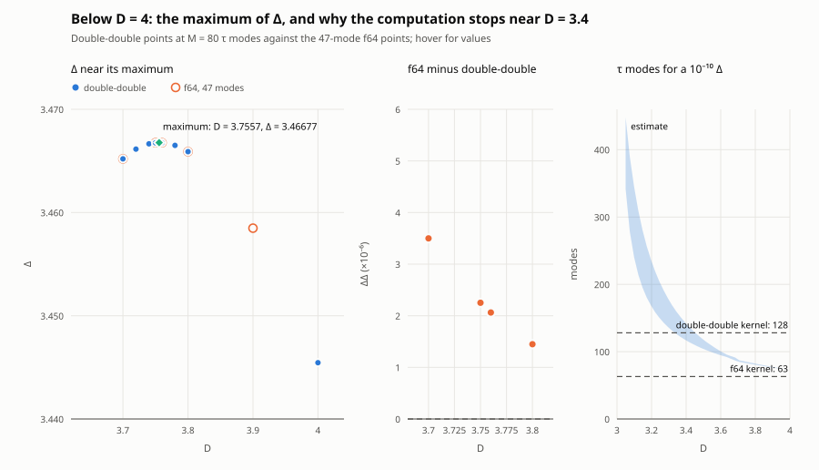
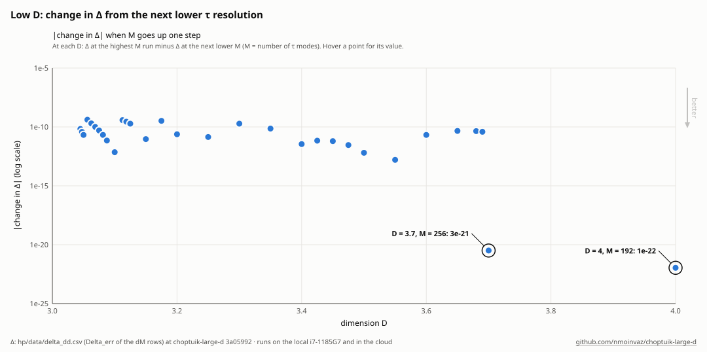
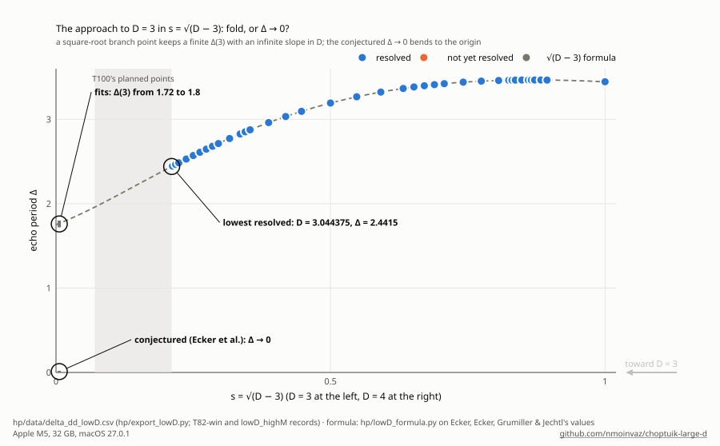

# Low D: how close to D = 3 the solvers get

Status of 2026-10-22 (cloud, 2 shared cores, load 10-25 for most of the day). Ecker et al. asked how close to D = 3
our solvers get. This note gives the values reached, the convergence evidence for each, why it gets hard, and a task
for the local machine to go further. Status words as in AGENTS.md; every number is *numerical evidence* unless marked.

## Summary

- **Lowest D with a demonstrated-converged Delta: D = 3.7** (double-double solver): Delta(3.7) = 3.46520048 +- 3e-8
  (M = 80: 3.4652004835; the bar is the last M difference, the M = 48 / 64 / 80 steps contracting 33-fold), unchanged to
  < 1e-16 by two node layouts with longer series and tighter Taylor steps (Sec. 3). gamma(3.7) = 0.34865019 +- 8e-8
  (M = 80; the M = 48 / 64 / 80 steps -5.5e-6, -8.4e-8). Both agree with Ecker et al. (2.1e-8, 7.5e-8). The f64 solver
  does not get below D = 4 with a demonstrated 1e-8; its kc 47 values at 3.64-3.7 are 3.6-5.2e-6 high (Sec. 3).
- **Validation at D = 4:** Delta = 3.4454524022410 (M = 80; M = 48 / 64 / 80 differences -2.6e-7, -1.8e-9), against
  Martin-Garcia & Gundlach's 3.445452402(3): 2.4e-10. gamma(4) = 0.3739607160 (M = 80; M = 64 differs by -4.0e-9).
- **The obstruction is representation, not precision.** Below D = 4 the echo's harmonics decay more slowly
  (|F_k| ~ e^(-beta k): beta = 0.157 at D = 4, 0.134 at 3.7, about 0.03 at 3.05 in Ecker et al.'s data) and its
  amplitude grows like (D - 3)^(-1.09). This costs modes (about 73 at D = 4, about 90 at 3.7, 104-118 at 3.5, 135-177 at
  3.3, several hundred near 3.05 for 1e-10 in Delta), and with the modes the centre and horizon series converge ever
  more slowly at the matching points, so the nodes must move toward the centre and the horizon as M grows.
- **A converged residual is not a converged answer,** twice over here: the double-double solver reached |F| = 3e-30 at
  D = 4 (M = 48) and at D = 3.7 (M = 64) on node sets whose series were still truncated at 1e-6, and Delta moved by
  1.35e-7 and 4.1e-8 when the nodes were fixed. Each value below records its series tails.
- **D -> 3:** at n = D - 2 = 1 the scalar decouples from gravity in these equations, and the free wave has no
  time-periodic self-similar solution regular at the centre and analytic at the light cone (*proved*, the n = 1 case of
  Proposition 2, checked at 40 digits). The family therefore cannot tend to a regular solution as D -> 3 (Sec. 6).

## 1. What failed before (T15, comms.txt 2026-10-20/21)

- kc 47 (solver/data/scan_lowD3_kc47.jsonl): the first step 4.0 -> 3.95 failed (|F| 1.3e-4). Re-seeded at 3.7938 and
  3.7, it reached 3.675 (|F| 1.8e-10) and 3.6425 (2.3e-9, accepted only by the relaxed NE_STRONG_TOL 2e-8), then failed
  at 3.6214 and 3.6002 (|F| 1.5e-6, 3.4e-6).
- kc 55: D = 4.0 and 3.7938 converged; at 3.7 the regridded kc 47 state landed on a false minimum (|F| 7.8e-5, the same
  point to all digits after a long LM). Continuation from 3.7938 needed steps <= 0.0125 at 1000-4800 s each, reached
  3.7689, then failed at 3.7564-3.7626 with weak residuals 8e-11 to 1.5e-10 above the 5e-11 cut.
- kc 63: only D = 4.0 was accepted (weak residual 1.6e-11), 1.0e-6 above kc 55 and above Martin-Garcia & Gundlach;
  3.7938 and 3.7 stalled at strong residuals 8e-7 and 1e-6.

Why, from Sec. 2: a seed without harmonics 49-63 is far from the kc 55/63 solution in the near-centre blocks (the
double-double solver shows it at M = 64: |F| 4e-2, all in the first block); the horizon series at u0 = 0.4 converges
ever more slowly as D falls and as the top harmonics fill in; and at kc >= 55 the top centre and horizon harmonics fall
into ne_solve's weak band, where the f64 Schur-complement step stalls at 1e-12 to 1e-10. With |dDelta/dF|_1 of 2e3 to
8e4 at kc 47 and more at higher kc, a weak residual of 1.6e-11 can be worth 1e-7 to 1e-6 in Delta: the order of the
kc 63 error at D = 4.

## 2. The obstruction, measured

### Harmonic content

`cd solver/data && python3 ../lowD_spectrum.py <state> --fit=21:35 --json=lowD_spectrum.jsonl` (planted-truth selftest:
`--selftest`), and `cd hp && python3 lowD_ecker.py <ecc> --fields` for Ecker et al.'s exported fields
(hp/data/lowD_logs/ecker_fields.log; ecc = a clone of github.com/EckerChristian/CriticalSpacetimeCrystal):

| D | source | \|F_1\| | F_3/F_1 | beta |
|---|---|---|---|---|
| 5.5 | Ecker et al., field | 3.30 | 0.333 | 0.277 (k = 9-31) |
| 4.0 | f64 kc 47 | 16.23 | 0.438 | 0.157 (k = 21-35) |
| 4.0 | Ecker et al., field | 16.21 | 0.438 | 0.161 (k = 9-31) |
| 3.875 | f64 kc 39 | 18.37 | 0.451 | 0.158 |
| 3.794 | f64 kc 47 | 20.12 | 0.459 | 0.141 |
| 3.7 | f64 kc 47 | 22.65 | 0.469 | 0.134 |
| 3.046 | Ecker et al., field | 437 | 0.558 | 0.032 (k = 9-31) |

F = sqrt(D - 2) dp/dx at x = 0, the README's normalisation (their U/x at their smallest x times sqrt(n); the D = 4
rows agree). Their D = 3.046 samples are not one exact uniform period (4% antiperiodicity error at the best period), so
that row is indicative. The kc 39 states give beta 0.01 higher than kc 47 at the same D (truncation depresses the top).

- **Amplitude:** |F_1| ~ (D - 3)^(-q), q = 0.93 between D = 4 and 3.7 and 1.09 between 3.7 and 3.046.
- **Modes:** Delta's error in the mode count falls like e^(-2 beta K): at D = 4 the steps kc 23 -> 31 -> 39 -> 47
  (README) and 47 -> 55 (T15) shrink by 12.6, 12.1, 11.2 per 8 modes, and the double-double M = 48 -> 64 -> 80 steps by
  140 per 16 (2 beta = 0.31). `cd hp && python3 lowD_cost.py` (hp/data/lowD_logs/cost.log; planted check `--selftest`)
  calibrates A e^(-2 beta K) at D = 4 and continues beta and |F_1| to 3.046 two ways: for 1e-10, K = 73 (D = 4), 81-82
  (3.8), 85-88 (3.7), 95-101 (3.6), 104-118 (3.5), 117-142 (3.4), 135-177 (3.3), 167-234 (3.2), 239-343 (3.1),
  340-450 (3.05). The double-double kernel stops at M = 128 (K = 127): 1e-10 to about D = 3.4, 1e-8 to about 3.3.
  At D = 3.7 the measured M = 48 -> 64 -> 80 steps contract 33-fold per 16 modes (0.22 per mode, less than 2 x 0.134),
  so the estimates are on the low side there: 1e-10 needs M about 90 at 3.7.

### Conditioning (f64)

`cd solver/data && python3 ../lowD_svd.py <state> --json=lowD_svd.jsonl` (exact Rust Jacobian, full SVD):

| D | kc | s_min/s_max | weakest direction | \|dDelta/dF\|_1 | weak / junk band |
|---|---|---|---|---|---|
| 4.0 | 47 | 1.9e-7 | centre p, k = 45 | 2.0e3 | 0 / 0 |
| 3.875 | 39 | 2.7e-7 | centre p, k = 37 | 5.5e3 | 0 / 0 |
| 3.794 | 47 | 4.5e-8 | centre p, k = 45 | 2.3e4 | 0 / 0 |
| 3.7 | 47 | 1.7e-8 | centre p, k = 45 | 7.8e4 | 0 / 0 |

At kc 47 nothing is near-null down to D = 3.7: the centre-data harmonics sit at 1e-5 to 1e-8, not the 1e-10 to 1e-24 of
large D. The ladder steepens as D falls (about 0.15 per harmonic at D = 4, 0.29 at 3.7), so the harmonics that 1e-10
needs at 3.7 (k about 85-90) extrapolate to about 1e-14: f64 noise. In double-double the weakest directions at D = 4,
M = 48 are the same centre harmonics at 6e-8 to 1e-6 (hp/lowD_weak.py, hp/data/lowD_weak.jsonl): no obstacle at 1e-32.
The kc 55 state in the repository (neB_kc55_rk2_D3.7689.npy) is not converged in this build (|F| 2.5e-8 at its
D = 3.7688625, all in the matching block; its file name rounds D, and at 3.7689 |F| = 1.5e-5), so its SVD row in
lowD_svd.jsonl is not used.

### Series at the matching points

f64, horizon series at u0 = 1 - x_K = 0.4 (`cd solver/data && python3 ../lowD_horizon.py <state>`, lowD_horizon.log):
the sum changes by 8.6e-11 (D = 4), 7.8e-9 (3.79), 7.6e-8 (3.7) from Ks = 60 (production) to 90; the radius in u falls
from 0.57-0.62 to 0.48-0.53. At kc 47, D = 3.7 this moves Delta by +3.7e-8 (Ks 90) and RK steps x4 by +8.8e-9
(solver/data/lowD_f64.jsonl), both far below the kc error there.

Double-double (`python3 hp/lowD_series.py <state>`, hp/data/lowD_logs/series.log):

| state | centre series, last terms | horizon series radius in u | horizon, last terms |
|---|---|---|---|
| D = 4, M = 48 | 6.7e-6 at x = 0.02 with 60 terms; 2.3e-23 at 0.01 | 0.455 | 5.7e-7 at u = 0.4 with 100; 2.8e-37 at 0.3 with 200 |
| D = 3.7, M = 64 | 4.2e-5 at x = 0.01 with 60, 2e-8 with 100; 6e-38 at 0.005 with 100 | 0.316 | 3.9e-6 at u = 0.3 with 200; 7e-41 at 0.2 with 200 |

The radius of the horizon series shrinks as D falls and as M grows (at D = 3.7, 0.47 at M = 48 from its tail, 0.32 at
M = 64), and the centre series' radius is about 0.025 at D = 4 and about 0.012 at 3.7. So the node set has to follow:
first node 0.02 -> 0.01 -> 0.005, last node 0.6 -> 0.7 -> 0.8, with 80-100 centre and 200-250 horizon terms. The
solver's tails are recorded with every point (tail_c, tail_h in hp/data/lowD_dd.jsonl); hp/lowD_dd.py --auto_nodes
extends the nodes during a continuation when they exceed 1e-30.

### Newton and cost

From an f64 kc 47 seed the double-double Newton goes straight to M = 64 only by failing (line search at |F| 4.3e-2, all
in the first block; filling the missing harmonics by each field's geometric trend, `--fill_tail`, only brings the start
to 1.4e-2). Through M = 48 it converges in 5-11 Jacobians (linear at first, then quadratic); each higher M from the
lower M's solution in 4-6. Time per Newton iteration here (2 threads; hp/data/lowD_dd.jsonl, seconds / its): under a
load of about 20, 260-340 s at M = 48, 625 s at M = 64, 865 s at M = 80; with the machine nearly idle, 180-280 s at M =
64 and 400 s at M = 80. Roughly M^3 at fixed load, so about 2100 s at M = 96 and 5000 s at M = 128 under load.

## 3. Converged points

Double-double, `python3 hp/lowD_conv.py` (hp/data/lowD_logs/conv.txt). Error = the last M difference when the
contraction between successive differences is below 0.5 (an estimator, tested on planted sequences: `--selftest`;
`--mutate` must refuse an unconverged one).

| D | Delta | M = 48 / 64 / 80 differences | other discretisation | tails (centre, horizon) | gamma |
|---|---|---|---|---|---|
| 4.0 | 3.4454524022 +- 1.8e-9 | -2.6e-7, -1.8e-9 (ratio 0.007) | nodes 0.005..0.8, 100/250 terms, step tol 1e-30, at M = 64: < 1e-16 | 5e-57, 9e-31 | 0.3739607120 (M = 64), 0.3739607160 (M = 80) |
| 3.7 | 3.46520048 +- 2.8e-8 | -9.35e-7, -2.83e-8 (ratio 0.030; geometric tail 9e-10) | nodes 0.0025..0.9, 120/300 terms, step tol 1e-31 against 0.005..0.8, 100/250, 1e-30, at M = 64: < 1e-16 | 2e-85, 4e-70 | 0.3486501896 (M = 80; steps -5.5e-6, -8.4e-8) |

Node sets: D = 4 on 0.01, 0.02, 0.05, 0.1, 0.16, 0.23, 0.3, 0.4, 0.5, 0.6, 0.7 (80 centre / 200 horizon terms); D = 3.7
on 0.005, 0.01, then the same, and 0.8 (100 / 250 terms, step tolerance 1e-30). At D = 3.7 the 0.01..0.7 set is exact at
M = 48 (< 1e-16 from the wider set) but 4.1e-8 off at M = 64, where its series tails are 5e-7 and 4e-6: the node set has
to follow M.

- D = 4 against others: Martin-Garcia & Gundlach 3.445452402(3) (2.4e-10); f64 kc 55 3.4454524280 (+2.6e-8);
  f64 kc 47 3.4454526772 (+2.75e-7); Ecker et al. 3.445452682 (+2.8e-7, their 512 modes).
- The f64 solver at D = 3.7 (solver/data/lowD_f64.jsonl): kc 39 3.4652276243, kc 47 3.4652040679 (+3.6e-6 from the
  double-double value), Ks 90 +3.7e-8, RK x4 +8.8e-9. Its kc 47 points at 3.675 and 3.6425 are 4.7e-6 and 5.2e-6 above
  Ecker et al.'s interpolated values. Pushing it lower needs kc of 95-120 (Sec. 2), a kernel size above Ctx<96>, and
  directions near f64 noise: it is stopped at D = 3.7, without a demonstrated 1e-8 even there (kc 55 / 63 did not
  converge at 3.7 in T15).
- What the double-double and f64 values share: the field equations and gauge, the multiple-shooting idea with a
  centre and a horizon series; not the code, the tau discretisation (collocation vs dealiased Galerkin), the
  x-integration (Taylor vs RK4) or the precision.

## 4. gamma

- Double-double, `python3 hp/lowD_gamma.py <out> <state> --lam0=<guess>` (root of det M(lambda), the hp kernel's
  growth-mode matrix; hp/data/lowD_gamma.jsonl): gamma(4) = 0.3739607120 / 0.3739607160 at M = 64 / 80 (Ecker et al.
  0.373961 +- 1e-6; f64 kc 55 0.3739607061); gamma(3.7) = 0.3486557785 / 0.3486502734 / 0.3486501896 at M = 48 / 64 / 80
  (Ecker et al. 0.3486502642; f64 kc 47 0.3486495942).
- f64 (Rust mode matrix): gamma(3.7) = 0.3486470 (kc 39), 0.3486496 (kc 47).
- **gamma(3.5) by extrapolation** (`python3 hp/lowD_gamma_extrap.py <ecc>`, hp/data/lowD_logs/gamma_extrap.log): from
  our points at 3.6425-4.0, degree-2 and -3 fits, gamma(3.5) = 0.3235 +- 0.0030 (twice the spread of the fits; an
  estimator range). The rule was first applied to Ecker et al.'s gamma curve at the same D and contained their
  gamma(3.5) = 0.32239 (error 1.1e-3); `--mutate` (a curve turning by 0.01) fails it. Our points sit within 8e-7 of
  their curve.
- Against Bland et al. 2005 (Table I): 0.349 +- 0.003 at 3.5 is 0.0255 above, more than four times the two ranges added;
  Ecker et al.'s direct 0.32239 and Bland's 2007 thesis value 0.3235 +- 0.0018 *(unverified, from Ecker et al.'s data
  file)* agree with ours. So the 2005 value at 3.5 looks wrong; the README's "gamma(3.5) <~ 0.33, an open check" can be
  replaced.

## 5. Comparison with Ecker et al.

`python3 hp/lowD_ecker.py <ecc>` tabulates their Fortran data per Fourier resolution (128 / 256 / 512 / 1024) for D <= 4
and our values at their D. Their own resolution changes 256 -> 512 in Delta: 8.9e-10 (D = 4), 3.0e-8 (3.7), 4.9e-7
(3.5), 1.8e-5 (3.3), 2.2e-4 (3.2), 1.0e-3 (3.15), and alternate in sign (128 -> 256 is -8.5e-8 at 3.7): their Fourier
error is not the limit at D >~ 3.6, while at D = 4 their 512-mode value is 2.8e-7 above Martin-Garcia & Gundlach and
ours, an error their Fourier test cannot see. At common D:

| D | ours | Ecker et al. (512) | Ecker - ours |
|---|---|---|---|
| 4.0 | 3.4454524022 (dd, M = 80) | 3.4454526819 | +2.8e-7 |
| 4.0 | gamma 0.3739607160 (dd, M = 80) | 0.3739606641 | -5.2e-8 |
| 3.7 | 3.4652004835 (dd, M = 80) | 3.4652005045 | +2.1e-8 |
| 3.7 | gamma 0.3486501896 (dd, M = 80) | 0.3486502642 | +7.5e-8 |
| 3.7938 | 3.4661208961 (f64 kc 47) | 3.4661193384 (interpolated) | -1.6e-6 |
| 3.675 | 3.4633685949 (f64 kc 47) | 3.4633638579 (interpolated) | -4.7e-6 |
| 3.6425 | 3.4597739279 (f64 kc 47) | 3.4597686847 (interpolated) | -5.2e-6 |

(hp/data/lowD_logs/ecker_compare.log.) At D = 3.7 the two independent computations agree to 2.1e-8 in Delta and 7.5e-8
in gamma, inside our bars (2.8e-8, 8.4e-8) and their 256 -> 512 change of 3e-8; at D = 4 they are 2.8e-7 apart in
Delta, their error (ours agrees with Martin-Garcia & Gundlach to 2.4e-10).

Their maximum (Eq. 70, D = 3.755726, Delta = 3.466772) agrees with the README's kc 47 estimate to 2e-6. Below 3.7 they
are, as far as we can check, the only values; with their 256 -> 512 changes they are good to about 5e-7 at 3.5, 2e-5 at
3.3 and 1e-3 at 3.15, and they need 1024 modes below 3.2. Sec. 6.2 and Appendices C, D of their paper could not be read
(the fetched text ends in Sec. 6).

## 6. What should happen as D -> 3

- **At n = 1 the equations decouple** (`python3 solver/lowD_n1_check.py`, solver/data/lowD_n1_check.log): in
  solver/dss.py's equations c_x = c (n - 1)(a^2 - 1)/x vanishes, so c = c(tau, 1) = 1 by the gauge, and the p, m
  equations no longer contain a: the scalar obeys the free 2+1 wave equation in self-similar form (checked on the code's
  right-hand side; the control n = 1.01 shows the coupling).
- **The free wave cannot echo at n = 1.** Proposition 2's argument goes through at kappa = (n + 1)/2 = 1: the solution
  regular at the centre is p - m = x 2F1((1+s)/2, (2+s)/2; 1; x^2) (the other one has a logarithm), and its coefficient
  of the non-analytic light-cone branch (1 - x^2)^(-1/2 - s) is C(1, s) = Gamma(s + 1/2)/(Gamma((1+s)/2) Gamma(1 +
  s/2)), with no zero for imaginary s != 0 (*proved*; the solution, both first-order equations and Gauss's connection
  formula checked at 40 digits for mu = 1, 3, 5 and omega = 1-3.82, |C| >= 0.13 there; a wrong kappa makes the check
  fail).
- **Consequence.** A regular finite-amplitude limit of the family at D = 3 would be a nonzero periodic regular solution
  of the free equation, which does not exist. So as D -> 3+ the family degenerates. The data show how: |F_1| grows like
  (D - 3)^(-1.09), the spectrum flattens (beta from 0.157 at D = 4 to about 0.03 at 3.046) and the series radii shrink,
  consistent with Ecker et al.'s narrow, large-amplitude peaks (their Psi reaches about 3e5 at 3.05). That the field has
  to grow until (D - 3) a^2 is of order one, gravity's only coupling being the factor n - 1, is a heuristic
  (*conjecture*). Their conjecture Delta -> 0 (fit 3.878 (D - 3)^0.15 on 3.01-3.05 in their plotting notebook) is not
  tested here.
- **2+1 itself** (Lambda < 0 is needed for black holes): the critical solution is continuously self-similar with a
  scalar linear in tau (c != 0), modelled by Garfinkle's n = 4 solution; gamma = 8/7 predicted, 1.23(4) measured
  (Jalmuzna, Gundlach & Chmaj, PRD 92, 124044 (2015), arXiv:1510.02592); the review of Gundlach, Hilditch &
  Martin-Garcia (arXiv:2507.07636, Sec. IV.A.1) quotes gamma = 1.20 +- 0.05 (Pretorius & Choptuik). Nothing ties that
  solution to the D -> 3+ limit of the asymptotically flat family: Delta -> 0 would suggest a CSS limit, gamma -> 0
  would not match.

## 7. Proposed task for the local machine

Double-double below D = 3.7: Delta and gamma with M = 96 / 128 and a node-set variant, down to D = 3.3. Needs this
branch (hp/lowD_dd.py with --Dlist / --auto_nodes, the states hp/data/lowD_states/lowDv_D3.7000_M{64,80}.npz); hpkernel
as built for T17 (hp/src unchanged since e0c77e5). From the repo root, every process `--threads 1` at below-normal
priority, at most 6 at a time, output to the logs named.

- **A (pilot and chain, 1 process).** M = 96 at 3.7, then continuation in steps of 0.05:

      python -u hp/lowD_dd.py hp/data/lowD_dd_local.jsonl --start hp/data/lowD_states/lowDv_D3.7000_M80.npz --nodes
      0.005,0.01,0.02,0.05,0.1,0.16,0.23,0.3,0.4,0.5,0.6,0.7,0.8 --Ms 96 --kcs 100 --ks 250 --tol_step 1e-30 --it_max 30
      --threads 1 --tag lowDv --resume --auto_nodes --Dlist 3.65,3.6,3.55,3.5,3.45,3.4,3.35,3.3 >
      hp/data/lowD_logs/local_A.log 2>&1

  Pilot rule: after 3.65, report the time per Newton iteration (expected about 15 min, a point in 4-6) and stop if the
  projected total exceeds 24 h. It stops by itself when a step below 0.005 fails; it restarts with the same command.
- **B (as A's points appear, up to 4 processes).** For each new state S = hp/data/lowD_states/<tag>_D<D>_M96.npz at
  D = 3.6, 3.5, 3.4, 3.3 (use the nodes and tag that S was solved with; auto_nodes changes them, the tag says how):

      python -u hp/lowD_dd.py hp/data/lowD_dd_local.jsonl --start S --nodes <S's nodes> --Ms 128 --kcs 100 --ks 250
      --tol_step 1e-30 --it_max 30 --threads 1 --tag <S's tag> --resume > hp/data/lowD_logs/local_B_<D>.log 2>&1 python
      -u hp/lowD_dd.py hp/data/lowD_dd_local.jsonl --start S --nodes <S's nodes> --Ms 80 --kcs 100 --ks 250 --tol_step
      1e-30 --it_max 30 --threads 1 --tag <S's tag> --resume >> hp/data/lowD_logs/local_B_<D>.log 2>&1 python -u
      hp/lowD_gamma.py hp/data/lowD_gamma_local.jsonl S --threads=1 > hp/data/lowD_logs/local_G_<D>.log 2>&1

  M = 128 is about 35 min per iteration locally (3-4 h per D); gamma about 8 determinants at M = 96 (2 h).
- **C (optional, 1 process):** f64 kc 55 / 63 at D = 3.7 from the double-double state, to see whether the f64 solver
  converges in kc there:
  `python -u solver/lowD_f64.py solver/data/lowD_f64_local.jsonl --dd hp/data/lowD_states/lowDv_D3.7000_M80.npz --kcs 55,63 --rks 2 --Ks 90 --threads 1 --gamma > solver/data/lowD_f64_local.log 2>&1`
  (needs rustkernel at cf79fba or later).
- **Stop conditions:** a record with "converged": false that a rerun does not fix; M = 128 differing from M = 96 by more
  than 1e-8 at some D (that D is then not resolved: finish it, then stop the chain); --auto_nodes asking for a first
  node below 0.0025; 24 h in all.
- **Push:** hp/data/lowD_dd_local.jsonl, hp/data/lowD_gamma_local.jsonl, the *_M96 and *_M128 states (not *_ckpt),
  hp/data/lowD_logs/local_*.log, solver/data/lowD_f64_local.*, and in the comms note the output of
  `python hp/lowD_conv.py hp/data/lowD_dd.jsonl hp/data/lowD_dd_local.jsonl`.

## 8. Proposed README text

For "Relation to published work", replacing the "Below D = 4" bullet:

> - **Below D = 4.** The double-double solver, with its first node moved to x = 0.005 and its last to 0.8 (the series
>   there converge ever more slowly as D falls), gives Δ(3.7) = 3.46520048 ± 3×10⁻⁸ and γ(3.7) = 0.34865019 ± 8×10⁻⁸,
>   converged in the τ resolution (48, 64 and 80 points) and in the node layout (notes/LOW_D.md); Ecker et al. 2026 give
>   3.4652005 and 0.3486503 there. The f64 points below D = 4 (47 Fourier modes) are 2-5×10⁻⁶ high in Δ. Extrapolated
>   from 3.64 ≤ D ≤ 4, γ(3.5) = 0.3235 ± 0.0030, in agreement with Ecker et al.'s 0.32239 and not with Bland et al.'s
>   0.349 ± 0.003. The modes needed grow from about 73 at D = 4 to about 110 at 3.5 and several hundred near 3.05, and
>   at D = 3 the scalar decouples from gravity in these equations, so the family cannot reach a regular D = 3 limit.

and in "The formula", the sentence "Below D = 4 the formula is not fitted; Δ(D) turns over there." can point to
notes/LOW_D.md for the converged values below 4.

## 9. Literature read for this note

- Ecker, Ecker, Grumiller & Jechtl, SciPost Phys. 20, 176 (2026), arXiv:2602.10185: Secs. 1-5 read (arXiv PDF text);
  Sec. 6.2 and Appendices C, D not read (text truncated); their data repository used instead. Range 3.05 <= D <= 5.5;
  "numerically too costly to go below D = 3.05"; narrow, large-amplitude peaks of Psi near the centre; N_x = 1.55e5 at
  D = 3.05, 8000 at D >= 4; N_tau = 512 enough for D >~ 3.2, at least 1024 below; x_L = 5e-5 for D < 3.1; results
  "converge to machine precision for any number of Fourier modes" but differ from the continuum limit; about 1e-6
  claimed at D = 4 and at the maximum; conjecture Delta -> 0 and gamma -> 0 as D -> 3+.
- Jalmuzna, Gundlach & Chmaj, PRD 92, 124044 (2015), arXiv:1510.02592 (abstract and text read; DOI from the arXiv page).
- Gundlach, Hilditch & Martin-Garcia (2025), arXiv:2507.07636, Sec. IV.A.1-2 (read).
- Bland, Preston, Becker, Kunstatter & Husain, gr-qc/0507088, Table I (read): gamma(3.5) = 0.349 +- 0.003 from fits of
  the apparent-horizon radius in evolutions, the error the a* range over which the fit stays good, "about 1%". Bland's
  2007 thesis values are from Ecker et al.'s data file plots/gBlandThesis.dat *(unverified)*.

## Files

Scripts: hp/lowD_dd.py, hp/lowD_conv.py, hp/lowD_gamma.py, hp/lowD_gamma_extrap.py, hp/lowD_cost.py, hp/lowD_ecker.py,
hp/lowD_series.py, hp/lowD_weak.py, solver/lowD_spectrum.py, solver/lowD_svd.py, solver/lowD_horizon.py,
solver/lowD_f64.py, solver/lowD_n1_check.py. Data: hp/data/lowD_dd.jsonl, hp/data/lowD_gamma.jsonl,
hp/data/lowD_weak.jsonl, hp/data/lowD_states/, hp/data/lowD_logs/, solver/data/lowD_*.jsonl, solver/data/lowD_*.log,
solver/data/lowD_f64_*.npy. The f64 kc 55 / 63 runs used a rustkernel built from this tree (cf79fba) into a private
directory, bitwise equal to the installed one at kc 47.

## 10. The gap 4 < D < 8.25 in double-double (T79, win, 2026-10-27; folder T79-win of the raw-data repository)

Until T79 the README's Δ for D = 5–7 and γ for D = 5–8 came from the f64 solver. T79 ran `scan_hp.py` down from the
D = 8.25 state at M = 48 (kt 36, kc 60, ks 100, corrector dnp, tol 1e-27) to D = 4 in steps of 0.25 (22 points, every
|F| 2–5×10⁻³¹, 65–170 s each), then `relayout.py` at M = 64 at D = 8, 6, 5 and 4, and `gamma_batch.py` at every
point. `hp/t79_rows.py` puts the records into the low-D exporter's inputs (`data/lowD_dd_t79.jsonl`,
`data/lowD_gamma_t79.jsonl`); `hp/data/delta_dd_lowD.csv` and `delta_dd.csv` hold the rows (run names lowD-M48,
lowD-M64; the M 48 points without an M 64 check are "unresolved" there, converged but not checked in M).

| D | Δ (M 48) | Δ(M 64) − Δ(M 48) | γ (M 48) |
|---|---|---|---|
| 8 | 2.711790054444401 | 9.5×10⁻²¹ | 0.446716389 |
| 7 | 2.842753206466524 | (not run) | 0.439991242 |
| 6 | 3.009483220493004 | −3.0×10⁻¹⁴ | 0.430079481 |
| 5 | 3.221701944618060 | +8.7×10⁻¹² | 0.413126936 |
| 4 | 3.445452661587394 | −2.6×10⁻⁷ (the earlier M 64 point; T79's M 64 re-solve at D = 4 did not converge, \|F\| 0.23 after 30 steps) | 0.373960289 |

The M 48 value at D = 4 reproduces the earlier low-D run's M 48 value to every digit. The M 48 truncation falls from
2.6×10⁻⁷ at D = 4 to 10⁻²⁰ at D = 8, so the points at D ≥ 5 are quoted to the M 64 check (10⁻¹¹ at D = 5, and Δ(7),
unchecked, to 10⁻¹¹ by its neighbours); γ to 10⁻⁹ (its M 48 value; at D = 4 the M 48 → 64 change in γ is 4×10⁻⁷, at
D ≥ 5 it was not measured). The growth-rate roots agree with the f64 formula's λ to 10⁻⁸–10⁻⁶. Not a stop, for the
record: the task's note expected the D = 4 value within 10⁻¹⁰ of the M 192 one; 2.6×10⁻⁷ is the known M 48 truncation
there, so the expectation was wrong, not the run.

## 11. The continuation below D = 3.4 (from the README)

Moved verbatim from README.md (commit ea42b3e, lines 269–285, 298–323, 325–330, 349–354) on 2026-11-04
(notes/README_PLAN.md); links made relative to this folder.

**Below D = 4** (`hp/plot_lowD.py`). Left: the double-double points at M = 80 and the 47-mode f64 points near the
maximum. Middle: the f64 points sit 1.5–3.5×10⁻⁶ high there. Right: the τ modes a 10⁻¹⁰ Δ needs (`hp/lowD_cost.py`, an
estimate over four model variants, not a bound) pass 128 near D = 3.4 and run into the hundreds near D = 3. The kernel
now runs to M = 384: a continuation in double-double reached D = 3.15, Δ = 2.96131964246 (the change from M = 192 to 256
is 9×10⁻¹²), where M = 160 already gives Δ to 10⁻⁸. Calibrated on it, the model put D = 3.05 at M = 256–384. The
run reached D = 3.05 at M = 320/384, Δ = 2.4849271637881, where the step from M = 320 to 384 is 2.1×10⁻¹¹ (the
resolution step, not a bound; [notes/HIGH_M.md](HIGH_M.md)). Below it the continuation at steps of 0.0025
(`hp/lowD_highM.py` from that run's states, on the Windows machine; its records are in the raw-data repository's folder
T82-win, which `hp/export_lowD.py` reads) has
reached D = 3.045 at M = 320/384, Δ = 2.4464747274662, with the step from M = 320 to 384 6.7×10⁻¹¹, 3.2 times the step at 3.05;
the run then stopped on its own time rule, and the legs `down25b` and `down25c` in the same folder went for D = 3.0425:
there the M = 320 Newton solve from the 7640-step Taylor plan (5082 steps at 3.045) started at |F| 0.34 and damped twice
(line-search factors 0.125 and 0.031), on which the script gave up and the run was stopped on 2026-11-01
(T82-win/down25c.log, commit 28545dc of the raw-data repository); whether the leg goes on is open. A first attempt that
went from 3.05 to 3.045 in one step of 0.005 crawled in Newton at M = 320 and was stopped (T82-win/down5.log).

Below D = 3.4: the resolution step at each D, and the node changes on the way

Below that the larger grids take over
(M = 128 → 160 → 192 → 256, each step one to two orders smaller than the one before): at D = 3.15 the step from 192
to 256 is 9×10⁻¹², and at 3.125, 3.11875, 3.1125 and 3.1 it is 1.9, 2.8, 3.8 and 5.5×10⁻¹⁰; at 3.1 the next
step, 256 → 320, is 7.2×10⁻¹³. At 3.0875 the steps are 1.8×10⁻⁹ and 7.0×10⁻¹², ten times those at 3.1 for 0.0125
in D, at 3.08125 4.3×10⁻⁹ and 2.1×10⁻¹¹, at 3.075 1.0×10⁻⁸ and 5.0×10⁻¹¹, at 3.06875 2.3×10⁻⁸ and 1.0×10⁻¹⁰,
at 3.0625 4.8×10⁻⁸ and 2.0×10⁻¹⁰, and at 3.05625 9.3×10⁻⁸ and 4.1×10⁻¹⁰, each about twice the one before. At 3.05
(the lowest point of that run) M = 192 did not converge, the step from 256 to 320 is 1.2×10⁻⁹, 2.9 times the one at
3.05625, and the step from 320 to 384 is 2.1×10⁻¹¹, 56 times smaller. At 3.0625 the M = 256
solution lifted to M = 320 had a centre-series tail of 8×10⁻¹⁸, above the run's 10⁻²⁰, so the first node was halved
(0.000313 to 0.000157, 21 nodes); there the M = 256 tail fell from 4×10⁻⁵⁴ to 2×10⁻⁹⁴ and the pair moved Δ by
5×10⁻³¹. At 3.075 the M = 320 horizon-series tail, 5×10⁻³³, was above the run's 10⁻³³ bound,
so a node was added at 0.975, taken from
the horizon series (integrating out from 0.95 passed the series' nearest singularity and gave NaN); on the 20 nodes
the tails are 3×10⁻⁵⁷ and 10⁻¹⁰⁷ and Δ moved by 2×10⁻³⁰. At D = 3.40 the second machine's M = 128 Newton (13
nodes) converged to a solution with content along the near-null directions (its centre-series tail 10⁻⁹, against
10⁻⁵⁰ at 3.425); the CSV lists it as polluted and does not use it. The cloud's M = 128 solve there (15 nodes) is clean
(centre tail 4×10⁻⁷⁶). From it the Mac lifted D = 3.4 to M = 160. The second machine's 13-node states at 3.425–3.65 do
not lift as they are (resampled at 3.425 the start has |F| = 3×10⁴, and at 3.5 Newton stalls); re-noded to the 15 nodes
first (`hp/highm_check.py lift --nodes=...`), they do. The steps of these lifts, M = 128 → 160, are 3.5×10⁻¹² (3.4),
6.8×10⁻¹² (3.425), 6.2×10⁻¹² (3.45), 2.9×10⁻¹² (3.475), 6.4×10⁻¹³ (3.5) and 1.6×10⁻¹³ (3.55), and M = 96 → 128 at 3.65
is 4.6×10⁻¹¹: from D = 3.4 to 3.65 every value is now resolved to 5×10⁻¹¹ or better.

**The last resolution step at each D** (`hp/plot_errors.py`, from `Delta_err` in
[`hp/data/delta_dd.csv`](../hp/data/delta_dd.csv); rerun it after `hp/export_dd.py`). The right panel above on a log
scale, one point per D: the step into the largest M run there. At D = 3.7 and 4 the grids were taken to M = 256 and
192, far past what Δ needs, and the last step falls to 3×10⁻²¹ and 10⁻²². Below 3.7 it is 7×10⁻¹³ to 3×10⁻⁹.

The same values against s itself (`hp/plot_lowD_sqrt.py`). D − 3 is the exponent of gravity's reach, r^−(D−3), so
D = 3 is where attraction switches off; a square-root branch point there keeps Δ finite at s = 0 with an infinite
slope in D (the fits' intercepts are the bar at s = 0), while the conjectured Δ → 0 bends toward the origin. The two
readings separate in the shaded band, where the T100 leg's planned points land.

## 12. The T100 stall at D = 3.04375 was a stale checkpoint (2026-11-04)

The diagnosis of T100's stop (comms 2026-11-03 23:59 UTC, "the lam-rule stop ... is right") read the second attempt,
`down25e`, as a stall from its best start. It was not one. That attempt formed the M 320 predictor on its own plan
(|F| 6.6×10⁻⁴, 6623 steps; `T100-win2/down25e.log` of the raw-data repository, lines 63–68) and then
`lowD_dd.solve_point` resumed `lowDhm_x0.000157-0.975_p1_D3.0438_M320_ckpt.npz` (line 69: "resuming from checkpoint
... (iteration 4)"), the state of the first attempt `down25d` after four damped steps, with that attempt's 4992-step
plan and |F| 1.0×10⁻² (line 70). `solve_point` resumes any checkpoint of the tag and keeps its plan
(`hp/lowD_dd.py`, the `a.resume` branch), and `lowD_highM.py` renames a checkpoint to `_failed` only when a solve
returns a failure; `down25d` was stopped by the line-search rule from outside, so its checkpoint kept its name and is
still in `T100-win2/states/`. The predictor start has never been solved, and the reading "stalls again with the same
pivot drop" is not established. T100 also ran at `--threads 4` (the 2026-11-03 02:15 UTC command), where its folder's
README says 6. Found by the code analysis of [LOW_D_SPEEDUP.md](LOW_D_SPEEDUP.md); before any rerun the stale
checkpoint is moved aside, and `solve_point` should refuse a checkpoint whose plan is not the start's.

## 13. T105: thread scaling on win2 and the leg restarted from its predictor (procedure, 2026-11-04 06:10 UTC)

Written before the run. Steps 1 and 2 of the plan in [LOW_D_SPEEDUP.md](LOW_D_SPEEDUP.md). Machine win2, from `hp\`
of the t98 worktree with venv-hp, after `git pull --ff-only` in it and in the raw clone (main has the resume rule of
section 12 in `hp/lowD_dd.py`, Python only, no rebuild). Output folder `T105-win2/` of the raw-data repository.

**A. The resume rule.** `python test_ckpt_resume.py` exits 0 ("all 5 cases pass") and `python test_ckpt_resume.py
--mutate` exits 1 (the former rule fails cases 2–4). Otherwise stop.

**B. Thread scaling and bit identity, beside T104 and the T99 nodes.** For N = 4, 8, 12, 16 in turn:
`python highm_check.py profile --M=320 --threads=N --reps=1 --no_dtau_split --out=<T105>\profile_M320.jsonl`, with a
`util_report.py` line after each. Reference: T98 measured 384 s per call at 4 threads and 240 s at 8 on an 825-step
plan (`T98-win2/hp_build/profile_M320.jsonl`). Then `python highm_check.py scaled
--compare=..\..\choptuik-large-d-raw\T81\scaled_main.json --Ms=192,256 --threads=N` at N = 4 and 16: exit 0, the
control firing. A differing hash stops the task (a result that depends on the thread count is a finding, not a
setting to choose). The leg's thread count N* is the smallest tested N whose `newton_mixed` time is within 1.1× of the
fastest.

**C. The leg from D 3.044375.** `python lowD_highM_leg.py
..\..\choptuik-large-d-raw\T100-win2\down25e.jsonl.progress.json
<T105>\down25f.jsonl --targets 3.04375,3.0425,3.04,3.0375,3.035,3.0325,3.03,3.0275,3.025,3.0225,3.02,3.0175,3.015,3.0125,3.01,3.0075,3.005
--states data\lowD_states,..\..\choptuik-large-d-raw\T100-win2\states,..\..\choptuik-large-d-raw\T82-win\states
--killed` must print (a dry run on the Mac on the pushed files) "M 320/384 (helper 256), last D 3.044375, targets
[3.04375, 3.0425, ...], 9 / 4 history states, nodes 0.000157..0.975"; exit 1 stops the task. Then T100's down25e
command with `--threads N*`, `--out <T105>\down25f.jsonl`, `--points <T105>\down25f_points.jsonl` and `--states
<T105>\states`, log `<T105>\down25f.log`. Its first lines read "resuming: M 320/384, last D 3.044375" and "--- D 3.04375
(from 3.044375)"; the M 256 helper takes its one iteration and fails, as at every point since 3.0475; the M 320
predictor should read |F| 6.60×10⁻⁴ on its own 6623-step plan (as in down25e, the same history), a different value is
posted, not a stop.

**What it decides.** Pass: the M 320 solve at D 3.04375 converges from the predictor, and the leg continues by itself (M
384, then the targets; the script halves a failed step down to 0.0005). Then the stall of section 12 was the stale
checkpoint. Fail: two consecutive M 320 or M 384 steps with a line-search factor ≤ 0.5 while |F| is above 10⁻⁴ (the rule
of the 2026-11-03 02:15 UTC entry): stop the tree, post the lines, no relaunch; then the branch or the Jacobian near D
3.044 is the question, and the next attempt is the exact Taylor predictor (LOW_D_SPEEDUP.md step 4). Other stops: the
script's own, and a process above 8 GB. Expected cost: A and B about 1.5 h; the first point 3–8 h by N*; the 17 targets
with their halvings several days.

**A and B (2026-11-04 06:55 UTC, win2; `T105-win2/` at 746ef43).** A passes (5 of 5, the mutation fails cases 2–4). B:
`newton_mixed` at M 320 takes 377.5, 236.8, 201.5 and 205.1 s at 4, 8, 12 and 16 threads, so a call saturates near 12
threads at 1.87× the 4-thread time (T98: 384 and 240 s at 4 and 8); N* = 12. `scaled` passes at 4 and 16 threads with
the control firing: the kernel is bit-identical across the thread count. C started at 06:57 UTC at 12 threads.

**C, the first point (2026-11-04 15:51 and 16:15 UTC, win2; `T105-win2/` at 92eb104).** D 3.04375 converged from the
predictor at M 320 (|F| 6.4×10⁻²⁹) and M 384 (5.7×10⁻²⁸), so the stall of section 12 was the stale checkpoint, the pass
case above. Δ = 2.4364591133608267 at M 320 and 2.436459113272686 at M 384, a change of 8.8×10⁻¹¹ (the leg's err_est in
`down25f.jsonl`). The point took 9.28 h, 10051 s at M 320 and 22169 s at M 384, and the M 256 helper failed as at every
point since 3.0475. The M 320 Δ is criterion 4's value for the T106 pilot's rerun. `hp/export_lowD.py` now reads
`T105-win2`, and the point is the lowest of `hp/data/delta_dd_lowD.csv`. It lies 1.6×10⁻⁵ from the √(D − 3) formula, the
largest gap of any point, after 1.3×10⁻⁵ at 3.044375 and 1.1×10⁻⁵ at 3.045 (the README's figure caption). The leg
continues on D 3.0425.

## 14. T106: hp with the jet residual at every M, and the exact Taylor predictor at M 320 (procedure, 2026-11-04 06:50 UTC)

Written before the run. Step 4 of [LOW_D_SPEEDUP.md](LOW_D_SPEEDUP.md). The change is on branch `feat/jet-all-sizes`
(a2f5d9a): `residual_jet_sized` in `hp/src/python.rs` is generic in the block size, so the jet residual exists at every
M the kernel builds (it was instantiated for M 32, 48 and 64 only), and `hp/anm_lowd.py` is the pilot. Machine win2,
after T105's parts A and B (so that the build does not disturb B's timings), beside T105's leg, T104 and the T99 nodes.
Output folder `T106-win2/`.

**A. Build**, as T98 did (`T98-win2/README.md`): a detached worktree `..\choptuik-t106` at `origin/feat/jet-all-sizes`,
a new venv `venv-t106` (numpy, scipy, maturin, mpmath), `pip uninstall -y multidouble`, `bash hp/build.sh`, with the
wall time and the peak memory of the build recorded. The running T105 keeps venv-hp and is not touched. Stops: a
compile error (post it; the fix is mine), or a build above 3 h or 32 GB.

**B. Nothing else changed**, at the new build, from `hp\` of the new worktree: `python highm_check.py ref
--compare=..\..\choptuik-large-d-raw\T81\ref_main.json --Ms=48,64,80` and `python highm_check.py scaled
--compare=..\..\choptuik-large-d-raw\T81\scaled_main.json --Ms=192,256`, each exit 0 (the AVX2 build passed both bit for
bit in T98). Then `python jet_check.py ..\..\choptuik-large-d-raw <T106>\jet_check.jsonl --state T75/pin7_D73.2657.npz
--N 16 --hs 1e-14,1e-13,1e-12 --kfreeze 13`: exit 0, and its `coef_norms` equal to those of the last record of
`anm-mac/jet_check.jsonl` digit for digit (the generic instance at M 32 is the same code as the former one). Any
difference stops the task.

**C. Smoke test** at M 48: `python anm_lowd.py ..\..\choptuik-large-d-raw <T106>\smoke --state <the checkout's>
hp/data/lowD_states/lowD_D4.0000_M48.npz --checks "" --target 3.99 --N 4 --newton_its 1 --threads 4` (the state path
relative to RAWDIR does not apply here; pass it as `..\choptuik-large-d\hp\data\lowD_states\lowD_D4.0000_M48.npz`
relative to the raw clone, or copy the state into `<T106>\smoke\`). It must reach its `done` record; its numbers are
not judged.

**D. The pilot at M 320**: `python -u anm_lowd.py ..\..\choptuik-large-d-raw <T106>\pilot_M320 --threads T` with T =
max(4, 16 − N*) (N* of T105), the defaults otherwise: base D 3.045 (`T82-win/states/..._D3.0450_M320.npz`, its own
2348-step plan), N = 15 orders, checks at D 3.044375 (`T100-win2`) and 3.0475 (`T82-win`), target 3.04375, Newton at
most 6 calls. Criteria, fixed now:
1. The control fires: with the dimension frozen the first order's right-hand side is below 10⁻¹⁰ of the real one
   (the script stops otherwise, exit 1).
2. Every order's GMRES converges within 40 products; the products per order are recorded.
3. At D 3.044375 (h = −0.000625) the prediction lies within 10⁻⁸ of the stored state (max over the unknowns) and its
   residual on that state's plan is at most 10⁻⁸; the cubic predictor of the leg started there at 3.2×10⁻³
   (`T100-win2/down25e.log`). At D 3.0475 (h = +0.0025, four times as far, where the leg's predictor read 8.3×10⁻²)
   the same at 10⁻⁶.
4. At D 3.04375 the prediction's residual on its own plan is at most 10⁻⁶ (the cubic: 6.6×10⁻⁴), and Newton from it
   converges (|F| below 10⁻²⁶) in at most 6 calls with full steps; its Δ is compared with T105's M 320 value there,
   when T105 has it (two starts, one point: they must agree to 10⁻²⁰).
5. The ratios |z_{k−1}|/|z_k| estimate the branch's radius in D; below 0.0025 the method gives no larger steps than
   the leg's, and the result is recorded as negative.
Pass on 1–4: the predictor goes into the leg's driver (a later change, with its own controls). Fail on 3 or 4 with 1
and 2 passing: the coefficients are right but the branch's radius or the M 320 truncation limits the steps; the
ratios of 5 say which. Expected cost: A about 1 h, B about 1 h, C minutes, D 3–5 h by T.

**A and B (2026-11-04 09:37 UTC, win2; `T106-win2/` at 4c4034f of the raw-data repository).** The build took 119 min
(`hp_build/build.log`), its LTO stage one rustc at up to 19.2 GB (the 09:02 UTC entry), against 52 min for main's
hpkernel on the same machine in T98 (`T98-win2/hp_build/build.log`): the jet lanes at all 14 block sizes cost the build
more than double, so branch `feat/jet-run-sizes` keeps them at M 32, 48, 64, 320 and 384, the sizes the runs use. `ref`
and `scaled` pass bit for bit. `jet_check` exits 1 on J2's original gate (worst ratio 2.2×10⁻¹⁶ against 10⁻²⁰), as the
last record of `anm-mac/jet_check.jsonl` does: J2 passes in its amended form ([QUAD_DOUBLE.md](QUAD_DOUBLE.md) 13.15),
and the "exit 0" asked for above was an error of this procedure. The record equals the Mac's in every field but the
timings, the 17 `coef_norms` digit for digit, with both controls firing (κ frozen 1.07, n frozen inf). B passes, and C
and D follow.

**C and D (2026-11-04, win2; `T106-win2/`).** C passes (the smoke test reaches its `done` record). D was stopped after
z_7 (`pilot_M320.log`): every order's GMRES hit the 40-product cap unconverged, so criterion 2 fails, and the
coefficients grow by about 10¹² per order from |z_1| = 2.7×10⁸ (max norm), far beyond the branch's tangent from the
stored states. Two errors of this procedure explain it, neither of the jet. (i) The base named above, the plain
`D3.0450` file, carries a coarse 2348-step plan, on which the f64 LU's smallest pivot is 3.8×10⁻¹¹; the leg's fine-plan
state at the same D (the `p1` file, 5082 steps) has 5.1×10⁻⁵ (`T82-win/down25_points.jsonl`). (ii) `anm_lowd.py` stopped
GMRES at a change of 10⁻²⁶, at or below the double-double floor of the solve, where its basis degenerates.
`hp/jet_lowd_check.py` tests each link of the first order against a computation that does not use it. At D 4, M 48
(`T106-mac/`, four converged states on one plan) the jet's orders 0 and 1, `jvp` with and without its early cut, the
stored states' tangent and the f64 LU solve all pass, and GMRES at 10⁻²⁶ runs from changes 1, 6.9×10⁻⁸, 6.4×10⁻¹⁶,
3.1×10⁻²⁴ into NaN, while at 10⁻²⁰ it converges in 4 products to the tangent (8.6×10⁻⁷, the interpolation's own size).
Its control (the dimension frozen, the horizon block's tangent dropped) fails links b, c and d as it must. `anm_lowd.py`
now stops at 10⁻²⁰ and records each order's changes. The same check at M 320 on the fine-plan states, its control, and
on the pilot's base are T106 E; the pilot is rerun from the `p1` state after it.
