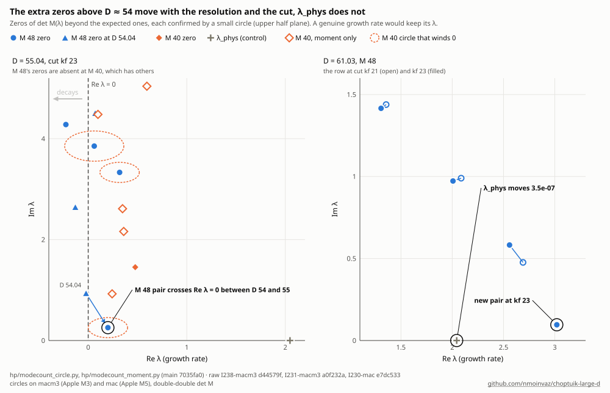

# Mode count: how many unstable modes does the DSS solution have?

The referee objection (notes/REFEREE_SIM.md, row 2): the growth rate λ is a local root of det M(λ) near its predicted
value (`hp/gamma_dd.py`, `find_lam`), so a second unstable mode would have gone unnoticed, and then 1/λ would not be
the critical exponent. Here the zeros of det M(λ) are counted by the argument principle in boxes of the complex λ plane
that cover at least −0.08 < Re λ < 6.18 and both symmetry sectors of the perturbations.

**Verdict.** At D = 30.07, 45.05 and 61.03 (double-double states at the production resolution, M = 32 points in τ),
det M has exactly three zeros in −0.08 < Re λ < 6.18 (the boxes reach −0.15 and 6.6 at some D), |Im λ| < 3ω/2:

- λ = 0, the translation in τ (marginal);
- λ_g = 1 + ⟨c₁⟩ (0.826, 0.871, 0.899), a residual gauge mode of this formulation: a change of the time coordinate
  that changes nothing physical (section 1);
- λ_phys (2.0797, 2.0567, 2.0435), the known growth rate.

So **at these D the solution has one physical unstable mode among the perturbations the layout resolves**, and
γ = 1/λ_phys. The deliberate checks behave as they should. The box holding λ_phys alone counts 1, the box next to it
counts 0, and the gauge box counts 1. The box holding seven poles of det M winds −7, and zeros planted in a synthetic
det M are all found.

One item is open. At a second resolution, M = 48 at D = 30, the count is the same except for an **extra conjugate
pair at 4.267 ± 1.324i**. The pair is absent at M = 32, and absent at M = 48 when the centre data's τ-harmonics above
13 are pinned (the cut the production runs use from D = 35 on). Without the cut, the M = 48 background converges only
to |F| = 9×10⁻¹⁸. It was closed in section 5 (#250, #260): on a fitted layout the pair is absent and the count at
M = 48 without the cut is 0 in every box, as at M = 32. At D = 4 (f64 solver, real λ only) det M changes sign only at
λ_g = 0.6139 and λ_phys = 2.6741 on 0.02 < λ < 6.47.

What is not covered: Re λ > 6.6, perturbations whose τ-harmonics lie above what the layout holds (above 31, and for the
centre data above 13 from D = 35 on), complex λ at D < 30, and resolutions other than M = 32 except at D = 30. The
runs proposed for the local machine are in section 7.

## 1. What det M(λ) is, and which of its zeros and poles are known in advance

The growth rate comes from the growth-mode matrix M(λ) of `hp/` (README, "Exact Jacobian and growth-mode matrix"): the
exact Jacobian of the multiple-shooting residual for perturbations $`\propto e^{\lambda\tau}`$, periodic in τ, with Δ
held fixed and the phase row dropped. Its unknowns are the centre data, the node states and the horizon data on the
half-period grid of M points in τ, with p, m odd and a, c even under τ → τ + Δ/2 (the "folded" layout). det M(λ) = 0
exactly when the linearised equations have a solution $`e^{\lambda\tau}`$ × (periodic, regular at the centre and at the
past light cone x = 1, with c(τ, 1) = 1). So its zeros with Re λ > 0 are the unstable modes of this formulation. Not all
of them are physical, and det M also has poles; both have to be known before a count means anything.

**Both symmetry sectors are in one period.** Multiplying a perturbation by $`e^{i\omega\tau}`$ (ω = 2π/Δ) swaps its
parity under the half-period shift, so a perturbation of the other sector (p, m even, a, c odd) with growth rate λ is a
folded perturbation with growth rate λ + iω. Multiplying by $`e^{2i\omega\tau}`$ keeps the parity, so the zeros of the
folded det M repeat with period 2iω (exactly in the continuum, up to the highest harmonics in the discretisation). The
strip −ω/2 < Im λ < 3ω/2 therefore holds every growth rate of both sectors exactly once (among the perturbations the
layout resolves, section 6): real growth rates of the
symmetric sector on Im λ = 0, those of the other sector on Im λ = ω, complex ones anywhere. The boxes below cover
|Im λ| < 3ω/2, which is that strip together with the mirror image of its upper part.

**λ = 0** is the translation in τ (∂τ of the background solves the λ = 0 equations). It is marginal, not unstable;
the strip B0 below contains it.

**λ_g = 1 + ⟨c₁⟩ is a residual gauge mode.** The usual gauge mode of critical collapse, λ = 1 (a shift of the
accumulation time t*), is not a zero here: the formulation pins the past light cone of the singularity to x = 1 by
c(τ, 1) = 1, and a shift of t* moves the light cone. What remains is a reparametrisation of time that keeps c = 1 on
x = 1. In polar–areal coordinates t → t + ε h(t) leaves r and the fields p, m, a unchanged as functions on spacetime
and rescales the lapse, α → α(1 − ε h′). With $`h = e^{(\lambda-1)\tau}P(\tau)`$ (τ = −ln(−t), x = r/(−t)) the change at
fixed (τ, x) is

```math
\delta f = -\varepsilon\, e^{\lambda\tau} P\,(\partial_\tau + x\partial_x) f \quad (f = p, m, a),\qquad
\delta c = -\varepsilon\, e^{\lambda\tau}\Big[P\,(\partial_\tau + x\partial_x) c + \big((\lambda-1)P + P'\big)\,c\Big].
```

At x = 1 one has c = 1, ∂τc = 0 and, from $`x c_x = (n-1)(a^2-1)c`$, $`\partial_x c = -c_1(\tau)`$ with
$`c_1 = (n-1)(1-a_h^2)`$, a_h = a(τ, 1). So δc(τ, 1) = 0 is $`P' = (1 + c_1 - \lambda)P`$. The perturbation lies in the
folded layout when P is Δ/2-periodic, which happens exactly for

```math
\lambda = \lambda_g + 2ik\omega,\qquad \lambda_g = 1 + \langle c_1\rangle = 1 - (n-1)\,\big\langle a_h^2 - 1\big\rangle ,
```

with ⟨·⟩ the average over τ and k any integer. (With P antiperiodic one gets λ_g + iω in the other sector, but
$`e^{(\lambda_g + i\omega)\tau}P_{\rm anti} = e^{\lambda_g\tau}P_{\rm per}`$: it is the same perturbation, so the
other sector adds no gauge zero; the counts below confirm this.) The perturbation is a change of coordinates, regular
at the centre and at x = 1, so it is a zero of det M that changes nothing physical. The real zero of det M sits
at 1 + ⟨c₁⟩ to 1.1×10⁻¹⁶ at D = 30.07 (no freeze) and to 4.9×10⁻¹¹ at D = 61.03 (kfreeze 13) (`hp/modecount_check.py`,
`hp/data/modecount_check.jsonl`). λ_g runs from 0.61 at D = 4 to 0.90 at D = 61. It is the real sign change of det M
between 0.5 and 1 that a scan of the real axis finds besides λ_phys.

**Poles.** λ enters M through τ-derivatives, polynomially in the centre series and the Taylor steps, and through the
horizon series, whose order-kk tangent solves
$`(\omega D + \mathrm{diag}\,\kappa_{kk} + \lambda)\,\delta p_{kk} = r_{kk}`$ with
$`\kappa_{kk} = (1+c_1)(kk+1) - n/2`$ (`hp/src/model.rs`, `horizon_lus` with `shift` = λ). So det M is meromorphic,
and its only possible poles are the λ where one of these M × M matrices is singular, kk = 0, …, ks (ks = 100):

```math
\lambda_{kk,j} = \frac{n}{2} - \lambda_g\,(kk+1) - i(2j+1)\,\omega
```

(the code uses the matrices' eigenvalues themselves). These are resonances of the horizon expansion: the exponent of a
perturbation's singular branch at the light cone, $`\sigma = (n/2 - \lambda)/\lambda_g - 1`$, is an integer there. They
lie on Im λ = ±ω, ±3ω, …, spaced by λ_g in Re λ. Each is at most a simple pole of det M: the eigenvalues are simple, so
near one of them one horizon coefficient, and with it the horizon block of M, has a rank-one singular part. At D = 61
there are 7 of them in 0.3 < Re λ < 6.6 on each of the lines Im = ±ω.

## 2. Method

**det M at complex λ.** `Solver.mode_det(zh, zl, lam_hi, lam_lo)` of `hp/` takes λ as a real double-double: its
fourth argument is the low part of λ, not Im λ, and complex λ is not supported. `hp/modecount_cx/` is a separate crate
(built by `hp/modecount_build.sh` into its own build directory; hpkernel is not modified or reinstalled) that links the
hp kernel as a library and takes the mode matrix from hp's engine at a complex rate (multishoot's
`Shooting::mode_matrix` on hp's equations, #597). Its lanes have a real value and a complex tangent (the background
is real, so every dual-number rule acts on the real and imaginary parts separately), d/dτ → ωD + λ on the tangent,
the horizon solves (A + λ) are the real 2M × 2M system [[A + Re λ, −Im λ], [Im λ, A + Re λ]], and the frozen rows
are the engine's exact projector. The test field's matrix holds the a and c tangents inside the recursions and keeps
its own copy of them in the crate (`src/test_field.rs`). ln|det M| and arg det M come from a complex double-double LU
with partial pivoting. With Im λ = 0 the matrix is hpkernel's bit for bit, at no cut and at kfreeze 13 alike.
Determinants cached by the crate before #597 differ at kfreeze states in their last digits (up to 1.2×10⁻⁶ rad in
arg at D 61 M 64), so caches of the two builds are not mixed. The matrix's entries carry a fixed error from the
double-double evaluation of the centre and horizon series: steps of k ulps in Re λ show a median non-linearity
falling as 1/k, 17% of the entries at D 61 M 64 kf 23 (#597, raw `I597-mac/` 86a9894e). Checks
(`hp/modecount_check.py`, `hp/data/modecount_check.jsonl`):

| check | D = 30.07 (M 32, no freeze) | D = 61.03 (M 32, kfreeze 13) |
|---|---|---|
| M(1.7), entry by entry, against hpkernel's `mode_matrix` | identical (largest difference 0) | identical (largest difference 0) |
| ln\|det M\| at real λ against hpkernel's `mode_det` | equal to all printed digits at λ = 0.5, 1.7, 4 | 4×10⁻¹⁰ apart at λ = 1.7: the two double-double LUs round differently and max \|M\| = 2×10⁹ |
| sign of det M at real λ | arg det = 0 or π, matching | matching |
| analyticity: d ln det M / dλ along h and along ih (h = 10⁻⁵) | agree to 9×10⁻⁷ and 3×10⁻⁷ at λ = 1.3 and 3.0, i.e. to O(h) | not run |
| real zero near 1 + ⟨c₁⟩ | 1.1×10⁻¹⁶ from it | 4.9×10⁻¹¹ from it |
| complex LU against numpy's `slogdet` (random matrices, n = 7–129) | 8×10⁻¹³ | |

**D = 4 with the f64 solver, real λ only.** The double-double states start at D = 8.25. At D = 4 the f64 solver's
state `solver/data/neB_kc39_D4.0000.npy` (kc 39, nodes 0.02–0.6, horizon series Ks = 60) is used with the Rust f64
kernel's exact (dual-number) mode matrix, which takes real λ only (`hp/modecount_f64.py --realscan`): the sign of
det M on a grid of step 0.05 over 0.02 < λ < 6.47, each sign change refined by brentq. This covers the symmetric
sector's real growth rates only. (A complex-λ version through the Python reference's central-difference mode matrix,
`hp/modecount_f64.py` without `--realscan`, failed its real-λ check against the Rust matrix, max |ΔM|/max |M| = 0.89 at
λ = 0.3, cause not identified, and took 430 s per matrix; it is not used.) The f64 code solves the horizon series'
periodic problems on the full τ grid, so besides the resonances above it has full-grid resonances with Im λ an even
multiple of ω, which odd right-hand sides do not excite; one of them, at λ = 0.386, lies on the scanned interval.

**The function whose phase is followed.** On a closed contour C the winding number of det M is (zeros − poles)
inside C. Counting the zeros of a shooting determinant by its winding goes back to Hirschmann and Eardley (PRD 52, 5850
(1995), Sec. VI) and Gundlach (PRD 55, 695 (1997), App. E), whose poles also come from the light-cone conditions (his
App. B). Rather than det M, the phase of

```math
g(\lambda) = \det M(\lambda)\;\frac{\prod_j (\lambda - p_j)}{\prod_k (\lambda - z_k)}\;e^{-P_2(\lambda)}
```

is followed, with p_j all candidate poles with |Im λ| < 4.5ω (every kk = 0, …, ks), z_k the expected zeros 0, λ_g and
λ_phys with their copies 2ikω, and P₂ a real quadratic fitted to ln|det M ∏(λ − p_j)/∏(λ − z_k)| at the 15–17 sample
points on the real axis. The three factors are known exactly and the exponential has no zeros, so for every box

```math
\mathrm{wind}_C(\det M) = \mathrm{wind}_C(g) + N_{\rm exp}(C) - N_{\rm cand}(C),\qquad
Z(C) \le \mathrm{wind}_C(g) + N_{\rm exp}(C),
```

where Z(C) is the number of zeros of det M inside C, N_exp and N_cand the numbers of expected zeros and candidate
poles inside. The inequality holds because every pole of det M is a candidate and simple (equality when every
candidate inside is an actual pole). If det M has no zeros besides the expected ones and every candidate is a pole,
wind(g) = 0 for every box. A further zero shows as wind(g) ≥ 1. A candidate that is not a pole shows as wind(g) ≥ 1
too, so it can only make the bound weaker, never hide a zero. Along the real axis det M grows like $`e^{33\lambda}`$
(D = 45, 61) to $`e^{57\lambda}`$ (D = 30). Dividing that and the known zeros and poles out makes g nearly constant
(|ln g| < 1.5 on every edge at D = 61), which is what keeps the cost near 100 determinants per state; it does not
decide the count.

**Contour network** (`hp/modecount_wind.py`): vertical edges at Re λ = aLL ≈ −0.1, aL = 0.3 and aR ≈ 6–6.6 from Im λ = 0
to y2 = 3ω/2, and at a1 (between λ_g and λ_phys) and a2 = λ_phys + 0.6 from Im λ = 0 to y1 = ω/2; horizontal edges at Im
λ = y1 and y2 from aR to aLL. aLL, aL, a1 and aR are chosen within their ranges as far as possible from the real parts
of the candidate poles and expected zeros. det M is real on the real axis and
$`\det M(\bar\lambda) = \overline{\det M(\lambda)}`$, so a box symmetric about the real axis has winding (1/π) × (phase
change along its upper half); the strips y1 < Im λ < y2 are closed contours of their own (their mirror images hold the
conjugate zeros).

| box | region | zeros expected | wind(g) expected |
|---|---|---|---|
| B0 | aLL < Re < aL, \|Im\| < ω/2 | λ = 0 | 0 |
| U0 | aLL < Re < aL, ω/2 < Im < 3ω/2 | none | 0 |
| B1a | aL < Re < a1, \|Im\| < ω/2 | λ_g | 0 |
| B1b | a1 < Re < a2, \|Im\| < ω/2 | λ_phys | 0 |
| B1c | a2 < Re < aR, \|Im\| < ω/2 | none | 0 |
| B1 | aL < Re < aR, \|Im\| < ω/2 | λ_g, λ_phys | 0 |
| U | aL < Re < aR, ω/2 < Im < 3ω/2 | none | 0 |
| full | aL < Re < aR, \|Im\| < 3ω/2 | λ_g, λ_phys | 0 |

B1b (λ_phys alone), B1c (no zero) and B1a (λ_g alone) are the deliberate checks of item 4: the windings of det M must
come out 1, 0 and 1. U is a stronger one: its winding of det M must come out as minus the number of candidate poles in
it (−7 at D = 30, 45 and 61). B0 and U0 together cover aLL < Re λ < 0.3, so slowly growing modes, 0 < Re λ < 0.3, are
counted too.

**Sampling.** Each edge starts on a grid of spacing 0.4 (0.6 in the M = 48 counts) and every interval is bisected
until the phase change of g across it is at most π/4. Then every interval whose phase change exceeds π/8 is bisected
once more and the two halves are checked to add up to the whole (a hidden turn of 2π would show as a mismatch; there
were none). Note that the sum of wrapped phase steps around a closed contour is always a multiple of 2π, so windings
coming out as integers prove nothing; what makes them reliable is that every step is well below π. The records give,
per edge and box, the largest phase step of g, the largest phase step of det M itself between the same samples (up to
3 rad, because of its exponential growth, which is removed exactly and is therefore harmless), the range of ln|g| on
the boundary (how close the boundary comes to an unaccounted zero or pole of g), and the distances from the boundary
to the nearest candidate pole and expected zero.

**Alias rule (#242).** A step that looks small can hide whole turns: #212's kf 23 count left two intervals of the edge
Im λ = 3ω/2 at the initial spacing, whose steps of +0.04 and +0.23 rad hid +19.1 rad (#230). So each interval's length
h is also held against the local scale of g, |Δ ln g| / h (the change of ln|g|, which does not wrap, with the wrapped
phase step). The scale is taken on the interval, on 3 intervals each side and, at a corner, on the other edges' 3
intervals there. An interval is bisected while h × scale > π/2 (`--alias`; `--mutate=flat` restores the old rule). The
planted test (`hp/modecount_planted.py --controls`) holds the cases the old rule miscounts: close pairs of zeros between
two samples, the moment test's random configurations, and rows of zeros along Im λ = 3ω/2, where the old rule counted
U = 0 for 22 zeros with every edge resolved (raw `I242-mac/`, 17afb41).

## 3. Counts

Per state: wind(g) for every box (expected 0), and in brackets the winding of det M itself, wind(g) + (expected zeros
inside) − (candidate poles inside). Every production-resolution count has wind(g) = 0 in every box; the M = 48 count
at D = 30 (no freeze) is the one exception, in B1c (section 5).

| D | layout | ω | λ_g = 1 + ⟨c₁⟩ | λ_phys | B0 | U0 | B1a | B1b | B1c | B1 | U | full |
|---|---|---|---|---|---|---|---|---|---|---|---|---|
| 30.0688 | dd, M 32 | 3.198742 | 0.826484 | 2.079748 | 0 [+1] | 0 [−1] | 0 [+1] | 0 [+1] | 0 [0] | 0 [+2] | 0 [−7] | 0 [−12] |
| 45.0507 | dd, M 32, kfreeze 13 | 3.373741 | 0.871366 | 2.056739 | 0 [+1] | 0 [0] | 0 [+1] | 0 [+1] | 0 [0] | 0 [+2] | 0 [−7] | 0 [−12] |
| 61.0264 | dd, M 32, kfreeze 13 | 3.476755 | 0.899231 | 2.043533 | 0 [+1] | 0 [0] | 0 [+1] | 0 [+1] | 0 [0] | 0 [+2] | 0 [−7] | 0 [−12] |
| 30.0688 | dd, M 48, no freeze (\|F\| 9×10⁻¹⁸) | 3.198742 | 0.826484 | 2.079748 | 0 [+1] | 0 [−1] | 0 [+1] | 0 [+1] | **2 [+2]** | 2 [+4] | 0 [−7] | 2 [−10] |

What the M = 32 windings say, box by box (the same at all three D):

- **B0** (aLL < Re λ < 0.3, |Im λ| < ω/2): one zero, λ = 0 (τ translation). No mode with 0 < Re λ < 0.3.
- **U0** (aLL < Re λ < 0.3, ω/2 < Im λ < 3ω/2): no zero. (At D = 30 one candidate pole, −0.016 + iω, lies inside,
  so det M winds −1 there.)
- **B1a** (0.3 < Re λ < a1): one zero, λ_g, the gauge mode. In particular λ = 1 is not a zero.
- **B1b** (a1 < Re λ < λ_phys + 0.6): one zero, λ_phys. **B1c** (λ_phys + 0.6 < Re λ < aR ≈ 6.2–6.6): none. These are
  the deliberate checks: the box holding the known growth rate counts 1, the box next to it counts 0, and so does the
  gauge box B1a, with the same code and the same sampling.
- **U** (0.3 < Re λ < aR, ω/2 < Im λ < 3ω/2): no zero. det M winds −7 around it, and there are 7 candidate poles inside
  (the resonances kk with Re between 0.3 and aR on Im = ω; at D = 61 at Re = 0.738, 1.637, …, 6.133). Since a winding of
  −7 needs at least 7 poles, every one of the 7 candidates is a simple pole and the box holds no zero. The count is
  therefore sensitive to individual poles one at a time, not only to the known zeros.
- **full** (0.3 < Re λ < aR, |Im λ| < 3ω/2): det M winds −12 = 2 − 14: the two zeros λ_g and λ_phys and the 14 poles
  on Im = ±ω, nothing else.

So in −0.08 … −0.15 < Re λ < 6.2 … 6.6 and |Im λ| < 3ω/2, which holds every growth rate of both symmetry sectors
(section 1), det M has exactly three zeros at each of D = 30, 45, 61: λ = 0 (τ translation, marginal), λ_g (residual
gauge, a coordinate change) and λ_phys. The real-axis scan of each run shows the same: det M changes sign only in
(0.5, 1), at λ_g, and in (2, 2.5), at λ_phys.

**Sampling quality** (`hp/modecount_table.py`; per edge in `hp/data/modecount_results.jsonl`, all samples in
`hp/data/modecount_<D>_M<M>_evals.jsonl`):

| D | determinants | largest phase step of g | largest phase step of det M itself | ln\|g\| on all edges | sample spacing | halving checks (mismatches) | nearest candidate pole to an edge |
|---|---|---|---|---|---|---|---|
| 30.0688 | 98 | 0.36 rad | 2.60 rad | −1.23 … 0.69 | 0.20–0.40 | 4 (0) | 0.134 |
| 45.0507 | 104 | 0.38 rad | 3.08 rad | −1.41 … 0.73 | 0.19–0.40 | 3 (0) | 0.129 |
| 61.0264 | 125 | 0.37 rad | 2.26 rad | −1.46 … 0.75 | 0.19–0.39 | 4 (0) | 0.081 |
| 30.0688, M 48 | 148 | 0.50 rad | 2.72 rad | −0.73 … 6.17 | 0.002–0.53 | 50 (0) | 0.134 |

In the M = 32 counts the largest phase step of g is below π/8 = 0.39 on every edge, against the tolerance π/4. The
larger steps of det M itself come from its growth along the real direction, ln|det M| rising by about 33 (D = 45, 61) to
57 (D = 30) per unit of Re λ; the matching phase is removed exactly by P₂. In the M = 32 counts ln|g| stays within −1.5
… 0.8 on every edge: no edge passes near an unaccounted zero or pole of g (one at distance d from an edge would pull
ln|g| down by about |ln d| there). The determinant itself is accurate to about 10⁻¹⁰ relative at D = 61 (the two LUs
above), far below what moves a phase. The windings, by construction integers, are reliable because every step is far
below π.

At D = 61 the first count was run with λ_g ± iω wrongly in the list of expected zeros. It gave wind(g) = −1 in U and
−2 in the full box, and with that bookkeeping the same windings of det M (−7, −12). Recounted from the same samples
with the corrected list (`--v2` in `hp/modecount_jobs.sh`), every wind(g) is 0. This is the observation that showed
that the other sector has no separate gauge zero.

## 4. Checks that the count can fail

- **Known zero in, known zero out (item 4 of the task).** B1b holds λ_phys alone and B1c, next to it, nothing: their
  windings of det M are 1 and 0 at every D (section 3). B1a holds the gauge zero alone and counts 1. U holds 7 poles
  and no zero and winds −7, so single poles are resolved too.
- **Planted zeros** (`hp/modecount_planted.py`, `hp/data/modecount_planted.log`). A synthetic det M with the D = 30
  structure (ω, λ_g, λ_phys, the rows of horizon poles, growth $`e^{57\lambda + 0.3\lambda^2}`$, the 2iω copies) goes
  through the same code (geometry, factors, trend, sampling, bookkeeping). With nothing planted every wind(g) is 0;
  with an extra zero (or pair) planted in B1c (complex and real), in U (an other-sector real mode at 1.9 + iω, and one
  0.2 below the top edge), in B0 (a slowly growing pair at 0.07 ± 0.5i), in B1b next to λ_phys (2.4 ± 0.2i) and in
  B1a 0.05 from an edge, every box counts exactly what was planted in it. Pass criteria were fixed in the script before
  it was run; it exits non-zero on a failure.
- **Bookkeeping error caught.** The first D = 61 count listed λ_g ± iω as expected zeros. wind(g) came out −1 in U,
  not 0: the count exposed the wrong expectation, which the argument in section 1 then explained (the other sector's
  gauge mode is the same perturbation as λ_g).
- **The kernel at complex λ** (section 2): bitwise agreement with hpkernel at real λ, the Cauchy–Riemann test, and the
  gauge zero at 1 + ⟨c₁⟩ to 10⁻¹⁶.

## 5. Second resolution, and other D

**M = 48 at D = 30, without the freeze.** The M = 32 state resampled to M = 48 τ points converges only to
|F| = 9×10⁻¹⁸ (Newton stalls, Levenberg–Marquardt stops there). The count (`hp/modecount_wind.py
hp/data/states/up6_D30.0688.npz --M=48 --h0=0.6 --fmax=1e-15`, 148 determinants) agrees with M = 32 in every box but
one: B0 1 (λ = 0), B1a 1 (λ_g), B1b 1 (λ_phys), U 0 zeros (det M winds −7), U0 0 zeros, but **B1c holds an extra
conjugate pair**, wind(g) = 2. The real-axis signs are unchanged (sign changes only at λ_g and λ_phys). The count's
own samples place the upper zero at 4.267 + 1.324i (first moment of the argument principle over the upper half of
B1c, `hp/modecount_moment.py`; the same computation gives 0 for the M = 32 count and for U). A small circle confirms
it: det M winds +1 on |λ − (4.267 + 1.324i)| = 0.35 at M = 48 (`hp/modecount_circle.py`, 24 points, largest step
0.37 rad). Along the top edge Im λ = 3ω/2 there is a further zero within about 0.01 of the edge near Re λ = 3.30,
just outside the box (it does not enter U, which counts 0).

**The same with the kfreeze-13 cut.** Resampled to M = 48 with the centre data's τ-harmonics above 13 pinned (the cut
the production runs use from D = 35 on), the D = 30 state converges to |F| = 8×10⁻²⁸, and det M winds **0** on the
same circle (16 points, largest step 0.05 rad: g is flat there).

**Reading.** The extra pair is present only at M = 48 and only without the cut. It is absent at M = 32, whose count
covered the same region with steps of g below 0.36 rad. It disappears when the centre harmonics 15–47 are pinned,
which is also what lets the M = 48 background converge. These are the solver's weak ("junk") directions (README,
"The weak directions"): a ladder of high τ-harmonics of the centre data, outgoing waves near the centre that barely
reach the matching point, with singular values falling like $`e^{-0.7k}`$, which the production runs pin from D = 35
on. With M = 48 and no cut, harmonics 33–47 add more such directions, the background is undetermined in them at the
10⁻¹⁷ level, and det M picks up a zero there. The data support reading the pair as an artifact of that unconverged,
weakly coupled sector, not as an unstable mode.

That reading has a limit, and it is a limit of every finite-M count, not only of this one. A box of height 2ω holds
every growth rate only for perturbations the layout can represent once shifted into the strip, i.e. whose
eigenfunction lives in |k| ≤ M − 1. A perturbation that oscillates much faster in τ than the background, with its
weight near harmonics 30–50 after the shift, is not resolved at M = 32. It is also removed by the cut, so the cut test
does not separate such a mode from an artifact. What would separate them is a third resolution: at M = 64, a genuine
mode stays at the same λ while an artifact of the truncation moves or multiplies. That run is proposed in section 7.
So the statement this count supports is: **no extra unstable mode among perturbations with τ-harmonics up to about
30** (both sectors, 0 < Re λ < 6), with the M = 48 pair as the one open item.

**M = 48 at D = 61, with the cut (as in the production run).** With the production cut at kf 13 the resampled state
reaches only |F| = 2.7×10⁻¹⁵ after Levenberg–Marquardt (kept in `hp/data/modecount_state_D61.0264_M48_kf13.npz`), above
the 10⁻¹⁵ accepted for a count, so no count was run on it. Raising the cut lowers the floor, to 1.4×10⁻¹⁵ at kf 17 and
1.3×10⁻¹⁹ at kf 21, where the count runs (#159). It finds zeros beyond the expected ones. So does the count at kf 23
(#212; raw `I212-macm3/`, ecdd11a), with every edge resolved and 0 verification mismatches:

| cut | B0 | U0 | B1a | B1b | B1c | B1 | U | full |
|---|---|---|---|---|---|---|---|---|
| kf 21 (#159, re-evaluated with `--resolve=last` in #212) | 0 | 0 | 0 | +4 | +2 | +6 | +9 | +24 |
| kf 23 (#212, with the edge Im λ = 3ω/2 re-sampled in #230) | 0 | 0 | 0 | +6 | +2 | +8 | +11 | +30 |
| M = 32, kf 21 (#168) | 0 | 0 | 0 | 0 | 0 | 0 | 0 | 0 |

The entries are wind(g), the zeros beyond the expected ones. #212 recorded U +8 and full +24 at kf 23. #230 re-sampled a
stretch of the edge Im λ = 3ω/2 (Re λ from 1.157 to 0.300) that the count had left at its initial spacing, and found
three turns of g hidden there (+19.1 rad where the count's two steps gave +0.27; raw `I230-mac/`). So the extras
multiply as the cut rises, 24 at kf 21 and 30 at kf 23. The count's sampling now holds every interval against the local
scale of g (#242), and with it no other box of any count changes (#243). det M changes sign on the real axis only at λ_g
and λ_phys, so the extras come in conjugate pairs off the axis. Eight of them lie in B1b and B1c, with 1.27 < Re λ < 6.6
and |Im λ| < ω/2. If they were modes they would be extra growth rates. They are absent at M = 32 with the same cuts
(#160, #168).

**With one fixed left column (#241; raw `I241-macm3/`, b2d1c68).** Recounted with `--aLL=-0.096 --aL=0.124` at all three
D, reusing the earlier samples:

| D | B0 | U0 | B1a | B1 | U | full |
|---|---|---|---|---|---|---|
| 53.79 | 0 | 0 | 0 | 0 | 0 | 0 |
| 54.04 | +2 | +1 | 0 | 0 | 0 | 0 |
| 55.04 | 0 | +1 | +2 | +2 | +1 | +4 |

The onset in (53.79, 54.04] holds in one region. Between D = 54.04 and 55.04 the B0 pair crosses Re λ = 0.124 into
B1a, so it moves to larger Re λ as D grows. Where the two contours overlap their windings agree. The one difference,
U0 at D = 54.04, puts one zero of the strip at −0.150 < Re λ < −0.096.



`python3 hp/plot_modecount_extras.py <raw-data clone>` draws it from the circle and moment records of I238-macm3,
I231-macm3 and I230-mac.

**Positions at D = 54 and 55 (#238; raw `I238-macm3/`, 7331239).** Each zero is confirmed by a circle winding +1, and
the λ_phys circles wind +1 at both D:

| D | zero (upper half) | box |
|---|---|---|
| 54.04 | −0.0220 + 0.9365i | B0 |
| 54.04 | −0.1310 + 2.6426i, +0.0711 + 4.5045i | U0 |
| 55.04 | +0.1996 + 0.2548i | B1a (fixed column), B0 (automatic) |
| 55.04 | +0.3189 + 3.3314i | U |
| 55.04 | +0.0612 + 3.8526i, −0.2267 + 4.2800i | U0 and left of it |

The B0 pair at D = 54.04 and the B1a pair at D = 55.04 are one pair. Its Re λ goes from −0.022 to +0.200 and its Im λ
from 0.94 to 0.25, so at M = 48 it crosses Re λ = 0 between D = 54.04 and 55.04 and heads for the real axis. A pair of
growth rates crossing into Re λ > 0 is how a new unstable mode would appear, if it is genuine. None of the strip zeros
lies on Im λ = ω (3.44 at D = 55). At M = 40 it does not exist (#231, below).

**A third resolution at D = 55 (#231, interim; raw `I231-macm3/`, b9b2608).** At M = 40 with kf 23 the count finds B0
+2, U0 +1, B1a +2, B1 +2, U +3 and full +8 (every edge resolved, 0 mismatches, setup |F| 3.3×10⁻¹⁹), against 0 in every
box at M = 32 and B0 +2, U0 +1, U +1, full +2 at M = 48. On the M = 40 state, circles around the three M = 48 zeros, the
crossing pair at +0.1996 + 0.2548i, the U zero and the U0 zero, wind 0, while the λ_phys circle winds +1. M = 40 has
zeros of its own instead, one of them confirmed by a circle at 0.4773 + 1.4533i. So at D = 55 the extras move, multiply
and vanish as M changes, which is how truncation artifacts behave and not how a mode behaves, since a mode keeps its λ.
At D = 61 (#231; raw `I231-macm3/`) the M = 40 count finds U0 +1, B1b +4, B1c +4, B1 +8, U +8 and full +24, against B1b
+6, B1c +2, B1 +8, U +11 and full +30 at M = 48. On the M = 40 state, circles at three of #230's four positions wind 0,
and the fourth (2.0073 + 0.9727i) holds a zero 0.19 away, at 2.0426 + 1.1507i, while the λ_phys circle winds +1. So at
both D the extras appear at M = 40 and 48 and not at M = 32, and they do not keep their λ as M changes. With the cut at
D = 61, M = 40, three of four M = 40 zeros exist at kf 23 only, absent at kf 21 and kf 25, and the fourth moves by 0.20
between kf 23 and 25, while λ_phys winds +1 at all three cuts (#262; raw `I262-macm3/`). The circles also show the
moments' spreads to be optimistic by a factor of 2 to 5 for these zeros. At M = 64, on #141's fitted layout, circles (R
0.2–0.3) at all 8 M = 48 positions (#230 at D = 61, #238 at D = 55) and at 3 of the M = 40 positions (#231) wind 0, with
every step below π/4 and 0 mismatches (#252; raw `I252-mac/`, 0cc43ce). Its λ_phys controls wind +1 but place λ_phys up
to 5.4×10⁻⁴ off at D = 61, against the 10⁻⁵ gate set first. The cause is measured: at M = 64 the series blocks' entries
carry non-smooth error on a near-singular mode matrix, which leaves windings unaffected and limits positions. The
circles were read under a gate restated against that floor. The loss is in the series' terms, not their sums: the
largest tangent term of the centre series grows from 1.8×10⁶ at M = 48 to 2.5×10¹¹ at M = 64 (D = 55), and summing in
quad-double improves the entries by at most 4× where 100× is needed (#259; raw `I259-mac/`, 1d6a393). A fix needs the
terms themselves in quad-double, that is, a complex quad-double lane in multidouble. So no extra zero tested keeps its λ
across M = 40, 48 and 64. The circles cover discs only, and no full M = 64 count was made (#274).

**D = 56 to 59 at M = 48, kf 23 (#249; raw `I249-macm3/`, 6f5a46c).** With the fixed left column of #241, every setup
passing the gate (|F| ≤ 4.4×10⁻¹⁹):

| D | B0 | U0 | B1a | B1b | B1c | B1 | U | full |
|---|---|---|---|---|---|---|---|---|
| 56.01 | +2 | +2 | +2 | 0 | 0 | +2 | +4 | +10 |
| 57.03 | 0 | +1 | +4 | 0 | 0 | +4 | +4 | +12 |
| 58.01 | 0 | +1 | +4 | +4 | 0 | +8 | +1 | +10 |
| 59.03 | 0 | +1 | +4 | +6 | 0 | +10 | +9 | +28 |

D = 56.01 and 58.01 resolve only under `--resolve=last` (one and two early-pass mismatches, none in the last pass).
The real axis has only the two expected sign changes at every D, and every circled zero has Im λ ≥ 0.03, so no extra
zero reaches the real axis. The zeros nearest the axis, each confirmed by a circle winding +1, are −0.090 + 0.033i
(D = 56.01), 0.363 + 0.589i (57.03), 0.637 + 0.236i (58.01) and 1.608 + 0.200i (59.03). They do not form a monotone
path, so the pair of #238 cannot be followed across steps of 1 in D. The zero at D = 56.01 sits 0.0065 from the box
edge and 0.095 from the expected zero at λ = 0.

**More cuts and the inner node at D = 61 (#244, #270; raw `I244-macm3/`, `I270-macm3/`, 6f5a46c).** Zeros 1 to 3 of
the table below keep moving with the cut: at kf 25 they are at 1.2685 + 1.3933i, 1.9489 + 0.9436i and
2.4725 + 0.5757i. kf 22 reproduces kf 21, because both cuts keep the same odd harmonics. The pair at 3.0196 ± 0.0958i
exists at kf 23 only: its circle winds 0 at kf 22 and at kf 25. λ_phys itself moves by 4.7×10⁻⁶ from kf 23 to kf 25,
more than the 3.5×10⁻⁷ from kf 21 to 23. On a layout with an inner node at 0.15 (|F| = 1.3×10⁻¹⁹, both series far below
the gate) the four circles wind +1, +1, +1 and +2 at the same positions to 10⁻⁵. So, unlike D = 30's pair, these zeros
do not come from the centre series' layout. They follow M and the cut.

**A centre node at M = 64 (#275; raw `I275-macm3/`).** At D = 55 the λ_phys circle on the M = 64 state with a node at
0.15 misses λ_phys by 1.1×10⁻⁵, against 2.3×10⁻⁵ without the node (#252). Both lie inside the circle's own estimate
(1.6×10⁻⁵), so the node does not cure the M = 64 noise, and a halving is not established.

**Positions at D = 61 (#230).** The extras in B1b and B1c lie on one row, from 1.31 + 1.42i down to 3.02 ± 0.10i, each
zero confirmed by a small circle winding +1 (`hp/modecount_circle.py`; raw `I230-mac/`, 95906de):

| zero | kf 21 | kf 23 | shift |
|---|---|---|---|
| λ_phys (control) | 2.0435325 | 2.0435328 | 3×10⁻⁷ |
| 1 | 1.3560 + 1.4385i | 1.3065 + 1.4158i | 0.054 |
| 2 | 2.0869 + 0.9897i | 2.0073 + 0.9727i | 0.081 |
| 3 | 2.6897 + 0.4761i (B1c) | 2.5584 + 0.5825i (B1b) | 0.169 |
| 4 | none | 3.0196 ± 0.0958i (B1c) | new |

Raising the cut moves every member toward smaller Re λ, by more along the row, and adds a pair near the real axis,
while λ_phys moves 2×10⁵ to 5×10⁵ times less. The extras multiply and move with the cut, which points to the truncation.
A mode whose eigenfunction has weight in the centre harmonics 22–23 would move too, so the third resolution (#231)
decides. The U zeros are not located.

**The box 2.6 < Re λ < 3.6, |Im λ| ≤ 0.5 at D = 61 on the exact determinant, kf 27 to 37 (#551, #656, #657, #708;
raw `I551-win2/`, `I656-macm3/`, `I657-win2/` ddc106d0, `I657-macm3/` bcda518c, `I708-macm3/` 3edb2e48).** M = 48,
seed `up23_D61.0264.npz`. det M is the exact determinant of the double-double mode matrix, from python-flint's ball LU
at 320 bits (`--ball=320`). Four R 0.36 circles at 2.85 ± 0.25i and 3.35 ± 0.25i cover the box. A zero inside two
circles is counted once, and small circles (R 0.05, or R 0.1 at kf 37) confirm the pair near the real axis and any
zero shared by a left and a right circle. The control circle at λ_phys winds +1 at every cut. Every circle is resolved,
with 0 verification mismatches.

| kf | count | windings UL, LL, UR, LR | the pair near the real axis |
|---|---|---|---|
| 27 | 6 | +1, +1, +3, +3 | about 3.159 (R 0.36 circles only; #722 runs its small circle) |
| 29 | 6 | +3, +3, +3, +3 | 3.103405 ± 0.004333i |
| 31 | 8 | +3, +3, +2, +2 | 3.027496 ± 0.008339i |
| 33 | 8 | +3, +3, +2, +2 | 2.961992 ± 0.018132i |
| 35 | 10 | +4, +4, +3, +3 | 2.909650 ± 0.026350i |
| 37 | 10 | +4, +4, +3, +3 | 2.902819 ± 0.057580i |

**The count rises by 2 every second odd cut, 6, 6, 8, 8, 10, 10, so these zeros multiply with the cut.** If the step
continues, kf 39 gives 12, which #749 tests at kf 39 and 41. The pair's real part falls with the cut and nearly stops
between kf 35 and 37 (−0.0068), while |Im λ| roughly doubles at each cut but kf 35. Its zeros at one cut are matched
to the next by position alone. The other zeros are not tracked across cuts. This is numerical evidence on the M = 48
truncation, not certified. A count that grows with the cut points to the truncation, as the row above does.

**The series' radii, and M = 64 (#141; raw `I141-mac/`, 5eff98e).** The centre series (x = 0 to the first node) takes
one d/dτ per order, and its radius of convergence falls as M rises. At D = 30 without the cut it is 0.435, 0.324, 0.278
and 0.225 at M = 32, 48, 64 and 80, so from M = 64 on it diverges at the first node 0.3. The |F| of 2–3×10⁵ that stopped
#68 at M = 64 was its truncated sum. `hp/modecount_common.py` now adds a node at half the first node, or raises the
horizon order, until both series converge to 10⁻¹⁵, and refuses a layout where they do not
(`hp/modecount_probe.py --selftest`, whose mutation `nofit` fails). The layouts of all 22 states counted so far pass
unchanged. M = 64 then converges, to |F| = 2.5×10⁻²⁶ at D = 30 and 8.5×10⁻²¹ at D = 61 with kf 23. At M = 48 without the
cut, the centre series converges at x = 0.3 with ratio 0.93 per order, and that background's Δ is 1.4×10⁻¹² from M = 32,
while with a node at 0.15 it agrees with M = 32 and M = 64 to 10⁻¹⁷. The extra pair of the D = 30 count at M = 48
without the cut was found on that background. On the fitted layout (nodes 0.15, 0.3, …, 0.7, |F| = 2.4×10⁻²⁶) the circle
|λ − (4.267 + 1.324i)| = 0.35 winds 0, with every step below 0.06 rad, while the λ_phys circle on the same state winds
+1 and the circle on October's state and cache still winds +1 (#250; raw `I250-mac/`). So the pair belonged to the old
layout's unconverged background, not to M = 48. The full count on that state, with the alias rule, is 0 in all 8 boxes,
with every edge resolved and no alias bisection (#260; raw `I260-macm3/`, b5b1b32), so at D = 30 the count at M = 48
without the cut agrees with M = 32.

**Other D at M = 48, kf 23 (#232; raw `I232-macm3/`, 80df1f1).** Every edge resolved, with 0 mismatches, and both setups
passed the gate (|F| 2.3×10⁻¹⁹ and 1.6×10⁻¹⁹):

| D | B0 | U0 | B1a | B1b | B1c | B1 | U | full |
|---|---|---|---|---|---|---|---|---|
| 45.05 (#211) | 0 | 0 | 0 | 0 | 0 | 0 | 0 | 0 |
| 50.01 | 0 | 0 | 0 | 0 | 0 | 0 | 0 | 0 |
| 52.04 (#237) | 0 | 0 | 0 | 0 | 0 | 0 | 0 | 0 |
| 53.79 (#237) | 0 | 0 | 0 | 0 | 0 | 0 | 0 | 0 |
| 54.04 (#240) | +2 | +2 | 0 | 0 | 0 | 0 | 0 | 0 |
| 55.04 | +2 | +1 | 0 | 0 | 0 | 0 | +1 | +2 |
| 61.03 (#212) | 0 | 0 | 0 | +6 | +2 | +8 | +8 | +24 |

So the extras begin between D = 53.79 and 54.04 (#240; raw `I240-macm3/`, 6df6aa9). The automatic contour moves the left
edges with D (B0 spans Re λ from −0.150 to 0.124 at D = 54.04 and from −0.096 to 0.300 at D = 55.04), so B0 and U0 are
not the same region at every D. A recount with fixed edges is #241. At M = 32 with the same cut, D = 55.04 counts 0 in
every box (#237; raw `I237-macm3/`, f6afae0), so its extras, like D = 61's, are present at M = 48 only. At D = 55 they
are in the left column (−0.1 < Re λ < 0.3) and the strips, and none is in B1. At D = 61 none is in the left column. The
counts cannot tell whether the D = 61 zeros are D = 55's moved to larger Re λ or a second set. On the real axis det M
changes sign only at λ_g and λ_phys at both D. An odd winding of U or U0 had suggested a zero on Im λ = ω, a real growth
rate of the other sector, but #238 found none there (below).

**The same cut scan at D = 45, M = 48.** One extra real zero, at λ = 1.14 ± 0.03, appears at kf 21 only. It is absent
at kf 13 to 19 (#178) and at kf 23, 25 and 27 (#190), and the full count at kf 23 is 0 in all 8 boxes (#211). The kf 21
background it was found on is itself suspect: its centre series is truncated at 2.4×10⁻⁸ (ratio 0.967 per order at
x = 0.3), and its solve stalled at |F| = 8.2×10⁻¹⁷ (#254; raw `I254-mac/`, 38e8b7d). Refitted with a node at 0.15 the
series converges but the solve still stalls, so whether the zero comes from the cut, the truncation or the stall is
open (#264). #141's series gate runs before the solve, so a fresh setup would accept that background (#265).

**Reading, open.** At D = 45 the extra zero belongs to one cut. At D = 61 the extras stay through kf 21 and kf 23, and
the cut cannot be lowered to 13 because the background then does not converge. Three readings remain: weak directions
that M = 48 resolves and M = 32 cannot, genuine modes that need M = 48, or a defect of the D = 61 state. Until they are
told apart, the one-unstable-mode count at D = 61 holds at M = 32 only. The tasks that separate them are #230 (locate
the zeros), #231 (a third resolution, M = 40 at D = 55 and 61), #238 (locate the D = 54 and 55 zeros) and #241 (fixed
left edges).

**D = 4, f64 solver, real λ.** On 0.02 < λ < 6.47 (130 determinants of the Rust kernel's exact mode matrix, step 0.05)
det M changes sign exactly twice: at λ = 0.6138559 (λ_g = 1 + ⟨c₁⟩ = 0.6138550 from the state's a_h; in the f64 RK4
discretisation the discrete zero sits 9×10⁻⁷ away) and at λ = 2.6740838 (λ_phys; γ = 0.3739599 from this kc 39,
x_K 0.6 state, against the quoted 0.3739610, which is step-converged). There is no sign change at the full-grid
resonance λ = 0.386, so it is not a pole, as expected. This covers only the symmetric sector's real growth rates at
D = 4; a zero of even multiplicity would not change the sign (`hp/data/modecount_check.jsonl`, record "realscan").

**D = 4, double-double, complex λ** (#70 job 3, macm3, 2026-11-08). The count ran on the stored converged state
`hp/data/lowD_states/lowDn_D4.0000_M48.npz` (M 48, Δ 3.4454526615874, 2.6×10⁻⁷ above the M 80 value 3.4454524022410
of notes/LOW_D.md, which is M 48's truncation; setup |F| 3.8×10⁻³¹). wind(g) = 0 in all 8 boxes, every edge resolved
(largest step 0.372 rad, 0 verification mismatches), and det M changes sign on the real axis only at λ_g ≈ 0.614 and
λ_phys ≈ 2.674: one unstable mode, as at every other D counted (raw `I70-macm3/job3/`, c4635f9). Reseeding from the
f64 state (`hp/modecount_lowD.py`) does not reach this state: M 32 is 3.5×10⁻⁵ off in Δ and M 48 does not converge.
D = 16.76 and 8.25 were counted in #69.

## 6. Coverage and limits

- **Region.** −0.15 … −0.08 < Re λ < 6.2 … 6.6 and |Im λ| < 3ω/2. By the 2iω periodicity of the folded layout (exact
  in the continuum) this holds every growth rate of both symmetry sectors with Re λ in that range. Not covered:
  Re λ > 6.6. The physical growth rate is near 2 and tends to 2 as D → ∞; nothing here rules out a mode with
  Re λ > 6.6, but nothing points to one either (ln|g| is flat out to the right edge).
- **Dimensions.** Complex-λ counts at D = 4 (M 48), 8.25, 16.76, 30.07, 45.05 and 61.03 (#69, #70).
- **Harmonics.** A count covers the perturbations the layout represents once their growth rate is shifted into the
  strip: τ-harmonics up to 31 at M = 32, and for the centre data only up to 13 from D = 35 on (the cut is part of the
  production formulation there). A perturbation oscillating much faster in τ than the background is outside every
  finite-M count; the M = 48 pair at D = 30 sits exactly in that sector (section 5).
- **Discretisation.** A count is of the zeros of the discretised det M. At M = 32 no zero beyond the expected ones
  appeared at any D. At M = 48 (D = 30, no cut) one pair appeared, absent at M = 32 and with the cut (section 5).
  The gauge zero sits at 1 + ⟨c₁⟩ to 10⁻¹⁶ (D = 30) and 5×10⁻¹¹ (D = 61); λ_phys agrees with `hp/gamma_dd.py`.
- **Sampling.** Steps of g at most 0.38 rad (M = 32) and 0.50 rad (M = 48) against the π/4 tolerance. A zero within
  about 0.2 of an edge, or a zero–pole pair near an edge, would show as a large step or a dip of ln|g|, and none did
  (ln|g| ≥ −1.5). Two zeros of g hidden between the same two samples (about 0.4 apart) and adding a full turn would be
  missed by the halving checks alone. Every count was re-checked with the alias rule (#243; raw `I243-mac/`, 17afb41):
  only #212's kf 23 U and full change. The counts of 0 behind the one-unstable-mode statements (M = 32 at D = 30, 45 and
  61, M = 48 kf 23 at D = 45, M = 48 kf 13 at D = 30) and D = 53.79 were also sampled once more, at the golden-section
  point of every interval, a check that does not use the rule: no interval was flagged, and the largest piece was 0.26
  rad.
- **Accuracy of det M.** Double-double throughout; the complex and real LUs agree to 4×10⁻¹⁰ in ln|det M| at D = 61,
  where max |M| = 2×10⁹. Phases are therefore good to far better than 10⁻⁶ rad on every edge.
- **What the gauge zero means.** λ_g is a coordinate mode of the formulation that pins the light cone to x = 1 (section
  1); it is not a perturbation of the spacetime, so it does not enter the critical exponent. Its value matches the
  analytic 1 + ⟨c₁⟩, and its real sign change is the only one besides λ_phys.
- **What is not addressed.** Non-spherical perturbations; competition with other self-similar solutions (the CSS
  solutions of Clark and Pimentel); evolutions above D = 14. The count shows only that the DSS branch has one physical
  unstable spherical mode in this region at these D.

## 7. Not done here: proposed for the local machine

The cloud machine is shared; each of these needs one to a few hours on one thread (estimates are for an unloaded cloud
core; AGENTS.md puts the local machine at about 4× slower with 6 busy threads). One thread per job; the jobs are
independent. Commands run from the repository root (`hp/modecount_local.sh` holds them); each count is resumable
(evaluations in `hp/data/modecount_<tag>_evals.jsonl`, re-converged states in `hp/data/modecount_state_*.npz`). In
every count, wind(g) ≠ 0 in a box is a finding: stop, locate it (`hp/modecount_moment.py TAG STATE`), test it on a
circle at another M (`hp/modecount_circle.py`), and report.

| task | command | cost (one thread, unloaded) | stop condition | push |
|---|---|---|---|---|
| 1. D = 16.76, M 32 | `bash hp/modecount_local.sh 1` | ~80 determinants of N = 1152, ~45 s each on a cloud core | as below | `hp/data/modecount_D16.7600_M32*`, the results line |
| 2. D = 8.25, M 32 | `bash hp/modecount_local.sh 2` | convergence, then ~80 determinants of N = 1408, ~70 s each | setup raises if \|F\| > 10⁻¹⁵ | `hp/data/modecount_D8.2500_M32*`, the saved state |
| 3. D = 4, double-double | `bash hp/modecount_local.sh 3` | seeding: Newton at N = 1281 then 1921; count: ~80 determinants of N = 1920, ~2–3 min each | pilot: \|F\| < 10⁻²⁰ at M 32 and Δ within 10⁻⁶ of 3.4454555, else stop | the state, `hp/data/modecount_D4.0000_M48*` |
| 4. the D = 30 pair at M 64 | `bash hp/modecount_local.sh 4` | two convergences at N = 1536, ~20 determinants each, ~2 min each | if the pair stays at the same λ at M 64 without the cut, stop and report | `hp/data/modecount_circles.jsonl`, states |
| 5. D = 30, M 48 with the cut, full count | `bash hp/modecount_local.sh 5` | ~80 determinants, ~45 s each (state already converged) | wind(g) ≠ 0 in any box | `hp/data/modecount_D30.0688_M48_kf13*` |
| 6. D = 61, M 48 with the cut | `bash hp/modecount_local.sh 6` | convergence from \|F\| 2.7×10⁻¹⁵, then ~80 determinants | setup raises if \|F\| > 10⁻¹⁵ | `hp/data/modecount_D61.0264_M48*` |
| 7. D = 45, M 48 with the cut | `bash hp/modecount_local.sh 7` | as 6 | as 6 | `hp/data/modecount_D45.0507_M48*` |
| 8. D = 61, Im λ up to 3.5ω | `bash hp/modecount_local.sh 8` | ~60 new determinants (shares the M 32 cache) | expected wind(g) = 0 with the 2iω copies of 0, λ_g, λ_phys inside | results line, cache |
| 9. D = 61, Re λ up to 12 | `bash hp/modecount_local.sh 9` | ~50 new determinants | wind(g) ≠ 0 | results line, cache |

Order: 4 first (it decides the open item), then 1, 2, 5; 3 after its pilot (the seeding alone, checked before the count
starts).

## 8. Files and how to reproduce

| file | what |
|---|---|
| `hp/modecount_cx/` | the crate: det M at complex λ on top of the hp kernel (`src/lib.rs`); build with `hp/modecount_build.sh` |
| `hp/modecount_common.py` | loading a state, rebuilding hpkernel's and the crate's layouts, λ_g, the candidate poles |
| `hp/modecount_check.py` | the kernel checks of section 2 → `hp/data/modecount_check.jsonl` |
| `hp/modecount_wind.py` | the count → `hp/data/modecount_results.jsonl`, logs `hp/data/modecount_<D>_M<M>.log` |
| `hp/modecount_planted.py` | the planted-zero test → `hp/data/modecount_planted.log` |
| `hp/modecount_f64.py` | D = 4: `--realscan` (Rust f64, real λ); the complex central-difference path is not used |
| `hp/modecount_table.py` | the tables of section 3 from the results file |
| `hp/modecount_circle.py` | winding of det M on small circles, with a local linear detrending, and the positions of up to three zeros inside → `<data>/modecount_circles.jsonl`, `--data` a raw task folder (`--allow_unraw` for hp/data); planted test `hp/modecount_circle_planted.py --controls` |
| `hp/modecount_moment.py` | locates the zeros inside any box of a count from the count's own samples (power sums and Newton's identities; `--data`); planted test `hp/modecount_moment_planted.py --controls`. Its spread flags a usable root, it is not an error bar, and B0 positions need circles |
| `hp/modecount_local.sh` | the runs proposed for the local machine (section 7) |
| `hp/modecount_lowD.py` | a double-double state at low D from an f64 state (for the local D = 4 task) |
| `hp/modecount_jobs.sh`, `hp/modecount_queue.sh` | the job list as run here (resumable, commits after each job) |
| `hp/data/modecount_*` | evaluation caches, logs, results, re-converged M = 48 states |

To recompute a count from its cached determinants (no new determinants; a few minutes, since the state is first
re-converged in the rebuilt layout): `python3 hp/modecount_wind.py
hp/data/states/up6_D30.0688.npz --lam=2.079747703853` (likewise `hp/data/states/up7_D45.0507.npz` and
`hp/data/seeds/local/up23_D61.0264.npz --lam=2.043532530673195`), then `python3 hp/modecount_table.py`. Without the
caches each count takes 100–125 determinants, 20–60 s each on one core.

Two attempts are kept for the record and not used. The M = 16 run at D = 61 (`hp/data/modecount_D61.0264_M16*`): the
state resampled to M = 16 did not converge (|F| = 1.3×10⁻⁹ after Levenberg–Marquardt), and on it det M had an
additional real sign change between 4 and 4.5, which cannot be interpreted on an unconverged background;
`modecount_common.setup` now refuses such a background. The complex-λ f64 check at D = 4 (in
`hp/data/modecount_queue.log`) failed against the Rust kernel, as described in section 2.

## 9. Proposed README text

For the bullet "**Assumed, not checked: the branch stays critical.**" in "What is known about the selection, and what is
open":

> **Checked at D = 30, 45 and 61: one physical unstable mode.** The zeros of the growth-mode determinant were counted
> by the argument principle in −0.08 < Re λ < 6.18 and a full period in Im λ, which holds the growth rates of both
> symmetry sectors (notes/MODE_COUNT.md). Besides λ_phys there are only the τ translation (λ = 0) and a gauge mode of
> the formulation at λ = 1 + ⟨c₁⟩ (a change of time coordinate that keeps the light cone at x = 1). Open: a second
> resolution (M = 48) shows one extra pair at D = 30, absent at M = 32 and with the high-harmonic cut, and taken as a
> truncation artifact pending M = 64; lower D with complex λ; Re λ > 6.6; non-spherical perturbations; competition with
> CSS solutions (Clark and Pimentel).

## 10. λ_g(D) from D = 4 to the frontier, and the review's ν_SH

Issue #622. Subagent of the coordinator on the Mac, 2026-11-13. Code `hp/lam_gauge.py` (λ_g of a state, the checks,
the table) and `hp/lam_gauge_fit.py` (the fit in 1/n and its planted test). Table `hp/data/lam_gauge.csv`. Logs are in
folder `I622-mac/` of the raw-data repository (0c554329), and the states were read at its 6913f312.

**Result.** The residual gauge rate λ_g = 1 + ⟨c₁⟩ = 1 − (n − 1)⟨a_h² − 1⟩ of section 1 rises from 0.6138552748 at
D = 4 to 0.97115850 at D = 244.64. By the map between the gauges λ_g = 4πμ/Δ, with μ Reiterer and Trubowitz's echoing
parameter (notes/RT_FORMULATION.md section 2). At D = 4 λ_g is therefore the 2025 review's surface gravity ν_SH of the
self-similarity horizon (notes/REVIEW_GHMG25.md row 3), and here it reproduces 4πμ/(2K) from Reiterer and Trubowitz's
constants to 2.7×10⁻²⁷. Past D = 4 the table is 4πμ/Δ, the review's expression evaluated in D dimensions. As D → ∞,
λ_g → 1. The fits in 1/n with c₀ free give c₀ = 1 to 9.2×10⁻⁸, and with c₀ = 1 they give

```math
\lambda_g = 1 - \frac{7.4165644}{n} + \frac{107.5086}{n^2} - \frac{1530}{n^3} + \dots
```

with spreads over fit choices of 4.4×10⁻⁶, 0.0069 and 5 (numerical evidence). The coefficients grow by about 14 per
order, so the series converges only for n above about 14. μ = λ_g Δ/(4π) has a minimum near D = 38.02 (0.12910162
there) and tends to Δ_∞/(4π) if λ_g → 1. Two discrepancies are open (10.5).

### 10.1 What is computed

a_h = a(τ, 1) is the block at offset 3M + 4MK of the state vector (`Ctx::off_ah` in `hp/src/model.rs`). Every part
the state stores (two, four or eight) is summed exactly at 1400 bits, and n = D − 2 comes from the meta's `D_str` where
the state has one (the chain's D in mpmath precision). ⟨·⟩ is the mean over the M points of the half τ grid. It is the
exact τ average of a_h² up to aliasing at the state's truncation level. `hp/modecount_common.py` forms the same number
in f64 (`st.lam_g`).

### 10.2 Checks

Each check exits 1 when it fails, and each was run with its control, `--mutate=n` (n in place of n − 1), which must
exit 1. The bounds were fixed before the runs.

| check | result | bound | verdict | control |
|---|---|---|---|---|
| D = 4, M = 192 state of `T45-win`, against 4πμ_RT/(2K_RT) | 2.7×10⁻²⁷ | 10⁻²⁰ | OK | −0.386, exit 1 |
| identity at D = 15, against the RT prototype's 4πμ/Δ (32 × 121) | 2.5×10⁻²³ relative | 1.0×10⁻²¹ | OK | 0.031, exit 1 |
| identity at D = 20.043653 | 1.7×10⁻²¹ relative | 7.9×10⁻²⁰ | OK | 0.017, exit 1 |
| identity at D = 40.020065 | 3.8×10⁻¹⁶ relative | 8.2×10⁻¹⁵ | OK | 0.0045, exit 1 |
| `modecount_common`'s f64 λ_g, 5 records and 3 live setups | at most 2.2×10⁻¹⁵ | f64 bound, 1.6×10⁻¹⁴ to 1.1×10⁻¹³ | OK | exit 1 |

The D = 4 check restates `solver/rt/mu_check.py`'s on the same state (μ 7.7×10⁻²⁸ and Δ 3.1×10⁻²⁶ from Reiterer and
Trubowitz's) as the one number the review quotes.

The identity's bound is 10 times the two states' measured agreement in Δ, |Δ_RT − Δ_hp|/Δ = 1.0×10⁻²², 7.9×10⁻²¹
and 8.2×10⁻¹⁶, which is the precision this pair of states has. On the RT side μ comes from the RT state's last
unknown and Δ from its run record, so neither touches a_h. The two codes share no equations, unknowns or
discretization (RT_FORMULATION.md 9.4 lists what they share: a D = 10 start state mapped from ours, multidouble's
`dd_dot` inside a preconditioner, and Python). The agreement is numerical evidence for the identity, a measured
difference of two discretizations, not a bound. The RT side's own coarser grids (48 × 101 at D = 15 and 20.04,
32 × 141 at 40.02) differ from 32 × 121 by 1.2×10⁻¹⁷, 3.2×10⁻¹⁷ and 9.2×10⁻¹⁶ in 4πμ/Δ.

The f64 bound is u(8(n − 1) + M max|c₁| + 4), u = 2⁻⁵², the rounding of a_h to f64 amplified by n − 1.

### 10.3 The table

`hp/data/lam_gauge.csv` holds 1510 stored states from D = 4 to 244.64, with one backbone state at each of 1274 D. Each
row gives λ_g to 40 digits, Δ, μ, the f64 value, M, K, the number of parts, the cut and the held harmonics, the stored
|F| where the state has one, delta_all.csv's error of Δ where it names the state, and the state's path. The sources
are the double-double scans and resolution studies (`hp/data/states`, `hp/data/lowD_states`, folders `T45-win`,
`T79-win`, `T12-win`, `T13-win`, `I254-mac`, `I609-macm3`, `I624-macm3`, `I252-mac` and two smaller ones), the pinned
runs of `T73` and `T75`, every state delta_all.csv names, and #603's chain. The backbone is delta_all.csv's state where
it names one. From D = 225.13 on it is #603's rerun on the exact projector, which is to replace the chain_fit rows
there, and delta_all.csv's I461 states are kept as superseded rows. Left out are pass-1, failed and checkpoint states,
predictions, and five states whose stored |F| exceeds 10⁻¹⁸ (among them the M = 48 state at D = 30.07 of section 5).
`python3 hp/lam_gauge.py summary` prints this table from the CSV. The chain has gone on since (#603's states at
D = 245.14 and 245.64, raw-data commit bdb59d11), and a rerun of `table` adds them.

| D | λ_g | n(1 − λ_g) | μ = λ_g Δ/(4π) | M | parts | kind | spread at this D |
|---|---|---|---|---|---|---|---|
| 4 | 0.6138552748275863 | 0.77228945 | 0.168307078963 | 192 | 2 | dd | 3.2e-08 (12 states) |
| 5 | 0.6159001942416268 | 1.1522994 | 0.157901347523 | 48 | 2 | dd | 7.5e-13 (3 states) |
| 6 | 0.6268262820946539 | 1.4926949 | 0.150116786781 | 48 | 2 | dd | 3.5e-15 (3 states) |
| 8 | 0.6538632595891257 | 2.0768204 | 0.141101988691 | 48 | 2 | dd | 4.7e-21 (2 states) |
| 10 | 0.6802262243476667 | 2.5581902 | 0.136467723845 | 48 | 2 | dd |  |
| 15 | 0.7343107544932498 | 3.4539602 | 0.1316588888 | 48 | 2 | dd |  |
| 20.0437 | 0.7741046242265046 | 4.0759778 | 0.130048962668 | 32 | 2 | dd | 1.2e-21 (2 states) |
| 30.0688 | 0.8264840435223195 | 4.8703888 | 0.129188936627 | 32 | 2 | dd | 4.6e-15 (5 states) |
| 40.0201 | 0.859114044119647 | 5.3564932 | 0.129106119531 | 32 | 2 | dd | 3.6e-23 (2 states) |
| 50.0075 | 0.8815254515810067 | 5.6876658 | 0.129189625721 | 32 | 2 | dd | 3.6e-13 (2 states) |
| 61.0264 | 0.8992305398413639 | 5.9480634 | 0.129320395656 | 32 | 2 | dd | 2.2e-14 (6 states) |
| 70 | 0.9101693456550344 | 6.1084845 | 0.129425853784 | 32 | 4 | pinned | 1.6e-17 (2 states) |
| 80 | 0.9198662582035799 | 6.2504319 | 0.129533487902 | 32 | 4 | chain |  |
| 100 | 0.9340982831555508 | 6.4583683 | 0.129713366985 | 32 | 4 | chain |  |
| 125 | 0.9460731705500394 | 6.633 | 0.129883062024 | 32 | 4 | chain |  |
| 150 | 0.9543663237784518 | 6.7537841 | 0.13000955416 | 32 | 4 | chain |  |
| 175 | 0.9604491250544841 | 6.8423014 | 0.130106690454 | 32 | 4 | chain |  |
| 200 | 0.9651012172824055 | 6.909959 | 0.130183349561 | 32 | 4 | chain |  |
| 225.131 | 0.9687914431998714 | 6.9636043 | 0.130245566676 | 32 | 8 | chain | 2.8e-17 (2 states) |
| 244.637 | 0.9711585000283656 | 6.998004 | 0.130286113376 | 32 | 8 | chain |  |

The parts are the arithmetic the state was solved in (2 double-double, 4 quad-double, 8 octo-double). What the table
can say about each state's error is the spread between stored states at the same D. These spreads are over states, not
error bounds:

| states at the same D | D | largest spread of λ_g |
|---|---|---|
| double-double, M or layout differs | 11 | 3.2×10⁻⁸ at D = 4, from its M = 48 states (M = 160 against 192 there: 1.6×10⁻²³); 3.6×10⁻¹³ at D = 50.01, 2.2×10⁻¹⁴ at D = 61.03 |
| pinned, 5 against 7 held harmonics (`T73`, `T75`) | 160 | 1.6×10⁻¹⁴ |
| pinned against quad-double (`T81`, `T84`) | 7 | 1.0×10⁻¹⁵ |
| chain, #603 against I461 | 14 | 3.8×10⁻¹³ at D = 237.13 |

### 10.4 D → ∞

The fit (`hp/lam_gauge_fit.py`) takes the backbone from D = 20 on, thinned to D at least 1 apart, which gives 200 points
from D = 20.04 to 244.64. It fits polynomials in t = 1/n and in t = 1/D from D_lo = 20, 30, 40 and 60, of degree 3 to
14, with c₀ free or fixed at 1, and converts the 1/D coefficients to 1/n. At each variable and D_lo it keeps the
degrees whose rms residual is within a factor 3 of the smallest there. The quoted value is the median of the kept fits,
and its ± is the half-width of their range: a spread over fit choices, not a bound.

**Planted truth first** (the plants and the pass criteria are in the script's docstring, fixed before the real data
were fitted). Synthetic λ(t) = 1 − 7.4t + 95t² + t³h(t) on the real D grid, with Gaussian noise of σ = 10⁻¹² and tails
h that the polynomial does not contain: a pole (T1), a square-root branch point (T2), a complex pole pair (T3), a log
branch point (T4), all of size 1200, and one pole at every order (T5). T6 adds 30t² log t, outside the model class.

| run | free c₀: range | c₁ at c₀ = 1: range | verdict |
|---|---|---|---|
| T1–T5, σ = 10⁻¹² | 1 ± 2.0×10⁻⁷, holds 1 | −7.4 ± 6.8×10⁻⁶, holds −7.4 | pass, exit 0 |
| T6 (reported, not graded) | 1.000021 ± 1.6×10⁻⁵, 1 outside | | informative |
| control `--mutate=limit` (c₀ = 1 + 10⁻⁵ planted) | 1.0000100 to 1.0000104, 1 outside at every plant | | fails, exit 1 |
| post hoc, σ = 5×10⁻¹⁴ (the real data's level) | holds 1 | −7.4 ± 3.4×10⁻⁷, holds −7.4 | pass, exit 0 |
| post hoc, σ = 5×10⁻¹⁴ and an offset of ±3×10⁻¹³ below D = 74 | holds 1 | holds −7.4 | pass, exit 0 |

**The real data.** The residuals of the reference fit (c₀ = 1, 1/n, D ≥ 20, degree 14) have an rms of 1.7×10⁻¹⁴ to
6.8×10⁻¹⁴ in every band of D below 226, and 2.1×10⁻¹³ above it, with the largest, 7.5×10⁻¹³, at the last state
(D = 244.64).

| coefficient of 1/nᵏ | c₀ free (36 fits) | c₀ = 1 (31 fits) |
|---|---|---|
| c₀ | 0.99999999941 ± 9.2×10⁻⁸ | 1 |
| c₁ | −7.41656 ± 1.6×10⁻⁴ | −7.4165644 ± 4.4×10⁻⁶ |
| c₂ | 107.51 ± 0.12 | 107.5086 ± 0.0069 |
| c₃ | | −1530 ± 5 |

The value with c₀ = 1 is conditional on λ_g → 1, which the free fits support to 9.2×10⁻⁸ but not to the 10⁻¹⁰ the
fits resolve (10.5).

### 10.5 Discrepancies (reported, not fixed)

- **The free fits' c₀ is below 1 at every fit choice.** The 36 kept fits give c₀ from 0.99999981663 to 0.999999999914,
  so 1 lies 8.6×10⁻¹¹ above the range. The planted tests hold their c₀ = 1 at the frozen noise and, post hoc, at the
  real data's noise and with a step between layouts, so the one-sidedness comes from something in the real data that
  the plants lack. A diagnostic fit of the chain alone (`fit --dlos=74,90,110`) is one-sided as well. Untested
  candidates are the M = 32 truncation of λ_g along the chain, which no stored state measures past D = 61.03 (M = 32
  differs from the two M = 64 layouts there by 1.6×10⁻¹⁴ and 2.0×10⁻¹⁴), and structure outside the model class, as T6
  shows for a t² log t term.
- **I461's last chain_fit states are off the λ_g curve.** Against the reference fit through #603's states, the states
  delta_all.csv names from D = 239.54 to 242.57 (I461 crawlJ and probe083) are off by −5.1×10⁻¹² to 2.5×10⁻¹⁰,
  growing with D, while those up to D = 238.76 are within 1.2×10⁻¹². With them as the backbone (the table before #603's
  states were preferred, `I622-mac/lam_gauge_before603.csv`), the post-hoc planted test with their offsets at their D
  fails for T1, T2, T4 and T5 (exit 1). This agrees with #603's purpose, but delta_all.csv still names those states.

### 10.6 Reproduction

From the repository root, with the raw-data repository checked out at RAW (`git clone
https://github.com/nmoinvaz/choptuik-large-d-raw`). The f64 check's `--live` needs hpkernel (`hp/build.sh`). Each
command exits 1 when its check fails.

```
python3 hp/lam_gauge.py rt RAW/T45-win/hp/data/lowD_states/d4hm15_D4.0000_M192.npz   # 2.7e-27; --mutate=n exits 1
python3 hp/lam_gauge.py identity RAW                                                  # 10.2; --mutate=n exits 1
python3 hp/lam_gauge.py f64 --raw=RAW --live                                          # 10.2; --mutate=n exits 1
python3 hp/lam_gauge.py table RAW                                                     # writes hp/data/lam_gauge.csv
python3 hp/lam_gauge.py summary                                                       # the table of 10.3
python3 hp/lam_gauge_fit.py planted                                                   # 10.4; --mutate=limit exits 1
python3 hp/lam_gauge_fit.py planted --sigma=5e-14                                     # post hoc
python3 hp/lam_gauge_fit.py fit                                                       # 10.4 and 10.5
python3 hp/lam_gauge_fit.py planted --csv=RAW/I622-mac/lam_gauge_before603.csv --sigma=2.5e-13 \
    --junk=241.887:4.8e-11,240.514:-2.5e-11                                           # 10.5, exits 1
```

### 10.7 Proposed README text

For the coordinator, after the gauge mode in the bullet of section 9:

> The gauge mode's rate λ_g = 1 + ⟨c₁⟩ equals 4πμ/Δ, with μ Reiterer and Trubowitz's echoing parameter, so at D = 4
> it is the surface gravity of the self-similarity horizon in the 2025 review of critical collapse, 0.6138552748. It
> rises to 0.9712 at D = 244.6 and tends to 1 as 1 − 7.4165644/n + 107.5086/n² (numerical evidence;
> notes/MODE_COUNT.md section 10).

