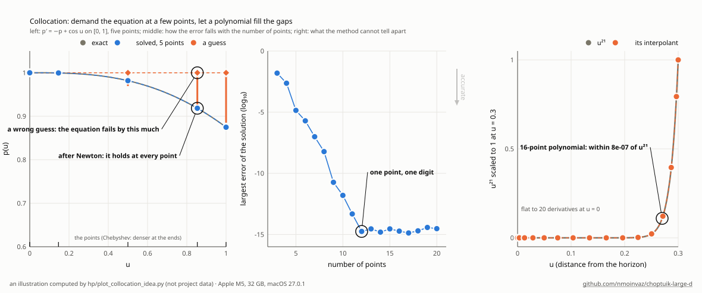
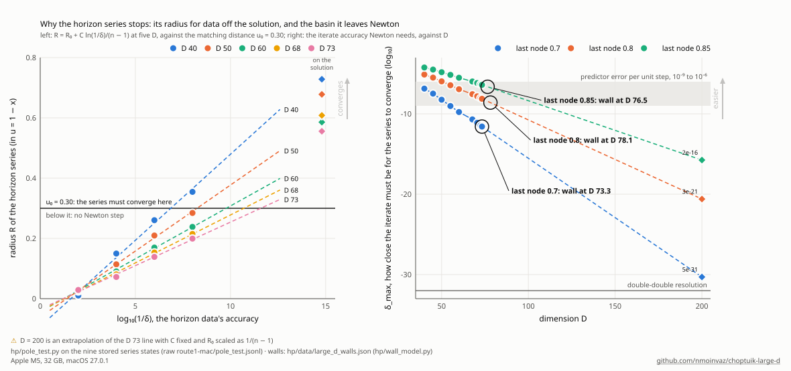
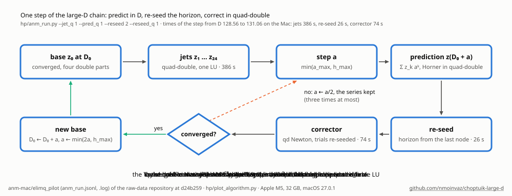
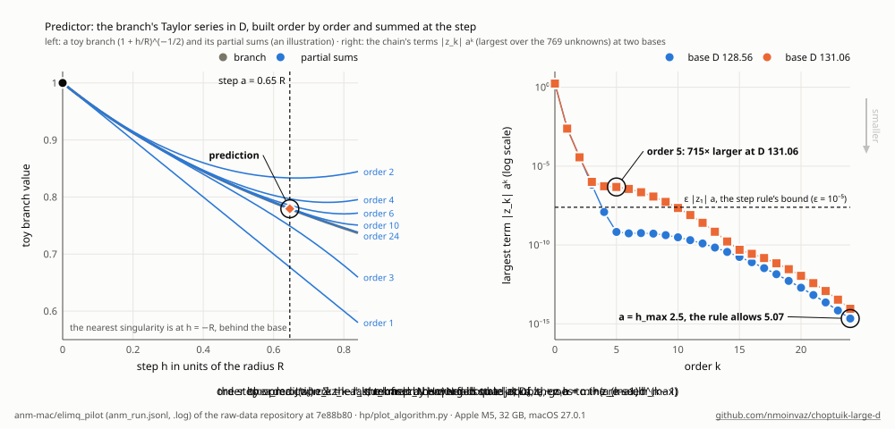
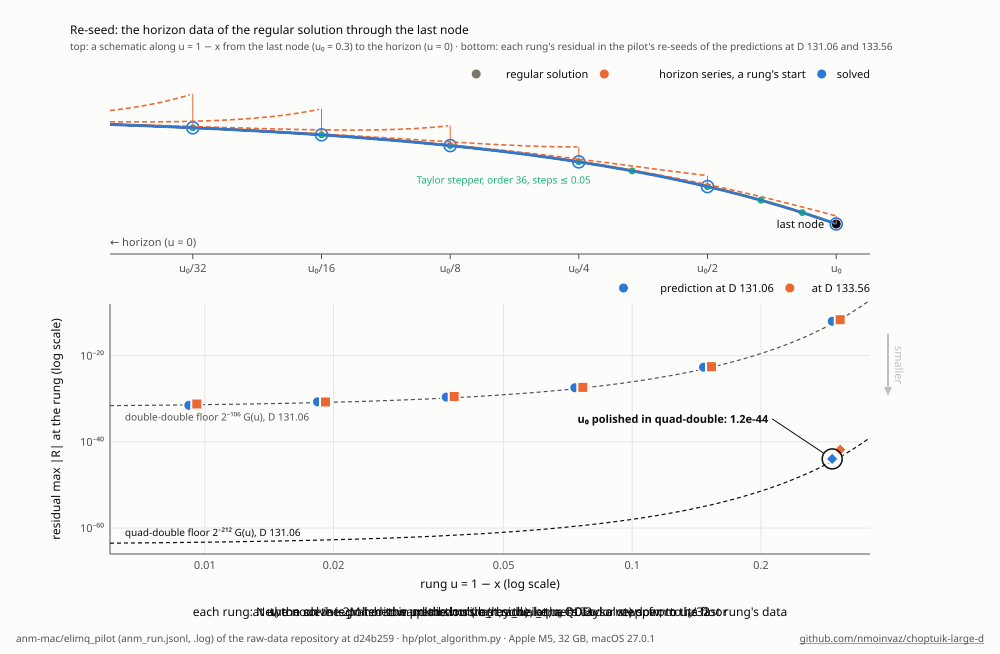
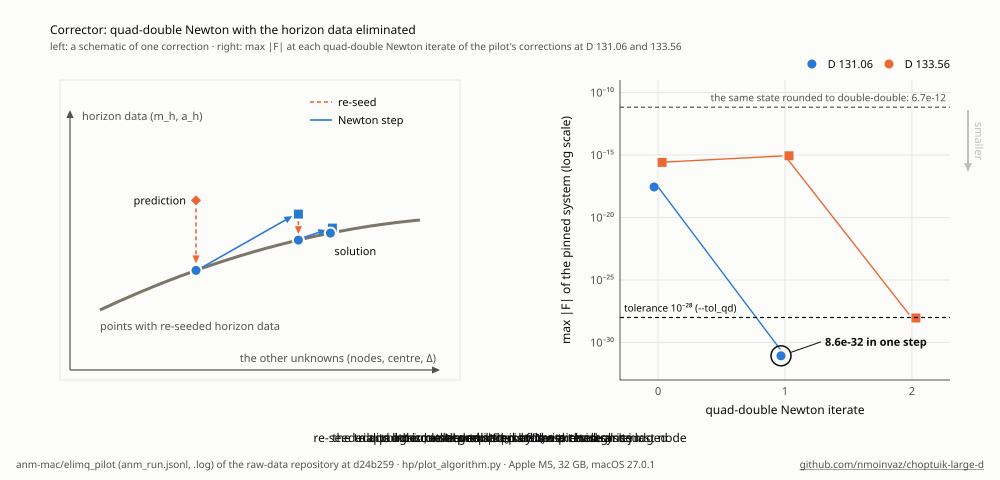

# Quad-double arithmetic in the Rust kernel (`hp/`)

> **Moved.** The arithmetic described here (`dd.rs`, `v8.rs`, `dv.rs`, `qd.rs`, `qv.rs`, `exact.rs`, `qd_tests.rs`, the
> dual lanes and the LU) now lives in the separate crate [multidouble](https://github.com/nmoinvaz/multidouble) (crates.io), which
> `hp/Cargo.toml` names by version. Paths `hp/src/<file>` below are that crate's `src/<file>`; the feature `qd_mutate`
> is its feature `mutate`; `hp/qd_check.py` runs the Rust tests in a checkout of it. The logs below were made before the
> move; the code is the same.

Quad-double numbers (an unevaluated sum of four f64, about 64 significant digits) are now in the `hpkernel` crate:
a scalar type `QD` and an 8-lane SIMD type `QV` with bitwise the same results, on the AVX-512, AVX2 and portable
backends of `v8.rs`. Sections 1–10 describe them as first built, when nothing in the solver used them yet; the
quad-double solver built on them is in section 12.1 onward. Every existing output is bit-identical (section 9). The
logs behind every number here are in `hp/data/quad_double/`, and the commands run in `hp/`.

**Summary.**

- **Accuracy** against exact arithmetic (and, independently, mpmath): every operation is within its threshold in all
  seven input categories. The thresholds were written before the runs (section 2).
  - The accurate operations (accurate add, accurate mul, qd × f64, accurate div) err by at most 0.083 u.
  - The library's defaults (sloppy add, sloppy mul, sloppy div) and sqrt err by at most 0.016, 0.38, 2.1 and 0.38 u.

  Here u = 2⁻²⁰⁹ ≈ 1.2×10⁻⁶³, so 2.1 u is 63 correct digits and 0.02 u is 65. The literature's ε_qd is 0.25 u
  (section 3).
- **Two repairs of the QD library's algorithms**, each confirmed independently:
  - The accurate (IEEE-style) add drops the accumulator's low part v in one branch: 16.8 u in 2 of 20 000
    near-cancelling sums here, and up to 86 u in a later check of the current C++ library, against the stated 0.5 u.
    The first repair (x₃ = u + v) was incomplete: it still left up to 11 u on some sums. The repair now in the code
    renormalizes five terms, with a worst case of 0.016 u over 180 000 such sums (Finding 1, addendum).
  - The square root loses all but 53 bits above about 2⁸⁶⁰ and below about 2⁻⁸⁶⁰. Its operand is now scaled by an
    exact power of four.

  Also, the sloppy add, whose stated bound is only Cray-style, never exceeded 0.016 u relative to the result.
- **Cost** (one thread, AVX-512, section 6). Quad-double over double-double:

  | add | multiply | divide | a·b + c | dot-product term |
  |---|---|---|---|---|
  | 8.3× | 22.5× | 12× | 16× | 17× |

  AVX2 runs quad-double 1.3–1.9 times slower than AVX-512.
- **A quad-double residual** at D = 3.7, M = 80 (section 7):
  - Its lane work measures 10–11 times the double-double one. The model's own generic code with `QV` lanes takes
    0.97–1.00 s against 0.092–0.100 s on one thread.
  - With the horizon LUs kept in double-double and refined in quad-double, a residual would take about 1.05–1.08 s
    against 0.15 s, about 7× at the same discretization.
  - The Taylor and series orders for a smaller truncation error would add a factor of about 2 (tolerance 10⁻⁴²)
    to 4 (10⁻⁶²).
- **Stage 2** (section 8): `QV` implements `Lane`, and the generic residual code compiles and runs with it. A
  quad-double residual needs the constants, D, n and the phase row in quad-double, a scalar-type parameter in the
  model, iterative refinement of the horizon solves, and a four-part state in the Python bindings. Effort: about
  6–9 agent-days.

## 1. What was built

Code in `hp/src`:

| file | contents |
|---|---|
| `qd.rs` | `QD` (scalar): QD's two-sum, FMA two-product, three-sum, renormalization (four and five parts), sloppy and accurate add, qd ± f64 and ± dd, sloppy and accurate multiply, qd × f64 and × dd, square, sloppy and accurate divide, reciprocal, sqrt, integer power, `mul_pwr2`, abs; conversions from f64 and dd (exact) and to f64 and dd; constants π, 2π, ε (exact); exact decimal parsing (`parse`, `FromStr`) and printing (`to_sci`, `Display` with 66 digits); `QdAcc`, the scalar sum-of-products accumulator; the mutation hooks of the controls (`qd::mutate`, feature `qd_mutate`) |
| `qv.rs` | `QV` (8 lanes, four `V8` registers, structure of arrays): every `QD` operation with the same algorithm, the data-dependent branches run on all lanes with masks; load, store, splat, broadcast, lanes; `QDotAcc`; `impl Lane for QV` (stage 2) |
| `v8.rs` | added: the mask type `M8` (compare `ne`, `eq`, `gt`, `ge`; `and`, `or`, `not`; per-lane select `sel`), `sqrt`, `pow2_floor`, for all three backends (`_mm512_cmp_pd_mask` / `_mm512_mask_blend_pd`, `_mm256_cmp_pd` / `_mm256_blendv_pd`, arrays) |
| `exact.rs` | exact arithmetic on dyadic rationals (big integers, no dependency): the decimal input/output and the tests' reference |
| `qd_tests.rs` | the accuracy, agreement, decimal and control tests, the mpmath dump, the benchmark, the two diagnostics of section 3 |
| `qd_residual.rs` | `QV` through the model's blocks (test), a counting lane, the residual's operation mix and timing (bench) |

Also `hp/qd_check.py` (independent mpmath check; the three-backend check) and the cargo feature `qd_mutate`. No new
dependency and no inline assembly: the SIMD code is `std::arch` intrinsics only, as in `v8.rs`.

**Defaults.** The operators follow the QD library's default configuration (`qd_config.h`: `QD_IEEE_ADD` unset,
`QD_SLOPPY_MUL` and `QD_SLOPPY_DIV` set): `+`, `-` the sloppy add, `*` the sloppy multiply, `/` the sloppy divide.
`ieee_add`, `accurate_mul` and `accurate_div` are the others. (`DV`'s `+` is the accurate double-double add, which
costs about as much as the sloppy one; for quad-double the accurate add costs 4.5 times the sloppy one, section 6.)

**How the branches run on 8 lanes.** QD's renormalization skips zero error terms, and its accurate add merges the
eight parts by magnitude. Both branch on the data, and both are emulated exactly with masks:

- The renormalization's second pass, written with a slot index k (the part being filled), is
  (t, e) = quick_two_sum(s[k], c); s[k] = t; s[k+1] = e; k += (e ≠ 0). The last step at k = 3 keeps t only (QD's
  `s3 += c4`). k is held as threshold masks, and the slots are updated by selects.
- The merge add keeps per-lane read positions i, j and output position k. It reads a[i] and b[j] by selects, freezes
  lanes that have finished, runs at most seven steps, and stops once all lanes are done.

**Departures from QD, each for a reason found or stated here:**

1. The accurate add keeps v as a fifth term and renormalizes five terms where QD keeps u alone (section 3).
2. sqrt scales its argument by an exact power of four into [1, 4) (section 3).
3. The O(ε³) and O(ε⁴) partial products that QD sums in plain arithmetic are summed by FMA, in QD's order. A C
   compiler contracting QD's expression would do the same.
4. Decimal input and output are exact instead of QD's digit-by-digit loops. `parse` rounds the exact decimal value
   to four parts by greedy round-to-nearest (x₀ = RN(v), x₁ = RN(v − x₀), ...; error ≤ ulp(x₃)/2 ≤ 2⁻²¹²|v|).
   `to_sci` prints the exact four-part sum correctly rounded (half to even).
5. `to_f64` returns x₀ + (x₁ + (x₂ + x₃)) where QD returns x₀, as `DD::to_f64` returns hi + lo.
6. `QDotAcc` is new (QD has no accumulator); section 3.

The model never calls exp, log, sin or cos: its set-up (D matrix, phase weights, n) is computed in Python with
mpmath and passed in. So no transcendental functions were written; a quad-double set-up needs those values to about
70 digits from Python (section 8).

**Inlining.** On the SIMD backends the hot operations are forced inline: the renormalizations, the sloppy add and
multiply, × and + f64, and the accumulator. Done on the portable backend's 8-element arrays as well, that made its
test build exceed 3 GB of memory (killed) after 17 minutes. There the compiler now decides, and the build takes
16 CPU-minutes and 1.2 GB. The other large operations are never forced.

## 2. Algorithms, sources, and the bounds expected before the runs

- **Error-free transformations:** two-sum (Knuth), quick-two-sum (Dekker), and the FMA two-product. These are the
  same functions as in `dd.rs` and `dv.rs`.
- **Quad-double:** Y. Hida, X. S. Li, D. H. Bailey, *Algorithms for quad-double precision floating point arithmetic*,
  ARITH-15 (2001); LBNL report, https://escholarship.org/uc/item/69q5t2mj; library QD 2.3.
  - The texts of `renorm` (both), `three_sum`, `three_sum2`, `quick_three_accum`, `ieee_add`, `sloppy_add`, qd + f64
    and qd + dd were compared with `qd_inline.h` as served by an LXR mirror
    (https://eic-code-browser.sdcc.bnl.gov/lxr/source/include/qd/qd_inline.h). They were read through WebFetch, as
    quotes and line-by-line extracts.
  - The sloppy multiply, qd × f64, the square and the sloppy divide were checked step by step against a summary of
    the oct Lisp port (https://people.eecs.berkeley.edu/~fateman/generic/newer-versions/newoct/oct-3-arg/qd.lisp).
  - The configuration defaults come from `qd_config.h` on the same mirror.
  - The accurate multiply, qd × dd, the accurate divide and sqrt follow my reading of QD 2.3 and the paper's
    description: the O(ε⁴) partial products, five quotient terms, three Newton steps. They were not compared line by
    line with the C++ source.
- **The accumulator:** T. Ogita, S. M. Rump, S. Oishi, *Accurate sum and dot product*, SIAM J. Sci. Comput. 26 (2005)
  (SumK). *(Recalled, not re-read for this note.)*
- **Prior SIMD quad-double:** T. Kouya, *Acceleration of multiple precision matrix multiplication based on
  multi-component floating-point arithmetic using AVX2* (arXiv:2101.06584). It uses QD's sloppy add and multiply on
  AVX2 and runs the renormalization's branches as a scalar loop over the lanes.

The bounds expected before any test ran, and the pass thresholds, were committed first (e789a42). They are repeated
here. The paper states:

- the sloppy add: a ⊕ b = (1 + δ₁)a + (1 + δ₂)b with |δᵢ| ≤ ε_qd = 2⁻²¹¹ = 0.25 u, a Cray-style bound;
- the accurate add: |δ| ≤ 2ε_qd "or so" relative = 0.5 u;
- multiplication: |δ| ≤ ε_qd = 0.25 u;
- nothing for division or sqrt; and "Necessary conditions for this renormalization algorithm to work correctly are,
  unfortunately, not known."

My expectations, derived from the algorithms and not proved:

| operation | expected | threshold |
|---|---|---|
| accurate add | 0.5 u relative | 1 u |
| sloppy add, qd + f64, qd + dd | 0.25–0.5 u × (\|a\| + \|b\|) | 1 u × (\|a\| + \|b\|) |
| sloppy mul, qd × dd, square | ≲ 1 u relative | 2 u |
| accurate mul, qd × f64 | 0.25 u, ≲ 1 u | 1 u |
| sloppy div | ≲ 2 u relative | 4 u |
| accurate div | ≲ 1 u relative | 2 u |
| sqrt | ≲ 2 u relative | 4 u |
| parse | ≤ 0.125 u relative | 0.25 u |
| dot accumulator, n terms | ≲ (8 + n)/8 u × Σ\|aᵢbᵢ\| | (8 + n)/8 u |

Near underflow an absolute allowance of 16·2⁻¹⁰⁷⁴ was planned.

**Changed in the tests after the first runs** (each reported, none to make a failure pass):

- The near-underflow allowance is now defined on the quantity each test checks. For add and mul that is the result.
  For division it is the residual r·b − a: 16·2⁻¹⁰⁷⁴·(1 + |b|), because the quotient's parts cannot go below 2⁻¹⁰⁷⁴
  and the remainders are formed at the dividend's scale. For sqrt it is r² − a: 16·2⁻¹⁰⁷⁴·(1 + 2|r|). The first run
  put 16·2⁻¹⁰⁷⁴·|b| on the residual and failed 210 division cases; the second put 16·2⁻¹⁰⁷⁴ and failed 489 others.
  The cases were the two floors.
- The square got its own input ranges: the first run reused the multiply's, and a² overflowed.
- A seventh input category, *computed* operands, was added (section 3).
- `QD::EPS` was the decimal literal of QD (1.21543267145725e-63), which is not 2⁻²⁰⁹; it is now exact.

## 3. Accuracy

**How it is measured.** Every input is built from an exact random value by greedy rounding (`exact.rs`), without
any quad-double arithmetic, except the computed category, which is generated with no mutation active. Every
reference is exact.

- Add and mul: the result against the exact sum or product.
- Div: the residual |r·b − a| / |a|, which equals the relative error of r.
- sqrt: |r² − a| / (2|a|).
- The Cray-style operations are checked against |a| + |b|, and their error relative to the result is reported too.

`python3 qd_check.py mpmath` recomputes all of it with mpmath at 3000 bits (the 120 digits asked for are a lower
bound, needed so that sums of parts are exact under deep cancellation). It shares no code with `exact.rs`. On 2000
inputs per row it gives the same maxima and 99.9th percentiles as the Rust reference
(`hp/data/quad_double/mpmath_check.log`, exit 0).

The input categories, for every operation:

| category | inputs |
|---|---|
| wide | exponents of a and b uniform in ±400 (sqrt ±800) |
| cancel | adds: b = −a + d with \|d\| = 2⁻ᵏ\|a\|, k = 1..260; mul: (1 + d₁)(1 − d₂); div: b = a(1 + d); sqrt: 1 + d |
| overflow | results and operands up to 2¹⁰²² |
| underflow | results between 2⁻¹⁰²⁰ and 2⁻⁸⁶⁰, so that the last parts are subnormal or zero |
| pow2 | b (sqrt: a) within 2⁻ʲ of a power of two, j around the part boundaries (52–54, 105–107, 158–159, 211–212) or random, and exact powers of two |
| sparse | sums of 1–4 small integers with random binary gaps (exact sums, zero error terms: the renormalization's branches) |
| computed | operands from quad-double arithmetic (x·y·(1/y)), so with QD-renormalized parts instead of greedy ones; for the adds b = −x·y·(1/y) or b = −(a + d), so a + b is about 2⁻²¹⁰\|a\|, as in a residual's subtraction |

**Results** (in `hp/`, `QD_N=20000 QD_REPORT=1 cargo test --release --lib qd_`, with RUSTFLAGS choosing the backend;
`hp/data/quad_double/accuracy_n20000.log`;
20 000 inputs per operation and category; max and 99.9th percentile over the six categories other than underflow;
units of u = 2⁻²⁰⁹):

| operation | measure | expected | threshold | max | 99.9% | worst category |
|---|---|---|---|---|---|---|
| accurate add | relative | 0.5 | 1 | 0.083 | 0.015 | cancel |
| sloppy add | / (\|a\| + \|b\|) | 0.25 | 1 | 0.016 (relative: 0.016) | 0.015 | pow2 |
| qd + f64 | / (\|a\| + \|b\|) | ≲ 0.5 | 1 | 0.016 | 0.015 | overflow |
| qd + dd | / (\|a\| + \|b\|) | ≲ 0.5 | 1 | 0.016 | 0.015 | pow2 |
| accurate mul | relative | 0.25 | 1 | 0.016 | 0.015 | wide |
| sloppy mul | relative | ≲ 1 | 2 | 0.38 | 0.18 | overflow |
| qd × f64 | relative | ≲ 1 | 1 | 0.024 | 0.020 | overflow |
| qd × dd | relative | ≲ 1 | 2 | 0.20 | 0.074 | overflow |
| square | relative | ≲ 1 | 2 | 0.15 | 0.10 | computed |
| accurate div | relative | ≲ 1 | 2 | 0.036 | 0.022 | overflow |
| sloppy div | relative | ≲ 2 | 4 | 2.07 | 0.56 | cancel |
| sqrt | relative | ≲ 2 | 4 | 0.38 | 0.19 | wide |
| parse | relative | 0.125 | 0.25 | 0.015 | 0.014 | |
| dot, n = 16 / 128 | / Σ\|aᵢbᵢ\| | 3 / 17 | 3 / 17 | 0.24 / 0.58 | 0.21 / 0.35 | |

- **In decimal digits:** 0.016 u is a relative error of 2×10⁻⁶⁵ and 2.07 u one of 2.5×10⁻⁶³.
- **Where the errors come from.** A result's last part, correctly rounded, contributes up to ulp(x₃)/2. For the
  parts of random numbers that is typically 2⁻²¹⁵ to 2⁻²¹² relative (0.015–0.125 u). The accurate operations stay at
  that level, below the literature's ε_qd by a factor of 3 to 15. The sloppy operations sit 10–100 times higher.
- **Near underflow** (every row passes with the allowance): add and accurate add are exact or 0.01 u; mul, square
  and the divisions are limited by the subnormal floor of their last parts (relative errors up to 2⁻⁵¹, absolute
  within 16·2⁻¹⁰⁷⁴ of the result or residual); sqrt keeps 0.28 u.
- **Decimal I/O:**
  - greedy round-to-nearest of the parse held in 20 000 of 20 000 cases (exact check);
  - 45 000 printed strings (1–100 digits) are all correctly rounded (exact check, and the same as mpmath's `nstr`);
  - 5000 round trips through the exact digits and 5000 through 70 digits give back the same four parts.
  - `to_dd` is within 2⁻¹⁰⁵ relative and `to_f64` within half an ulp in all 20 000 cases.
- **Scalar and 8-lane** agree bitwise, lane by lane, in every operation, category and input (the "lanes" column of
  the tables, 0 everywhere), for the conversions, and for the accumulator.

### Finding 1: QD's accurate add drops half of its last part when all eight parts are read with three emitted

With 20 000 near-cancelling inputs, 2 accurate adds had relative errors of 5.7 and 16.8 u, against the stated 2ε_qd
(0.5 u) (`accuracy_n20000_before_repairs.log`). mpmath confirms both independently. The sloppy add gets these inputs
right. A step-by-step trace of the second case, in a Python transcription of the same operations, shows the
mechanism:

- the leading parts cancel by 2¹⁵ (|a|/|a + b| = 4.1×10⁴);
- the merge emits three parts and then has read all eight;
- QD's branch `x[k] = u; if (k < 3) x[++k] = v;` then stores u and drops v;
- after the cancellation, the accumulator's u has only about 41 significant bits, and v holds the next 12.

This branch (lines 305–310 of `qd_inline.h`) was quoted from the source. `QD::ieee_add` keeps x₃ = u + v in that
branch. `cargo test --release --lib qd_diag -- --ignored --nocapture` (`diag.log`; 200 000 sums a + b = 2⁻ᵏa, by k)
compares a literal copy of QD's algorithm with it:

| cancellation k (bits) | 1–7 | 8–15 | 16–23 | ≥ 24 |
|---|---|---|---|---|
| QD 2.3: max relative error (cases above 1 u) | 1.17 u (1) | 10.1 u (3) | 4.4 u (1) | 0 |
| `QD::ieee_add` | 0.12 u | 0.015 u | 0 | 0 |

A first hypothesis, that the merge's leftover accumulator is dropped when four parts are emitted before all are
read, was tested the same way and changed nothing (`diag_first_design.log`, "remainder kept").

**Addendum (2026-10-22, coordinator): the u + v repair was incomplete.** A later check of the current C++ library
(github.com/BL-highprecision/qd at b527a4b, whose `ieee_add` is unchanged) used sums a = round(x), b = round(−x + d)
with x and d of 424 random bits, |d| ≈ 2⁻ᵏ|x|, k = 1–30, checked against mpmath. QD itself reached 86 u (about 1 sum
in 6 000 above 1 u). Keeping x₃ = u + v still left 1.3, 3.9 and 10.8 u on some of them. The cause: after cancellation
the emitted parts can overlap, so the four slots hold fewer than 212 bits, and v can lie above the last bit of the
result while still falling below the rounding of u + v. The repair is now x₃ = u with v as a fifth term, and the five
are renormalized with `renorm5` (scalar `QD::ieee_add`, and the 8-lane `QV::ieee_add` on the lanes that take that
branch, selected by mask). Over 180 000 such sums the worst error is 0.016 u. `qd_ieee_add_regression` in
`qd_tests.rs` holds 11 of these sums: each must be within 1 u, the 8 lanes must equal the scalar results bit for bit,
and QD's literal algorithm must miss by more than 1 u (the control). The three-backend check passes with a new digest
(`data/quad_double/backends/`), since the repaired add changes some results.

### Finding 2: QD's sqrt loses accuracy near the ends of the exponent range

Every input of the first run's near-overflow sqrt category (a between 2⁹⁹⁰ and 2¹⁰²²) failed, with relative error
2⁻⁵²·⁶: the result was correct to its first part only. The iteration works on r ≈ 1/√a and forms r² ≈ 1/a, whose
lower parts underflow once a exceeds about 2⁸⁶⁰. Near underflow, h = a/2 drops the last bit of subnormal parts (457
of 800 failed). `QD::sqrt` now scales a by an exact power of four, 4⁻ᵏ with 2ᵏ = `pow2_floor`(√a₀), into [1, 4) in
two exact steps, runs QD's three Newton steps and scales back. All categories pass, with ≤ 0.38 u. (These first runs
were on the scratchpad and not kept; the repair's effect is in the overflow and underflow rows of
`accuracy_n20000.log`.)

### Finding 3: the sloppy add stays accurate relative to the result

QD's sloppy add has only a Cray-style bound, error ≤ ε_qd(|a| + |b|), and so may fail relative to a small result.
In none of 140 000 inputs did its relative error exceed 0.016 u: not in near cancellation down to 2⁻²⁶⁰, nor with
operands computed along different routes. Its dropped terms are third-order errors (of the errors of a₂ + b₂ and
a₃ + b₃). For QD-normalized operands, total cancellation forces the parts to pair up almost exactly, so those terms
are zero or tiny. This is numerical evidence over these categories, not a proof, and no counterexample was searched
for beyond them. For a residual, where the error matters relative to the operands, the Cray-style bound is the
relevant one anyway.

### The dot accumulator (`QDotAcc`), and why it has five levels

Each product is expanded into its partial products by order:

- order 0: a₀b₀;
- order 1: a₀b₁, a₁b₀ and the error of a₀b₀;
- order 2: a₀b₂, a₁b₁, a₂b₀ and the errors of the order-1 products;
- order 3: the four O(ε³) products by FMA and the errors of the order-2 products.

The O(ε⁴) products are dropped, as in the sloppy multiply. Level l of the accumulator sums the order-l terms with
two-sums, and their errors go to level l + 1.

The first design had four levels, the last summed in plain f64. At n = 128 it exceeded the pre-registered threshold
(22.8 u against 17, in 1 of 312 sums; `accuracy_n20000_before_repairs.log`). `qd_diag_accumulator` separates the
sources (maxima over 4000·16/n random sums of n products):

| | n = 16 | 128 | 512 |
|---|---|---|---|
| first design, as built (`diag_first_design.log`) | 1.9 u | 16.8 u | 72 u |
| its level 3 replaced by the exact sum of its inputs | 0.042 u | 0.012 u | 0.003 u |
| five levels, every running-sum error by its own two-sum (`diag.log`) | 0.57 u | 0.37 u | 0.88 u |
| the same, its levels summed exactly (no `finish`) | 0.57 u | 0.37 u | 0.88 u |

So the products' truncation costs below 0.12 u, and `finish` costs nothing; the first design's error was level 3's
plain rounding. The two-sum errors of adding into a running sum are relative to that sum, not to the terms, so
level 3 grows to about n^1.5·2⁻¹⁵⁹ Σ|aᵢbᵢ| (2⁻¹⁵³ at n = 128), and each plain addition into it rounds at about 8 u.
Now level 3 is error-free as well, the errors of adding into the running level-2 and level-3 sums enter the next
level by their own two-sums, and level 4 is the only plain sum.

The remaining error, below 1 u up to n = 512, is the plain summation of per-term errors that still carry the
running sums' lower-level errors. Carrying those separately too would cost three more two-sums per term and was not
done.

## 4. Controls

`cargo test --release --lib --features qd_mutate qd_controls` (`controls.log`) breaks one algorithm at a time, in
scalar and 8-lane alike unless marked, and reruns every accuracy, agreement and decimal check (1000 inputs per row).
All 16 fire, each on its own operation's rows:

| # | breakage | rows failing | lane mismatches |
|---|---|---|---|
| 1 | renormalization: last first-pass two-sum in plain f64 | 104 | 0 |
| 2 | sloppy add: error of a₀ + b₀ dropped | 13 | 0 |
| 3 | accurate add: merge takes the smaller part first | 7 | 0 |
| 4 | sloppy mul: error of a₀b₀ dropped | 14 | 0 |
| 5 | sloppy mul: error of a₀b₂ (an O(ε³) term) dropped | 14 | 0 |
| 6 | accurate mul: error of a₀b₁ dropped | 7 | 0 |
| 7 | qd × f64: error of a₁b dropped | 21 | 0 |
| 8 | qd × dd: error of a₀·b.lo dropped | 7 | 0 |
| 9 | qd + f64: error of a₀ + b dropped | 25 | 0 |
| 10 | qd + dd: error of a₁ + b.lo dropped | 7 | 0 |
| 11 | divide: third remainder update skipped | 14 | 0 |
| 12 | sqrt: one Newton step instead of three | 7 | 0 |
| 13 | accumulator: level-2 errors dropped | 20 | 0 |
| 14 | parse: last part truncated instead of rounded | 3 | 0 |
| 15 | 8-lane only: renormalization's zero test ignored (step c2) | 29 | 18 413 |
| 16 | 8-lane only: merge add reads the next part of a one late | 7 | 6354 |

- The two 8-lane-only breakages are caught by the bitwise lane check. No. 16 leaves the accuracy intact (0.015 u),
  which shows why that check is needed.
- The parse truncation is caught by the exact greedy-rounding check and the round trips, not by the 0.25 u threshold.
  Truncating the last part errs by less than 2⁻²¹¹, inside it.
- The independent mpmath check fails, as it must, on a dump made with a breakage:
  - `python3 qd_check.py mpmath --mutate=5`: exit 1, 8482 failures (`mpmath_control_mutate5.log`);
  - `--mutate=14`: exit 1, 470 greedy-rounding violations (`mpmath_control_mutate14.log`).
- The QV-through-model test's control (Δ moved by 10⁻²⁰) fires at 9.7×10⁻²³ against the 10⁻²⁶ threshold.

## 5. Backends

`python3 qd_check.py backends` builds and runs the quad-double tests (4000 inputs per row) with each `v8` backend:

- AVX-512: `-C target-cpu=x86-64-v4`;
- AVX2: `-C target-feature=+avx2,+fma`;
- portable: no target features.

All three pass, and the digest of all scalar results is the same: cc1ea59faf5a7550 (`backends.log`, `backends/`).
Each build also checks its 8-lane results against the scalar ones bit for bit. Since the scalar code is the same IEEE
operations everywhere, all three backends give the same bits. The check writes each backend's result to
`data/quad_double/backends/<isa>.txt`, and a rerun skips the ones already recorded as passed, because the container
restarted twice during this work.

The AVX-512 build uses x86-64-v4 instead of `native`. After a restart the container moved to a host without AVX-512
VBMI/IFMA, and a test binary built with `native` on the earlier host stopped with SIGILL. A bare
`+avx512f,+avx2,+fma` feature list made LLVM fail to select an instruction.

## 6. Benchmarks

`cargo test --release --lib bench_qd -- --ignored --nocapture` measures one thread, in ns per lane and operation, 16
independent vectors per pass (throughput), minimum of 5 timings per row. The figures are the per-row minimum of two
runs (`bench_avx512_run2.log`, `_run3.log`, `bench_avx2_run2.log`, `_run3.log`). The host is an Intel Xeon @ 2.80
GHz with AVX-512 F/BW/CD/DQ/VL; another session's single-threaded job ran on the second core. "a·b + c" is a
multiply then an add; the dot term is a 16-term sum through the accumulator, finished, per term.

| AVX-512 (x86-64-v4) | f64 | double-double | quad-double | qd/dd |
|---|---|---|---|---|
| add | 0.12 | 0.55 | 4.55 | 8.3 |
| mul | 0.11 | 0.28 | 6.20 | 22.5 |
| div | 0.64 | 4.17 | 50.0 | 12.0 |
| a·b + c | 0.11 (FMA) | 0.87 | 14.3 | 16.3 |
| dot term | 0.05 | 0.35 | 5.81 | 16.6 |
| accurate add / accurate mul / accurate div / qd × f64 / sqrt | | | 20.6 / 7.8 / 71 / 4.3 / 144 | |

| AVX2 | f64 | double-double | quad-double | qd/dd |
|---|---|---|---|---|
| add | 0.10 | 0.75 | 8.76 | 11.7 |
| mul | 0.09 | 0.34 | 9.62 | 28.7 |
| div | 0.60 | 4.90 | 66.3 | 13.5 |
| a·b + c | 0.10 (FMA) | 1.40 | 21.1 | 15.0 |
| dot term | 0.08 | 0.55 | 7.79 | 14.2 |
| accurate add / accurate mul / accurate div / qd × f64 / sqrt | | | 45.1 / 13.1 / 88 / 7.9 / 172 | |

So:

- **A quad-double add costs about 8–12 double-double adds, and a multiply about 23–29 double-double multiplies.** The
  double-double multiply is very cheap (7 instructions), while the quad-double one does 6 two-products, 3 three-sums
  and a masked five-part renormalization (about 170 instructions per 8 lanes).
- **In sums of products, the form the model uses most, the ratio is 14–17×.**
- **The masked branches cost.** The accurate add (the merge) is 4.5 times the sloppy one, and AVX2's blend
  instructions cost more than AVX-512's mask registers: quad-double runs 1.3–1.9 times slower on AVX2, against
  1.2–1.6 for double-double.
- **The machine matters by about 20%.** On the host used before the container moved (AVX-512 with VBMI/IFMA,
  `native` builds; `bench_previous_host.log`), quad-double over double-double was 9.8× for add, 27.5× for multiply
  and 13.2× for divide.

## 7. What a quad-double residual would cost

Measured by `FILE=ctx.bin cargo test --release --lib bench_qd_residual -- --ignored --nocapture` (runs 2 and 3:
`residual_M80_run2.log`, `_run3.log`). The state is D = 3.7, M = 80 (`data/lowD_states/lowDv_D3.7000_M80.npz` via
`hp/dump_ctx.py`: kt 36, kc 100, ks 250, 13 nodes, 86 Taylor steps), one thread, AVX-512, same host. Two methods.

**Operation mix** (a counting lane through the model's generic code; 8-lane operations, over all 14 blocks):

| Cauchy-sum products (`acc a b`) | τ-derivative products by D (`acc a c`) | × integer (`x f64`) | adds | × constant | `finish` | multiplies | divides |
|---|---|---|---|---|---|---|---|
| 11.9 M | 5.5 M | 2.0 M | 0.77 M | 0.51 M | 0.49 M | 0.14 M | 1754 |

Weighted by each operation's quad-double cost (run 2), the shares are: Cauchy products 48%, D products 22%, `finish`
11%, × integer 9%, the rest 10%. Counts times costs predict the blocks at 0.062–0.073 s in double-double and
0.78–0.80 s in quad-double (ratio 11–13). That is 18–38% below the measured times, from the memory traffic and
latency a throughput benchmark does not see.

**Direct measurement:** `QV` implements `Lane` (section 8), so the same blocks run with quad-double lanes:

| part (one thread) | double-double | quad-double | |
|---|---|---|---|
| lane work of the 14 blocks (centre, 12 Taylor segments, horizon series) | 0.092–0.100 s | 0.97–1.00 s | measured, 9.8–10.9× |
| of which 251 horizon solves | 0.006 s | 0.006 s | double-double LU in both |
| 251 horizon LU factorizations (80 × 80) | 0.052–0.067 s | the same | kept double-double (section 8) |
| refinement of the horizon solves | | about 0.012 s | a second double-double solve and a quad-double D-product each (estimate) |
| the rest of `residual` | ≤ 0.004 s | about 0.01 s | estimate |
| residual | 0.153–0.156 s | about 1.05–1.08 s (about 7×) | |

With two threads the double-double residual took 0.1 s of the 3.5 s mixed Newton step at M = 80 on the earlier host
(`hp/data/mixed_precision/profile.log`). At 7× the quad-double one would take about 0.7 s, about 17% of a step,
if the Jacobian stays f64.

**At a smaller truncation error the discretization costs more.** The Taylor plan's step is
h ∝ (tol/|c_kt|)^(1/kt), and the series orders kc and ks are set for 10⁻³⁰. These are estimates from that step rule,
not measurements:

- At tol 10⁻⁴², enough for the 2× per unit of D growth of rounding effects from D = 61 to about 100, kt = 48 gives
  about the same steps for 1.6–1.8 times the work per step, a factor of about 2.
- At tol 10⁻⁶², kt = 60–80 minimizes the work at about 4 times.

The series orders kc and ks grow in proportion to the digits; ks also multiplies the number of horizon LUs. So a
quad-double residual is about 7 times a double-double one at the same discretization, and about 15 to 30 times at
10⁻⁴² to 10⁻⁶².

**Cheap savings not taken:**

- the accumulator's `finish` (five qd + f64 additions): 11% of the quad-double lane work;
- the integer weights of `cs_w` multiplied in quad-double: 9%; folding them into the accumulator would avoid this;
- a multiply by a double-double constant with qd × dd instead of qd × qd: 4%.

## 8. Stage 2: readiness for a quad-double residual

**Done.**

- `impl Lane for QV` (in `qv.rs`): `Acc = QDotAcc`, and the model's constants and inputs (`DV`) enter exactly with
  `QV::from_dv`.
- `qd_residual::qv_lane_blocks_agree` runs every block of a small synthetic context (M = 8, nodes 0.005–0.1, ks 30)
  through `model::block_state::<QV, _>`: the centre series, the Taylor stepping and the horizon series with its
  periodic solves. QV agrees with DV to 5.8×10⁻³²; the check is 10⁻²⁶, and Δ moved by 10⁻²⁰ gives 9.7×10⁻²³. It runs
  in `cargo test` and on every backend.
- `bench_qd_residual` runs the real M = 80 context (section 7).
- No solver or Python function uses it.

What this instantiation is not: a quad-double residual. The trait passes every constant as double-double (`cst`,
`mulc`, `addc`, `accc` take `DV`; `splat`, `muls` take `DD`); `val()` rounds back to double-double; the horizon
solves are double-double (`DDLu`). So it computes in quad-double with double-double data. Its cost is that of a real
quad-double residual, since the constants' zero lower parts are not exploited.

**What a quad-double residual needs**, with my estimate of the work for an agent session:

1. **A scalar type in the model** (1.5–2 days).
   - About 70 lines of `model.rs` compute constants in `DD`: n − 1, n/2, 1/k, 1/x₀, x₀², the centre series' 2 × 2
     inverse, 2π/Δ, the step h, u₀, κ.
   - `Lane` gets an associated scalar type (`DD` for the existing lanes, `QD` for `QV`) and a constant vector type
     (`DV` or `QV`). `cst`, `mulc`, `addc`, `accc`, `splat`, `muls`, `val` and `from_vt` use them. A small `Scalar`
     trait over `DD` and `QD` (+ − × ÷, `mul_f`, `from_f64`, `ONE`, `TWO_PI`) lets the model's functions be written
     once.
   - The existing lanes keep `DD` and `DV`, so they perform the same operations, and `mixed_check.py ref` guards
     their bits.
2. **Constants in quad-double** (1 day).
   - `Ctx` needs n, the phase weights and λ in quad-double.
   - `DMat` needs quad-double columns. At M = 80 that is 205 KB against 102 KB in double-double, still L2-resident.
     `Lane::dmat_apply` for `QV` would use them.
   - Python computes them as it does now (`dmat_odd`, `phase_weights`, n = D − 2), at 80 digits instead of 40, split
     into four parts.
   - `field::DMat::from_rows` and the freeze projectors take four arrays.
3. **The horizon solves: double-double LU plus quad-double refinement, not a quad-double LU** (1 day).
   - Each periodic solve (ωD + diag κ)f = r uses the double-double LU already factored, then one or two refinement
     steps f += LU⁻¹(r − (ωD + κ)f), with the residual formed in quad-double by `dmat_apply`.
   - A double-double LU gives about 32 digits times the condition number per step. The pivots here range over
     10⁻³–10², so two steps reach quad-double.
   - Cost: about 0.012 s at M = 80, against 0.7–1.1 s for quad-double LUs of the 251 matrices at the measured
     ratios, which would also need a new blocked LU.
   - For the tangent lanes nothing changes.
4. **The residual function and the state** (1 day).
   - `residual_qd(z0, z1, z2, z3) -> (F0, F1, F2, F3)`: the blocks with `QV`, the targets read as four parts, the
     phase row in quad-double, the frozen-harmonic projectors in quad-double.
   - `Fl<QV, B>::load/store` for four arrays.
5. **Python** (1–2 days).
   - `Solver.residual_qd`, and the state as four arrays (`z0..z3` in the `.npz`; double-double states load with
     z2 = z3 = 0).
   - Driver helpers `qd_from_mp`, `qd_add`, `qd_norm`.
   - A Newton loop for quad-double: chord steps with the f64 Jacobian's LU from the double-double solve, dz from F
     rounded to f64, and z ← z − dz in quad-double.
   - With the measured contraction of about 10⁻⁷ per step (notes/MIXED_PRECISION.md), going from |F| ≈ 10⁻³⁰ to
     10⁻⁶⁰ takes about five chord steps. Each is one quad-double residual and one f64 solve, about 3.5 s at M = 80 on
     two threads at the same orders.
6. **Tests** (1–2 days).
   - At a converged double-double state, the quad-double residual must equal the double-double one to 10⁻³⁰ and be
     computable to 10⁻⁵⁰ and below.
   - A planted solution, a state built by integrating with known data, must give |F| at the quad-double floor.
   - Convergence at M = 16 to |F| ≈ 10⁻⁶⁰.
   - The truncation orders (kt, kc, ks, plan tolerance) for 10⁻⁴² and 10⁻⁶², with the cost of section 7.

Total about 6–9 agent-days. The predicted residual cost is about 7 times the double-double one at the same
discretization (about 1.05 s on one thread at M = 80, 0.7 s on two). At the orders needed for a 10⁻⁴²–10⁻⁶²
truncation error it is 2–4 times that. The Jacobian stays f64.

## 9. Existing outputs are bit-identical

- `python3 mixed_check.py ref --save` with main's build (f91dafe, built privately in the scratchpad; the system
  `hpkernel` was not touched), then `--compare` with this branch's final build: all 17 arrays bit-identical.
  - Covered: the residual and the Jacobian, the Newton step and its pivots, the chord step, `lu_solve_t`,
    `mode_matrix` at λ = 0.3, and the frozen-harmonic and inward-node Jacobians at D = 3.7, M = 48.
  - Logs: `ref_save_main.log`, `ref_compare.log`.
- `hp/proto/test_dd.py` gives 1.24, 1.28 and 1.64×10⁻³², and 9.8×10⁻³¹ for `dd_solve` (`proto_test_dd.log`), the
  same digits as `hp/data/mixed_precision/proto_test_dd.log`.
- `cargo test --release` passes 8 tests, the three existing LU tests among them, and ignores 7 benches and
  diagnostics (`cargo_test.log`).
- Changes to existing files: additions only in `v8.rs` (masks, `sqrt`, `pow2_floor`) and `lib.rs` (modules), and the
  `qd_mutate` feature in `Cargo.toml`. No existing function changed.

## 10. Proposed README text (for the coordinator)

In "The double-double solver" list:

> - **Quad-double arithmetic (not yet used by the solver):** `hp/src/qd.rs` and `qv.rs` add quad-double numbers
>   (four f64, about 64 digits), scalar and 8-lane SIMD with bitwise the same results on AVX-512, AVX2 and portable
>   builds. They use the QD library's algorithms[^qd], with two repairs found by the tests (the accurate add's last
>   part, the square root near the ends of the exponent range). Against exact arithmetic they err by at most
>   2.1×2⁻²⁰⁹ (63 digits). They cost 8–29 times double-double per operation and 14–17 times in sums of products. A
>   quad-double residual would cost about 7 times the double-double one at the same orders
>   ([notes/QUAD_DOUBLE.md](QUAD_DOUBLE.md); `hp/qd_check.py`).

[^qd]: Y. Hida, X. S. Li, D. H. Bailey, *Algorithms for quad-double precision floating point arithmetic*, ARITH-15
(2001).

In the Layout block under `hp/`:

```
├── src/qd.rs, qv.rs  quad-double: scalar and 8-lane (not used by the solver yet)
├── qd_check.py     checks of the quad-double arithmetic against mpmath, and across the SIMD backends
```

## 12. Plan: a fully quad-double solver past D ≈ 73 (2026-10-27, the author's choice)

**Why.** The pinned double-double continuation (T72–T80, `raw/T73`, `raw/T75`, `raw/T80`) ends near D = 73.3: steps of
6×10⁻⁴ in D stall at |F| ≈ 10⁻¹⁹ against a tolerance of 1.1×10⁻²⁰, and the two pin choices' corrected Δ drift apart
(10⁻¹⁶ at D = 71, 8.6×10⁻¹⁵ at 73.1). The full system's u·κ is 10³ there (README, "Why the solver stalls"): the
double-double Jacobian's rounding, u·σ_max ≈ 10⁻²¹, exceeds its weakest singular value, 3×10⁻²⁴, so no double-double
Jacobian or LU resolves that direction. Done on `wip/qd-horizon` (be10434, 37468e6): `residual_qd`, the residual with
every block in quad-double (kernel test `residual_qd_agrees`), `QdSolver` (Newton–GCR on it, preconditioned by the
double-double LU) and `hp/full_step_check.py`. At D = 72.80 one such step with 60 GCR products (not converged) raised
|F| from 6×10⁻²² to 10⁻¹⁷, and Newton with line search made no progress (`raw/T76` 84517a1, 1e59a76).

**First, the deciding experiment.** The same step with GCR converged (up to 300 products):
- if it lowers |F|, the linear solve was the limit: Newton–GCR on `residual_qd` is the solver, no quad-double Jacobian;
- if it still raises |F|, the pinned state lies outside Newton's basin along the weak directions (basin 2σ²/c), and
  the solver must release the pinned harmonics one at a time in quad-double (pin 13 → 11 → 9 → 7 → none), each
  release solved from the last.

**Then, if a quad-double Jacobian is needed** (in this order; arithmetic in multidouble first, per AGENTS.md):
1. multidouble: a forward-mode dual over quad-double lanes (as `dual::Du` over double-double) and a quad-double dense
   LU with solve and transpose solve (as `linalg`'s double-double LU); tests and mutation controls; a release.
2. hp: `jacobian_lanes::<QDu, B>` for M = 32 and 48, a binding, and the Newton step on it; the bit-identity checks
   (`highm_check.py ref` and `scaled`) for the unchanged paths.
3. The driver: a quad-double Newton (deflated as `deflated_newton`) and `scan_hp --solver qd`; the stall detector's
   u·κ with u = 2⁻²⁰⁸ to check that the weakest direction is resolved (u·κ ≪ 1).
4. A pilot from T75's last states, then the run toward D = 100 on `raw/<task>`.

### 12.1 Built (2026-10-27, feat/qd-solver; raw/T81)

The arithmetic is multidouble 1.7.0 (PRs #23 and #24): `Qu`, a quad-double value and tangent, and `QDLu`, a dense
quad-double LU with partial pivoting. In hp, `model::residual_in` (on multishoot's engine) gives the residual with every
block in quad-double (the horizon solves refined to quad-double, value and tangent together), its exact Jacobian by `Qu`
lanes and the Newton step, for M = 32 and 48. `driver.newton_qd` is Newton on it, `scan_qd.py` the continuation in D,
and `qd_planted.py` the planted-root check.

**Precision tests.** The kernel tests (`cargo test --release --lib qsolve_`) run on the synthetic context.

| check | result | control |
|---|---|---|
| quad-double residual and Jacobian against the double-double ones | 5.5e-32, 5.9e-31 | |
| Jacobian against central differences (h = 2^-70) of the quad-double residual | 1.5e-41 | horizon solves unrefined: 6.6e-4 |
| two refinement steps against four | 3.3e-63 | |
| planted root from 1e-6 | 1e-6, 6e-8, 1e-14, 4e-28, 3e-55, 4e-62 | |
| a change of 2^-180 seen (J d to 1.6e-11) and undone (8.9e-8 of it left) | pass | state read in double-double: 1.0, 1.0 |

`qd_planted.py` at T75's D = 72.8 state (full system, kfreeze 13) solves G(z) = F(z) - F(z*), whose root is the state.
The pass criterion is at eps = 1e-40.

| start eps | quad-double max \|z - z*\| | \|Delta - Delta*\| | control (state in dd) | double-double \|Delta - Delta*\| |
|---|---|---|---|---|
| 1e-40 | 8.0e-42 | 1.0e-48 | 3.0e-27 | 2.2e-16 |
| 1e-36 | 2.1e-42 | 1.0e-49 | 3.0e-27 | 6.2e-16 |
| 1e-32 | 1.3e-41 | 2.4e-48 | 4.6e-27 | 1.2e-16 |
| 1e-28 | 3.8e-42 | 7.1e-49 | 5.5e-27 | 5.1e-17 |

Started at the root, the double-double Newton drifts to Delta errors near 1e-16. This is the 1e-16 A-B spread of
T75 at D = 71, so that spread is the double-double limit.

**Newton's basin.** A first run from eps = 1e-24 failed the criterion. Every solver, double-double included, took the
same first step to 2.3e-11. The cause is the nonlinearity, not precision. Newton's quadratic constant is
K = 2.3e-11 / (1e-24)^2, about 2e37, so the radius of quadratic convergence is near 4e-38. That is below
double-double's resolution of the state (about 1e-31 of its entries). A double-double iteration cannot enter it, which
is the large-D stall. A quad-double one can.

**The deciding experiment of section 12 was flawed.** `full_step_check.py` loaded only the state's first two parts, so
it started from the double-double truncation. Its quad-double residual was 6.4e-22. The state itself, with all four
parts, has a full-system residual of 1.6e-29.

**Step acceptance.** From that state the full-system Newton step has |dz| = 4.5e-9, mostly p1's harmonics 13, 11
and 9. Along it |F(z + lam dz)| = (1 - lam) 1.6e-29 + 5.2e-18 lam^2 exactly, so a decrease of max |F| accepts no step.
Deuflhard's natural monotonicity test with the old Jacobian rejects the full step too (ratio 748). The weak direction
turns between iterates. Full steps converge in four: 1.6e-29, 5.2e-18, 1.3e-31, 8.9e-32, 2.3e-53. `newton_qd`
therefore accepts a trial when the next correction, with its own Jacobian, is smaller.

**Convergence of T75's states in quad-double (full system).**

| state | result | Delta |
|---|---|---|
| pin 7, D = 72.8 | 2.3e-53 in 5 steps | 1.7816051756032902 - 4.7345207382657e-17 |
| pin 5, D = 72.8 | stalled at 8.2e-18 | (1.7816051756032902 - 4.7300989e-17) |
| pin 5, D = 73.0 | 2.5e-53 in 7 steps | 1.7812396819309262 + 3.9940754733380e-18 |
| pin 7, D = 73.0 | stalled at 7.8e-19 | (1.7812396819309262 + 3.993650e-18) |

The stalled runs halve |F| and |dz| at lam = 1/2 each step while the smallest pivot falls. That is Newton's
behaviour at a nearly double root: along the weak direction the residual is close to a perfect square. The converged
solutions have the smallest pivots, 2.3e-16 and 2.9e-16 against 1e-9 for the largest.

**Taylor plan.** The plan (Solver.plan, tol_step 1e-32) is computed from the state. Replanning at the converged
D = 72.8 state moved Delta by 9.1e-28, so with that tolerance Delta is defined to about 1e-27. `scan_qd.py` keeps a
plan until D moves --replan (0.5).

**Bit-identity of the bump from multidouble 1.5.1 to 1.7.0.** `highm_check.py ref` and `scaled` were saved with a
build of main (6014cb1, 1.5.1) and compared with a build of this branch (086a95e, 1.7.0), on the Mac. All 168 `ref`
outputs (M = 8 to 128) and all 22 `scaled` outputs (M = 192 and 256) are bit-identical, and the `scaled` control
(the scale wrong at order 7) fires. The logs and hashes are on raw/T81 (14cac15).

### 12.2 What stops the continuation past D = 73: the horizon block (2026-10-27, raw/T81)

The quad-double solutions at D = 72.8 and 73.0 lie on one smooth branch. p1's harmonics 9, 11 and 13 are -1.707234e-6,
2.659647e-7 and -4.136447e-8 at D = 72.8, and -1.700991e-6, 2.646266e-7 and -4.109847e-8 at D = 73.0, with a geometric
ratio of 6.4. Continuing it fails at once. Every block but the horizon block responds to D linearly, about 4e-5 per
unit of D at the D = 72.8 state; the horizon block's residual explodes, and more horizon orders make it worse.

| horizon orders ks | horizon block at D + 1e-6 | at D + 1e-4 |
|---|---|---|
| 130 | 9.6e3 | 3.8e15 |
| 160 | 1.5e5 | 2.6e19 |
| 200 | 4.8e6 | 2.9e24 |

At the solution the horizon series converges cleanly (terms 1e-45 at order 130, 2e-70 at order 200). Off it they grow
about 1.34-fold per order. That suggests a radius near 0.22 for generic horizon data at D = 73, against the matching
distance u0 = 0.3; the solution's own radius is 0.75 at D = 60 (BEYOND_LIGHT_CONE section 2.3). Even linear
interpolation between the two solutions, at D = 72.9, leaves the horizon block at 4.6e18 with every other block near
1e-8. This one structure gives the quadratic constant of about 2e37 (12.1), the response of the residual to D like
dD^6.7, and the nearly double roots where Newton halves. A finite-difference tangent in D is meaningless here: it
scales like h^2, its truncation error. These are measurements; the mechanism (a radius for generic data below u0, or a
nearly singular horizon solve amplifying the deviation) is not established.

The candidate remedy is to match closer to the horizon, with the last node at x = 0.75 or 0.8 (u0 = 0.25 or 0.2), so
that the series converges for data near the solution. That changes the discrete system, so Delta must agree between
layouts to the quoted precision before it is used.

### 12.3 Past D = 73: the layout, single jumps, and the price (2026-10-27; folders T81, T84 and T85 of the raw-data repository)

**The quad-double Newton at T75's frontier (old layout, last node 0.7).** T75's states at D 73.10 (both runs),
73.2657 (pin 7) and 73.1211 (pin 5) all stall the way the stalled 72.8 and 73.0 runs did: |F| and the correction
halve at lam = 1/2 each step while the smallest pivot falls, to 7e-18, 5e-16, 7e-17 and 1e-16 (T81, frontier.log).
Precision does not step past 73 in this layout.

**One node added beyond 0.7** (T81, layout_test.py: the D 73.0 quad-double solution re-noded, newton_qd at D 73.0,
then the blocks' response to D with the state held, then Newton at D + dD).

| last node | newton_qd at D 73 | Delta - the 0.7 layout's | horizon block at dD 1e-4 | at dD 1e-2 |
|---|---|---|---|---|
| 0.7 | converged (12.1) | | 3.8e15 | |
| 0.75 | 1.5e-55 in 5 steps | +4.3e-17 | 6.0e5 | 8.6e21 |
| 0.8 | stalls at 4.5e-18 (lam 1/2 halving) | +1.3e-13 | 1.9e-2 | 4.3e9 |
| 0.85 | stops at 7.0e-14 (the first step moves Delta 1.3e-9) | +9.7e-9 | 2.8e-4 | 2.8e-2 |
| 0.9 | wanders (|F| 2.6e-3 after 7 steps; stopped) | | | |

At 0.85 (u0 = 0.15) the horizon block is linear in dD out to 1e-2, with ks 130 and 200 alike, as the radius
estimate of 12.2 predicts; at 0.75 it is not. But past 0.75 the Newton no longer converges: its first step leaves
along one direction with Delta content, which is nearly singular in these layouts (below). Newton at D + 1e-3 fails
from every layout.

**The pinned double-double continuation in the new layouts** (T84, scan_hp of wip/qd-horizon dd0186e with the pin of
T73-T80, steps of 0.005 from T75's frontier): it converges points at 73.27-73.28 in both layouts, but the full
system's sensitivity dDelta/dF there is 1e22-1e25 (T75: 1.3e11) and the linearised full-system correction
dDelta_pin is 2e-8 to 1.6e-7 (T75: 1e-12); a third 0.85 point at 73.2832 lies 5e-3 off. Delta is undetermined at
double-double precision in these layouts. The pilot was stopped (its criterion was |dDelta_pin| <= 1e-10).

**Single jumps with the state held** (T84, jump_resid.py: the full-system residual at D + dD, the converged state
unchanged):

| dD | last node 0.7 | last node 0.85 |
|---|---|---|
| 0.05 | 2e39 | 14 |
| 0.2 | 4e47 | 1e9 |
| 1 | 1e59 | 2e20 |
| 5 | 1e76 | 1e37 |

The horizon series' radius shrinks with the deviation from the solution: at 0.85 the block is linear for deviations
of about 1e-6 (dD 1e-2 at the state's 4e-5 per unit of D) and exponential beyond. No jump lands from the state held,
in either layout, and T68's jumps of 2.3 and 4.3 from D 67.72 (|F| 1.7e17 and 1.7e27) were the same thing.

**Single jumps with a predictor through wide-spaced points** (T84, run_jump.sh): the pinned scan in the 0.85 layout
from the frontier 73.2657, the cubic predictor through T75's waypoints 70.65, 71.5 and 72.4 and the frontier (spacing
0.87), one step of 0.5, 1, 2 or 5. All four converge. Delta_full1 is the pinned Delta plus the linearised
full-system correction (T75's quantity); the rational formula's value is a plausibility check, not a reference
(T75's own Delta_full1 lies 5.0e-8 to 6.2e-8 above it).

| jump | D | \|F\| | steps | pinned Delta - formula | Delta_full1 - formula |
|---|---|---|---|---|---|
| 0.5 | 73.7657 | 1.3e-27 | 39 | +1.1e-6 | -6.6e-7 |
| 1 | 74.2657 | 5.8e-21 | 6 | -6.6e-8 | -1.0e-6 |
| 2 | 75.2657 | 3.1e-28 | 13 | +2.1e-5 | -9e-9 |
| 5 | 78.2657 | 1.6e-27 | 10 | +4.3e-4 | +4.8e-7 |

So the steps land on the branch when the predictor's error is below the horizon series' tolerance, which the new
layout raises from about 1e-13 (0.7) to about 1e-7 (0.85), and the predictor through points 0.87 apart stays below
it over a step of 5. In the 0.8 layout the pilot's three points have Delta_full1 - formula = +4.9e-8, +4.9e-8,
+4.7e-8, on T75's trend, so that layout may hold Delta better. T85 runs both layouts to D = 200 in steps of 1 on
shared waypoints; their difference per waypoint is the uncertainty of Delta_full1 there.

**The price, and the quad-double solver's part.** Both new layouts make one direction of the full system nearly
singular (the sensitivities above). Double-double leaves Delta there at 1e-6 to 1e-8. Quad-double, with residuals of
1e-50, can resolve a direction of singular value 1e-20 to about 1e-30 in Delta, but the plain quad-double Newton
leaves along it (the 0.85 row of the layout table). `driver.newton_qd` therefore now has the double-double solver's
deflation (`w > 0`: the step and the corrections it is judged by are projected off the w weakest right singular
directions of the quad-double Jacobian, `weak_subspace_q`, then plain Newton finishes; `junk=True`: only the weak
directions without Delta content are frozen, `junk_subspace_q`, for the whole iteration). Its tests on T84's states,
with the undeflated Newton as the control, are in T84-mac/qd_deflated*.

**What the quad-double Newton found at D 73.27 (T84-mac, qd_*.py; 2026-10-27 evening).** Every variant stalls, on
every system and layout tried:

| system, layout | start |F| | ends at | behaviour |
|---|---|---|---|
| full (kfreeze 13), last node 0.85: deflated, junk frozen, plain | 1.5e-23 | 4.7e-14, 1.8e-14, 3.2e-17 | step halving at lam 1/2 |
| full, last node 0.8: deflated, plain | 6.9e-26 | 4.6e-16, 8.1e-17 | the same |
| harmonics above 7 zeroed (kfreeze 7), 0.7 and 0.8 | 6e-6, 3e-5 | 3e-6, 1.9e-11 | lam 1/32; halving |
| the pinned system of T73-T85 (`PinnedQ`, T84-mac/qd_pinned.py), 0.7 and 0.8 | 3.5e-23, 6.9e-26 | 7.4e-18, 4.6e-17 | the first step raises |F| by 5-10 orders |

The arithmetic is not at fault: at the 0.8 state the quad-double LU's plain and transposed solves and the Newton
step satisfy their equations to the quad-double roundoff of |J| |x| (python-flint at 320 bits, qd_luexact.py:
relative residuals 9e-36, 2e-29, 2e-33 with |x| 1.5e29 for a unit right-hand side), and the Jacobian matches finite
differences (qd_jvcheck.py). That |J^-1 b| is 1e29 says the full system's smallest singular value is about 1e-29
there. Inverse iteration on the LU (qd_weak.py) finds twelve directions with sigma 1e-29 to 1e-24, p1's harmonics 13,
11, 9, 7, 5, 3 (cos/sin pairs), with Delta content 1e-5 to 1e-2: in the layouts with the last node at 0.8-0.85
the junk extends down to harmonic 3 (in the 0.7 layout it was 9-13). Two further directions with Delta content
0.6-0.8 at sigma 2e-22 and 5e-22 were f64 Rayleigh-Ritz noise on matrices with entries 1e58 (|J v| = 1.4 along one,
equal to the finite difference, qd_scan1d.py and qd_jvcheck.py) and are withdrawn.

Why no variant converges: the pinned system's step of 1.3e-12 from |F| 3.5e-23 lands at |F| 7.4e-18, so the
residual's second-order term is about 1e7 |dz|^2 (the horizon block's exponential sensitivity, 12.2), while the
pinned Jacobian's smallest pivot in quad-double is 9e-12. Newton converges only where c |J^-1 F|^2 < |F|, i.e. |F|
below about sigma^2 / c = 1e-29 here, and the best start any double-double run can give is its floor, 1e-21 to 1e-26.
That is also what the double-double floor of T73-T80, rising 1.45-fold per unit of D, was: not roundoff but the edge
of the basin. Precision, deflation and the pin do not move that edge; only a discretisation with a smaller c (the
horizon block) or a larger sigma (the junk) does.

**The inward match** (the kernel's `match_node`: segments beyond it integrate inward from the horizon side; used
before only at D = 3.7). T84-mac/qd_inward.py: the frontier state re-noded into 0.3..0.7 plus 0.85 and 0.95, matched
at 0.7, the series summed at u = 0.05. Before any step the two inward segments' residuals are 0.5 and 11 (the node
states are the old series' values, f64-rounded by renode, and the inward integration amplifies that by about 1e17
over 0.1 in x), they respond to dD = 1e-8 by rising to 34 and 47, and the Newton step is 2.6e4 with no trial accepted.
Integrating away from the horizon brings back the growing mode the series suppresses, about 1e9 per unit of D at
D = 73, so the two-radius form of the horizon treatment is out at large D as well.

### 12.4 Newton's basin and the horizon series' radius against D (2026-10-27 evening, T84-mac/qd_basin.py, horizon_radius.py)

**The basin.** At the saved pinned states of T73 and T75 (the 0.7 layout), for the pinned system (kfreeze 7 with the
band, `PinnedQ`) and the full system (kfreeze 13) in quad-double: the LU's smallest pivot sigma, the Newton step
|dz|, the residual after the full step and c = |F(z + dz)| / |dz|^2, and the basin sigma^2 / c that |F| must be inside
for Newton to converge quadratically (the double-double polish of a converged point leaves |F| at the floor column).

| D | system | sigma | c | basin sigma^2/c | the state's |F| | inside |
|---|---|---|---|---|---|---|
| 67.74 | pinned | 1.6e-11 | 4e4 | 6e-27 | 1.3e-30 | yes |
| 70.5 | pinned | 1.2e-11 | 1.4e5 | 1e-27 | 2.6e-30 | yes |
| 72.4 | pinned | 1.3e-11 | 4e5 | 4e-28 | 3.1e-30 | yes |
| 73.27 | pinned | 9.2e-12 | 4e6 | 2e-29 | 3.5e-23 (the frontier, never polished) | no |
| 67.74 | full | 1.3e-15 | 0.07 | 2e-29 | 9e-28 | no |
| 68.5 | full | 8.6e-16 | 0.03 | 2e-29 | 6e-31 | yes |
| 70.5 | full | 8.4e-16 | 0.08 | 9e-30 | 3e-30 | yes |
| 71.5 | full | 3.8e-16 | 0.14 | 1e-30 | 1.4e-30 | marginal |
| 72.4 | full | 4.9e-16 | 0.19 | 1.3e-30 | 3e-30 | no |
| 73.0 | full | 2.9e-16 | 0.28 | 3e-31 | 1e-29 | no |
| 73.27 | full | 2.3e-16 | 0.31 | 1.7e-31 | 3.5e-23 | no |

The full system's basin halves every 0.8 in D (sigma falls 0.73-fold and c grows 1.3-fold per unit) and the
states' floors cross it near D 71: the quad-double Newton converged the 72.8 and 73.0 states from two starts of
four (12.1), and fails at the frontier. The pinned system's basin is 2-3 orders wider and its polished states sit
inside it: from the 72.4 state the pinned quad-double Newton (`PinnedQ`, qd_pinned.py) converges in two full steps,
3.1e-30, 5.9e-33, 3.4e-53, Delta 1.78234204349234227 + 4.615237e-17 + 2.3e-34, the first quad-double solution of the
pinned system past D 70. From the frontier state (3.5e-23, outside) it fails, and a backtracking line search on
|F|_2 (newton_qd ls="F") creeps by 1e-4 of |F| per step, as the quadratic model predicts (lam about F0 / (c |dz|^2)).
So the recipe that works is the double-double deflated Newton and its polish to the floor, then quad-double from the
floor, and its reach is where the double-double floor still falls inside the basin.

**The pin ladder at the frontier** (qd_pinned.py with the pin at 1, 3, 5, 7: p1's harmonics above the pin held at
the double-double solution's values, the band subtracted as PinnedSolver does, the solver built with kfreeze = pin):

| pin (harmonics held) | result | Delta |
|---|---|---|
| 1 (3-13) | converged, 2.3e-53 in 3 steps | 1.78075708073508832 - 1.539722e-17 + 2.7e-34 |
| 3 (5-13) | converged, 3.4e-53 in 5 steps | 1.78075708073509054 + 1.341929e-17 - 6.1e-35 |
| 5 (7-13) | stalls at 3.9e-18 after one step | |
| 7 (9-13) | stalls at 7.4e-18 after one step | |

At D 73.27 the quad-double Newton converges once harmonics 5 and up are held, and not with 5 or 7 free: those two
are junk there as well (their directions' sigma against c). The two converged Delta differ by 2.2e-15, the cost of
holding harmonic 3 at its double-double value.

**The full-system Delta from the pinned quad-double solutions** (qd_fullcorr.py: the full system's residual at the
pinned solution and one full-system Newton step from it in quad-double, not taken; its Delta component is T75's
linearised correction dDelta_pin, there in double-double). Delta_full1 is the exact sum of the pinned Delta's four
parts and the correction's four, and T75's value the exact sum of its two (hp/data/delta_pinned_qd.csv, from
hp/export_pinned_qd.py):

| D | pin | full-system |F| at the pinned solution | correction | Delta_full1 (quad-double) | T75's double-double Delta_full1 |
|---|---|---|---|---|---|
| 72.4 | 7 | 1.2e-32 | -3.740277e-16 | 1.782342043492341937179 | 1.7823420434923420 (pin 7), ...3418 (pin 5) |
| 72.4 | 5 (T75's pin 5 state) | 1.1e-31 | +2.976526e-16 | 1.782342043492341937179 | |
| 73.2657 | 1 | 1.9e-22 | +1.157711e-12 | 1.780757080736246011439 | 1.7807570807362566 (pin 7) |
| 73.2657 | 3 | 3.5e-25 | +1.154965e-12 | 1.780757080736245514196 | |

**The quad-double leg** (qd_leg.sh: T75's pin 7 and pin 5 states at the shared waypoints, each converged with its own
pin to 1e-53 in 3-5 steps, then corrected to the full system as above; hp/data/delta_pinned_qd.csv). The two pins'
Delta_full1 agree to the digits shown. Their difference is a spread between two systems, not a bound. Each pin's
Delta_full1 minus the full system's converged quad-double Delta (hp/data/delta_qd.csv: 12.1 at 72.8 and 73.0, the table
below at 71.0 and 71.5) is a difference between two computations, not a bound. T75's double-double pairs differ by
2e-16 typically and 8.6e-15 at 73.1.

| D | Delta_full1 (pin 7 and pin 5) | pin 7 - pin 5 | minus the full system's (7, 5) | the full step's |dz| (7, 5) |
|---|---|---|---|---|
| 71.0 | 1.784984518005292743111 | -5.3e-29 | -2.0e-28, -1.4e-28 | 2e-10, 9e-9 |
| 71.5 | 1.784029248778231812597 | -7.1e-33 | +3.8e-28, +3.8e-28 | 3e-10, 7e-10 |
| 72.0 | 1.783086858030484121665 | +1.9e-29 | | 4e-9, 4e-9 |
| 72.4 | 1.782342043492341937179 | +1.0e-29 | | 2e-9, 2e-9 |
| 72.8 | 1.781605175603290189107 | -1.1e-26 | -1.5e-29, +1.1e-26 | 5e-9, 8e-8 |
| 73.0 | 1.781239681930926192607 | -1.9e-26 | -8.1e-28, +1.8e-26 | 7e-9, 1e-7 |
| 73.1 | 1.781057663313550556488 | +9.0e-25 | | 6e-8, 9e-7 |

The pins' disagreement, which is the pin's cost, falls from 2e-16 in double-double to between 7.1e-33 (71.5) and
9.0e-25 (73.1) here. At 71.0, 71.5, 72.8 and 73.0 both pins lie within 1.8e-26 of the full system's converged Delta.
Pin 7, whose full step is the smaller there, lies within 8.1e-28 of it, the size of the full system's own spread
between two starts (3.8e-28 at 71.5 and 8.4e-28 at 73.0, a spread between Taylor plans, not a bound). So at 71-73.1
one linearised full-system step from a quad-double pinned solution gives the full system's Delta to about the pins'
spread, 9.0e-25 or better (an estimate, not a bound), and to within 1.8e-26 where the full system converged.

**The full system from the polished states** (qd_fullleg.py: the full system, kfreeze 13, converged in quad-double
from T73's and T75's pin 7 and pin 5 states as two independent starts, each with its own Taylor plan; the basin
table above said inside to about 71):

| D | from the pin 7 state | from the pin 5 state | difference |
|---|---|---|---|
| 68.5 | 1.78996363061599162 - 1.016822e-16 - 5.7e-33 | the same to the parts shown, - 5.1e-33 | 3.2e-28 |
| 69.5 | 1.78793029796176284 + 7.083175e-17 + 3.6e-33 | the same, - 2.8e-33 | 5.0e-29 |
| 70.5 | 1.78595293211829387 + 1.087438e-16 + 2.8e-33 | the same, - 6.9e-34 | 9.1e-29 |
| 71.0 | 1.78498451800529279 - 4.310301e-17 | stalls at 2e-19 | |
| 71.5 | 1.78402924877823188 - 6.717132e-17 | stalls at 1.4e-20 | |
| 72.0, 72.4 | stalls at 3e-19, 6e-20 | stalls | |

So the full system's Delta is known to about 3e-28 at D 68.5, 69.5 and 70.5 (two starts, two plans), thirteen digits
past the double-double data's 2e-15 check error, and to the single converged solution at 71.0 and 71.5, where the
corrected pinned pairs above lie within 2.0e-28 (71.0) and 3.8e-28 (71.5) of it. From 72 on no start of double-double
quality reaches the full basin, as the table of basins said. At the frontier the two pins' quad-double values differ by
5.0e-16 (a spread between two systems, not a bound), and the double-double one lies 1.06e-14 and 1.11e-14 above them
(pins 1 and 3): the digits there are set by the pin's cost (the full step's |dz| is 7.9e-6 against 1.6e-9 at 72.4),
not by the arithmetic. So the quad-double solver adds digits where the pin is cheap, through 73.1 in this layout, and
at the frontier the full system's junk, not precision, bounds Delta.

**Second starts at 71-73, and the spread corrected (2026-11-06 04:00 UTC).** The other pin's states polished in
quad-double in their own pinned system (T84-mac's `*_pinned5_dz.npz` at 71.0, 71.5 and 72.8, `*_pinned7_dz.npz` at 73.0,
whose full-system residual is 7e-33 to 5e-30) were converged in the full system by `qd_fullleg.py` with their own
plans (raw-data repository `qd2start-mac/`). At 71.5 and 73.0 they converge (|F| 1.9e-53, 2.2e-51) and differ from
the first solutions by +3.8e-28 and -8.4e-28. At 71.0 and 72.8 they stall at |F| 2.04e-19 and 8.2e-18, the values the
double-double starts stalled at, so those two D keep one solution. Measured as the difference of the exact sums of the
four parts, the spreads at 68.5, 69.5 and 70.5 are 3.2e-28, 5.0e-29 and 9.1e-29, all in the second part. The
`spread` of `hp/data/delta_qd.csv` was formed with an f64 sum of the parts, which cannot see that part, and gave
6e-34 to 6e-33. `export_qd.py` now sums the parts exactly, and this section, 12.5 and notes/SOLVER_HP.md quote the
corrected spread. The two plans' agreement to about 3e-28 is the plan's truncation (each plan's step terms are about
1e-32), not the arithmetic.

Freezing p1's harmonics 3-13 or 9-13 as bare band fields (qd_freezeh.py) does not deflate: the first projected step
of 5e-7 leaves a residual of 5e-7, identical for both sets, because a bare harmonic is not a weak direction of J
(the junk directions mix p1 with the other centre field, qd_weak.py's masses), so the projection breaks the step
instead of removing its weak part. The kernel's pin removes those unknowns and their rows, which is the reduction
done right.

**The horizon series' radius** (horizon_radius.py: the growth of the terms |c_k| u0^k over the last 40 orders,
R = u0 / growth, at the state held while D is moved by dD, i.e. for data about 4e-5 dD off the solution; a
different estimator from BEYOND_LIGHT_CONE 2.3's root test, which gives larger on-solution radii):

| D | R on the solution | R at dD 1e-8 | 1e-6 | 1e-4 | 1e-2 |
|---|---|---|---|---|---|
| 40.02 | 0.73 | 0.50 | 0.43 | 0.36 | 0.26 |
| 45.05 | 0.70 | 0.46 | 0.40 | 0.33 | 0.24 |
| 50.01 | 0.68 | 0.43 | 0.37 | 0.30 | 0.22 |
| 55.04 | 0.62 | 0.40 | 0.34 | 0.28 | 0.21 |
| 60.00 | 0.59 | 0.38 | 0.32 | 0.26 | 0.19 |
| 67.74 | 0.61 | 0.34 | 0.29 | 0.24 | 0.18 |
| 70.5 | 0.62 | 0.33 | 0.28 | 0.23 | 0.17 |
| 72.4 | 0.62 | 0.32 | 0.27 | 0.22 | 0.17 |
| 73.27 | 0.56 | 0.32 | 0.27 | 0.22 | 0.17 |

The matching node is at u0 = 0.30. For data a given distance off the solution the radius falls through u0 at
D about 50 for dD 1e-4, 63 for 1e-6 (the double-double stalls at 61 and 67.8) and, extrapolating the 0.004 per unit
of D, about 78 for 1e-8, the predictor error of T75's steps. Each decade of predictor accuracy buys about 15 in D,
so the series' wall moves and is not the binding constraint at 73; the basin above is, and its c is the series'
sensitivity near its radius. A horizon discretisation without a radius (collocation in u) removes both.

### 12.5 What the quad-double digits can test now (2026-10-27, hp/qd_remainder.py)

The seven quad-double values (hp/data/delta_qd.csv: D 68.5, 69.5, 70.5 to 3e-28 by two starts, 71, 71.5, 72.8, 73 by
one) against the 1/D and 1/n series fitted on the double-double points (dd_fits_mp, 60 digits), evaluated at 25
digits:

| fit on | series | quad-double minus series at D 68.5 | at 71 | at 73 |
|---|---|---|---|---|
| D <= 67.77 | 1/D, degree 18 | +2.7e-16 | +1.1e-15 | +2.2e-15 |
| | 1/D, degree 20 | -4.3e-16 | -2.7e-15 | -7.0e-15 |
| | 1/n, degree 20 | -2.1e-16 | -1.4e-15 | -3.9e-15 |
| | 1/D and 1/n, degree 16; 1/n, 18 | -4e-15 to -2e-13 | | -4e-14 to -1.6e-12 |
| D <= 60 | 1/D, degree 20 | +1.5e-14 | +2.6e-14 | +3.7e-14 |
| | 1/n, degree 20 | +2.6e-14 | +5.0e-14 | +7.7e-14 |

So the series extrapolated from the double-double data reproduce the quad-double points to 1e-15 (the best three
series, from D <= 67.77) and the residuals grow smoothly with D with signs that differ between series: the
truncated series' own extrapolation error, as the fits on D <= 60 confirm (their held-out error at 67.8 is 2.5e-14,
notes above). The points' remaining seventeen digits cannot be tested against anything we have: the series'
coefficients from the fits are good to about 1e-15 at these D, and a non-perturbative term c e^(-a (D - 1)) is seen
only above that. The bounds those residuals give, with the best three series' spread (1e-15 at 68.5): |c| < 2e-8 for
a = 1/4, |c| < 0.5 for a = 1/2, |c| < 2e14 for a = 1; with every series in the table, 4e-6, 90 and 4e16. The
transseries test of transseries_fit.py on the double-double data alone found no term the data need, which is the
same statement at the double-double level.

To use the digits, the series' coefficients would have to come from the large-D theory rather than from fits: an
exact 1/D expansion of Delta to the order where its terms fall below 1e-30 at D 70, which is where the exponentially
small part would then sit. That is a theory project (the inner problem's expansion in the papers' notation), not
more numerics, and the quad-double points are its test when it exists.

### 12.6 Jumps toward D = 100 (2026-11-02, T101-mac; the author's instruction "just jump to 100")

With the pinned double-double scan of T84 and T85 (`scan_hp.py` of wip/qd-horizon, patched on wip/t101-mac 0129a65 so
that a solve raising on the predicted state counts as a failed step), from two starts, the Lagrange predictor through
the waypoints each start has, and the scan's own halving from the full jump (folder T101-mac of the raw-data
repository, 7c06884; its README has the expectation written before the runs and every attempt):

| start | jump | result |
|---|---|---|
| 77.8806, layout A (T85's frontier; history 74, 75, 76, 77) | 22.1 to 100 | the predicted state has a non-finite horizon residual (NaN pivot) |
| the same, halving | 11.1, 5.5, 2.8 | the predictor's residual 1e133, 4e29, 8e7: the horizon block off its domain |
| the same, halving | 1.38, 0.69, 0.35 | Newton stalls at \|F\| 3e-6, 5e-7, 1e-7, as T85's steps of 0.4 to 0.005 did; nothing lands |
| 73.2657, layout B (T75's frontier; history 70.65, 71.5, 72.4) | 26.7, 13.4, 6.7 | the predictor's residual 8e48, 2e21, 2e3 |
| the same, halving on | 3.34 | lands at 76.6075, \|F\| 1e-27 (T84's jump of 5 from this start landed at 78.27) |
| from 76.6075 | 2.67, then 1.34 | 2.67 stalls at 8e-6; 1.34 lands at 77.9442, 3e-21 |
| from 77.9442 | 1.34, then 0.67 | 1.34 stalls at 7e-6; 0.67 lands at 78.6126, 8e-27, but dDelta_pin −2×10⁻³ (off the branch) |
| from 78.6126 | 0.53, 0.27 | NaN pivot; \|F\| 7e131; the ladder ends below 0.25 |

So no jump of any size lands past D 79.3 from either start, and the wall T85 met with steps of 1 near 78 is met by
jumps of every size: it is the Newton basin of 12.4 (the horizon block's exponential sensitivity), not the step rule.
A jump beyond a few units puts the predicted state outside the horizon series' domain altogether. The three landed
points of layout B carry that layout's 10⁻⁶ to 10⁻³ uncertainty (the last is off the branch) and enter no table.
What would move the wall is the discretisation, as 12.4 concluded: a horizon treatment without a series radius
(collocation in u on the last segment, the regularity condition imposed at the horizon itself), which is kernel work
with a planted test at a D where both treatments must agree before any point past 78 is read.

### 12.7 Where the next wall falls: the off-solution radius against the matching distance (2026-11-02)

Nathan asked whether the walls (67.8, 73.3, 76.5, 78.1) can be predicted. The Newton basin of 12.4 cannot be the
predictor: at T85's states in the 0.8 and 0.85 layouts the full system's smallest pivot is 10⁻²⁰ to 10⁻²¹ and 10⁻²² to
10⁻²⁵ (against 10⁻¹⁵ to 10⁻¹⁶ in the 0.7 layout; T101-mac/basin_x80.jsonl and basin_x85.jsonl, qd_basin.py), so the
basin σ²/c there is 10⁻³⁸ to 10⁻⁵⁷, and the damped Newton nevertheless converged from predictor starts at |F| 10⁻³ to
10⁻¹ up to D 78: the nearly singular direction is flat (Δ drifts along it, 12.3), not a trap. What the layouts do
change is the matching distance u₀ = 1 − x_last at which the horizon series is summed, and 12.4 measured the series'
radius R for data a given distance off the solution against D. `hp/wall_model.py RAWDIR` (`hp/large_d_walls.svg`,
`hp/data/large_d_walls.json`) fits R = A·D^p to those nine points (D 40 to 73.27) per deviation and reads off where
R crosses each layout's u₀:

| data off the solution by | p | R at D 100 | R at D 200 | crosses u₀ = 0.30 (node 0.7) | 0.20 (node 0.8) | 0.15 (node 0.85) |
|---|---|---|---|---|---|---|
| on the solution | -0.34 | 0.525 | 0.413 | – | – | – |
| 4×10⁻¹³ | -0.74 | 0.255 | 0.153 | 80 | 139 | 205 |
| 4×10⁻¹¹ | -0.78 | 0.213 | 0.124 | 64 | 108 | 156 |
| 4×10⁻⁹ | -0.80 | 0.172 | 0.098 | 50 | 83 | 118 |
| 4×10⁻⁷ | -0.79 | 0.129 | 0.075 | 34 | 57 | 82 |

Read against the record: the 0.8 layout stopped at 78.1 with its iterates stalling at |F| 10⁻⁷, between the
crossings for 4×10⁻⁹ and 4×10⁻⁷ off (83 and 57); the 0.7 layouts stopped at 67.8 (plain, its floor)
and 73.3 (pinned, the floor and the basin of 12.4) before the radius of their polished iterates (4×10⁻¹³ off,
crossing 80) could bind; the 0.85 layout left the branch at 76.5 and 78.6 along its flat direction,
which the radius does not describe. So the rule "a layout stalls where R for its iterates' deviation falls below
u₀" fits the one wall set by the series (0.8) and is consistent with the others being set by something else. Its
forecast for the series formulation: a last node at 0.9 (u₀ = 0.10) would move the 4×10⁻⁹ crossing near D 195, but
each step of the node toward the horizon costs about five decades of the smallest pivot (10⁻¹⁵, 10⁻²⁰, 10⁻²⁵ at 0.7,
0.8, 0.85), so Δ would be undetermined there even in quad-double; and the linear reading of the same nine points
puts R at zero near D 128 for 4×10⁻⁹ off, where no node placement helps. Either way the series must go,
which is the collocation route of 12.6. Caveats: nine points at D 40 to 73 extrapolated to 200 (the power law and the
linear reading differ by a factor 2 in R at 200); the deviation scale 4×10⁻⁵ per unit of dD is 12.2's estimate; the
iterates' deviation during a continuation was not measured, only bracketed by the stall.

## 13. Route 1: the horizon block as a collocation in u (design, 2026-11-03, before any code)

The author's choice of 2026-11-02 ("1"): replace the horizon series by a collocation in u = 1 − x on the last segment,
with the regularity condition imposed at the horizon itself (12.6, 12.7). This section fixes what is built, why, and
the tests that decide, before any kernel code; the tests' pass criteria are written here first.

### 13.1 What the series block does, and the two mechanisms behind the walls

The horizon block (`model.rs`, `horizon_series`; the same recurrence in `solver/dss.py`, `ssh_series`) takes the
horizon data m_h(τ), a_h(τ) and Δ, fixes c(1) = 1 (the gauge) and p(1) by the periodic solve of the p-equation's limit
at the horizon (order 0 of the recurrence), continues all four fields as a Taylor series in u to order ks, and sums it
at u₀ = 1 − x_last, where the 4M matching rows compare it with the last node's unknowns. Two things were measured:

1. **The series' radius for data off the solution** (12.2, 12.4): on the solution the terms converge (radius 0.75 at
   D = 60, 0.56 at 73.27, against u₀ = 0.30); for data δ off it the radius falls with log δ and with D, through u₀ at
   D ≈ 50 for δ = 10⁻⁴ and D ≈ 80 for δ = 4×10⁻¹³, and the block's residual at the predicted state explodes (12.2's
   table, 10¹⁵ to 10²⁴ at dD = 10⁻⁴). At D = 73.27 the radius moves 0.05 per factor 100 in δ (0.32, 0.27, 0.22, 0.17
   for δ = 10⁻⁸ … 10⁻²), and read to the double-double rounding of the converged state (δ ~ 10⁻¹⁷) that line gives
   0.55, the measured on-solution 0.56; at D = 40.02 the same reading overshoots (0.86 against 0.73). The mechanism
   this suggests, **H1**: the perturbed data excite the mass mode μ x^−(n−1), which grows inward as (1 − u)^−(n−1) and,
   through the a-equation's a² terms, gives the perturbed solution a pole at u_pole ≈ R₀ + C ln(1/δ)/(n − 1), a
   genuine singularity of that solution, not of the series. If H1 holds, any formulation that *evaluates* the
   perturbed solution at u₀ (the series summed there; a Taylor path marched from the horizon) hits the pole: Newton's
   basin is the set of data with u_pole > u₀, which shrinks exponentially with D. A collocation never evaluates the
   perturbed solution: its residual is the mismatch of the field equations at the points for whatever polynomial the
   unknowns describe, finite for every iterate, and Newton's basin is the ordinary quadratic one. That is the case for
   the route, and T2 and T5 below test it.
2. **The near-singular direction** (12.3, 12.7): the global Jacobian's smallest pivots are 10⁻¹⁵–10⁻¹⁶ with the last
   node at 0.7, 10⁻²⁰–10⁻²¹ at 0.8 and 10⁻²²–10⁻²⁵ at 0.85 (D 76–78), and Δ drifts along that direction. The
   p-equation's coefficient (x − c) vanishes at the horizon, so x = 1 is a regular singular point for p
   (BEYOND_LIGHT_CONE 2.3): the recurrence's operator at order k is ωD + κ_k with κ_k = (k + 1)(1 + c₁) − n/2 and
   c₁ = (n − 1)(1 − a_h²) (`horizon_lus`), so the singular solutions behave as u^{s_j} e^{ijωτ} with
   s_j = n/(2(1 + c₁)) − 1 − ijω/(1 + c₁), Re s ≈ (D − 4)/2 (≈ 35 at D 73). They are C^⌊Re s⌋ at the horizon: no
   condition of finite order there excludes them, only analyticity does. Their size at the last node relative to their
   size further in is u₀^{Re s}: 0.3³⁵, 0.2³⁵ and 0.15³⁵ are 10⁻¹⁸, 10⁻²⁴ and 10⁻²⁹, the measured pivots' spacing of
   about five decades per layout step. **H2**: the flat direction is the regularity mode, invisible at the last node
   by u₀^{Re s}. If H2 holds, the node should move *away* from the horizon, not toward it (u₀ = 0.5 gives 0.5⁹⁸ =
   3×10⁻³⁰ at D = 200, 0.7 gives 6×10⁻¹⁶), which the series cannot do (its on-solution radius at D = 200 is 0.41 by
   12.7's power law) and a collocation on [0, u₀] can, since polynomial interpolation on an interval converges for a
   function analytic in a Bernstein ellipse around it, not in a disc about u = 0 (the on-solution singularities are a
   complex pair at |u| ≈ 0.6–0.8, BEYOND_LIGHT_CONE 2.3; for the interval [0, 0.7] and a singularity at that
   distance the rate is about 4 per point, 30 digits in 50 points). T3 tests H2.

The series-at-small-u variant (sum the series at u_s = 0.05, where even perturbed data converge, and Taylor-step to
u₀) is rejected without a test: marching outward from u_s amplifies the regularity modes by (u₀/u_s)^{Re s}, 10²⁷ at
D = 73 for u₀ = 0.3, so the double-double rounding of the series' values at u_s reaches 10⁻⁵ at the node. The series
summed at u₀ has no such step: it is the analytic continuation itself, which is why it is exact when it converges.

### 13.2 The formulation

On the last segment, u ∈ [0, u₀], the four fields are polynomials in u of degree N_u − 1 per τ-harmonic, held by their
values at the Chebyshev–Gauss–Lobatto points u_i (u₀ = 0 the horizon, u_{N_u−1} = u₀ the last node); the τ-derivative
is the harmonic multiplication as everywhere else, the u-derivative the dense Chebyshev differentiation matrix. The
field equations in u (x = 1 − u, ∂_x = −∂_u):

```
−(x − c) p_u = −p_τ + c_x p − c p/x + n c (p + m)/(2x)        (singular at u = 0: x − c = −(1 + c₁) u + O(u²))
−(x + c) m_u = −m_τ − c_x m + c m/x − n c (p + m)/(2x)
−a_u = a [ (p² + m²) + (n − 1)(1 − a²) ] / (2x),   −c_u = c (n − 1)(a² − 1) / x
```

Rows and unknowns, per harmonic (M harmonics; B lanes of 8 as in the kernel):

| field | unknowns | rows | where |
|---|---|---|---|
| p | N_u | N_u | the equation at u_1 … u_{N_u−1}; at u = 0 its limit, −p_τ + c_x p − p + n(p + m)/2 = 0, the periodic solve the series' order 0 does |
| c | N_u − 1 (c(0) = 1 fixed) | N_u − 1 | the equation at u_1 … u_{N_u−1} |
| a | N_u | N_u − 1 | the equation at u_1 … u_{N_u−1}; a(0) = a_h is free (the horizon datum) |
| m | N_u | N_u − 1 | likewise; m(0) = m_h free |

The values at u_{N_u−1} *are* the last node's unknowns (the node is absorbed into the block; segment K − 1 takes its
initial data from them as now), so the block replaces m_h, a_h (2M unknowns) and the 4M horizon matching rows by
4M N_u − M unknowns and 4M N_u − 2M rows: the same net count, −2M, the gauge and the regularity. The Jacobian of the
block is sparse: a row couples its own point's four fields across all harmonics (the products, 4M entries) and its own
field and harmonic across the N_u points (the derivative), about 4M + N_u entries per row; the kernel's tangent lanes
give its columns as for any block (an unknown's column is the derivative row's column plus the products' local terms),
and the quad-double residual is formed as for the other blocks. The global system grows from 4M(K + 1) + 1 to about
4M(K + N_u) + 1 unknowns; at the large-D harmonic counts (M = 16–32, 12.3) and N_u = 50 that is 7000–14000, a dense
double-double LU of 10¹¹–10¹² operations per Newton step, minutes on win2; a Schur complement of the block onto its
two end points brings it back to the present size and is the second version, after the first has been measured
(13.3's risk is a reason to keep the block's unknowns global at first). The residual costs N_u products per field
against the series' ks orders of convolutions: comparable or less.



`hp/plot_collocation_idea.py` draws the method on a toy equation (an illustration, not project data): the equation at a
few points with a polynomial between them, the geometric fall of the error with the number of points, and the
non-analytic solution u²¹ that sixteen points cannot tell from a polynomial, which is 13.3's point.

### 13.3 What a collocation cannot do, and what that implies

It cannot impose analyticity. The singular solutions u^{s_j} with Re s ≈ 35 are C³⁵ at the horizon and representable
by the polynomials to about 10⁻⁷⁰ (the Chebyshev coefficients of u^α fall as N^−(2α+1)); the row at u = 0 is satisfied
by them, as is every derivative condition up to order ⌊Re s⌋. So the discrete system does not exclude them at the
horizon. The series excludes them by construction. In the collocation, their amplitude is fixed by the interior
matching, where they are visible after growing by (u/u₀)^{Re s} between the node and the match point (10¹² for
u₀ = 0.3 at D = 73), which is the same mechanism that makes the series layouts' pivots small, now acting on an explicit
unknown. Whether this leaves the global Jacobian's spectrum as it is (the same count of singular values below 10⁻¹⁰,
H2) or adds M near-null directions (the formulation fails) is T3, and the route stops there if it fails; no local
cure at the horizon exists, because no finite-order condition sees the modes.

What the route does not change: the residual floor of the mass mode, G = x_m^−(n−1) between the horizon and the
match point (`model.rs`, HALPHA_ON; LARGE_D_MIXED 10), is the problem's conditioning, not the block's. The choice of
x_last then trades G (smaller for x_last near 1) against the regularity mode's visibility u₀^{Re s} (larger for
x_last far from 1); T3 measures the product, and the layout for the continuation is read off it, not chosen.

### 13.4 Tests, in order, with their pass criteria

All before kernel code, in `solver/dss.py`'s framework (f64, n = D − 2, RK4 segments, the same horizon recurrence),
as `solver/dss_colloc.py`: a subclass whose horizon block is 13.2's, N_u a parameter, everything else shared. Its
f64 floor at D is G × 10⁻¹⁶ (2×10⁻⁹ at D = 50, x_m = 0.7), which bounds what the agreement tests can see.

- **T1, consistency.** At D = 10, 20, 40, 50 the converged series solution, evaluated at the points by the series
  itself, gives a collocation residual at the f64 floor for N_u = 24, 32, 48, and the residual's convergence in N_u is
  geometric. Fail: a residual above 10× the floor at N_u = 48.
- **T2, the basin (H1, the case for the route).** At D = 40 and 50, from the converged state with (m_h, a_h) moved
  by δ = 10⁻⁶, 10⁻⁴, 10⁻³, 10⁻² (a random harmonic vector, and the mass direction a_h → a_h(1 + δ)): the series block
  must reproduce 12.2 (a residual that explodes or is not finite at δ ≥ 10⁻³ at D = 50; this is the control, and
  the prototype is wrong if it does not fire); the collocation block must converge from every δ ≤ 10⁻² to the same
  Δ within 10× the floor, with the last two steps quadratic. Fail: a start the series survives and the collocation
  does not, or any δ ≤ 10⁻² from which the collocation does not converge.
- **T3, the pivots (H2).** The smallest singular values of the global Jacobian at the solution, both blocks, layouts
  x_last = 0.7, 0.8, 0.85, and 0.6, 0.5 for the collocation; D = 20, 40, 50. Pass for H2: σ_min scales as u₀^{Re s}
  with Re s from 13.1's formula at the state's a_h, within a factor 10 across the layouts. Pass for the formulation:
  the number of singular values below 10⁻¹⁰ (f64) is the same for both blocks at the same layout. Fail: M more of them
  in the collocation (13.3's risk; the route stops).
- **T4, agreement and controls.** Δ at D = 10, 20, 40, 50 from the two blocks agrees within 10× the floor at N_u = 48,
  and the change from N_u = 32 to 48 is below it. Mutations, each of which must fire: the sign of n c(p + m)/2 flipped
  in the row at u = 0 (Δ moves beyond the tolerance); the gauge row dropped (the Jacobian singular); the derivative
  matrix transposed (T1 fails).
- **T5, the pole (H1's mechanism, with the series alone, no new solver).** At D = 40, 50, 60, 73 (the stored states of
  T75/T84, the double-double series in `horizon_radius.py`'s setting): for δ = 10⁻⁸ … 10⁻², the radius from the
  late-order ratio test against ln(1/δ)/(n − 1), and the sign and position of the nearest singularity by a Domb–Sykes
  plot (a real pole on the positive u axis is H1; a complex pair is not). Pass: a line in ln(1/δ) with slope within a
  factor 2 of C/(n − 1) for one C across the four D. This test is independent of T2 and runs first, on the Mac.
- **T6, the kernel.** Only after T1–T5: the block in `hp/src` at double-double, with T1 and T4 repeated at D = 40,
  50, 60, 67.74, 73.27 against the stored series states (the block's residual on them, Δ within each layout's quoted
  precision, 12.3), and 12.2's dD-response table repeated (the block at D + 10⁻⁶, 10⁻⁴: linear in dD or the route
  has not removed the wall). Then one continuation past 78 in the layout T3 selects, on win2 when the author's CPU
  instruction allows, with the quad-double residual.

### 13.5 Order of work and cost

T5 first (a day of the Mac, coordinator's script on the stored states), T1–T4 in the prototype (one to two days of
coordinator work, minutes of compute at M = 16–32), then T6 (three to five days of kernel work, each step with its
control). Nothing in this section is read as a result; the first number from it is T5's.

### 13.6 T5, the pole: H1's radius law holds at D = 40–73 (2026-11-03 16:45 UTC)

`hp/pole_test.py` on the nine stored series states of 12.4 (`hp/data/states/up*` for D 40–60; T73/t73, T84-mac and
T75 for 67.7–73.3; output `route1-mac/pole_test.jsonl` and `.log` of the raw-data repository): the horizon datum a_h
scaled by 1 + δ, the state otherwise held, the series recomputed, its radius by 12.4's ratio test, and the control of
12.4's own perturbation (D moved by 10⁻⁴ with the state held), which reproduces `horizon_radius.jsonl` to three
decimals at all nine states.

| D | R = R₀ + b ln(1/δ): R₀ | b | C = b (n − 1) | worst residual | δ_max at u₀ = 0.30 | 0.20 | 0.15 |
|---|---|---|---|---|---|---|---|
| 40.02 | −0.092 | 0.0248 | 0.92 | 0.013 | 1.4×10⁻⁷ | 7.8×10⁻⁶ | 5.8×10⁻⁵ |
| 50.01 | −0.061 | 0.0190 | 0.89 | 0.008 | 5.8×10⁻⁹ | 1.1×10⁻⁶ | 1.5×10⁻⁵ |
| 60.00 | −0.043 | 0.0153 | 0.87 | 0.007 | 1.7×10⁻¹⁰ | 1.2×10⁻⁷ | 3.1×10⁻⁶ |
| 67.74 | −0.040 | 0.0138 | 0.89 | 0.006 | 2.0×10⁻¹¹ | 2.8×10⁻⁸ | 1.1×10⁻⁶ |
| 73.27 | −0.035 | 0.0126 | 0.88 | 0.009 | 2.6×10⁻¹² | 7.5×10⁻⁹ | 4.0×10⁻⁷ |

(The four other states, 45.05, 55.04, 70.5 and 72.4, lie on the same lines: C = 0.91, 0.87, 0.89, 0.88.) Over four
decades of δ the radius is a line in ln(1/δ) to 0.01, and C = b (n − 1) is 0.87–0.92 at every D from 40 to 73: the
pass criterion of 13.4 (one C within a factor 2) is met at the level of 6%. R₀ falls as about −2.6/(n − 1) at the
large-D end, so u_pole ≈ 0.9 ln(1/(14 δ))/(n − 1). The same line reads 12.4's dD table once dD is converted to data
error at 12.2's 4×10⁻⁵ per unit (dD = 10⁻⁸ is δ = 4×10⁻¹³, for which the line gives 0.32 at D 73, the table's 0.32).
The Domb–Sykes ratios of the a field's τ-mean are positive at 98–100% of the last sixty orders for δ = 10⁻⁸ to 10⁻⁴:
the singularity is on the positive real u axis, as H1 says; the fit's exponent is not determined (the ratios are not
asymptotic within the orders computed), so whether it is a simple pole is not read. On the solution the same ratios
point at u = 1 with exponent n − 1 (65.5, 57.2 and 69.5 at D 67.7, 60.0 and 72.4): the Tangherlini term
(1 − u)^−(n−1) of the a field, far outside u₀, which is the mode H1 names.

Reading. The series block's Newton basin is the set of iterates with u_pole > u₀, that is δ < δ_max(u₀) =
exp(−(u₀ − R₀)(n − 1)/C), the last three columns: at D 73 an iterate must be within 3×10⁻¹² of the solution for the
0.7 layout, 8×10⁻⁹ for 0.8, 4×10⁻⁷ for 0.85, against predictor errors of 10⁻⁹–10⁻⁶ per unit step (12.6): the walls
of 12.7 in one formula. Extrapolated to D = 200 with C fixed and R₀ as 1/(n − 1) (the script's last line), δ_max is
5×10⁻³¹, 3×10⁻²¹ and 2×10⁻¹⁶ for the three layouts: no predictor reaches it, and the layout that comes closest is the
one whose pivots leave Δ undetermined (12.7). So the series cannot carry the branch to 200 in any layout, which is
13.1's case for a block whose residual never evaluates the perturbed solution. T5 passes; T1–T4 follow in the
prototype. Not established here: that the pole is the a-equation's (H1's mechanism as opposed to its law), which T2's
basin test and the prototype's a-field profile near u_pole will show.



`hp/plot_pole_basin.py RAWDIR` draws the lines and the thresholds above (hp/pole_basin.svg).

**Addendum: C depends on the series' order count (#538, #546).** The radius estimator reads the series' last orders,
and C grows with their number. The table above is at the states' own 100 orders. At D 40–60, C(R136) is 0.869–0.918
at 100 orders and 0.947–0.958 at 250. The rise shrinks with each added block of orders but has not stopped: from 200
to 250 orders it is still 0.004–0.009 (`hp/pole_c_orders.py` writes `hp/data/pole_c_orders.csv` from the raw-data
repository's `I538-mac/` at 651f29e6 and `I546-win/` at b904462b).
- So C ≈ 0.88 is a 100-order value, not a limit. The thresholds δ_max above use it, and R₀ also moves with the order
  count, so they are not recomputed here.
- The law's form, a line in ln(1/δ), holds at every order count (#538).
- The mechanism read in 13.1 (H1, g_rr → ∞ at an apparent horizon) is contradicted. In the variables B = 1/a² and
  C = c a² every field keeps the radius of a, and B stays at 0.90–0.98 near the radius (#538). #545 tests the sonic
  point x = c instead.

**At the chain's front (#693).** At D 225–254, with ks = 130, the law still holds where the pole is visible: for a_h
off by δ ≥ 1e-28 the radius is 13.6's line within 2–13%. By that line, data off by 1e-32 have their pole at 0.28–0.25,
inside u₀ = 0.3 at every D of #603's chain. The re-seed's quad-double polish starts from such data, and its failures
from D 249.39 on are that start's (notes/HORIZON_RADIUS.md). The chain's own data, about 1e-39 off, have a radius of
0.71–0.77 there.

### 13.7 T1–T4 in the prototype: the collocation block fails T3 (2026-11-03 19:00 UTC)

`solver/dss_colloc.py` is the block of 13.2 inside the reference solver (`dss.py`, DSSMulti): the kernel's stored
double-double states load as DSSMulti states (the same layout; their f64 residual floors are 3×10⁻⁹ at D 40, 9×10⁻⁹ at
50 and 3×10⁻⁶ at 67.7, all in the horizon block), and the collocation values come from the kernel's own horizon series
summed at the points in 40-digit arithmetic. `solver/colloc_tests.py` runs the tests; the records and logs are in the
raw-data repository's `route1-mac/colloc/` (c19d668). Everything below is at D = 40.02 (`up7_D40.0201`), M = 32, f64.

- **T1 passes.** On the double-double samples the collocation rows are 10⁻¹³ to 2×10⁻¹² at N_u = 16, 24, 32, 48 (D 40
  and 50), against the series block's own f64 floor of 3×10⁻⁹: the block's equations are right.
- **T2, the basin, half passes.** From the horizon datum a_h moved by 10⁻⁴ (the series' basin there is 1.4×10⁻⁷, 13.6)
  the series block's residual starts at 10²⁹ and Newton never recovers, as the radius law says; the collocation
  starts at 0.09 and one undamped step takes it to 1.8×10⁻⁸, the ordinary quadratic basin. But from a random
  perturbation of m_h, a_h of the same size it stalls near 5×10⁻⁷ with Δ 2×10⁻⁴ off, and even the mass case leaves Δ
  2×10⁻⁶ off: it converges into a valley, not onto a point.
- **T3 fails.** Plain, the series block has 10 singular values below 10⁻⁸ (769 unknowns) and the collocation 32
  (2753); all of them live in the centre datum p1, whose sensitivities are identical in the two formulations (the
  centre block is shared), so the plain count measures the junk directions the kernel pins at D ≥ 35 (`kfreeze` 13),
  not the block. With that pin reproduced (p1's harmonics above 13 removed, the horizon's p-matching rows projected):

  | last node, u₀ | series: smallest singular value, count below 10⁻⁸, Δ − Δ_dd | collocation (N_u = 16): the same |
  |---|---|---|
  | 0.7, 0.30 | 7.9×10⁻⁶, 0, +4×10⁻¹¹ | 1.3×10⁻¹³, 14, −2×10⁻⁹ |
  | 0.6, 0.40 | 1.5×10⁻⁵, 0, −1×10⁻¹⁰ | 2.5×10⁻¹², 14, +2×10⁻⁶ |

  The series block, pinned, has no near-null direction and gives Δ to 10⁻¹⁰ in f64, and moving its node outward
  raises its smallest singular value, as H2 says. The collocation keeps 14 near-null directions, one per retained
  harmonic of p (the odd harmonics 1…13, cos and sin), in every layout. The block alone is not rank-deficient (its rows
  are full rank with exactly the 2H free horizon data), and its p-equation sub-block is nonsingular at N_u = 16
  (smallest singular value 4×10⁻³) but goes soft at N_u = 24 (10⁻⁷): the singular solutions u^{s_j}, with Re s = 21.1 at
  this state (c₁ = −0.141, 13.1's formula), become representable as the degree grows, exactly 13.3's risk. The flat
  directions are those modes coupled to p1 through the matching at the last node: the series block cannot absorb a
  change of the centre data, the collocation can.
- **T4.** Polishing the known solution with the pin, the series block returns Δ within 4×10⁻¹¹ of the double-double
  value; the collocation within 2×10⁻⁹ (N_u 16), 2×10⁻⁸ (24), 1×10⁻⁹ (32), not improving with N_u. The mutations
  `p0sign` and `dut` fire (Δ off by 0.43; the residual not finite); `nogauge` is inconclusive because the Jacobian is
  singular with or without the gauge rows. With the pin and a plain linear solve, T2's starts no longer converge at
  all (the step along the flat directions defeats the line search); the plain run's convergence to 10⁻⁸ relied on the
  least-squares solve discarding them.

Reading. The design's criterion for T3 (the same count of singular values below 10⁻¹⁰ in both blocks) fails: 0 against
7, and 0 against 14 below 10⁻⁸. The reason is the one 13.3 named, not a defect of the prototype: a set of point
equations cannot impose analyticity, so the block admits polynomial imitations of the horizon's singular solutions,
and they leave Δ undetermined at the 10⁻⁹–10⁻⁶ level where the series determines it to 10⁻¹⁰. The route in its pure
form stops here; T6 is not run. What the prototype also established: the collocation block's Newton basin is the
ordinary one, as hoped, and in f64 its rows are satisfied to 10⁻¹³ where the series' floor is 10⁻⁹. A hybrid that
uses the collocation to turn a predictor's guess into one accurate enough for the series block to finish would reach
only where the radius law allows the series to start from that accuracy (δ_max of 13.6: about D 90 in the 0.8
layout for a 10⁻¹⁰ guess), not 200; whether a collocation solve delivers the horizon data m_h, a_h to that accuracy
is not measured here. No formulation that is rigid at the horizon without a radius is known to the coordinator at
this point; the record stands at D 78 with the formula's extrapolation and its stated assumption beyond it.

### 13.8 Route 1b, the hybrid: procedure and pass criteria (2026-11-03 19:15 UTC, the author's choice, before the data)

The author chose to try the hybrid of 13.7's reading ("ok let's try the D 90 option"). The step from D to D + h:
the predictor's guess as now; then Newton on the collocation formulation (the ordinary basin, 13.7), whose result is
taken only for what it determines well; then Newton on the series block from that result, which finishes the point
sharply if the horizon data it receives are inside the series' basin, δ < δ_max(D, u₀) of 13.6. The ceiling follows
from 13.6: a collocation solve in double-double can be expected to deliver the horizon data to about 10⁻¹² (its floor
over its smallest singular value, 13.7), which the lines of 13.6 place at D ≈ 75 (last node 0.7), 90 (0.8), 105
(0.85); the layout is then chosen by that table, and nothing in this route reaches 200.

The measurement, in the prototype (f64, D 40.02 and 45.05, where the f64 collocation's accuracy of about 10⁻⁹ in Δ
is inside the series' basin, 1.4×10⁻⁷ and 3.3×10⁻⁸; at higher D the f64 floor is outside it and only the kernel can
test), `colloc_tests.py t5h`, records in `route1-mac/colloc/`:

1. Starts ε off the double-double solution, ε = 10⁻⁴, 10⁻³, 10⁻², in two kinds: the mass direction (a_h scaled by
   1 + ε) and every unknown scaled by 1 + ε r with r random (a predictor's error).
2. **Stage 1**, the collocation Newton, pinned as 13.7 and with the flat directions regularised: each step is the
   least-squares solution of the reduced linear system with singular values below 10⁻⁹ of the largest discarded
   (the true solution has no component along the modes, so the minimum-norm step is the right prior); at most 12
   steps, to within ten times the pinned floor. Recorded: the residual history; δ_h, the largest relative error of
   the horizon data m_h, a_h (the collocation's values at u = 0) against the double-double state; the relative error
   of Δ; the error of p1's kept harmonics.
3. **Stage 2**, the series block's Newton from the series state assembled from stage 1's result (p1, c0, the nodes,
   m_h, a_h from the point u = 0, Δ), pinned, plain solve, at most 8 steps. Recorded: whether its first residual is
   finite, the history, Δ − Δ_dd.
4. **Controls**: the series block from the raw start ε (must fail for ε ≥ 10⁻⁶ at D 40, as 13.7 found); stage 1
   without the regularisation (must not deliver, as 13.7's pinned T2 found).

Pass: at both D and for every start, stage 1 leaves δ_h and the relative error of Δ below δ_max(D, 0.30)/10
(1.4×10⁻⁸ at D 40, 3.3×10⁻⁹ at 45) and stage 2 converges to within ten times the series block's pinned floor with
Δ within 10× that floor's effect (the series' own polish from the double-double state, 4×10⁻¹¹ at D 40). Fail: any
start from which stage 2's first residual is not finite or Newton does not converge, or δ_h above the threshold;
then the hybrid is dropped too. If it passes, the kernel work is the collocation block in `hp/src` (13.2) plus the
two-stage step in `scan_hp.py`, checked at D 60–73 against the stored states before any point past 78, with the
ceiling of 13.6 read before the layout is chosen.

### 13.9 Route 1b fails: the collocation does not determine the horizon data (2026-11-03 19:25 UTC)

`colloc_tests.py t5h` at D 40.02, N_u = 16, the mass direction (`route1-mac/colloc/t5h.jsonl`, `t5h.log`; stopped after
these two starts, which decide it, to free the Mac's memory for T103):

| start ε (a_h scaled by 1 + ε) | series block from the raw start | stage 1: residual, steps | δ_h after stage 1 | Δ error after stage 1 | plain stage 1: δ_h | stage 2 |
|---|---|---|---|---|---|---|
| 10⁻⁴ | fails (10²⁹) | 0.09 → 4×10⁻¹² in 2 | 5.1×10⁻⁵ | 7.7×10⁻⁶ | 5.1×10⁻⁵ | residual 1.4×10⁻⁸ → 1.3×10⁻⁸, Δ off by 1.4×10⁻⁵ |
| 10⁻³ | fails (10⁵³) | 0.9 → 4×10⁻¹² in 2 | 5.1×10⁻⁴ | 7.6×10⁻⁵ | 5.1×10⁻⁴ | no decrease from 6.6×10⁻⁸, Δ off by 1.4×10⁻⁴ |

The pass line was δ_h < 1.4×10⁻⁸. Stage 1 drives the collocation residual to 4×10⁻¹² in two steps and leaves the
horizon datum a_h half as wrong as it started (δ_h ≈ ε/2), with or without the regularisation: the mass direction
is one of the collocation's flat directions, so its Newton step does not move along it, and the residual does not see
the error. The series block then starts from horizon data 10⁻⁵ to 10⁻⁴ off and either settles on a wrong Δ (10⁻⁵
off at a residual its tolerance accepts) or does not decrease. The hybrid's premise, that a collocation solve sharpens
the horizon data to the series' basin, is false at the smallest ε tried, and the remaining starts (10⁻², the random
kind, D 45) cannot repair it. Route 1b is dropped; with 13.7 the collocation treatment of the horizon is closed, and
the large-D record stands at D 78 with the formula's extrapolation beyond it under its stated assumption (README,
"What the horizon block's wall is").

### 13.10 The literature search (2026-11-03 20:00 UTC)

At the author's request a research subagent searched the literature for a way past the wall; its report is
`notes/LARGE_D_LITERATURE.md`. Its verdict agrees with 13.7 and 13.9: no published method imposes analyticity at a
regular singular point whose exponents are large and positive; the singular-BVP collocation theory (de Hoog–Weiss,
Koch) admits the u^{s} branches as solutions fixed by the far boundary, which is 13.2 with theory attached; the
critical-collapse codes impose Taylor conditions of order 2–3 at the light cone, sufficient only while the exponent is
below that order (Ecker et al. meet the mechanism at D = 5 and say so); no group has a discretely self-similar solution
past D = 14; the large-D effective theory fixes Δ at no order and cannot supply a guess. It also derives 13.6's law:
a relative mass error δ at the horizon is δ x^{−(n−1)} inside, the Tangherlini term, and b = g_rr blows up where it
reaches order one, u_pole = ln(1/δ)/(n − 1): C = 1 and R₀ = 0 at leading order against the measured 0.87–0.92 and
−2.6/(n − 1). The basin is "no trapped surface before the matching node", a property of the equations.

Two leads survive, both on the predictor's side, neither measured: (i) high-order Taylor continuation in D (the
asymptotic numerical method: the branch's Taylor coefficients in D to order N from one Jacobian factorisation and N
right-hand sides formed with truncated-power-series arithmetic through the residual), whose predictor error is
(h/R_D)^{N+1} with R_D the branch's radius of convergence in complex D; 13.6's requirement at D = 200 is then
(N + 1) ln(R_D/h) ≥ 69, so N = 30 with h = R_D/10. R_D is unmeasured; the formula's analytic structure (poles at
D = −3.2 and −11.0 in Δ) suggests R_D of order D + 3 for Δ, which would make the step about 8 and the road to 200
some fifteen steps, if the full state shares it. (ii) Analytic continuation of the horizon series past its pole
(Fornberg–Weideman), costly in digits (about 130 in the horizon block for a 10⁻⁶ predictor at D = 200) and dependent
on the pole's nature, unread. And one cheap idea from the derivation: the pole is driven by the mass-mode content of
the data error alone, so adjusting the predicted a_h to maximise the series' radius before Newton might remove it;
untested, a prototype test on the stored states. Order of work, if the author wants large D pursued: that cheap test
first; then R_D from the stored states; then the kernel work for (i) only if R_D is large.

### 13.11 Two measurements before any kernel work (2026-11-03 20:20 UTC, the author's "do it", before the data)

**A. The mass correction** (`hp/mass_correct.py RAWDIR`, records `route1-mac/mass_correct.jsonl`). On the stored
states at D 40.02, 50.01, 60.00, 67.74, 73.27, the horizon data are perturbed three ways: a_h scaled by 1 + ε (the
mass direction, ε = 10⁻⁴, 10⁻³, 10⁻²); m_h and a_h by a random vector of relative size ε (10⁻⁶, 10⁻⁴); every unknown
by 1 + ε r (10⁻⁶, 10⁻⁴). For each, the kernel's double-double horizon series is recomputed and its radius R read by
12.4's ratio test; then a one-parameter search over s, a_h → a_h(1 + s), maximises R (golden section on
[−2ε, 2ε], about 50 series evaluations), as the 13.10 derivation suggests the pole is driven by the mass content of
the data error alone. Recorded: R before, s*, R(s*), and for the mass kind the error of s* against the exact restoring
value −ε/(1 + ε) in units of δ_max(D, 0.30) (13.6). Pass: R(s*) > u₀ = 0.30 for every state and kind, so the series
block's Newton can start from the corrected data (the operational criterion), and for the mass kind |s* − s_true| <
δ_max(D, 0.30). Fail: any case with R(s*) < u₀, which means the other components of the error, or the search's
resolution, stop the correction; then the idea is dropped.

**B. The branch's radius of convergence in D** (`hp/branch_radius.py RAWDIR`, records `route1-mac/branch_radius.json`),
which decides whether the high-order Taylor continuation of 13.10 is worth building. T75 holds 562 states of one
layout (M 32, nodes 0.3–0.7, kc 146, ks 130) at D = 70.63–73.27, spaced about 0.01. Every component of the state and
Δ are fitted by Chebyshev polynomials in D over the window; the coefficients of a function analytic in the Bernstein
ellipse of parameter ρ fall as ρ^−k, so the decay rate over the orders above the noise floor gives ρ, and the distance
from the window's centre to the nearest singularity, R_D ≈ ρ·(half-width)/2 when it is far. Reported: R_D from Δ,
from the full state (the smallest over components, with the components named), and the order where the noise floor
(the states' own precision) is reached. Reading: 13.10's requirement at D = 200 is (N + 1) ln(R_D/h) ≥ 69 with
N ≈ 30, so R_D ≥ 20 makes the step about 2 and R_D ≈ 70 about 7; R_D below 5 ends the idea. The measurement is at
D ≈ 72; whether R_D grows with D is a second question, answerable from the stored states at D 40–60 (`hp/data/states`,
sparser) only roughly.

### 13.12 Measurement B: the branch is analytic in D with a radius of about 50–75 at D ≈ 72 (2026-11-03 20:05 UTC)

`hp/branch_radius.py` on T75's 562 states (`route1-mac/branch_radius.json`): the window is D 70.63–73.27, centre
71.95, half-width 1.317, Chebyshev degree 16. Δ's relative coefficients fall 1, 1.4×10⁻³, 1.2×10⁻⁵, 1.1×10⁻⁷,
9.8×10⁻¹⁰, 8.7×10⁻¹², 7.1×10⁻¹⁴ and then sit on the states' own noise floor (2×10⁻¹⁵, their consistency along the
branch): a decay of 113 per order, ρ = 114, so Δ's nearest singularity is 75 units from the window's centre, which
is the formula's pole at D = −3.2 (README, the rational formula's denominator) seen from D 72. *(Correction,
2026-11-04: the radius does not identify the singularity. The README formula and a model with no poles, only a cut
from −7 to 3, give the same coefficients there, R_D = 73.6 against the measured 77.5; raw-data repository
`formula-mac/v2/radius.log`.)* For the state, the
ratio of the second to the third Chebyshev coefficient, read for every component whose third coefficient is above
the floor (all but a handful), has block medians of 76–81 for the a fields and a_h, 112–131 for p, m and c at every
node and 155 for m_h, with no component below 10 (the smallest, two p samples at the outer nodes, 13.6 and 28.7): the
nearest singularity of the whole state is 50–85 units away in D, the a fields being the closest. (A first estimate
that fitted the decay over all orders above the floor read ρ ≈ 3 for a few p and m samples at the inner nodes; those
components have noise floors of 10⁻⁹ and only their noise was being fitted, which the low-order ratio does not see.)

Reading, against 13.11's criterion: R_D ≥ 50 at D ≈ 72, far above the 20 that makes the high-order Taylor
continuation worth building. With N = 30 terms the predictor error (h/R_D)^{N+1} reaches 10⁻³¹ for h = R_D/10 ≈ 5
and 10⁻²¹ (the 0.8 layout's need at D 200) for h ≈ 10. Whether R_D keeps growing with D as the formula's pole
suggests (R_D ≈ D + 3) is not measured here; the plan below assumes only that it does not shrink.

### 13.13 Measurement A fails as formulated; measurement C, the Taylor predictor from stored points (2026-11-03
20:25 UTC)

`hp/mass_correct.py` (`route1-mac/mass_correct.jsonl`, `.log`), five states D 40–73, 58 series evaluations per
search. For the mass kind at ε = 10⁻⁴ and 10⁻³ the search recovers the datum to the series' basin at every D
(R from 0.03–0.15 before to 0.36–0.63 after, |s* − s_true| from 5×10⁻¹⁰ δ_max at D 40 to 10⁻³ δ_max at D 73); at
ε = 10⁻² the objective is no longer unimodal in the bracket and the search lands on the wrong side (R 0.05–0.08,
fail). For a random error of m_h and a_h, or of every unknown, the correction changes R by 0.01–0.03 and leaves it
below u₀ at every ε, even 10⁻⁶ (R 0.15–0.28): each harmonic of the horizon data drives a pole of its own, and the
mean of a_h is one direction of sixty-four. By 13.11's criterion ("R(s*) > u₀ for every state and kind") A fails,
and the idea is dropped as formulated; an M-dimensional search over all harmonics of a_h and m_h is untested and
would cost about sixty evaluations per dimension per step.

**C, the Taylor predictor from stored points** (`hp/taylor_predict.py RAWDIR`, records
`route1-mac/taylor_predict.jsonl`),
before any kernel change, since 13.12 found the branch analytic with R_D ≥ 50: the state z(D) is fitted over T75's
window (D 70.63–73.27, 562 states, Chebyshev degree 16, the fit's own error 10⁻¹³ to 10⁻¹⁵ on the smooth components)
and extrapolated to D = 73.27 + h for h = 0.5, 1, 2, 3, 4, 5. At each extrapolated state: the horizon series'
radius by 12.4's ratio test (the basin: R > u₀ = 0.30 or not), and the kernel's double-double Newton of the series
block (the production `newton_solve`, pinned as the states) from it, at most 12 steps. Pass: Newton converges to
|F| ≤ 10⁻²⁵ at h ≥ 2 (where every predictor of 12.6 failed from this layout and start), with Δ continuous with the
branch (within 10⁻⁶ of the formula's value). Fail: the predicted state's radius below u₀ at every h ≥ 1, or Newton
not converging at any h ≥ 1; then the Taylor predictor is only as good as the fit's noise allows and the kernel
version of 13.10's method is still the decision. Expectation written before the run: the extrapolation's error is
(h/R_D)^{17} from the truncation plus the fit's floor, so 10⁻¹³ or better for h ≤ 5, inside the 0.7 layout's basin
to about D 80 (δ_max 2×10⁻¹³ there by 13.6's lines) and the 0.8 layout's to about D 115.

### 13.14 Measurement C fails: a predictor from stored points cannot reach the basin (2026-11-03 21:30 UTC)

`hp/taylor_predict.py` (`route1-mac/taylor_predict.jsonl`, `.log`). The first run (`taylor_predict_run1.*`) hung
for 75 minutes in the kernel's segment planner on the cubic control at h = 0.5 and was stopped: by 13.6 that
state's apparent horizon lies inside the domain, the planner's step goes to zero at the pole and it never reaches
the matching node. The rerun plans the segments once, at the last converged state, so a guess past its pole shows a
non-finite residual instead. Per predictor and step from D 73.27 (needed radius u₀ = 0.30; Newton at most 12
steps, 11 s each case):

| h | degree 16: radius, residual, Newton | cubic: radius, residual |
|---|---|---|
| 0.5 | 0.253, 1.5e8, stops after 1 step | 0.183, not finite |
| 1 | 0.194, 9.5e59, stops after 1 step | 0.141, not finite |
| 2 | 0.109, not finite | 0.089, not finite |
| 3 | 0.001, not finite | 0.048, not finite |
| 4 | 0.000, not finite | 0.022, not finite |
| 5 | 0.000, not finite | 0.002, not finite |

The degree-16 extrapolation's Δ is 1.764 at h = 3, 1.416 at h = 4 and −4.13 at h = 5 against the branch's
1.7727 at D 78 (the README's formula): a polynomial fitted on a window of half-width 1.32 grows outside it like
exp(N arccosh(1 + h/1.32)), which multiplies the fit's floor by 10⁵ at h = 0.5 and by 10¹⁰ at h = 2. The
expectation written in 13.13 ignored this: it took the fit's residual on the window for the extrapolation's
error. By 13.13's criterion C fails at every h, and the Taylor predictor from stored points is closed. The method
of 13.10 can only work in its exact form: the branch's coefficients computed from the equations at one point, not
fitted from stored states. Those have no window and no floor from stored noise; their error is the truncation
(h/R_D)^{N+1} and the arithmetic of the solves alone. That build is the next section.

### 13.15 The exact Taylor continuation in D (the asymptotic numerical method): design, before any code
(2026-11-03 21:50 UTC)

**The method.** F(z, n) = 0 is the kernel's residual (the series block's mismatches at the nodes and the phase
row), n = D − 2. Along the branch z(n), with n = n₀ + h, z(h) = Σ_{k=0}^{N} z_k h^k. Order k of
F(z(h), n₀ + h) = 0 is J z_k = −[F(z_{<k}(h), n₀ + h)]_k: the h^k coefficient of the residual evaluated on the
series truncated below order k (the terms of order k that do not involve z_k), with J = ∂F/∂z at (z₀, n₀), the
pinned Jacobian that Newton already factors. One factorisation, N right-hand sides, each one evaluation of the
residual in truncated-power-series arithmetic at order k (the asymptotic numerical method, Cochelin 1994;
Guillot–Cochelin–Vergez 2019; notes/LARGE_D_LITERATURE.md). The step is the standard rule
a_max = (ε ‖z₁‖/‖z_N‖)^{1/(N−1)} with ε the tolerated truncation; the prediction z(a) starts the Newton of 12.x;
the radius R_D comes from the coefficient ratios (a Domb–Sykes plot of ‖z_k‖), checked against 13.12's 50–75.

**Why it can reach the basin and the fit cannot.** The error is (h/R_D)^{N+1} ‖z‖ plus the arithmetic floor, no
stored-point noise and no window: with R_D = 50 and N = 30, h = 5 gives 10⁻³¹ and h = 10 gives 2×10⁻²². By 13.6
the basin at D 200 is 1.8×10⁻¹⁶ for the 0.85 layout and 2.5×10⁻²¹ for the 0.8 layout, so the 0.85 layout with
h ≈ 10 and N = 30 meets it with margin and 78 → 200 is about twelve steps, if R_D stays near 50 (the formula's
pole at D = −3.2 suggests it grows with D). The floor: the right-hand sides in double-double (10⁻³² relative),
the solves through the pinned LU, whose conditioning sets the loss; J3 below measures it, and the quad-double
lanes (QV, Qu) are the fallback.

**The build, three parts.**

1. multidouble: a lane type `Jet<N>` (N double-double coefficients, a truncated power series in one variable h),
   beside `Dtn<N>`: addition coefficient-wise, multiplication the Cauchy product truncated at N, division by the
   series-reciprocal recurrence, the `Lane` methods (`cst`, `mulc`, `mulf`, `mul_pwr2`, `addc`, `bcast`, `val` the
   coefficient 0, `tan` the coefficient 1, `from_vt`, the dot accumulators coefficient-wise), `MatLane::dmat_apply`
   coefficient-wise, and one new trait method `fn var(c: DD) -> Self`, `splat(c)` for every existing lane and
   c + h for `Jet<N>`. Its tests: products and quotients against exact polynomial arithmetic (`exact.rs`), the jet
   of a rational expression against its derivatives, coefficient 1 against `Du`'s tangent for the same expression,
   and a wrong convolution index as the mutation. Release 1.9.0, hp's Cargo.toml bumped, and the bit-identity
   checks (`highm_check.py ref` and `scaled`) rerun, since the kernel's sites change.
2. hp's kernel: the dimension as a lane value. The sites are `centre_series` (n − 1, n/2, the reciprocal
   1/(−(k − 1)(k − 1 + n))), `taylor_coeffs` (n − 1, n/2) and `horizon_series` (n − 1, n/2, κ); `horizon_lus`
   is unchanged (the LU at the values). `let n = T::var(ctx.n)`, and `.muls(n1)` becomes `* n1`, bit-identical for
   the existing lanes (`muls` is `mulc` of the splat constant), which the checks confirm. `psolve` gets a jet branch,
   the order-by-order solve with the value LU, A₀ f_k = r_k − Σ_{j=1}^{k} (ω_j D + κ_j) f_{k−j}, which is its
   tangent branch continued past k = 1. A residual entry point `residual_jet` in python.rs takes z_0, …, z_K and
   returns the K + 1 coefficient vectors of F (hi, lo), monomorphised for N in {8, 16, 24, 32}; Δ enters as its own
   jet (the last entry of each z_k). Two mutation flags: the dimension frozen (`var` = `splat`; the control that must
   fail J3) and κ's n-dependence dropped (must fail J2).
3. The driver `hp/anm_step.py`: from a converged pinned state at n₀ with the block LU that `newton_solve` uses,
   for k = 1, …, N: rhs_k = the order-k coefficient of `residual_jet(z_0, …, z_{k−1}, 0)`, z_k = −J⁻¹ rhs_k
   (the pinned solve; the frozen harmonics' z_k are zero); records ‖z_k‖, the ratios, R_D, a_max; the prediction
   and its Newton; raw records in a task folder of the raw-data repository.

**Tests, in order, with their pass criteria.**

- J1, the arithmetic (multidouble's tests): exact agreement; the mutation fails.
- J2, the residual's jet against the residual itself: at T75's last state z, fixed, F(z, n₀ + h) by the plain
  residual for h = ±0.25, ±0.5, ±1 against Σ_{k≤16} F_k h^k from one jet evaluation. The residual is rational in n
  with no singularity within |h| ≤ 1, so the difference is the arithmetic floor plus (h/R)^{17}. Pass: the
  difference at most 10⁻²⁰ of ‖F_1 h‖ at every h; central differences of orders 1 and 2 agree to their ε² as the
  cruder cross-check; the κ mutation fails.
- J3, the branch, planted truth from stored states: z_k at T75's converged state near D 71.0, N = 24, the
  prediction at h = 0.5, 1, 2 against the state Newton converges to at exactly D₀ + h from the nearest stored state.
  The truncation (2/50)^{25} ≈ 10⁻³⁵ is below any floor, so this measures the floor. Pass: the predicted state's
  residual at most 10⁻¹⁸ at h = 2 (the need at D 200 is 10⁻¹⁶ for the 0.85 layout), Newton converges to 10⁻²⁵ in
  at most 3 steps, the frozen harmonics' drift over h reported, R_D from the ratios consistent with 13.12. The
  frozen-dimension control predicts z₀ and must fail.
- J4, the step C failed: from T75's last state (D 73.27), h = 2, 3, 5: Newton converges to 10⁻²⁵ with Δ within
  10⁻⁶ of the formula's value, 13.13's criterion unchanged. Then a pilot from the large-D run's end at D 78.12, one
  step of a_max, on the Mac or win2.

**Cost and risks.** The lane type half a day, the kernel's sites and `psolve` a day, the driver and tests a day.
One step computes N evaluations at orders 1, …, N, each (k + 1)²/2 times a residual (0.1 s at M 32 on two
threads), about ten full-order evaluations, some 8 minutes at N = 30 and M 32; the 0.85 layout at D 200 perhaps
an hour a step. Risks: the floor above the basin at D 200 (J3 measures it; quad-double jets are the fallback); the
frozen harmonics' drift over a step (J3 and J4 measure it; a larger kfreeze or re-pinning each step is the fix);
R_D falling with D (the a_max rule adapts, and every step's ratios are recorded); a fold or bifurcation before 200
(the ratios would show it; 13.12 shows none to 73).

### 13.16 The jet lanes and the exact Taylor continuation: J1–J4 (2026-11-03 22:50 UTC)

**Built.** multidouble's `Jet<N>` (a truncated power series lane, N double-double coefficients) with the parameter
arithmetic `Lane::P` (`Param`: `DD` on every other lane, so the constants a lane forms from the dimension stay bit
for bit what they were; `Series<N>` on a jet): pull request #26 of nmoinvaz/multidouble (26 tests, 5 of them
controls; 38 CI checks pass), the branch `feat/jet-lane` until release 1.9.0. hp's kernel on the branch `anm` (backed
up as `wip/anm`): `centre_series`, `taylor_coeffs` and `horizon_series` take the dimension through `Param`,
`psolve` solves a jet order by order with the value LU, and `residual_jet` returns the residual's coefficients in D
on a jet state (M 32, 48, 64 then, every M the kernel builds since 2026-11-04, [LOW_D.md](LOW_D.md) 14; up to 32
coefficients; the controls JET_MUT_FREEZE_N and JET_MUT_KAPPA). The
bit-identity checks of AGENTS.md against T81's references pass with it: `ref` 72 outputs bit-identical, `scaled`
bit-identical with its control firing (`anm-mac/highm_ref.log`, `highm_scaled.log`). Scripts `hp/jet_check.py` (J2)
and `hp/anm_step.py` (J3, J4); records in `anm-mac/` of the raw-data repository.

**J2, amended.** Its premise was wrong. At fixed data the residual is not analytic within |h| ≤ 1: the horizon data
are then wrong for n + h by O(h), and by 13.6 the series' apparent horizon enters the domain once h exceeds the
basin, so F(z, D + h) has a radius of about 10⁻⁷ at D 73 (its coefficients grow by 10⁷ per order: |F_k| = 1.1×10⁷,
8.7×10¹³, 8.8×10²⁰, …), while the branch has 50–75 (13.12). Inside the basin (h = 10⁻¹⁴, 10⁻¹³, 10⁻¹²; D + h
formed in mpmath, since a float rounds 10⁻¹² at D 73 to 10⁻¹⁴, which cost the first run 0.5% of F_1 h) the jet's
sum and the direct residual agree to 2×10⁻²³ absolute at every h, the residual's own rounding floor (the
double-double floor times the horizon block's growth); the criterion "10⁻²⁰ of |F_1 h|" is then 2×10⁻¹⁸ to
2×10⁻¹⁶ and is failed by that floor, not by the jet. Independently, central differences at ε = 10⁻¹⁴ agree with
F_1 to 8.2×10⁻¹⁵, exactly ε²|F_3|/|F_1|, and with 2F_2 to 2×10⁻⁹ (the floor over ε²); on the centre and Taylor
blocks, where differences at ε = 10⁻⁴ stay inside the basin, F_1 and 2F_2 agree with them to every printed digit
(the block diagnostic of 22:30 UTC). Both controls fire: κ frozen gives a ratio of 1.1 and n frozen gives
coefficients 1–16 exactly zero against a changed residual. Amendment (2026-11-03 22:50 UTC): J2 passes as agreement
to the residual's rounding floor inside the basin with both controls firing; passed in that form.

**J3 and J4.** The unpinned kfreeze 13 problem first, at D 71: the Jacobian's smallest pivot is 5×10⁻¹⁶, z_1 comes
out at 0.084 against the branch's tangent 2.6×10⁻³ (from neighbouring stored states), and the coefficients grow
350× per order: the junk directions of 12.x make that branch meaningless here, as T75 found (it ran the pin
ladder). In the pinned formulation of `hp/pinning.py` (the kernel built with kfreeze K, p1's odd harmonics in
(K, 13] held at the base state's own values by the residual offset, so their coefficients are zero and the jets of
orders 1 and up are the kernel's unchanged) the continuation behaves. From T75's state at D 71.0 (pin 5 and 3) and
its last at 73.27 (pin 5 and 3), N = 24, the LU and the 24 right-hand sides take 1 + 20 s on four threads:

| base, pin | pivots | Δ′ from z_1 | ratios of orders 2–5 | predicted residual at h = 0.5, 1, 2, 3 (5) |
|---|---|---|---|---|
| 71.0, pin 5 | 3.4e-9 to 5.6e8 | −1.924e-3 | 84, 77, 68, 19 | 9.4e-17, 1.9e-16, 3.0e-11, 1.1e-6 |
| 71.0, pin 3 | 7.1e-7 to 5.6e8 | −1.923e-3 | 83, 75, 71, 68 | 3.7e-17, 8.0e-17, 1.6e-9, 5.7e-5 |
| 73.27, pin 5 | 1.4e-9 to 1.2e9 | −1.810e-3 | 87, 80, 54, 6.8 | (h = 1) 5.7e-16, 7.7e-10, 2.7e-5, 7.6e4 |
| 73.27, pin 3 | 4.8e-7 to 1.2e9 | −1.809e-3 | 87, 78, 74, 70 | (h = 1) 1.8e-16, 3.2e-9, 1.1e-4, 1.5e8 |

The reading. (i) The low orders are the branch: Δ′ = −1.924×10⁻³ against −1.9239×10⁻³ from the stored
neighbours, and Δ″/2 = +2.629×10⁻⁵ against +2.629×10⁻⁵ from three of them. (ii) The ratios of orders 2–5, 68–87,
are the distance to the formula's pole at D = −3.2 (74 from D 71, 76.5 from 73.27): an independent confirmation
of 13.12's radius and of the formula's analytic structure. (iii) From order 6 on a component of amplitude 10⁻¹⁰ to
10⁻¹² with ratios 3–10 takes over, its largest entries in p1 (the weakly determined harmonics); it, not the
arithmetic (the solves refine to 10⁻⁴⁰), sets the step: a_max = (ε|z_1|/|z_24|)^{1/23} is 1.7–1.9 at ε = 10⁻¹⁶
and 1.1–1.3 at 10⁻²⁰. (iv) The predictions land inside the basin at h ≤ 2: residuals of 4×10⁻¹⁷ to 6×10⁻¹⁶ at
h ≤ 1 and 8×10⁻¹⁰ to 3×10⁻⁹ at h = 2, against 1.5×10⁸ for the stored-point predictors of 13.14 at h = 0.5; at
h = 3 they are 3×10⁻⁵ to 10⁻⁴ (outside) and at h = 5 lost. Newton (the pinned double-double Newton of the driver,
tolerance 10⁻²⁰) converged from the h = 2 predictions at pin 3, D 71 → 73: 8×10⁻²¹ in 4 steps, and 73.27 →
75.27: 1.9×10⁻²⁰ in 5 steps with Δ within 6.7×10⁻⁷ of the formula; it converged at h = 0.5 (pin 3, 7 steps) and
stalled at 7×10⁻¹⁷ to 6×10⁻¹⁶ in the other h ≤ 1 cases, taking no step: a corrector matter at the floor (re-planning
the segments at the predicted state changes nothing), not the basin, and not understood. The control (the dimension
frozen) predicts z_0: residual 10⁵² at h = 0.5. Against 13.15's criteria: J3 fails (10⁻¹⁸ at h = 2 asked, 10⁻⁹
found; Newton to 10⁻²⁵ in 3 steps asked); J4 passes at h = 2 (Newton to 2×10⁻²⁰, Δ within 10⁻⁶ of the formula)
and fails at h = 3 and 5.

**What it means.** The exact continuation works as a predictor, with steps of 1.5–2 in D rather than the 10 hoped
for in 13.15, the step set by the weak harmonics' component of the series and not by the arithmetic. From 78 to 200
that is 60–80 steps of a few minutes each at M 32, if the corrector converges at every one; the stalls at 10⁻¹⁶ are
the open item, and the pin must follow the ladder as D grows (at 73.27 the quad-double Newton needed pin 1 or 3,
12.x). Next, in order: the stalls (the pinned Newton here against T75's settings); a chained pilot from 73.27 at pin
3 with steps of a_max, re-based at each converged point, to 78 and past it; the release (PR #26 merged, 1.9.0,
hp's version bumped, the worktree merged).

### 13.17 The chained pilot: D 73.27 → 79.27 converged, 82 on accepted stalls (2026-11-04 01:20 UTC)

`hp/anm_run.py` chains the steps of 13.16: at each converged base the coefficients to N = 24, the step
a = min(a_max, 2), the prediction, the corrector at D + a, and on acceptance the new base; a failed step is halved
three times. D is carried in mpmath precision: at fixed data the residual moves by about 2×10⁶ per unit of D (13.16),
so the float64 rounding of D + a, 7×10⁻¹⁵ at D 73, put 10⁻⁸ into every prediction of the first run
(`anm-mac/run_pin3_float.log`). The corrector is the kernel's double-double Newton (`newton_solve`) or T75's
recipe (`scan_hp.py`'s dnp: `deflated_newton`, then plain steps from below 10⁻¹²); a stall below `--accept_stall`
is accepted with the linearised Δ correction of its residual recorded as that point's Δ uncertainty. Records:
`anm-mac/run_*/anm_run.jsonl`, the converged states beside them, the logs `anm-mac/run_*.log`.

| run (base, pin, corrector, step rule) | reached | how |
|---|---|---|
| T75's 73.27, pin 3, plain Newton, a = 2 (ε 10⁻¹⁴) | 79.27 | 75.27, 77.27, 79.27 converged to 2e-20, 3e-20, 7e-20 in 5, 7, 12 steps; predictions 3e-9 to 1e-8 |
| same, ε 10⁻¹⁶ (a = 1.67) | 77.87 | 74.94, 76.62 (stall 4e-20 accepted), 77.45, 77.87 after halvings; then Newton stalls at 1e-11 |
| same base, deflated corrector | none | every prediction (6e-11 at a = 1.68 to 4e-13 at 0.21) left at 1e-16 to 1e-15 after 30 steps |
| from 79.27, pin 3, plain Newton, stalls below 1e-13 accepted | 80.52 | Newton takes no step from predictions at 1e-14 to 1e-13; two stalls accepted, Δ corrections 2e-9 and 3e-9 |
| from 79.27, pin 3, deflated, stalls below 1e-13 accepted | 82.12 | six accepted stalls (7e-14 to 1e-13), Δ corrections 6e-9 to 2e-8; steps shrink to 0.12 |
| from 79.27, pin 1 (harmonics 3–13 held), plain Newton | 81.86 | 80.52 and 81.86 accepted at 7e-20 and 1.2e-19 (Δ corrections 1e-27, 1e-20); then no progress at 1e-11 |
| T101's 78.61 (the 0.85 layout), kfreeze 13 and pin 3 | none | pivots 10⁻¹⁹ to 10⁻²⁰; z_1 ten times the tangent; Δ off by 10⁻² |

The reading. (i) The predictor is no longer the bottleneck: from 73.27 to 79.27 every prediction at a step of 2
landed inside the basin, and it went on doing so to 82 (6×10⁻¹⁵ to 2×10⁻¹⁴ at steps of 0.25–1). The corrector is:
past 79.3 the double-double Newton finds no decrease along its step from residuals of 10⁻¹⁴ in the horizon block,
where the residual is strongly nonlinear in the weakly determined harmonics (the diagnosis of 13.16's stalls,
`anm-mac/newton_diag*.log`: plain Newton creeps at λ = 1/16 with |dz| 10⁻¹²; the deflated phase reaches 2–4×10⁻¹⁸;
the junk-only phases have nothing to freeze in the pinned problem). (ii) Holding p1's harmonics above the pin at the
first base's values is not harmless over a long chain: at D 80.5 the pin-1 and pin-3 chains differ in Δ by 5×10⁻⁶
(formula differences −2.8×10⁻⁶ and +2.4×10⁻⁶), against 3×10⁻¹⁷ between pins at 73.27 when T75 held them on their
trend (12.x). The held harmonics drift, and Δ feels the stale values at the 10⁻⁵ level over seven units of D. (iii)
The series' orders 4 and 5 lose their 70–90 ratios past D 79 (57, 5.4 at 79.3; 12.6, 5.1 at 80.3), the weak
component of 13.16 growing with D, so a_max would fall below 1 by about 82 in this formulation. (iv) The 0.85 layout's
T101 state is not a usable base here: its weak directions are weaker still (pivots 10⁻¹⁹), its own pin ladder's
settings would be needed.

**Δ against the formula** along the converged pin-3 chain: +6.7×10⁻⁷ at 75.27, +1.4×10⁻⁶ at 77.27, +2.0×10⁻⁶ at 79.27.
The formula was fitted on 4 ≤ D ≤ 30.2; with (ii) part of this may be the held harmonics, so no conclusion about the
formula is drawn from it.

**Next.** The pinned formulation must hold the harmonics on a trend, as T75's PinnedSolver did (pin-to-trend from the
history), not at stale values: in the continuation's terms, the held harmonics get their own Taylor coefficients in
D from a fit along the converged history (log-linear per harmonic), entered into the jet state so that the equations
see their motion, and the corrector holds them at the trend's values at the new D. That is the one design change the
pilot asks for; with it the pin-1 chain's floor (7×10⁻²⁰ at 80.5) suggests the corrector converges again. The build
of 13.15 is otherwise complete, and the release of multidouble 1.9.0 (PR #26) and the merge of the worktree remain.

### 13.18 The harmonics on a trend: Δ on the formula to 10⁻⁷; the double-double wall at D ≈ 80 (2026-11-04 03:10 UTC)

`hp/anm_run.py --trend T75` holds p1's harmonics above the pin on a trend instead of at the base's values, T75's
pin-to-trend in the continuation's terms. Across T75's states (D 70.7–73.3, both pins) each held coefficient follows a
power law in n: in |v| ~ n^s, harmonic 5 has s = −1.21 (cos) and +0.07 (sin), 7 has −1.61 and −0.71, 9 has −1.99
and −1.30, with fit residuals of 10⁻⁵ to 5×10⁻³ in ln|v|; harmonics 11 and 13 are noise at their size (sign changes,
residuals 0.04–0.7) and stay constant. The trend is taken relative to the base, its Taylor coefficients in h enter
each order's right-hand side on the held rows (as the pinned solver's offset carries the values), and the corrector
holds the trend's values at the new D. Records `anm-mac/run_trend_pin3/`, `run_trend_pin5.log`, `run_trend_pin3_cont/`.

| chain from 73.27, pin 3, plain Newton | 75.27 | 77.27 | 79.27 | 79.77 | 80.27 |
|---|---|---|---|---|---|
| held at the base's values (13.17) | 2.0e-20, Δ − formula +6.7e-7 | 3.4e-20, +1.4e-6 | 6.6e-20, +2.0e-6 | — | 3e-14 accepted, +2.4e-6 |
| held on the trend | 3.2e-20, −6.8e-8 | 2.8e-20, −9.9e-8 | 2.1e-15 accepted, Δ correction 4e-14, −1.4e-7 | 6e-14 accepted, −9e-10, −1.5e-7 | 9e-14 accepted, −1.9e-8, −1.4e-7 |

The reading. (i) The stale holding was the source of the drift: on the trend, Δ sits 0.7–2×10⁻⁷ from the formula
from 75 to 80, the formula's own extrapolation past the 4 ≤ D ≤ 30.2 it was fitted on, where the stale chains drifted to
2×10⁻⁶ by 80. (ii) The corrector's reach is unchanged: from 79.3 on the double-double Newton takes no step from
residuals of 10⁻¹³ in the horizon block's weak directions, with the trend or without, and the chain ends at 80.27
with its last three points accepted as stalls; their linearised Δ corrections are 4×10⁻¹⁴, 9×10⁻¹⁰ and 2×10⁻⁸, so
Δ there is good to about 10⁻⁸. (iii) Pin 5 is unusable with the trend: its free harmonic 5 (pivot 4×10⁻⁹) takes up
the held rows' forcing and the coefficients come out polluted (|z₂₄| 10⁻⁷, a_max 0.38), where pin 3 gives
|z₂₄| 4×10⁻²⁶ and a_max 2.4. (iv) This is the double-double floor in the weak directions, the wall of 12.x in its
corrector form: the predictor still lands inside the basin at every step (10⁻¹⁴ to 10⁻¹³), and the quad-double
corrector of the kernel (`--corrector qd`) is the next test (13.19).

### 13.19 The quad-double corrector (2026-11-04 03:30 UTC)

Two forms were tried; the pinned offset is what decides between them. The pinned solver of 13.16 works on a kernel
built with `kfreeze 3`, whose rows for p1's harmonics 5–13 read "coefficient = 0", and subtracts the held values from
those rows of the double-double residual (`PinnedSolver`), so the double-double Newton solves "coefficient = held
value". The kernel's quad-double methods (`Solver.newton_q`, `residual_q`) know nothing of that offset.

(a) *Frozen directions on the unpinned kernel* (`anm-mac/run_trend_pin3_qd.log`, `run_trend_pin3_qd2.log`). A first
run handed `newton_qd` the pinned kernel itself: its quad-double residual was the offset, max |F| 2.6×10⁻³ at every
prediction, and it accepted no step. The second run built the kernel unpinned (`kfreeze 13`) and froze the held
harmonics as directions (`newton_qd`'s junk mode with V = their band fields): from the double-double prediction at
80.27 (|F| 3.8×10⁻¹⁴) its first step raised max |F| to 1.0×10⁻⁵ at the line search's smallest step (1/128) with
|dz| 9.3×10⁻⁴ growing to 8.4×10⁻³, and the run was stopped. Freezing the columns leaves the rows the pinning
drops, p1's high-harmonic equations, whose near-singular combinations (pivots 6×10⁻⁶ against 1.3×10¹⁰) throw the
step; the pinned system removes rows and columns together.

(b) *The pinned quad-double corrector* (`pinning.PinnedQ`): the offset subtracted from the quad-double residual and
its solve added to the step, dz = −J⁻¹(F − c) = −J⁻¹F + J⁻¹c with the quad-double LU of `newton_q`, so `newton_qd`
runs unchanged on the pinned system, plain Newton (no frozen directions). `anm_run.py --corrector qd` polishes the base
with it and corrects each prediction with it, to `--tol_qd` on max |F|; the chain's base is the result's first two
parts (the jets are double-double) and the four parts are saved. Run from the 79.27 state of 13.18 (the chain's first
accepted stall, double-double |F| 2.1×10⁻¹⁵) with h_max 1: `anm-mac/run_trend_pin3_qd3/`.

The base polish decides the question of 13.18 (iv). The stalled state's quad-double residual is 5.5×10⁻¹⁶ (max norm),
and two quad-double Newton steps at full length take it to 1.7×10⁻²⁹: the first moves Δ by +3.7×10⁻¹⁴ (the
linearised correction recorded for the stall was 4×10⁻¹⁴) and |dz| from 5×10⁻¹³ to 7×10⁻²⁰, the second moves Δ by
10⁻²⁰. The double-double residual of the result's first two parts is 6.1×10⁻²⁰, where the double-double Newton could
take no step from 10⁻¹⁵. The wall of 13.17–13.18 is the corrector's precision, not the problem's conditioning or the
predictor. The chain from there (h_max 1, three steps, `anm-mac/run_trend_pin3_qd3/`; Δ − formula against the README's
tabulated coefficients, `hp/taylor_predict.py formula_delta`):

| from | to (h) | quad-double steps | max \|F\| | Δ | Δ − formula |
|---|---|---|---|---|---|
| 79.27 | 80.27 (1) | 5, stalled at 2.3e-9 | — | — | — |
| 79.27 | 79.77 (0.5) | 6 | 3.1e-30 | 1.76992625893774225 | −1.48e-7 |
| 79.77 | 80.77 (1) | 8, crawling at 6e-9 with λ = 1/32 | — | — | — |
| 79.77 | 80.27 (0.5) | 7, stalled at 3.2e-9 | — | — | — |
| 79.77 | 80.02 (0.25) | 8 | 1.2e-43 | 1.76954388298321508 | −1.53e-7 |
| 80.02 | 80.52 (0.5) | 8, cut off at 7.4e-17 while converging | — | — | — |
| 80.02 | 80.27 (0.25) | 7 | 5.6e-38 | 1.76916382457664212 | −1.58e-7 |

The reading. (i) Every accepted point converges to the quad-double floor (10⁻³⁰ to 10⁻⁴³ against the tolerance
10⁻²⁸) where the double-double chain accepted stalls at 10⁻¹⁴. The quad-double Δ differs from the stalled states' by
−9.0×10⁻¹⁰ at 79.77 and −1.85×10⁻⁸ at 80.27, the linearised corrections recorded for those stalls (−9×10⁻¹⁰ and
−1.9×10⁻⁸), so the stall rule's Δ uncertainty was right. (ii) The corrector's basin sets the step, not the predictor's
radius (a_max 2.2–2.3). The prediction's double-double residual is 10⁻¹⁴ at every h (the jets' double-double floor),
but the first quad-double step from it is 4×10⁻⁹ to 1.2×10⁻⁸ in the three attempts that failed and 3×10⁻¹⁰ to 2×10⁻⁹
in those that converged. The iteration creeps from there: the first step raises max |F| to 10⁻⁹ (its quadratic term,
the pivot ratio is 10¹⁷), then |dz| falls by factors of 1.5–2 with half or smaller steps until it is below about 10⁻¹¹,
from where the convergence is quadratic; from 4×10⁻⁹ it does not get there in 8 steps, from 2×10⁻⁹ it does. So the
step is h ≤ 0.5 with this corrector, and `--qd_it` is 12 now (8 cut off the 80.52 attempt at 7×10⁻¹⁷, two steps
from converged). (iii) Cost: 17 s per quad-double Jacobian and LU at M 32 on two threads, 35–60 s per step when the
"dz" acceptance tries trial points (each trial costs a Jacobian), 2.5–3 min per converged point plus the jets' 30 s; a
failed attempt at h = 1 costs 9–12 min. (iv) Δ − formula is against the README's tabulated coefficients, since
2026-11-04 the stored formula (`solver/data/formula_coefficients.json`, which `formula_all.delta` evaluates). Until
then `formula_all.delta` refitted the points on every call, and on the Mac that refit lay 6×10⁻⁸ below the table at
D 61 and 1.1×10⁻⁷ at 80 on the same data (the fit on the data of the table's commit, rerun here, gives the Mac's
coefficients): the weighted least squares has a flat valley, and the 2026-10-19 cloud fit and the 2026-11 Mac fit
are two points in it, 0.7% apart in the coefficients and 10⁻⁹ apart in value on the fitted range. The README's text
had drifted to the refit's numbers (9.6×10⁻⁸ against the double-double points, where the table gives 5.8×10⁻⁸) and
is back on the table's. Against the Mac's refit the chain's points would sit at −3.7, −4.2 and −4.7×10⁻⁸; both
evaluations drift by about −2×10⁻⁸ per unit D past the fitted range, as an extrapolation does, and their spread is
the extrapolation's own uncertainty. The chain continues as `anm-mac/run_trend_pin3_qd4/` (from the 80.27 state,
h_max 0.5, qd_it 12, toward D 110).

**The basin shrinks past D 81 (2026-11-04 09:55 UTC).** `anm-mac/run_trend_pin3_qd4` went from 80.27 to 81.52 with
11 accepted steps in 24 attempts, and the failed attempts took 80% of the corrector's time. From 81.20 the accepted
steps are h = 0.031–0.125 and 7 of 12 attempts failed (84% of the time, 3.1 h for 0.31 in D). The smallest pivot
stays at 2–4×10⁻⁷ from 79.3 to 81.5 while the largest grows from 9×10⁹ to 2×10¹⁰, and a_max stays 1.8–2.3, so the
predictor is not the limit, and the pivots show no fold ahead. A deflated start (`--qd_w 1`, newton_qd's phase 'all'
without the weakest right singular direction, then plain Newton) does not widen the basin. From the 81.42 state at
h = 0.0625, where plain Newton stopped at 7.2×10⁻¹⁰ after 668 s, its first step raised max |F| from 1.2×10⁻¹⁴ to
2.1×10⁻⁹, and plain Newton then stopped at 2.6×10⁻⁹ after 914 s (`anm-mac/qdw_test_w1/run.log`). A restart from 81.52
at h_max 0.5 (`anm-mac/run_trend_pin3_qd5.log`) was still at 4×10⁻⁸ with steps of 1/64 after 32 min, so the chain
continues as `anm-mac/run_trend_pin3_qd6/` from 81.52 with h_max 0.0625, otherwise unchanged.

**Correction (2026-11-04 15:10 UTC): the predictor is the limit, not the basin.** The previous paragraph's reading is
wrong. `hp/anm_pred_slope.py` divides each attempt's predicted max |F| by its step h. Over qd3, qd4 and qd6 the ratio is
the same at every h tried from a base, to 0.3% from qd4 on and to 5% at h = 1 in qd3, so the prediction error is linear
in h. It is an error of the series' first-order coefficient, and the higher orders add nothing measurable. The ratio
grows with D, from 3.0×10⁻¹⁴ at 79.27 and 1.2×10⁻¹³ at 80.27 to 0.65–13.8×10⁻¹³ at 81.5–82.2, and it differs by up to 15
times between neighbouring bases. The corrector's reach does not shrink. From 79.3 to 82.2 every attempt with a
predicted |F| below 1.53×10⁻¹⁴ converged and every one above 3.70×10⁻¹⁴ failed. The usable step, about 2×10⁻¹⁴ divided
by the ratio, fell from 0.5 at 79.3 to 0.008–0.06 past 82. The source of the first-order error is not known yet. The
candidates are the order-1 solve (one refinement against the stored LU, whose residual the records keep only at order N)
and the double-double rounding of its right-hand side. The test runs on the stored base 82.1642 (ratio 9.77×10⁻¹³) once
T103 frees the Mac. It reads the order-1 refinement residual, then the ratio after more refinement steps.

**The slope fix (2026-11-04 15:40 UTC).** `hp/anm_run.py --probe 1` at the base 82.1642 (raw folder
`anm-mac/slope_probe/`, three logs) measured the error. In the jet's own model the order-1 residual is 3.0×10⁻¹³ before
its one refinement step and 1.5×10⁻¹³ after it, a reduction of only one half. The quad-double model's order-1 residual
of the same z_1, by central differences along (z_1, 1) at step 2⁻³³, is 1.0506×10⁻¹². That equals the probe's measured
|F_pred|/h, 1.0492×10⁻¹², to 0.13%. So the double-double series' z_1 is wrong by 2.2×10⁻⁷ in max norm, 10⁻⁴ of |z_1|.
Two passes of the quad-double residual through the stored LU take it to 1.2×10⁻²⁴, once the e² truncation of the central
differences is removed (Richardson, steps 2⁻²⁹ and 2⁻³⁰; at 2⁻³³ alone it leaves 2.1×10⁻¹⁴). The predicted |F| of the
corrected series is then second order, 2.7–2.8×10⁻¹⁴ h² from h = 1/64 to 1, and 3.5×10⁻¹¹ at h = 1.5 (a_max 1.71). The
probe's control fired on its first run (exit 1). Its |F_pred|/h differs from the chain's recorded 9.77×10⁻¹³ by 7.4%.
The cause is the base's Taylor plan, which the chain carries over from the previous prediction and the probe makes at
the base. At plan tolerance 10⁻³³ the same state gives 1.53×10⁻¹², while the corrected series' error is the same under
both plans. The third run reproduces the first's 1.0492×10⁻¹² (exit 0). Why the jet's z_1 is wrong is not yet known. The
chain now runs with the correction (`--fix1 1`) as `anm-mac/run_trend_pin3_qd7/`, from 82.2188 at h_max 0.5. Its first
step, from 82.22 to 82.72, was predicted at 6.92×10⁻¹⁵ and converged in quad-double to 1.2×10⁻⁴¹ in 8 steps (247 s).

**Where the jet's slope error sits (2026-11-04 18:00 UTC).** `hp/anm_run.py --probe 2` at the base 82.1642
(`anm-mac/slope_probe/probe_D82.1642_links_rows.log`) compares the two terms of the order-1 equation separately with
quad-double central differences. It uses steps 2⁻⁴² to 2⁻⁴⁶, where D ± e is exact in double-double, Richardson-combined,
and the two step pairs agree. Each term's largest disagreement, 2.3×10⁻⁹ in row 767, is the same in both and cancels in
their sum. The sum, the order-1 residual, is off by at most 3.9×10⁻¹³, in rows 649–654 of the horizon block's first
field. There each term is off by 3.5–5.3×10⁻¹⁷ of its value (dF/dD from −2.9×10⁶ to −2.2×10⁵ in those rows), float64's
precision rather than double-double's, and the two terms' errors differ by 1–3×10⁻¹⁹ of it. So the defect is in the
jet's arithmetic for that field, not in the series. The kernel code that computes it is the next place to read, and the
quad-double correction (`--fix1`) stands in for it meanwhile.

**Correction (2026-11-04 23:00 UTC): the float64-level errors were the probe's.** The previous paragraph is wrong about
the cause. `probe_links` and `order1_r` formed the Richardson combination with the float64 weights 4/3 and −1/3, each
2⁻⁵⁴ below its value, so the reference was (1 − 2⁻⁵⁴) times the true one, 5.55×10⁻¹⁷ relative in every row. The weights
are now exact in double-double (8547ccc). With them, the two links agree with the differences to 8×10⁻¹², and the
order-1 sum's 3.9×10⁻¹³ stands, since a common factor cancels in it. Its source is double-double rounding in the horizon
series. There a² − 1 and a − a³ cancel down to α_h (`hp/src/model.rs` 641 and 668), which is as small as 4.6×10⁻⁶ at
grid point 15, and the horizon block's mass mode amplifies the rounding by G = 0.7^−(n−1), 1.8×10¹² at D 82. Across 7
bases from D 79.8 to 86.4 the order-1 error is 0.03–1.43 times ε_dd·G·|dF/dD| (raw-data repository
`anm-mac/precision_study/exp_multi.log`, a coordinator subagent's study).

**The series' high orders are rounding, not the branch.** The two horizon forms (`--horizon_alpha` 0 and 1) are the same
function, yet with z_1 fixed their z_k differ by 0.5–3.6 times |z_k| for k ≥ 4 (`exp_series.log`). So a_max ≈ 1.7–2, the
series' reach read in 13.16(iii) as a weak component of the branch, is the double-double noise of the jets.

**Growth laws and what they predict (estimates).** Per unit of D, `exp_multi.log` and `growth_fit.log` measure:
- the double-double value floor grows 1.43×;
- |dF/dD| grows 1.38×;
- the jets' order-1 error grows 2.1×, about G²;
- the slope fix's contraction through the double-double LU grows 2.44×, from 7×10⁻⁷ at 79.8 to 7×10⁻⁵ at 86.4, which
  reaches 1 near D 95–97.

Through the quad-double LU (`--fix1_qlu 1`) the contraction stays at 10⁻¹⁰–10⁻¹³. At 85.75 that fix converges to 8×10⁻²⁴
in one pass but predicts no better, 1.2×10⁻¹³ against 5.4×10⁻¹⁴ at h = 0.5, because the second order dominates
(`anm-mac/slope_probe/probe_D85.7473_qlu*.log`). Quad-double jets would carry the chain to about D 170–185, since the
derivative-level errors grow like G² (`d200_estimate.log`). That estimate assumes a flat basin, unchanged growth laws, M
= 32 and a branch radius of at least 50. D = 200 would need about 80-digit jets and Jacobian, or a smaller G from a
layout with the matching point nearer the horizon (untested).

**Jumping ahead does not work in this layout (2026-11-04 23:30 UTC).** The source is a coordinator subagent's study,
raw-data repository `anm-mac/jump_study/`. The full solution vector at D 35–61 (47 states, M = 32, nodes 0.3–0.7) was
fitted in 1/n and extrapolated. Its non-smooth part is four directions: an SVD of the fit residual gives 1.8×10⁻⁷,
1.3×10⁻⁸, 5.3×10⁻⁹ and 3.0×10⁻⁹, then 7.4×10⁻¹¹. They are p₁'s harmonics 13 and 11, with echoes in p and m at nodes
0.3–0.4 and in c₀'s harmonics 12–14, and the double-double states carry a smooth bias in them. T73's
`full1_D67.7422.npz` is a pin-7 state, not a full-system one: converged in quad-double, its p₁ harmonic 13 moved by
1.0×10⁻⁷. Projecting the four directions out and extrapolating the rest (Chebyshev degree 12, chosen on a holdout before
the truths were seen) gives the rest to 2.1×10⁻¹⁰ at 67.74, 3.4×10⁻¹⁰ at 68.5 and 5.8×10⁻¹⁰ at 69.5. The truths are the
full-system quad-double states (T84-mac `*_full.npz`, T81). A planted check recovers that part within a factor 1.4, and
its controls fire.

Newton from that guess takes a first step of 106 and accepts no trial. Single perturbations of the truth show why.
Errors of 2×10⁻⁷ along the four directions are removed in one step. But an error of 3.3×10⁻¹² in the horizon data gives
a first step of 3.9, and 4×10⁻¹⁶ in Δ alone gives 2.5×10⁻⁶ and stalls. So the full system's basin is wide along those
directions and about 10⁻¹⁶ across them. An extrapolated guess is 3×10⁻¹⁰ off in the horizon data 7.5 units ahead, and
about 10⁻³ at D 200 (the spread over 96 fit choices), so it is at least six orders outside. The 2–4×10⁻⁹ first-step
basin measured above is the pinned chain's, a different measure. The study's three routes to a jump are: a horizon block
that stays linear over errors of 10⁻⁶; horizon data from a convergent solve from node 0.7 rather than extrapolated; or
the chain's exact Taylor coefficients.

**The held harmonics' bias (2026-11-04 18:10 UTC).** `hp/chain_vs_series.py` compares the quad-double chain's Δ with the
1/D and 1/n series fitted on the double-double points up to D 67.77. That series is the reference that matched the
unpinned quad-double points at 68.5–73 to 10⁻¹⁵ (12.5); the output is in the raw-data repository,
`anm-mac/slope_probe/chain_vs_series.txt`. The six series agree with one another to 8×10⁻¹² at D 79.8 and 2×10⁻¹¹ at
85.7. The chain lies below them by 5.0×10⁻⁸ at 79.77, 8.4×10⁻⁸ at 82.22 and 1.44×10⁻⁷ at 85.75, thousands of times their
spread, and the gap grows smoothly with D. T85's pinned runs agree in sign and size once their linearised full-system
correction is applied (`Delta_full1`, the values the README graph plots): they lie 0 to 1.7×10⁻⁷ below the series from D
75 to 78.1. Freeing the held harmonics in the chain's layout does not converge (`hp/full_release.py` at 79.77, kfreeze
13). The full-system residual at the held state is 4.3×10⁻¹⁸, but its Newton correction is 0.51, along a near-null
direction, so the step is damped to 1/128 and stalls, as 12 found past about 72.5. So past D 75 the pinned and held
values carry a 10⁻⁸–10⁻⁷ bias from the holding, and the series is the better estimate of Δ there.

**T85's states.** `hp/nec_center_check.py` checks the centre zero structure that the NEC-angle formula assumes
(notes/LIT_REVIEW.md). It flags 4 of T85's 15 states, at D 76.4, 76.48, 78.0 and 78.1, with 6 zeros of p₁ per period
instead of 2. Their pinned harmonics 9–13 are polluted: harmonic 13 is 5.6×10⁻² of the profile at D 78, against 2.4×10⁻⁵
at 74. Their raw Δ is off by up to 2×10⁻³, which the linearised correction removes, so the plotted values stand. In a
broader sample of 198 states from D 3.04 to 85.7, the only failure was T85's state at 78.0, and the check's control
fires on all 198.

### 13.20 The quad-double jet (2026-11-05)

multidouble 2.0.0 (pull request #29 of nmoinvaz/multidouble) adds `QJet<N>`, the jet lane in quad-double. hp uses it on
branch `feat/qd-jet`: c218de7 pins the version, and c6c5ec9 adds `qsolve::residual_jet_q` and `Solver.residual_jet_q`
(M 32 and 48; N 8, 24 and 32). In `psolve` a quad-double jet is solved order by order, each order's solve refined to
quad-double. The jet forms its D-dependent constants in quad-double (`QSeries`), where `residual_q` forms them in
double-double, so its order 0 equals `residual_q`'s only to that rounding.

The Rust tests on the synthetic context (`cargo test --release --lib qsolve_`, 8 of 8) check three things. The jet's
sum, at n + h with the state moved along a direction, matches the quad-double residual. Its error falls by 2²⁴ per
halving of h, the order-24 truncation, to 4×10⁻³⁹ at h = 2⁻⁸; the frozen dimension fails it by 10³⁴. The coefficients
agree with the double-double jet's to 1.1×10⁻³⁰. A change of 2⁻¹⁸⁰ in z_1 reaches F_1 to 7.5×10⁻⁹ of J·δ, which neither
the double-double reading of z_1 nor unrefined solves see. The release build (NEON) passes the bit-identity checks
against T81's references: `highm_check.py ref`, 72 outputs bit-identical, and `scaled`, bit-identical at M 192 and 256
with its control firing (raw-data repository `anm-mac/release200/highm_ref.log`, `highm_scaled.log`).

**`hp/qjet_check.py`, first version: fails as written.** At the base 85.7473 (`anm-mac/release200/qjet_check_v1.log`),
order 0 is 1.15×10⁻³⁵ from `residual_q` for the quad-double jet and 2.02×10⁻¹⁹ for the double-double one. Order 1 is
compared along (z1d, 1) with R, the Richardson-combined central differences of `residual_q`, whose own spread is
3.24×10⁻²². There the quad-double jet is 3.45×10⁻²² from R, the double-double jet 7.20×10⁻²⁰, so the criterion "1000
times closer" fails. The cause is the check's z1d, the double-double jet's dF/dD solved through the quad-double LU. The
double-double jet's errors in dF/dD and in J·v are common-mode, as the probe of 13.19 found, and they cancel in its own
LU solve. Through the quad-double LU they do not, so z1d lies 8.96×10⁻³ from the corrected slope, whose norm is
1.88×10⁻³. Along that direction the double-double jet's order-1 error is below what R resolves. The z_1 criterion
passes: the quad-double jet's z_1 lies 6.82×10⁻¹⁴ from the corrected one, R's resolution through J⁻¹. The kappa and
frozen-dimension controls fire, at 6.7×10⁷ and 1.3×10⁸. The unrefined-solve control does not fire (3.51×10⁻²²): at
this resolution the horizon solves' refinement does not show in order 1, since the double-double jet's error comes
from the horizon series' arithmetic, not its solves. The second version takes z1d the chain's way (the double-double
jet through the double-double LU, `anm_run.py coefficients`). It keeps the criteria and the two firing controls, and it
records the unrefined jet without counting it as a control, whose control is the Rust test above.

**The chain pilot, A against B (criteria fixed before the run).** Both start from qd9's state at 86.9494
(`anm-mac/run_trend_pin3_qd9/anm_pin3_D86.9494.npz`) with qd9's options, one step (`--steps 1`), `--h_max 0.169` and
`--eps 1e-6`, so that h_max sets the first attempt. A has `--jet_q 1`, B the double-double jet with `--fix1 1`.
From bases at 86.36 to 86.95 every one of qd9's attempts at 0.146–0.169 failed, the corrector stalling after moving
1.1–3.1×10⁻⁹, and the attempts that converged moved 0.7–1.4×10⁻¹⁰ at 0.042 (`run_trend_pin3_qd9/anm_run.jsonl`). The
basin has shrunk: from 84.73 to 86.07 attempts converged after moving up to 1.9×10⁻⁹. Pass: A's first attempt
converges, and its distance moved is at most a tenth of B's first attempt's. Fail: A fails at 0.169 as B does, and then
the second-order error was not the jets'.

**`hp/qjet_check.py`, second version: fails as written, and it relocates the slope error.** At the same base
(`anm-mac/release200/qjet_check_v2.log`), z1d is now the chain's z_1 on the bare kernel. Its order-1 residual in the
quad-double model is |R| = 4.66×10⁻¹³, with R's spread 8.1×10⁻²³. The double-double jet's own order-1 coefficient on
(z0, z1d) equals R to 7.21×10⁻²⁰, and the quad-double jet's to 8.64×10⁻²³, at R's resolution. The criterion "1000
times closer" fails by a ratio of 1.2×10⁻³, and the other criteria pass. z_1 through the quad-double jet and LU lies
8.9×10⁻¹⁵ from the corrected slope, against 2.95×10⁻⁷ for the chain's, and both controls fire.

The criterion fails because its premise is wrong. The double-double jet's order-1 coefficient is not where the slope
error sits: it agrees with the quad-double model to 7×10⁻²⁰, while the chain's z_1 leaves a residual of 4.66×10⁻¹³ in
both models. So the chain's z_1 does not solve the jet's own order-1 equation. `coefficients` refines it with a
residual formed by `jvp`, J·x in a separate evaluation. The links of 13.19 (the jet's dF/dD and `jvp`'s J·z_1, each
off by up to 8×10⁻¹² against quad-double differences, in the same rows) are rounding in the horizon series, as found.
Their errors cancel within one jet evaluation to below 7×10⁻²⁰, and between the jet and `jvp` only to about 4×10⁻¹³.
This corrects the attribution in 13.19's correction paragraph, which put the order-1 error in the jet's arithmetic. It
is in the solve's mixing of two evaluations. A test follows from it, without quad-double: refine each order with the
jet's own residual, F_k on (z_0, …, z_(k−1), x), through the double-double LU.

**The chain pilot: A passes (2026-11-05 02:00 UTC; `anm-mac/pilot_qdjet_A.log`, `pilot_qdjet_B.log`).** From 86.9494,
A's series (quad-double jet and LU, 770 s) predicts at a = 0.169 with |F| 1.48×10⁻¹⁸, the double-double floor. The
quad-double corrector converges in 2 steps after moving 1.3×10⁻¹⁹, in 85 s. B's series (185 s) is pre-screened from
0.169 to 0.148, fails there after moving 1.9×10⁻⁹ and at 0.074 after 5.7×10⁻¹⁰, and converges at 0.037 after
1.5×10⁻¹⁰, with 2263 s in its corrector. So A's distance moved is 10⁻¹⁰ of B's, far inside the criterion. A's ratios
|z_(k−1)|/|z_k| for k = 2–5 are 105.5, 95.5, 90.6 and 86.5, steady, where B's are 105.5, 83.8, 1.5 and 3.3. Its |z_24|
is 1.0×10⁻²⁵, where B's is 4.7×10⁻²¹. So the double-double series' high orders were its rounding (as found above), and
the quad-double series reads a radius near 90 from the first orders on. The second-order prediction error that
shrank qd9's steps to 0.04 was the double-double series'. The chain continues as `anm-mac/run_trend_pin3_qdj1/` from
A's state at 87.1184 with `--jet_q 1` and qd9's other options (h_max 1); qd9 was stopped at its base 87.0224.

### 13.21 The formulation study: horizon data re-seeded from the node (a toy model, 2026-11-05)

A coordinator subagent's study, with numerical evidence in a toy model only. Scripts are in `hp/horizon_toy_nl/` and
output in the raw-data repository's `formulation-mac/`. It asks whether the corrector's shrinking basin (13.6, 13.19)
belongs to the equations or to the formulation. The formulation makes the horizon data independent Newton unknowns,
with the horizon series evaluated out to the matching point.

**The toy (`toy_nl.py`).** The b-equation x b′ = (N + k) b² − (N + y²) b is the a-equation of `hp/src/model.rs` (b = a²)
with a planting source k. It is a Bernoulli equation, so 1/b is linear and b has movable simple poles. The y-equation
u y′ = s y + u(½ + ½N(b − 1)) y + g has exponents 0 and s and the real equations' coupling through N(b − 1). N = 2s + 1,
the planted truth is in closed form, and an algebraic condition at the node u₀ = 0.3 stands for the interior. The
toy reproduces the pole law of 13.6 (`calib.py`): a simple pole on the positive real axis, the slope C within 5–20%
(0.72–0.84 against 0.87–0.92 at D 39–73), and δ_max about 10 times the real one, a constant offset in R₀.

**Basins** (`run_basin.py`; every unknown off by 0.5δ–δ, three seeds; "prec" where the planted test fails at that
precision; † one seed). The three formulations are the series one (ours), inward integration from u_e = 0.1, and
re-seeding, the series formulation with b_h recomputed from the node data before Newton.

| s (toy D) | series, 64 digits | inward, 64 digits | re-seeded, 64 digits | 1/G, G = x₀^(−N) |
|---|---|---|---|---|
| 5.5 (15) | 10⁻² | 10⁻¹·⁵ | ≥ 10⁻⁰·⁵ | 9×10⁻³ |
| 20.5 (45) | 10⁻⁷ | 10⁻⁷·⁵ † | 10⁻¹ | 2×10⁻⁷ |
| 40.5 (85) | 10⁻¹³·⁵ | 10⁻¹⁵·⁵ † | 10⁻¹ | 10⁻¹³ |
| 70.5 (145) | 10⁻²²·⁵ | 10⁻²⁸ † | 10⁻¹·⁵ | 5×10⁻²³ |
| 98.5 (201) | below 10⁻³⁰ | not run | 10⁻¹ | 10⁻³¹ |

The series formulation's basin follows 1/G within a factor of 3 at every s and at both 32 and 64 digits. That is the
basin of Newton on the Möbius map from b_h to b(u₀). The inward formulation pays twice: a weak direction of size
(u_e/u₀)^s and as many digits lost. The re-seeded one does not see the pole. An error δ_n at the node becomes δ_n/G in
b_h (`diag.py`: 1.05×10⁻³² at s 98.5 for δ_n = 0.1), and that member of the family has its pole at
u₀ + ln(1/δ_n)/N, beyond u₀. Its remaining cost is the series' slow convergence near its radius, polynomial in s. The
precision floor εG stays in every formulation (residual floors at 64 digits from 10⁻⁶³·⁸ at s 5.5 to 10⁻³⁴·¹ at
98.5). A Padé form (`pade_nl.py`, [30/30] at s 20.5) passes its planted test but stalls at |F| ≈ 0.5 from δ = 10⁻⁶,
since the perturbed b has a ring of N poles. The controls (the coupling scaled by 1 + 10⁻⁶, and the series stopped at
half the digits) fire wherever the planted test passes.

**What it suggests for the solver (untested).** Before each corrector, replace the predicted (m_h, a_h) by those of
the regular solution through the predicted last node. Integrate the node toward x = 1 with the existing Taylor stepper
to u₀/32, invert the horizon series there (a Newton of size 2M on the m_h and a_h columns), and re-invert on the
rungs u₀/16 … u₀. That would turn the corrector's requirement on the horizon data from the basin of 13.6 (about
5×10⁻³¹ at D 200, extrapolated) into node-level accuracy. Its assumption is that integrating toward the horizon is
stable for the mass mode, the m-mode and p's singular branch, which the signs of their leading terms suggest. 12.3's
failed match integrated the other way. It is also the second of the jump study's three routes (13.19, horizon data from
a solve from node 0.7). The toy has one horizon unknown and no τ, interior or moving sonic point, and it does not model
the weak directions of 13.19.

**On other machines and other bases (2026-11-05 02:28 and 02:48 UTC).** win's build of the same commit (x86, AVX-512;
raw-data repository `T108-win/`) passes the 8 Rust tests, `ref` (72 outputs bit-identical) and `scaled` (its control
firing), and its `qjet_check.py` record equals the Mac's to every printed digit. It runs quad-double about 4.7 times
faster than the Mac (the quad-double LU in 8.6 s against 40.6 s). The Mac runner's `qjet_check.py` at six bases
(`T109-mac/`) gives:

| D | \|R\| | dR | dd jet against R | z_1 error, qd jet | z_1 error, dd chain |
|---|---|---|---|---|---|
| 79.77 | 3.5×10⁻¹⁴ | 2.0×10⁻²⁴ | 8.2×10⁻²¹ | 1.8×10⁻¹⁶ | 2.4×10⁻⁸ |
| 81.52 | 1.3×10⁻¹³ | 5.8×10⁻²⁴ | 1.9×10⁻²⁰ | 5.7×10⁻¹⁶ | 7.4×10⁻⁸ |
| 82.22 | 3.4×10⁻¹³ | 9.0×10⁻²⁴ | 2.8×10⁻²⁰ | 8.9×10⁻¹⁶ | 3.4×10⁻⁷ |
| 84.72 | 7.3×10⁻¹³ | 4.3×10⁻²³ | 5.7×10⁻²⁰ | 4.5×10⁻¹⁵ | 1.3×10⁻⁷ |
| 86.95 | 9.6×10⁻¹² | 1.7×10⁻²² | 1.3×10⁻¹⁹ | 2.0×10⁻¹⁴ | 3.9×10⁻⁶ |
| 88.12 | 9.2×10⁻¹² | 3.6×10⁻²² | 2.3×10⁻¹⁹ | 4.1×10⁻¹⁴ | 8.2×10⁻⁶ |

At every base the double-double jet's order-1 coefficient is 4×10⁶ to 7×10⁷ times closer to the quad-double model than
the chain's z_1 is to solving it (|R|), and the quad-double jet sits at R's spread. The chain's z_1 error grows from
10⁻⁵ to 4×10⁻³ of |z_1| over these 8 units of D. At the four lower bases R resolves the "1000 times closer" criterion
and it passes. At 86.95 and 88.12 the ratio is 1.4 and 1.7×10⁻³, R's spread limiting it, as at 85.75. The double-double
jet's regression check on the 2.0.0 build (`jet_check.py`, J2 at T75's 73.27 state) reproduces the 1.9.0 build's record
bit for bit, its coefficient norms and its failing literal criterion (J2 passes in its amended form, 13.16).

**The chain with the quad-double jet (2026-11-05 03:17 UTC).** `anm-mac/run_trend_pin3_qdj1/` went from 87.12 to
96.12 in 9 steps of 1.0. Each correction took 3 quad-double steps and moved about 3×10⁻¹⁹. Its Δ lies 3.7×10⁻⁷ below
the formula at 88.12 and 6.3×10⁻⁷ at 96.12, the held harmonics' bias growing. It was stopped there, since the
double-double floor of its predictions (1.2×10⁻¹⁴) had reached the pre-screen's `--F_pred_max`, which has no use with
the quad-double jet. It continues on win as T110 from that state toward D 200, without the pre-screen.

**multidouble 2.1.0 (2026-11-05 07:40 UTC).** psolve's two jet branches moved into multidouble (pull request #30) as
`FieldSolve::solve_lanes_jet` and `solve_lanes_jet_refine`, which take the coupling and the residual as closures, so hp
keeps its order of operations. `anm_run.series_at` is multidouble's `dd_horner`, and `solve_lanes_refine_t` now refuses
a jet lane. hp's `highm_check.py` gained `jets`, the jet residuals' hashes, which `ref` never covered. Its reference was
recorded on the 2.0.0 build (`anm-mac/release210/jets_200.json`, 28 hashes at M 32, 48 and 64). On the 2.1.0 build
(NEON) every check is bit-identical: `ref` 72 of 72, `scaled`, and `jets` 28 of 28. The kappa control makes all 28 jet
hashes differ, the 8 Rust tests pass, and `qjet_check.py` prints every number of its 2.0.0 run
(`anm-mac/release210/`). `dd_horner` equals the replaced loop bit for bit at five points, dyadic and not.

### 13.22 The elimination corrector in the chain: T111 (procedure, 2026-11-05 09:00 UTC)

Written before the run. A coordinator subagent's study (`notes/RESEED.md`, raw-data repository `reseed-mac/`) found that
re-seeding the horizon data at every point the quad-double corrector steps from or tries (`anm_run.py --reseed 2`,
`reseed.ElimQ`) converges after jumps of 2, 5 and 10 from 91.12 where the plain corrector fails. Each lands within
2.5–4.8×10⁻²¹ in Δ of an independent state, and the basin along the series' error direction at 96.12 is 10⁻⁵. Its
floor test of amendment 10 has passed its unit checks but has not yet run in a chain step. T111 runs the chain with it
on win, from qdj1's 96.1184 state, with qd9's other options, `--jet_q 1 --reseed 2 --h_max 5 --eps 1e-5`. The
code is the branch commit a5c7b26 with win's 2.0.0 build (venv-t108); main's `anm_run.py` needs multidouble 2.1.0's
Python package. T110 (`T110-win/chain`, `chain2`) holds states at every fifth unit from 96.1184, 101.1184 to 126.1184,
reached by steps of 1 and 0.5 with the plain corrector. The two chains share the kernel, the model and the corrector's
Newton, not the series, the step or the elimination. Pass at each such D: |Δ_T111 − Δ_T110| ≤ 10⁻²⁰ (amendment 8 of
`notes/RESEED.md`), where T110's Δ carries the same held-harmonic trend. A larger difference stops the run. Past 127.1
the steps are compared with T110 wherever it has the same D, and with the formula's trend.

**T110 stopped at 128.49 (2026-11-05 08:57 UTC, win; `T110-win/chain2.log`).** From 128.12 every step failed, 0.5
down to 0.016, from predictions at the double-double floor (|F| about 3×10⁻¹²), and the script stopped after its
halvings. At steps that small the series' truncation is negligible, so the step size is not what fails. A reading,
not yet tested: the prediction is formed in double-double, so its horizon data carry about 10⁻³² of rounding that the
node does not imply. The first-step diagnostic of `notes/RESEED.md` shows that such an error grows by about G in the
plain Newton step, and G is about 2×10¹⁹ at D 128. The elimination corrector removes that error at every trial, and
T111 runs with it from 96.12, now on all of win's cores.

**T111's first steps (2026-11-05 09:46 UTC, win; `T111-win/chain.log`).** The step of 5 from 96.12 failed after 12
damped corrector steps, where the Mac's pilot had converged from the same state in 5. The two did not run the same
corrector: win's commit a5c7b26 has amendment 10's floor test as its default, and the pilot ran before it. The halved
step of 2.5 converged, then a full 5 to 103.62. With its D at 98.62 + 5k, off T110's grid, the check against T110 is
made by one plain step of 0.5 from T110's state half a unit below each of T111's D up to 118.62 (T111b), and directly
at 123.62, with the same bound of 10⁻²⁰.

**The check fired at 103.62, and its cause (2026-11-05 11:40 UTC).** T111b's plain step to 103.6184 gave a Δ 1.004×10⁻²⁰
from T111's, over the bound, and win stopped T111 (`T111-win/check_pairs.txt`; 3.2×10⁻²⁴ at 98.62, and 8.6×10⁻²¹
against T110's own state at 123.62). `hp/held_plan_check.py` separates the two ways the paths' systems differ
(raw-data repository `anm-mac/held_plan/D103.6184.log`). The held harmonics differ by 8.7×10⁻¹⁹ between the two
states, since each chain re-bases them in float64 on its own previous state. The Taylor plans are equal (12 steps
each). Re-solved from the plain state with T111's held values and plan, Δ equals T111's to 4.8×10⁻³³. With only the held
values swapped back, the difference is again 1.0042×10⁻²⁰, and with only the plan swapped it is 0. So the whole
difference is the held values' dependence on the path, about 10⁻¹³ of their bias against the formula (13.19), and the
two correctors reach the same root of the same system to quad-double. The bound of amendment 8 measured that dependence,
not the corrector. **Amendment (written before T111 restarts):** at each pair the check re-solves the plain state with
T111's held values and plan (`held_plan_check.py`, run 1), and passes at |ΔΔ| ≤ 10⁻²⁸, the corrector's tolerance. The
held values' difference and its effect on Δ are recorded beside it. T111 continues from its 123.62 state.
At 123.6184, against T110's own state, reached by 36 plain steps of 1 and 0.5 (`anm-mac/held_plan/D123.6184.log`), the
held values differ by 6.5×10⁻¹⁹ and move Δ by 8.6×10⁻²¹. On equal held values and plan the two agree to 4.9×10⁻³⁰,
inside the amended 10⁻²⁸, and the plans are equal (13 steps).
The other three pairs pass the amended check too (`anm-mac/held_plan/D*.log`): on equal held values and plan the two
states agree to 1.1×10⁻³¹ at 108.62, 2.8×10⁻³³ at 113.62 and 7.4×10⁻³² at 118.62. Their raw differences, 2.8×10⁻²¹,
2.2×10⁻²² and 2.7×10⁻²¹, are again the held values' effect alone, and the plans are equal. So from 98.62 to 123.62 the
elimination corrector reaches the plain corrector's root of the same system at every pair, to quad-double.

**The wall at D ≈ 128 and its two causes (2026-11-05 14:40 UTC; raw-data repository `anm-mac/pred_q/`).** T110 (plain
corrector) stopped at 128.49 and T111 (elimination) at 127.99, both failing even at steps below 0.1 from predictions
at the double-double floor. The horizon solves' refinement is converged there (four steps against two change F by
3×10⁻⁴⁸), and the series do not end early in quad-double. One step each from the two stops, on the Mac, separates the
causes. From T110's 128.4934 state at a = 0.0625, the prediction summed in double-double fails (the corrector stops at
3.4×10⁻¹⁵ with no trial accepted). Summed in quad-double from the base's four parts (`anm_run.py --pred_q`), it
converges in 3 steps to 7.5×10⁻⁴⁵. From 127.9934 the elimination corrector fails at 0.078 and 0.039, and at 0.0195 its
re-seed itself fails (the u₀ rung stops at 3.5×10⁻¹³; its inversions are double-double Newton, whose floor grows with
G, amendment 10 of `notes/RESEED.md`). So past 128 the double-double rounding of the prediction, about ε_dd·G in F,
exceeds what the plain corrector's first step tolerates. The re-seed's double-double floor does the same for the
elimination. The chain continues with the plain quad-double corrector and `--pred_q`. The elimination would need its
re-seed in quad-double to go on.

**The re-seed in quad-double (2026-11-05 15:10 UTC; raw-data repository `anm-mac/reseed_q/`).** `Reseeder(qd=True)`
(`anm_run.py --reseed_q 1`) polishes the u₀ rung after the double-double ladder. The residual is the quad-double
`residual_q` against the node's four parts, and the step solves the rung block of the quad-double Jacobian at 80 digits.
A first version stepped with the double-double Jacobian. It stalled at 2.4×10⁻¹⁹ at 127.99, since that Jacobian's own
rounding is amplified by the mass mode, and its check failed as it should. With the quad-double Jacobian the unit check
(`reseed.py check --qd 1`, criteria written before the run: the re-seeded state's pinned residual within 100 times the
larger of the truth's own and 2⁻²⁰⁹ G) passes. At 127.99 the rung goes from 4.9×10⁻¹³ to 3.7×10⁻⁴⁵ in 6 steps, and the
pinned max |F| is 4.5×10⁻³⁶, the truth's own. The re-seeded horizon data match the truth's to 6×10⁻³⁴ (m_h) and
5.8×10⁻³³ (a_h). At 103.62 the residual is 1.9×10⁻³⁵, again the truth's. Its controls fire: double-double mode at 127.99
keeps the start (its rung stops at 3.9×10⁻¹³), and `wrongu` diverges. **The pilot (criteria written now).** From the
128.5559 state, `--reseed 2 --reseed_q 1 --pred_q 1 --h_max 2.5`. Pass: a step of 1.25 or more converges; otherwise the
elimination gains nothing over T113's steps of 0.5 and T113 stays the route.

**The pilot's result (2026-11-05 17:45 UTC; raw-data repository `anm-mac/elimq_pilot/`, commit d24b259).** Two steps
of 2.5 converged, 128.56 → 131.06 → 133.56, so the pilot passes its criterion. The third does not. At 133.56 the
series' first ratios |z_(k−1)|/|z_k| are 6.7, 0.9, 1.1 and 1.1, so a_max is 0.725. The re-seeds at 0.725 and 0.3625
then fail at the u₀ rung (7.1×10⁻⁵ and 5.8×10⁻¹⁰), and the corrector takes no step. Three signs put the start at the
131.06 base.
- Its series' terms |z_k| aᵏ of orders 4–12 are up to 715 times those at 128.56 (`hp/plot_algorithm.py` prints both).
- Its step moved the state by 6.0×10⁻⁸, against 6.0×10⁻¹⁶ for the step before.
- The 133.56 re-seed's quad-double polish stopped at 1.5×10⁻⁴², 60 times its floor 2⁻²¹² G, where the one at 131.06
  reached its floor.

The cause is not known, and the elimination does not continue past 133.56 until it is. A component of small radius
(ratios 2.4–8 from order 6) is already in the 128.56 series at the 10⁻¹² level. Either it is the quad-double jets'
rounding, which 13.19's growth laws put near D 170–185 instead, or it belongs to the model, as a singularity of the
pinned branch about 1 beyond 133.56. If it is the model's, T113 meets it too. `hp/series_forms_check.py` separates the
two (its criteria are in its docstring, written before the run). It builds each series in both forms of the horizon
series, which share the model and differ in rounding, and its control is the double-double series, whose high orders
must differ by their own size.

**The series' orders are the model's (2026-11-05 18:10 UTC; raw-data repository `anm-mac/series_forms/`).** At
the 131.06 base `series_forms_check.py` built the quad-double series in both horizon forms. They agree to 8.6×10⁻¹⁴
relative at every order from 1 to 24, so by the check's criteria every order is the model's. The control fired: the
double-double series of the two forms differ by 1.3 to 10¹³ times their size. So the component of small radius is a
property of the pinned branch, a singularity about 3 beyond 131.06, and not the jets' rounding. T113 and T114 (the
plain chain from 128.56 to 140 on the Mac) meet it too. Whether it belongs to the critical solution or to the pinned
formulation, whose held harmonics follow the trend of 13.18, is open.

**Correction: the plain chain passes 131-132.6 with a healthy series (2026-11-05 18:54 UTC; raw-data repository
`T114-mac/`).** T114 runs T113's chain on the Mac, from 128.56 to 140 in steps of 0.5. At its bases 131.06, 131.56,
132.06 and 132.56 the series' first ratios are 164-166, 148-150, 139-145 and 40-44, and |z_N| is 6.4-6.5×10⁻²⁵, as at
128.56. The pilot's 131.06 base gave 164, 91, 4.7 and 2.8, and 2.5×10⁻²⁴. The two 131.06 states agree to 5×10⁻²⁰ in
every block and Δ to 2×10⁻²², and their held harmonics differ by 2.7×10⁻²⁰ (the path dependence above). So the
degenerate series belongs to the pilot's state and its pinned system, not to the branch, and the paragraph above is
wrong where it says T113 and T114 meet it. `series_forms_check.py` cannot see this cause. Its two forms share the held
values, their float64 trend and the plan, so its "model" means only "not the horizon series' rounding". The open
question is which of these three, changed at the 10⁻²⁰ level and amplified by G ≈ 7×10¹⁹, decides the series' orders
4-12.

**The jets bit-identity check across systems (2026-11-05 20:19 UTC; raw-data repository `T112-win/`,
`anm-mac/jets_plans/`, `anm-mac/jets_inputs/`).** On win's T112 build `highm_check.py jets` against the Mac's reference
differed at the 12 outputs of M 32 and matched at M 48 and 64. M 32 is the only resolution whose plan is computed and
whose input is resampled (from the M 48 state, by numpy). With the Mac's plans given, the 12 still differed. With the
Mac's inputs given as well, all 28 outputs were bit-identical, and win's own resampled M 32 input hash differed from the
Mac's while those of M 48 and 64 agreed. So the difference was the resampling, not the build. The check now stores each
resolution's plan and input with its hashes (main 30c3db1, 7a59d78), and T113 started on the T112 build.

### 13.23 The step, animated (2026-11-05)

`hp/plot_algorithm.py RAWDIR` draws one step of the chain with `--jet_q 1 --pred_q 1 --reseed 2 --reseed_q 1` in four
animated SVGs. The measured panels are the elimination pilot's records of 13.22 (raw-data repository
`anm-mac/elimq_pilot/`), and the schematic panels are illustrations. `--frame T` writes the still at T seconds.





The re-seed's rungs reach the double-double floor 2⁻¹⁰⁶ G(u), with G(u) = (1 − u)^−(D−3), at every rung, and the
quad-double polish at u₀ reaches 2⁻²¹² G(u₀).





### 13.24 Faster jets, and restarting the chain (2026-11-06 00:32 UTC)

**The jet call's parallelism.** One `residual_jet_q` call parallelized only over its six blocks, and the centre block's
series recursion (146 orders, about 97% Cauchy sums) took 45% of the work, so the call stopped gaining at three threads.
hp's `cs`, `cs_range` and `cs_w` (`hp/src/field.rs`) now sum each lane vector of a jet lane on its own thread, in the
order multidouble sums it, and through multidouble 3.2.0's in-place lane sums, which add each term to a borrowed
accumulator instead of moving it (multidouble PR #35). The bits are unchanged. `highm_check.py ref`, `scaled` and
`jets` pass and the kappa control fires on the Mac (raw-data repository `anm-mac/md32/`) and on win2's AVX2 build
(`T115-win2/`). `hp/jet_scale.py` times one call at the 128.56 base (nout 24):

| machine | build | 1 thread | 4 threads | 8 | 12 | 20 |
|---|---|---|---|---|---|---|
| Mac, loaded, interleaved runs | before | 28.9, 33.5 s | 19.8, 21.3 s | | | |
| Mac, loaded, interleaved runs | split, multidouble 3.1.0 | 34.5, 33.0 s | 17.0, 17.4 s | | | |
| win2 | split, multidouble 3.2.0 | 11.8 s | 3.49 s | 2.16 s | 2.03 s | 1.97 s |

The Mac's logs are `anm-mac/jetpar/scale_interleaved.log`, win2's `T115-win2/jet_scale_new.log`. The release build
peaked at 23.4 GB on win2 (19 GB before), which matters on the laptop (31.8 GB).

**Restarting the chain.** A run started from a stored state polished it in quad-double from its first two parts only,
which puts it eps_dd G off the root: 3.9e-13 at 129.06 (still converging) and 3.5e-12 at 135.06, where the polish failed
and T113's restart from T114's state stopped (`T113-win/chain_from135*`). The series built at that unconverged base was
degenerate too. `anm_run.py` now starts the polish from all four parts (fece0ba). The same restarts then start at
2.0e-32 and 1.3e-35 and converge at once (`anm-mac/restart_plan/v3/`). Storing the plan and the held values with the
state was tried first and made no difference at 129.06, so it is not used. T116 on win2 resumes T113's chain from 146.56
on the faster build.

### 13.25 Every value of Δ in one table (2026-11-06 03:10 UTC)

`hp/export_delta_all.py` writes `hp/data/delta_all.csv`, one row per D with Δ in up to four parts, the kind of
computation, an error estimate and its kind, the source record and the state (columns and precedence in its docstring;
the README's Values section describes the file). It read the raw-data repository at cb5bcab. Its 2295 rows:

| kind | rows | D | err, its kind and range |
|---|---|---|---|
| dd, the full system in double-double (`data/delta_dd.csv`) | 1259 | 3.044–67.767 | dM 1.1e-22 to 4.1e-10, check 1e-16 to 2e-15 |
| qd, the full system in quad-double (`data/delta_qd.csv`) | 7 | 68.5–73.0 | starts 5.0e-29 to 8.4e-28 (5 rows) |
| pinned, Delta_full1 of T73 and T75 | 883 | 67.768–73.266 | pins 7.4e-19 to 8.6e-15 (150) |
| chain_fit, the chain with the harmonics held on the 1/n fit (T138) | 146 | 74.0–215.0 | fits 1.4e-15 to 1.6e-11 (92, at 74–165); T139's runs (2e-22 to 2e-20) are all smaller |

`--verify` re-reads every row from the record or state it names and finds all 2295 equal. `--mutate=dd`, `qd`, `pinned`
and `chain_fit` move one row's second part by one ulp, and each fails it (exit 1). `--mutate=chain` finds no chain row
and exits 2, which `hp/update_delta.py` reports as skipped. Two more checks hold the chains apart. Each chain row's run
must hold the harmonics as its kind says, and no row that chain_fit replaces may remain (a chain row at or below its
last D, or a T85-mac row inside its span). `--mutate=held` labels the last chain_fit row chain and fails the first.
`--mutate=frontier` puts the chain's last row (214.88, below the frontier) back, and `--mutate=t85` gives the first
chain_fit row a T85-mac source, and each fails the second.

**chain_fit replaces the chain.** T138 (`T138-win2/`) reruns the chain with the harmonics held on the 1/n fit of the
full-system states (13.29, notes/HELD_HARMONICS.md). Its backbone runs from T81's quad-double state at 73.0 through
`T138-win2/chain` (steps of 1.0, quad-double series) and, from 173.5, `chain_o` (octo-double series). It passed 188 and
193.77, where the trend-held chain hung and stalled (13.28), with the quad-double corrector converging at every accepted
step. Its last D, 215.0, is above the chain's last (214.88), so it replaces every chain row, which was 3.2e-6 low near
200 (13.29). It also replaces T85-mac's 12 rows at 74–78.1, below. The replaced rows stay in git history. Its pilot
(`T138-win2/pilot`) equals it bit for bit at 74, 75 and 76. T139 (macm3, `T139-macm3/`), a second path in steps of 0.75
on another machine, to 165.25, differs from it by 2.1e-22 to 2.0e-20 where the two share a D (every 3.0). The gap is in
the held values, not the corrector, whose residuals are 1e-51 to 1e-49 in both at 88–97. `held_at` (`hp/anm_run.py`)
rounds each step's held coefficients to float64 and the next step starts from them, so two step histories hold values a
few ulps apart (macm3, comms 2026-11-07 06:26 UTC). That is far below chain_fit's distance from the 1/D series
(notes/HELD_HARMONICS.md). T140 (win, `T140-win/`) reruns its path from 73.0 with the harmonics held on the fits of
degree 6 and 10 (chain_fit's is 8). Where it reached a D, err is the larger difference (err_kind fits), a spread over
the fit's degree: 1.4e-15 at 74, 1.5e-13 at 85, 1.2e-12 at 100, 1.1e-11 at 150 and 1.6e-11 at 165, with degree 6
above chain_fit and degree 10 below it at every D (raw cb5bcab).

**T85-mac below 78.1, replaced by chain_fit.** chain_fit, interpolated through nine of its rows, agrees with T75's
pin 7 and pin 5 rows at 73.10–73.26 to 5.3e-13 or better (the interpolation's own spread, from dropping its end points,
is 3e-11). It lies above T85-mac's last-node-0.8 rows (`x80`) by 1.1e-9 at 74, 3.9e-8 at 77 and 1.7e-7 at 78.1. That
is inside T85's spread between its layouts, 2.3e-7 to 8.3e-7 where both reached a D. It lies above the two rows of the
coarser layout (`x85`, 76.4 and 76.48) by 3.0e-6 to 4.7e-6, beyond that spread. T85's rows at 77–78.1 have no err,
since only one layout reached them. Nathan chose the better values, so chain_fit replaces T85-mac's rows inside its
span.

**The chain's backbone.** Every state of a run carries the run's start state (`source` in its metadata), so the chain is
traced from the highest-D state back through the start states, taking from each run its states up to the next run's
start. That gives 25 runs from T75's pin 7 state at 73.27, through `anm-mac/run_trend_pin3` (double-double to 79.27),
the quad-double runs from 79.77 and T110, T113, T116, T117 and T118, to T122, T127 (`chain`, `chain2`) and T129
(`chain`, `chain2`, `chain4`, with the octo-double series from 175.52, and `chain5`, with the octo-double corrector
from 207.90). A run resumed from a state of its own folder
(T124-win) is one lineage. Each state is checked to be an accepted step of its run's `anm_run.jsonl` from the state
before it.
Twenty runs off the backbone reach a backbone D with the same held trend and precision. They gave the err of 69
rows, none of them above chain_fit's frontier:

| D | other run | other − backbone |
|---|---|---|
| 101.12 | `reseed-mac/anm_reseed_pilot` | +2.2e-21 |
| 123.62, 126.12 | `T111-win/chain`, `chain3` | +8.6e-21, +5.9e-21 |
| 129.06–135.56 | `T114-mac/chain` (14 states), `anm-mac/restart_plan` (2) | +2.9e-21 to +1.2e-20 |
| 131.06, 133.56 | `anm-mac/elimq_pilot` | +3.1e-21, +3.0e-21 |
| 146.81–148.56 | `T113-win/chain` past T116's start | 1.9e-32 to 3.2e-21 |
| 153.43–154.93 | `T123-win/chain` (4), `T121-win2/stepB`, `anm-mac/stall153/stepE` (2) | −2.2e-22 to +6.3e-27 |
| 153.43–161.93 | `T124-win/chain` (18) | −1.9e-24 to +2.0e-20 |
| 162.81, 163.31 | `anm-mac/stall162/am162` | +1.7e-21, +3.4e-21 |
| 163.31–169.81 | `T131-win/chainA` (15) | −1.4e-20 to +1.5e-21 |
| 171.77 | `T127-win2/chain` past chain2's start | +2.1e-22 |
| 171.77, 172.27 | `T128-win2/pilot` (octo-double series) | −2.5e-33, +1.4e-21 |
| 176.52–182.52 | `T130-mac/chain` (7, octo-double series, steps of 0.5) | −2.1e-22 to +1.1e-20 |
| 194.27 | `T129-win2/chain3` (its one step before chain4) | −2.9e-19 |
| 194.27 | `od-corrector-mac/d_step` (the octo-double corrector's check step) | +2.1e-19 |
| 194.27–195.52 | `T134-macm3/chain` (3, quad-double with the stall rule, on macm3) | −2.0e-18 to +1.1e-17 |

They are the held values' dependence on the path, about 1e-20 (13.22). Two comparisons are not counted. The runs that
hold the harmonics constant (`run_pin3_newton_e14`, `run_pin3_cont`) are another system and differ by 7.3e-7 to 2.5e-6
at 75.27–80.27. The double-double `run_trend_pin3_cont` differs from the quad-double `run_trend_pin3_qd3` by 9.0e-10 at
79.77 and 1.9e-8 at 80.27, which measures the double-double run's accepted stalls, not the quad-double row.

### 13.26 Past the stall at 152.93: the u0 polish, and the corrector's solution (2026-11-06 04:15 UTC)

T118 (win2) stopped at 152.93. At every attempt the re-seed failed at the rung u 0.3, and the plain prediction it kept
did not converge. Replaying T118's step from its 152.93 state on the Mac found two defects (raw-data repository
`anm-mac/stall153/`, a2fa875).

**The u0 rung's quad-double polish** (`reseed.py` `invert_q`) factored its Jacobian once, allowed 6 steps and stopped
at the first step that did not halve |R|. At 152.93 + 0.5 it falls by about 10⁻⁴·⁵ every two steps from the
double-double rung's 4.35e-9, and after six steps it is at 3.6e-23, above the 1e-24 it must reach. T118's attempts
stopped at 3.9e-22 after six steps, and at 4.5e-15 to 2e-9 where a step did not halve. The corrector reaches 1e-36 on
the same rows, so 1e-24 is not a floor. The polish now allows 16 steps and refactors the Jacobian, at most 3 times,
where a step does not halve. The same prediction converges to 3.4e-38 in 12 steps without refactoring. A projection in
the corrector that stalled at 6.9e-15 converges to 4.0e-41 after one refactoring. T117's 5 failed re-seeds of 7 fit
the same defect.

**The corrector's solution.** With `--reseed 2` the corrector's residual is that of the point's projection
(`ElimQ`), but `correct()` returned Newton's last iterate and projected it only when Newton did not converge. The step
to 153.43 converged (max |F| 5.5e-32), but the state carried on and stored was the unprojected iterate. A restart from
it starts its base polish at |F| 2.85e-10 and takes no step, and the series built there is degenerate:

| base at 153.43 | base polish starts at | \|z_N\| | ratios 2-5 | a_max |
|---|---|---|---|---|
| the corrector's last iterate, as stored | 2.85e-10 | 6.5e-11 | 6.1, 1.7, 2.8, 1.9 | 0.50 |
| its projection | 5.55e-32 | 4.3e-25 | 193, 174, 171, 15 | 2.06 |

The projection moves only the horizon data, by 1.1e-31, which the mass mode's gain turns into the 2.9e-10.
`correct()` now projects the final iterate. From the projected state the next step converges at a = 0.5 (re-seed ok,
corrector 8.2e-30, D 153.93). The elimination pilot's degenerate series at 131.06 (13.22) also followed a converged
elimination step, so it is very likely the same defect (not rerun).

**A first check, not used.** The polish alone, started from a converged state's horizon data rounded to double-double,
fails under both rules. One step from 1.0e-9 lands 4.6e-19 (relative) from the state's data along an m_h column, and
|R| stays at 2.43e-16 there, though the exact correction from that point gives 7e-37. The computed steps miss it by
1e-31 to 7e-26, so the rung block's conditioning limits the step in that direction. The chain's projections did not
meet that start in these runs (none failed). `anm_run.py --save_pred 1` now stores each prediction before its re-seed,
so a check can run on predictions.

**The check.** `reseed.py checkq PRED.npz` re-seeds a stored prediction with the quad-double polish and passes when it
converges. On the prediction at 152.93 + 0.5 (`anm-mac/stall153/pred_pin3_D153.4309.npz`, b2db086) the new rule
passes (|R| 2.25e-37 in 12 steps), and its control `--legacy 1`, the earlier rule, fails at 3.60e-23 with exit 1:

    cd hp && python3 reseed.py checkq ../../choptuik-large-d-raw/anm-mac/stall153/pred_pin3_D153.4309.npz [--legacy 1]

**The chain on the fix.** T122 (win2, main 23d9448) runs from T118's 152.93 state and reached 159.93 in 14 steps of
a = 0.5 within 10 minutes, every series healthy (|z_N| about 4e-25, a_max 2.06-2.07). At 153.93 its re-seed failed (the
u0 polish at 3.7e-14), and the kept prediction converged. T123 (win, the same command for 4 steps on the T112 build,
multidouble 2.1.0 against win2's 3.2.0) re-seeded every step. The two machines' states agree to 1.3e-27 in Delta at
153.43, 6.3e-27 at 153.93, 3.8e-26 at 154.43 and 2.2e-22 at 154.93 (2.8e-20 over the whole state). They are not bit
for bit equal, since the builds differ and each chain re-bases its held values on its own states (13.22).

### 13.27 Past 162.31: the u0 polish as two block steps and Newton (2026-11-06 06:00 UTC)

T122 (win2, main 23d9448) took the chain from 152.93 to 162.31 in 22 steps, mostly of a = 0.5, with healthy series
to the end (|z_N| 3.7e-25, a_max 2.07). It stopped at 162.31: the re-seed failed at every a from 0.25 to 0.031 (the
polish from the double-double rung's 8e-8 to 1.2e-7), 9 of 10 projections failed, and the corrector stalled at 2e-20 to
1.2e-19. The cause is neither the series nor the precision (raw-data repository `anm-mac/stall162/`, 94c59da):

- The rung block's quad-double Jacobian equals the octo-double one to 1.2e-36, and the octo-double LU gives the same
  polish steps.
- The block's singular values are 32 near G (1.8e23 at 152.93, 5.2e24 at 162.31) and 32 near 1 (0.71 to 1.2), so its
  condition number is about G and no direction is nearly null.
- From a converged state's horizon data rounded to double-double (|R| 1.0e-9 at 152.93), one Newton step moves m_h by
  4.6e-19 where the root is 6.1e-33 away. The residual then stays at 2.43e-16 through steps that land within 1e-31 of
  the root, because the start's error is mostly in the high-gain a_h data.
- Moving the last node to 0.8 (G 2.6e15 at 162.31, `renode_q.py`) does not help: the base polish stalls at 7.9e-18, with
  pivots down to 9e-20, as T85's 0.85 layout did.

The rules compared on the stored prediction at 162.31 + 0.5 (`pred_pin3_D162.8059.npz`, `polish_variants.py`):

| rule | \|R\| from the double-double rung's 9.5e-8 | result |
|---|---|---|
| 13.26's (one factoring, refactored on a stall, steps that raise R refused) | 1.3e-7, then stuck | fails |
| an a_h least-squares step, then 13.26's | 4.0e-15, then 1.4e-13, stuck | fails |
| plain Newton | 1.3e-7, 5.8e-7, 7.5e-5, 9.4e11 | diverges |
| an a_h step, an m_h step, then Newton taking every step | 4.0e-15, 2.5e-18, 1.4e-13, 9.1e-27, 6.3e-31, 1.3e-39 | converges |

`invert_q` now takes a least-squares step in the block's a_h columns, then one in its m_h columns, each set's singular
values alike so each alone is well conditioned (normal equations in mpmath at 90 digits). Then it takes Newton steps,
refactored at every step and taken whether or not |R| falls, and keeps the best iterate. `reseed.py checkq` passes on
both stored predictions (4.4e-41 at 153.43, 1.3e-39 at 162.81), and its control `--rule136 1`, 13.26's rule, fails at
162.81 (9.5e-8, exit 1). A re-seed takes about 40 s on the loaded Mac, against 20 s before. On the Mac the chain from
162.31 then steps to 162.81 at a = 0.5: the re-seed converges, 3 of 6 projections succeed, and the corrector converges
in 6 steps to max |F| 1.5e-39 (324 s), where every attempt of T122 failed.

**The guard (2026-11-06 06:35 UTC).** T127 (win2) re-seeded only 3 of its first 8 steps, which the kept predictions
and the corrector carried. On the Mac its stored predictions fail the same way, so the input, not the platform, is
the cause (win2's prediction at 162.81 differs from the Mac's by up to 1.3e-14, through the plans). Each failure ended
after the block steps and one Newton step, which raised |R| more than the 1e6-fold the divergence guard allowed. With
the guard at 1e12 the predictions at 162.81, 163.31 and 163.81 converge (9.0e-39, 2.0e-39, 1.7e-39), the Mac's still
pass, and checkq's control still fails (`anm-mac/stall162/guard_test.log`, 3abd306). The guard is now 1e12 (`rise_max`);
plain Newton's divergence from the double-double rung (to 9.4e11 from 1.3e-7) still stops it.

### 13.28 Past 188: the hang, the quad-double floor and the octo-double corrector (2026-11-06 21:00 UTC)

**The hang above 188.02.** T129 (win2, octo-double series, quad-double corrector) ran one step for over an hour on one
core. A py-spy dump put it in `Reseeder.integrate`, inside the full re-seed of a trial point's projection. The start's
projection had failed, so every trial sat far off (|dz| 0.19) and integrating its node crawled. Since 2164efe an
attempt stops when its start's projection fails at max |F| above 1e-6, and the step halves. Across every logged
attempt, 5 started that way and none converged; attempts with later failures and a small start still converge.

**The quad-double floor.** From 193.77 every halving stalled at max |F| 1.0–1.1e-28 against `tol_qd` 1e-28. Plain
quad-double Newton from stored states reaches 1.7e-37 at 175.52 and 1.6e-36 at 180.52, but from 185.52 on its steps
raise |F| (2.3e-29 to 1.5e-22 at 185.52, 9.8e-29 to 7.9e-16 at 188.02; `od-corrector-mac/qd_floor.log`). The cause is
the quad-double LU, whose smallest pivot drifts below the octo-double one (6.4e-12 against 1.5e-10 at 188.02, its step
45% wrong in the weak direction; notes/OCTO_DOUBLE.md 5). `--accept_stall_qd 1e-24` (d898c15) carried chain4 from
193.77 to 207.90, its accepted stalls rising from 1.2e-28 to 4.9e-26, where the 1e-26 trigger switched win2 to the
octo-double corrector (chain5, `--corrector od`), which converges each step to 1e-41 or below.

**What a stall costs Δ, measured.** The octo-double corrector polished stall-rule states at 195.52 to convergence
(macm3, `T134-macm3/`, 3194c6c): chain4's state (stall 2.55e-28) moved by +1.15e-17, T134's (2.5e-28) by +2.46e-19,
and the two polished values agree to 4e-21. So the 1.1e-17 between the two second paths was chain4's stall, and the
stall rule's cost there is up to about 1e-17, far below the held harmonics' bias.

### 13.29 The gap to arXiv:2611.07007 above D 80 (2026-11-06 23:30 UTC)

Ecker, Ecker and Grumiller's table to D = 200 (notes/LIT_REVIEW.md; `hp/data/delta_published_compare.csv`) agrees with
our values within its printed digits up to D 80, except a bump at D 21–27 in their table, and lies above our chain by an
amount growing to 7.4e-6 at D 200. Two measurements locate it.

**Releasing the held harmonics fails in octo-double too** (`T136-mac/`, d75ed99). Its control passed (the chain's own
system polished in octo-double moved Δ by −1.7e-26), but the full-system release at 79.77 took the same first step as
the quad-double release of 13.19, a correction of 0.51 along a near-null direction damped to 1/128, with max |F| rising
from 4.3e-18 to 5.9e-4. The obstacle is the full system's conditioning, not the arithmetic, so the bias cannot be
measured this way.

**Both against a third reference** (`hp/published_vs_series.py`, output `hp/data/published_vs_series.txt`): the 1/D and
1/n series of degrees 16–20 fitted on our full-system double-double points 10 ≤ D ≤ 67.77, extrapolated. Their spread
over fit choices is 2.3e-9 at D 200, a spread and not a bound. The control, 1e-6 planted in the published values,
moves their column by exactly 1e-6 (`published_vs_series_plant.txt`).

| D | ours − series | published − series | ours − published |
|---|---|---|---|
| 80 | −5.3e-8 | +8.6e-8 | −1.4e-7 |
| 100 | −4.7e-7 | +5.2e-7 | −9.9e-7 |
| 150 | −1.9e-6 | +3.0e-6 | −4.9e-6 |
| 200 | −3.2e-6 | +4.3e-6 | −7.4e-6 |

Our chain falls below the series smoothly, continuing the held harmonics' bias of 13.19 (−5.0e-8 at 79.77). The
published values lie above it by more and scatter by about 1e-6 between neighbouring D. If the extrapolated series is
right, the gap is about 40% our bias and 60% the published values' error. That rests on an extrapolation over a factor
of three in D, which nothing here checks; it is numerical evidence, not a resolution.

**The bias measured three ways (2026-11-07 01:15 UTC).** T137 (win2, `T137-win2/`) froze the full system's four
Δ-free weak directions (`full_release.py --octo 1 --junk 4`, 93a33a3) and took one full-system Newton step from
chain states. Its Δ component is the held harmonics' bias, from neither the series nor any fit:

| D | junk-frozen full-system step (T137) | series − chain | first-order fit correction (notes/HELD_HARMONICS.md) |
|---|---|---|---|
| 79.77 | +5.03e-8 | +5.00e-8 | +5.003e-8 |
| 100.12 | +4.79e-7 | +4.78e-7 | — |
| 149.56 | +1.905e-6 | +1.895e-6 | — |
| 200.27 | +3.228e-6 | +3.158e-6 | — |
| 214.88 | +3.448e-6 | — | — |

T138's rerun on the fit (chain_fit − chain, each interpolated through nine of its states) moves Δ by +5.007e-8 at 79.77,
+4.775e-7 at 100.12, +1.8947e-6 at 149.56, +2.5325e-6 at 173.5 and +3.1579e-6 at 200.27 (`hp/chain_fit_shift.py`,
`hp/data/chain_fit_shift.txt`, raw 9943776). The interpolation's spread is 1.5e-14 or less, and `--plant=1e-9` moves
every shift by 1.0e-9. That is the series − chain column to its last digit, and it is notes/HELD_HARMONICS.md's
first-order correction made exact.

The step is first order and the iteration does not converge past it (no trial accepted), so the agreement to 0.5–2% is
that of a linear estimate. With three methods agreeing, the chain's gap to the series is its held harmonics, and the
rest of the gap to arXiv:2611.07007, about +4e-6 at D 200, is on the published side. T138 reran the chain with the
harmonics held on the 1/n fit, and its rows replace the chain's (13.25).

**The step from chain_fit's states (2026-11-07 09:52 UTC).** T141 (win2, `T141-win2/`, raw 6e13ee5) took the same step
from T138's states. Its control, T137's state at 79.77, moved Δ by +5.029e-8 again. The series column is the release
log's, the 1/D fit of degree 20.

| D | step from the chain (T137) | step from chain_fit (T141) | chain_fit − series | spread over the fit's degree (13.25) |
|---|---|---|---|---|
| 80 | +5.03e-8 (79.77) | +1.195e-14 | −7.61e-14 | 4.2e-14 |
| 100 | +4.79e-7 (100.12) | +2.158e-13 | −1.630e-12 | 1.2e-12 |
| 150 | +1.905e-6 (149.56) | +3.859e-13 | −2.670e-11 | — |
| 200 | +3.228e-6 (200.27) | −1.804e-12 | −8.570e-11 | — |
| 215 | +3.448e-6 (214.88) | −3.149e-12 | −1.077e-10 | — |

The fit removes the held harmonics' bias, by a factor of about 4e6 at 80 and 1e6 at 215. Had the step's 0.5–2% error on
the chain been a fixed offset, about 7e-8 at 200, it would show here, so it scales with the bias or is below 2e-12. At
80 and 100 the step lies inside the spread over the fit's degree. chain_fit's distance from the series, 1.1e-10 at 215,
is inside the series' own spread (9.1e-11 at 100 and 1.5e-9 at 173.5, notes/HELD_HARMONICS.md 4.2), so above about 100
the series no longer resolves chain_fit's error and the step does. The iteration took 3–4 steps without converging at
80 and 100 and accepted no trial step at 150–215, so each value is a linear estimate, as T137's were.

T143 and T145 (win2, `T143-win2/`, `T145-win2/`, raw d6ac834 and 94f7338) took the step at 24 more states, so the
29 cover every 5 in D from 80 to 215. T143's control matched T141's log line for line. macm3 (`T142-macm3/`, raw
95d2426) ran the control and D 130 on another machine: its control printed T141's lines through the fourth step before
its time limit, and its D 130 gives +5.6900e-13, as win2's does. `hp/release_steps.py RAW` collects the logs into
`hp/data/release_steps.csv`, checks every control against T137's +5.03e-8 within 2% and every state in two logs for
agreement within 2% (`--mutate=control` and `--mutate=duplicate` scale one by 1.03, and each fails). The step rises from
+1.2e-14 at 80 to +5.7e-13 at 130, changes sign between 160 and 165, and falls to −2.8e-12 at 212.5 and −3.1e-12 at
215, smoothly at every one of the 29 states. A smooth curve is the held fit's error,
not noise in the step. Whether the step resolves biases this small is the planted test `hp/release_planted.py` (T144).

**The planted test (T144, win2, `T144-win2/`, raw 9232fff).** `hp/release_planted.py` solves a chain_fit state's pinned
system again with held harmonic 5's cosine moved by δ, which moves the pinned Δ by a known bias b. The full system holds
nothing, so the step from the moved state must be smaller by b. The criterion, set before the run, is that this
difference r matches −b within 2%. Its control (`--mutate 1`, r from the unmoved state) fails, and each run's step from
the state itself equals T141's.

| D | δ | planted bias b | r / (−b) |
|---|---|---|---|
| 80 | 3e-9 | +2.7661e-11 | 0.999994 |
| 80 | 1e-9 | +9.2204e-12 | 0.999998 |
| 80 | 1e-11 | +9.2204e-14 | 0.99999999 |
| 100 | 1e-11 | +1.1066e-13 | 1.000006 |
| 80 | 1e-10 (T146, macm3) | +9.2204e-13 | 0.9999998 |
| 100 | 3e-11 (T146, macm3, in moves of 1e-11) | +3.3198e-13 | 1.000006 |
| 100 | 1e-10 (T146, macm3, in moves of 1e-11) | +1.1066e-12 | 1.000007 |

Where the moved state solved, the step returns the bias to about 1e-5 of itself, down to 9e-14. b is linear in δ, with
dΔ/dδ 9.2204e-3 at 80 and 1.1066e-2 at 100 (notes/HELD_HARMONICS.md: 9.197e-3 at 79.77). The other moves did not
solve, which is a limit of the test, not of the step. The quad-double Newton's residual after its first step is
quadratic in δ (3e8 δ² at 80), so it converged from 3e-9 at 80 but only from 1e-11 at 100, and at 200 the quad-double LU
cannot solve it. T146 (`T146-macm3/`, `T146-win2/`, raw ef8db8b and c61a017) made the move in steps of 1e-11, which
re-solves at 80 and 100 (the rows marked T146). At 150 and 200 it does not, in quad-double or octo-double, with either
acceptance rule or the junk frozen: no fraction of the first Newton step lowers |F| from a move of 1e-11.

**The step on the other fits' states fails the 2% criterion (T147, win2, `T147-win2/`, raw 987f15c).** T140's chains
are converged pinned states at chain_fit's D with the harmonics held on the fits of degree 6 and 10, so with no
re-solve their steps must differ from chain_fit's by b, the difference of the pinned Δs (`hp/release_pairs.py RAW`,
`hp/data/release_pairs.csv`; `--mutate=pair` fails). The criterion was set before the run.

| D | b, degree 6 | ratio | b, degree 10 | ratio |
|---|---|---|---|---|
| 100 | +9.103e-13 | 1.0666 | −1.2255e-12 | 0.9892 |
| 110 | +2.0365e-12 | 1.0441 | −2.5659e-12 | 0.9827 |
| 120 | +3.6594e-12 | 1.0323 | −4.1510e-12 | 0.9794 |
| 130 | +5.7410e-12 | 1.0251 | −5.6518e-12 | 0.9786 |

Six of the eight fail. The miss, r + b, is negative for both degrees, −1.3e-14 to −1.4e-13: the released Δ (pinned plus
step) of the degree-6 and degree-10 states lies below chain_fit's by that much at every D, while their pinned Δs lie
on either side of it by up to 5.7e-12. So the step removes 93–99% of the fit's effect, not all of it, and the
remainder does not change sign with b. The moves of harmonic 5's cosine alone return b to 1e-5 at the same size, so
the remainder comes from the other held harmonics or from the junk directions the step freezes. Until the cause is
known, the step is a measurement of chain_fit's bias to about 1e-13, not a correction.

**The step's response per held coefficient (T148, win2, `T148-win2/`, raw dce0ace; T149, macm3, `T149-macm3/`, raw
f3cbbe8).** `release_planted.py --harm --part` moves one coefficient by 1e-11 and solves the pinned system again. The
ratio is the step's response over the planted bias, and s is the bias per unit move (dΔ/dh), both from the runs'
result lines. Harmonic 5's cosine is T144's.

| coefficient | s at 100 | ratio at 100 | ratio at 80 |
|---|---|---|---|
| 5 cos | +1.1066e-2 | 1.000006 | 0.99999999 |
| 5 sin | +7.5347e-3 | 0.9999952 | 1.0000001 |
| 7 cos | +2.5931e-4 | 0.99991 | 0.99991 |
| 7 sin | −9.4625e-4 | 0.9999969 | 1.0000048 |
| 9 cos | −3.1959e-6 | 0.894 | — |
| 9 sin | +1.0825e-5 | 0.988 | — |
| 11 cos | −5.9000e-6 | 0.222 | — |
| 13 cos | +6.1406e-7 | 0.191 | — |
| 11 sin | −3.0557e-6 | 1.394 | — |
| 13 sin | +7.2384e-7 | 0.644 | — |

The step returns moves of harmonics 5 and 7 to 1e-4 or better, at both D. It misses most of the highest cosines'
response, whose sensitivities are 10³–10⁴ times smaller. The sines of 11 and 13 (macm3, T148 part 1b, raw 379916c) miss
too, at biases of 3e-17 and 7e-18. The highest harmonics are among the directions in which the degree-6, 8 and 10 fits
differ, so they are a likely source of T147's remainder.

**The step against the number of frozen junk directions** (T148 part 2, win2, raw 81f97e8). `full_release.py --junk w`
for w = 2, 3, 5 and 6 on the three D 100 states. `hp/release_pairs.py RAW --tasks=T147-win2,T148-win2` pairs each
degree-6 and degree-10 run with chain_fit's at the same w. The step is flat from w = 2 to 3 and grows 4–5 times at 5
and 6, where the frozen set takes in directions with singular values near 8e-21. The detector labels them Δ-free, yet
they carry Δ. No w passes both pairs:

| w | ratio, degree 6 | ratio, degree 10 |
|---|---|---|
| 2 | 0.9970 | 0.9667 |
| 3 | 0.9928 | 0.9754 |
| 4 | 1.0666 | 0.9892 |
| 5 | 2.005 | 4.357 |
| 6 | 1.916 | 4.075 |

So the choice of frozen set moves the step by about 1e-13 at D 100, a few percent of the fits' differences. That is the
step's systematic uncertainty there. At D 120 and 130 (T154, win2, raw f8637b1; `--tasks=T147-win2,T148-win2,T154-win2`)
w = 2 and 3 fail the degree-10 pairs badly (ratios 2.0–4.4) and the degree-6 pairs by 2.5–10%, while w = 4 stays within
2–3% of both (0.979–1.032). There the octo-double step is no longer accepted (λ → 0), a milder form of the wall at 215,
so each value is the predicted first step only. So w = 4, the setting of T141–T145, is the right one above D 100, and
the step's systematic uncertainty is a few percent of the fits' differences, about 1e-13 at 100–130.

### 13.31 The chain's truncation in τ: M = 48 at D 80–240 (#636, 2026-11-13)

`hp/chain_dM.py` resamples a chain state from M = 32 to M = 48 and solves its pinned system again at its own D. The
system is the chain's except for M. It keeps the nodes, the Taylor orders and kfreeze 3, holds p1's harmonics 5–13 at
the state's own values (zero above 13), and makes the Taylor plan at the start at 10⁻³² with steps of at most 0.05.
The corrector is the chain's quad-double one, with the horizon data re-seeded from the last node and eliminated
(`anm_run.py --corrector qd --reseed 2 --reseed_q 1`), followed by plain Newton down to the floor. M = 32 is solved by
the same path from the stored state, so each difference is taken between two solutions of one corrector. A solution
above max |F| 10⁻²⁰ is refused. Raw output is in `I636-mac/` of the raw-data repository.

The kernel limits what can be measured. Quad-double is built for M = 32 and 48 only, and octo-double for M = 32 only.
So M = 48 is solved in quad-double at every D, also where the chain used octo-double, and M = 64 needs a build.

**The re-seed makes M = 48 solvable above D 80.** Resampling carries the truncation into the horizon data, where the
mass mode amplifies it (2×10¹⁵ in |F| at D 200 without the re-seed, notes/BIAS.md). Re-seeded, the M = 48 start at
D 80 falls from 1.7×10⁻⁹ to 1.4×10⁻¹⁶.

**Planted checks** (criteria fixed before the runs, in the script's docstring).

| plant | known | ours | bound | verdict |
|---|---|---|---|---|
| dd20: `up2_D20.0437`, no cut, Δ(M 48) against gamma_dd's record (raw `I271-macm3/gamma_dd.jsonl`) | Δ(M 48) − Δ(M 32) = +1.673×10⁻²⁰ | 4.4×10⁻²⁷ below the record's | 3 \|est\| + 10⁻²⁵ = 1.1×10⁻²⁵ | pass |
| chain80, first run: stop at max \|F\| ≤ 10⁻³⁰ | −2.376×10⁻²⁵ | −5.647×10⁻²⁵ | 10⁻²⁷ | fail |
| chain80, with the polish to the floor | −2.376×10⁻²⁵ | −2.308×10⁻²⁵ | 10⁻²⁷ | fail |
| chain80 against `resolution_check.py` rerun on this build | −2.309×10⁻²⁵ | −2.308×10⁻²⁵ | 10⁻²⁷ | pass |

The two failures each found a cause.

- **The stop at the tolerance.** The corrector stopped at max |F| 6.0×10⁻³¹. One more Newton step moved Δ by
  +3.3×10⁻²⁵ there, about 5×10⁵ times the residual. The driver now runs plain Newton on the pinned system to the floor
  before it takes Δ. The record carries est, the Δ part of one more step at the solution, and it is −2.6×10⁻⁵⁸ at D 80.
- **The kernel's system moved between builds.** The known value is from the kernel of 2026-11-07
  (`resolution-mac/scan_chainfit_D80.log`). On that build `resolution_check.py` finds the stored M 32 state at |F|
  1.0×10⁻³⁵. On this build (main 3c35f0c, the exact freeze projector, #523) the same script finds 2.9×10⁻³⁴, and its
  first step moves Δ by 3.3×10⁻²⁷. Its M 48 difference is −2.309×10⁻²⁵ here, against −2.376×10⁻²⁵ there. The two
  correctors share the kernel and the held values. They differ in the re-seed, the elimination, the resampler and the
  Newton mode (junk-frozen there). The plant now uses this build's value.

The plants dd40 and dd58 (kfreeze 13) were stopped for time. Their centre series of order 420 makes each M = 48
quad-double step take about 8 min under the Mac's load. The dd plants ran without the re-seed, since one M = 32
re-seed at D 40 took 431 s (`I636-mac/debug/dd40.log`).

**The refusal control.** `--mutate=unconverged` gives the M = 48 corrector no step at D 100. The re-seeded resample
stays at max |F| 3.4×10⁻¹⁷, and the driver refuses it, reports no difference and exits 1
(`I636-mac/controls/unconverged_d100.log`).

**The plants' control.** `planted --only=dd20 --mutate=D` solves the M = 48 system at D (1 + 10⁻¹⁴). Its Δ(M 48)
lies −4.307×10⁻¹⁵ from the record's, the plant fails, and the command exits 1 (`I636-mac/controls/planted_dd20_D.log`).
The D 80 plant also failed twice for real causes (above).

**The chain states.** Each D is delta_all.csv's backbone state nearest the D asked for. The differences are between
the M = 48 and M = 32 solutions of one path. est is the Δ part of one more Newton step at the M = 48 solution, an
estimate of that solution's error in Δ, not a bound.

| D | state | max \|F\| at M 32 / M 48 | est at M 48 | Δ(M 48) − Δ(M 32) | λ_g(M 48) − λ_g(M 32) |
|---|---|---|---|---|---|
| 80 (the plant) | `T138-win2/chain` | 4.6×10⁻⁵² / 8.1×10⁻⁵² | −2.6×10⁻⁵⁸ | −2.340×10⁻²⁵ | +3.925×10⁻²⁶ |
| 100 | `T138-win2/chain` | 3.2×10⁻⁴⁹ / 3.1×10⁻⁴⁹ | +6.8×10⁻⁵⁸ | +2.874×10⁻²⁵ | +2.337×10⁻²⁶ |
| 150 | `T138-win2/chain` | 2.8×10⁻⁴¹ / 2.1×10⁻⁴¹ | +5.2×10⁻⁵¹ | +3.106×10⁻²⁵ | +3.426×10⁻²⁷ |
| 200, at the floor | `T138-win2/chain_o` | 9.8×10⁻²⁹ / 9.8×10⁻²⁹ | −5.4×10⁻²¹ | −2.235×10⁻¹⁹ | +2.748×10⁻²² |
| 240.12, at the floor, against the stored state | `I603-win2/chain` | octo-double / 8.9×10⁻²⁸ | +7.1×10⁻²¹ | −1.602×10⁻²¹ | −4.697×10⁻²⁵ |

**D 200 is at the quad-double floor.** Both solutions stop at max |F| 9.8×10⁻²⁹. That is accepted under the refusal
rule (10⁻²⁰) but misses the bound of 10⁻³⁰ (13.28's floor near D 194). At M = 32 the quad-double path moves Δ by
+2.61×10⁻¹⁹ from the stored state, which the chain's quad-double corrector converged with its own plan. The M = 48
solution lies +3.74×10⁻²⁰ from the stored state and −2.235×10⁻¹⁹ from the M = 32 re-solve. So the difference in M is
not resolved there, and the floor bounds it at about 3×10⁻¹⁹ in Δ and 3×10⁻²² in λ_g. The re-seed took the M = 48
start from 2.3×10¹⁵ to 1.0×10⁻¹⁸. These runs used 4 corrector steps, 1 polish step and at most 2 halvings, since each
trial at the floor is a full residual and LU of about 4 min at M = 32 and 7 min at M = 48 on 2 threads.

**D 240.12 is at the floor too, and its M = 32 is the stored octo-double state.** The chain converged that state in
octo-double to 10⁻⁶⁰, which the quad-double path could only move by its own floor, so M = 32 is not solved again
and the difference is taken against the stored state. The re-seed took the M = 48 start from 1.4×10²⁴ to 5.0×10⁻¹⁹,
and one Newton step reached the floor, max |F| 8.9×10⁻²⁸, with the LU's pivots from 1.4×10⁻¹⁵ to 1.6×10³⁴. Later
steps at that floor cost about 10 min a trial and move Δ by less than the floor's bound, as at D 200, so the run took
one step (`I636-mac/chain/d240_it4_stopped.log` is the first run, stopped after that step). The difference is below
est there and is not resolved. At D 200 the floor moved Δ by 2.6×10⁻¹⁹.

**Δ and λ_g converge in M far faster than the fields.** The largest τ coefficient |c_k| with k ≥ 28 over every field of
the M = 32 states is 4.4×10⁻¹⁴ at D 80, 1.4×10⁻¹⁴ at D 100 and 2.1×10⁻¹⁵ at D 150, and the fields fall about 10 times
per two harmonics at every D. Yet at D 80–150 Δ moves by 3×10⁻²⁵ or less and λ_g by 4×10⁻²⁶ or less. At D 20 (the
dd20 plant) the tail is 7.1×10⁻¹⁰, and Δ moves only 1.7×10⁻²⁰ between M 32 and M 48. The pinned system's own
truncation, p1's harmonics above 13 held at zero, is a different term. M = 48 keeps it as it is, and the release step
measures it (13.29).

**Against #622's discrepancy.** The free fits of λ_g put c₀ below 1 by 8.6×10⁻¹¹ (notes/MODE_COUNT.md 10.5). A smooth
error of 10⁻¹² in λ_g along the chain, rising from 0 at D 73 to 10⁻¹² at D 245, moves the top of their c₀ range by
3.0×10⁻¹² (`hp/chain_dM.py ramp`, hp/data/chain_dM_ramp.csv). Closing the gap that way would take about 3×10⁻¹¹ at
D 245. λ_g's τ truncation is at most 4×10⁻²⁶ at D 80–150, and at D 200–240 it is below the quad-double floor's
3×10⁻²² in λ_g, 11 orders of magnitude short of that, so it is not the cause.

**The refit** (`chain_dM.py refit`, `I636-mac/refit/`). λ_g's table was refitted twice by `lam_gauge_fit.py`. The
first puts the M = 48 values in place of the six measured backbone rows (D 20.04, 80, 100, 150, 200 and 240.12). The
second adds the measured difference to all 188 chain rows from D 73 on, linear in D between the measured D. Both give
the free fits' c₀ range of 10.4 to its printed digits, 0.99999981663 to 0.999999999914, so 1 stays outside it. In
both, `planted --mutate=limit` still exits 1. The departure of c₀ from 1 is not the τ truncation.

**The D 61.03 comparison that pointed here measures the p1 cut.** MODE_COUNT.md 10.5 quotes λ_g at M = 32 against the
two M = 64 layouts at D 61.03 (1.6×10⁻¹⁴ and 2.0×10⁻¹⁴). The M = 32 backbone state there has kfreeze 13, and the M = 64
states have kfreeze 23 (`I252-mac/states/`). Between the kfreeze-23 states at M = 48 and M = 64, λ_g moves 6.5×10⁻¹⁸
(hp/data/lam_gauge.csv). So that figure is the effect of p1's harmonics 15–23, not of M.

**Proposed for delta_all.csv's err** (the coordinator's file, export_delta_all.py). A term `dM`, the τ truncation of
the pinned system, from the chain rows of hp/data/chain_dM.csv: |Δ(M 48) − Δ(M 32)| + |est| + |the M 32 re-solve's
move| at each measured D, log-linear in D between them and constant past the ends. It joins the chain_fit row's terms
as the projector term does, and err stays the largest term. That is a bound of about 3×10⁻²⁵ to D 150 and of the
quad-double floor above. It stays below the err of the 188 chain_fit rows that have one (1.4×10⁻¹⁵ to 4.4×10⁻¹¹),
so those rows keep their err. The two rows without one (D 173.5 and 190.5) would get the dM term as err.

**Reproduction** (from `hp/`, with a clone of the raw-data repository as RAW and its folder `I636-mac/` for output):

    python3 chain_dM.py planted RAW RAW/I636-mac/planted --only=chain80          # the D 80 plant, 48 min on 5 threads
    python3 chain_dM.py planted RAW RAW/I636-mac/planted --only=dd20 --reseed=0  # the D 20 plant
    python3 chain_dM.py planted RAW RAW/I636-mac/controls --only=dd20 --reseed=0 --m32=0 --mutate=D   # must exit 1
    python3 chain_dM.py run RAW RAW/I636-mac/chain T138-win2/chain/anm_pin3_D100.0000.npz
    python3 chain_dM.py run RAW RAW/I636-mac/controls T138-win2/chain/anm_pin3_D100.0000.npz --m32=0 --save=0 \
        --mutate=unconverged                                                      # must exit 1
    python3 chain_dM.py table RAW/I636-mac/planted/chain_dM.jsonl RAW/I636-mac/chain/chain_dM.jsonl \
        RAW/I636-mac/controls/chain_dM.jsonl
    python3 chain_dM.py refit RAW/I636-mac/refit RAW/I636-mac/planted/chain_dM.jsonl RAW/I636-mac/chain/chain_dM.jsonl
    python3 chain_dM.py ramp

The runs at D 200 and 240.12 add `--it`, `--polish_it` and `--halvings` as `I636-mac/run_i636_large.sh` and
`run_i636_d240.sh` give them.
