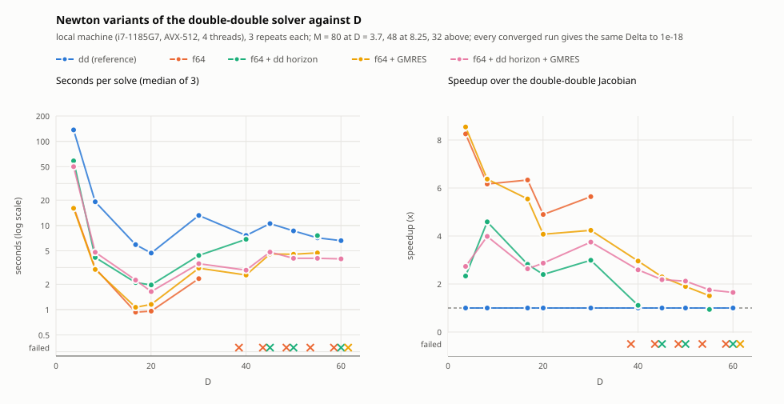
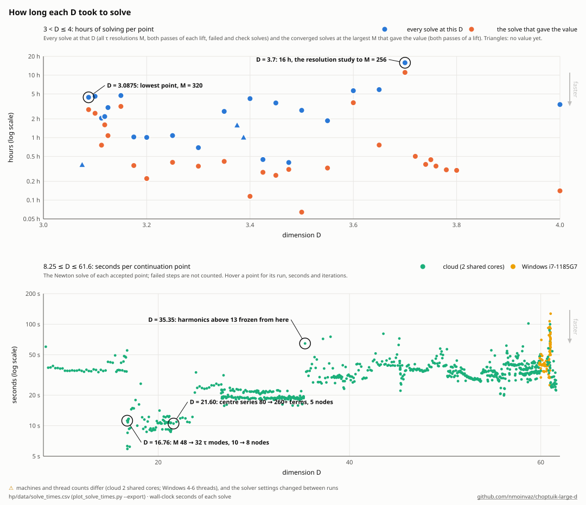
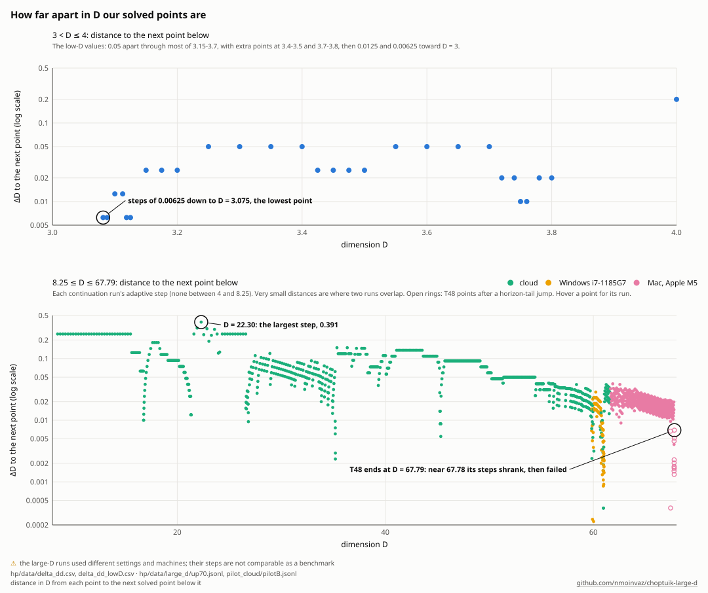
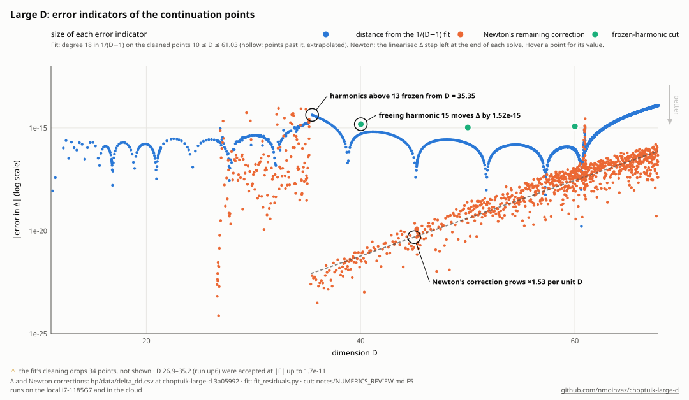
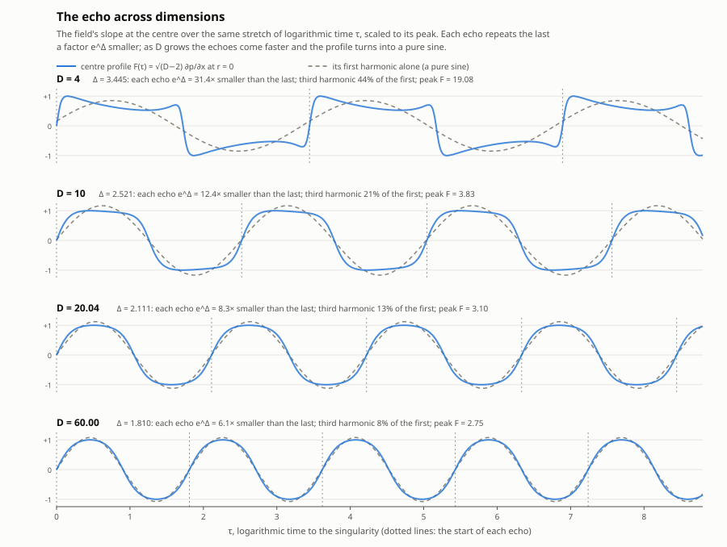

# The double-double solver: how it works, benchmarks, spacing, a sample of points, error indicators

Moved verbatim from README.md (commit ea42b3e, lines 726–796, 798–827, 904–929, 1000–1007) on 2026-11-04, in the
reorganization of [README_PLAN.md](README_PLAN.md); the README keeps a pointer where each block stood. Links were made
relative to this folder.

How the solver works: arithmetic, step control, Jacobian, Newton variants, τ grids, quad-double, continuation, centre-series order

- **Arithmetic:** double-double (hi + lo, about 32 digits)[^15] on 8-lane vectors: one AVX-512 register per lane group,
  two AVX2 registers, four SSE2 or NEON registers, or a portable array, chosen at compile time (`hp/build.sh` builds
  with `-C target-cpu=native`). Error-free two-sum and FMA two-product; sums of products accumulated Sum2-style[^16].
  The arithmetic, the dual lanes, the double-double LU, the staircase LU of the block storage, the τ-field kernels and
  the
  GMRES refinement are the separate crate [multidouble](https://github.com/nmoinvaz/multidouble) (the version in
  `hp/Cargo.toml`, its lane types on the compile-time backend); every backend gives bitwise the same results, and the
  solver's outputs are unchanged bit for bit by each move (`hp/highm_check.py ref` and `scaled` against the
  references of the build before it).
- **No fixed-step error:** Taylor series in x (order 36, step points planned once per D so the truncation term is
  10⁻³²), centre and horizon series run until their tails are below 10⁻³³, and collocation in τ on the
  half period (p, m odd harmonics, a, c even harmonics in τ) with no spectral truncation of the products.
- **Exact Jacobian:** forward-mode duals[^17] over double-double, double-double LU for Newton, a transpose solve that
  gives $`\partial\Delta/\partial F`$ at every point, and a Levenberg–Marquardt fallback.
- **Mixed-precision Newton (opt-in):** `Solver.newton_mixed` keeps the residual in double-double but computes the
  Jacobian with f64 vector lanes (four columns per pass over the base trajectory) and factors it in f64. Newton then
  converges to the same solution: at D = 3.7, M = 64 and 80, Δ agrees with the all-double-double solve to 5×10⁻³¹ and
  the fields to 1×10⁻²⁷, about as closely as two all-double-double solves from different starts agree (6–7×10⁻²⁸). It
  needs at most one extra step. A step is 9–10 times faster at M = 48–80 and a whole solve 7–9 times
  ([notes/MIXED_PRECISION.md](MIXED_PRECISION.md); `hp/lowD_dd.py --jac f64`, `driver.newton_solve(jac="f64")`). At M ≥
  48 the f64 Jacobian agrees with the exact one only to about 10⁻⁷, against 10⁻¹⁴ at M ≤ 32. The Taylor steps are
  planned for the solution, not for the top τ-harmonics of a single column, so rounding inside a step is amplified. That
  costs Newton speed (a contraction of about 10⁻⁷ per step), not accuracy, since the residual stays double-double. At
  large D the f64 Jacobian stops steering (from D = 40 in the benchmark below): the errors that matter all sit in the
  horizon block (notes/MIXED_PRECISION.md §8). Two repairs restore the step
  ([notes/LARGE_D_MIXED.md](LARGE_D_MIXED.md)): the horizon block's columns in double-double (`horizon_dd=4`), and a
  correction loop (GMRES preconditioned by the f64 LU, with exact double-double Jacobian-vector products, `Solver.jvp`).
  With both, Newton converges at every D tried, to the same Δ.
- **Larger τ grids:** M = 160, 192, 256, 320 and 384 collocation points besides 8–128. Above M = 128 the
  mixed-precision step builds and factors its f64 Jacobian in block storage (a staircase LU over the
  multiple-shooting blocks, `hp/src/block.rs`): 8–12 times less memory than the dense matrix (173 MB at M = 192), and
  the same steps as the dense path to that path's rounding at M ≤ 128, where every other result is unchanged bit for
  bit. The exact double-double Jacobian, the Levenberg–Marquardt fallback and γ stay at M ≤ 128. At D = 3.7, Δ
  changes by −3.4×10⁻¹¹, −3.2×10⁻¹⁵, −1.6×10⁻¹⁸ and −3.2×10⁻²¹ in the steps from M = 96 to 128, 160, 192 and 256
  ([notes/HIGH_M.md](HIGH_M.md)).
- **Quad-double arithmetic:** the `qd` and `qv` modules add quad-double numbers
  (four f64, about 64 digits), scalar and 8-lane SIMD, with bitwise the same results on AVX-512, AVX2 and portable
  builds. They use the QD library's algorithms[^20], with two repairs found by the tests: the accurate add's last
  part, and the square root near the ends of the exponent range. Against exact arithmetic they err by at most
  2.1×2⁻²⁰⁹ (63 digits). They cost 8–29 times double-double per operation and 14–17 times in sums of products. A
  quad-double residual would cost about 7 times the double-double one at the same orders
  ([notes/QUAD_DOUBLE.md](QUAD_DOUBLE.md); `hp/qd_check.py`, which runs the tests in a multidouble checkout).
  A fully quad-double Newton (`hp/src/qsolve.rs`, on multidouble's quad-double dual numbers and LU) converges the
  full system from the double-double states up to D ≈ 71.5 and the pinned system to 73.3: Δ(68.5) =
  1.7899636306159916 − 1.016822×10⁻¹⁶, Δ(69.5) = 1.7879302979617628 + 7.083175×10⁻¹⁷ and Δ(70.5) = 1.7859529321182939 +
  1.087438×10⁻¹⁶, each reproduced by a second start with its own Taylor plan to 10⁻³² ([`hp/data/delta_qd.csv`](../hp/data/delta_qd.csv),
  `hp/export_qd.py`), sixteen digits past the double-double data. It does not step past D ≈ 73 in this discretisation:
  Newton's basin there shrinks below any start the double-double runs can give, because the horizon series' sensitivity
  near its radius grows with D (notes/QUAD_DOUBLE.md, sections 12.3–12.4).
- **Continuation in D:** prediction by the cubic through the last four converged points (a tangent from the
  Jacobian is wrong in the weak directions, below), Newton with the weakest directions deflated, and from D = 35 on
  the centre data's τ-harmonics above 13 frozen (below). 32 collocation points in τ, nodes at
  x = 0.3, 0.4, …, 0.7 (the node checks in the table below moved the first node closer to the centre); 30–50 s per
  point on two cores up to D = 60. The tolerance on $`\lvert F\rvert`$ goes from 10⁻²⁵ at D = 35 to 10⁻²² at D = 56,
  following the residual floor, which rises about 1.4-fold per unit of D. Above D = 60.1, on the second machine, it
  was relaxed to 3×10⁻¹⁹ for part of the climb ($`\lvert F\rvert`$ up to 2.9×10⁻¹⁹ there). A step-size test at
  D = 45–60 ([notes/STEP_TEST.md](STEP_TEST.md)) found that Newton tolerates steps of 0.12 at D = 45 falling to
  0.034 at D = 60, 7–17 times what the scans used near D = 61, and that predictors through 6–8 points are 4–10 times
  faster up to D = 55 but fail at D = 60.
- **Centre-series order (`scan_hp.py --kc_auto 30`):** the scan raised the centre series' order kc whenever its tail
  check asked and never lowered it, so it ran with kc = 420 above D = 27, where the series' terms are 10⁻¹⁰⁷–10⁻¹⁵¹ by
  that order. The order where they stay below 10⁻⁴⁵, plus 30, is 209 at D = 36 and 153–155 at D = 60–61. With it the
  residual, the double-double Jacobian and the Newton step are bitwise those of kc = 420 at D = 36–61 (`hp/kc_check.py`;
  with a margin of 10 the Jacobian's low parts change). The Jacobian is 2–4 times cheaper, and real continuation
  steps at D = 59.84–59.88 with the scan's own arguments gave bitwise the same points 2.85–2.9 times faster
  (`hp/data/kc_check_scan/`). `--kc_auto` lowers kc after a converged point only when the residual and the Jacobian
  there are bitwise unchanged; the default keeps kc as given.

**The Newton variants against D** (`hp/plot_bench_variants.py`; data from `hp/bench_variants.py --repeat=3 --threads=4`
on an otherwise idle laptop, i7-1185G7 with AVX-512, in `hp/data/bench_variants/bench_local.jsonl`). Left: seconds per
whole solve, the median of three; right: the speedup over the double-double Jacobian; the arrows point the faster way,
and crosses mark a variant that did not converge. Up to D = 30 the f64 Jacobian alone, or with the loop, is 5–8 times
faster; alone it fails from D = 40, and with the loop alone (f64g) from D = 60. Only the horizon fix with the loop
(f64hg) converges at every D, 1.6–2.6 times faster than double-double at D = 40–60. Every converged run gives the same Δ
to 1.1×10⁻¹⁸.

**How long each D took** (`hp/plot_solve_times.py`, from [`hp/data/solve_times.csv`](../hp/data/solve_times.csv), which
`--export` writes from the solve records). Below D = 4 a point costs hours: about 86 in the exported records
(`data/solve_times.csv`, which stop at D = 3.075), counting every resolution, both passes of each lift and the failed
and check solves. The solve that gives the value is mostly under an hour above D = 3.2 and 2.5–3.1 h at M = 320 at D =
3.1–3.08125; D = 3.7 took 16 h because the resolution study ran there. Above D = 8.25 each accepted continuation point's
Newton solve takes 6–130 s, 10.5 h for all 1218 points (failed steps are not recorded). The cost hardly grows with D;
its steps come from the runs' settings, marked on the graph. The machines differ (the cloud's 2 shared cores, the
laptop's 4–6 threads, the Mac's 4 performance cores, from D = 61.63 at a median of 25 s), so this shows the effort, not
a benchmark.

**How far apart the points are** (`hp/plot_point_spacing.py`). Below D = 4: the distance from each point to the next
one below it, on a grid we chose, mostly 0.05 apart and halved to 0.0125 and 0.00625 toward D = 3. From D = 8.25 up
(there are no double-double points between 4 and 8.25): each continuation run's own adaptive step, the distance from
each point to the run's previous point, with runs that overlap kept apart. The step is about 0.25 below D = 15,
0.05–0.1 from 20 to 50, and then falls steadily, to a median of 0.027 at D = 55–60 and 0.016 at 65–70. A run's step
collapses where it got stuck: at D = 35.2 and 45.3 (two cloud runs that stopped there), at 60.96 (the stall that
holding the near-free centre harmonics on their trend cured) and at 67.78, where T48 stopped (open rings: points after
a horizon-tail jump).

A sample of the computed points

A sample of the computed points (all of them, from D = 8.25 up, are in
[`hp/data/delta_dd.csv`](../hp/data/delta_dd.csv)), with the residual and the largest entry of
$`\partial\Delta/\partial F`$, the factor by which a residual error moves Δ:

| D | Δ | $`\lvert F\rvert`$ | $`\max\lvert\partial\Delta/\partial F\rvert`$ |
|---|---|---|---|
| 8.25 | 2.683434296073424 | 5×10⁻³¹ | 1.2×10² |
| 12 | 2.389188553640616 | 8×10⁻³¹ | 5.9×10² |
| 16 | 2.218342998377885 | 4×10⁻³⁰ | 6.8×10³ |
| 21.19141 | 2.087734162683867 | 4×10⁻²⁹ | 2.0×10⁵ |
| 25.07972 | 2.023511166632091 | 1×10⁻²⁸ | 2.1×10⁶ |
| 29.98475 | 1.965111240898741 | 1×10⁻¹⁵ \* | 8.0×10⁷ |
| 35.35323 | 1.918943717094251 | 4×10⁻²⁷ | 7.0×10⁸ |
| 40.02007 | 1.888451664490614 | 2×10⁻²⁶ | 9.6×10⁹ |
| 44.96341 | 1.862784197662323 | 9×10⁻²⁶ | 1.3×10¹¹ |
| 50.00749 | 1.841631133202264 | 1×10⁻²⁴ | 1.5×10¹² |
| 54.99609 | 1.824394337272626 | 6×10⁻²⁴ | 1.2×10¹³ |
| 60.00195 | 1.809884258001715 | 2×10⁻²³ | 8.9×10¹³ |

\* From D = 27 to 35.2, before the freezing, points were accepted once the linearised correction to Δ,
$`-\partial\Delta/\partial F \cdot F`$, was below 10⁻¹⁴ with the weak directions held on their trend; their residual
sits in those directions.

**The error indicators side by side** (`hp/fit_residuals.py`, then `hp/plot_errors.py`). Blue: each point's distance
from the degree-18 fit in 1/(D − 1) on the cleaned points 10 ≤ D ≤ 61.03. The arches are the fit's own error, which
changes sign at each dip, and the step at D = 35.35 is where the frozen-harmonic cut sets in. Orange: Newton's remaining
linearised correction to Δ (`dDelta_est`), up to 10⁻¹⁴ on the points solved before the freezing (D = 26.6–35.2) and
growing 1.60-fold per unit of D after it, to about 10⁻¹⁷ at D = 61. Green: the cut itself, from the checks table.
Above D = 35 the cut, about 10⁻¹⁵, is the largest of the three (see "How good the values are" above).

## The echo over several periods (from the README)

Moved verbatim from README.md (commit ecf2b38, "What the numbers mean physically") on 2026-11-04 (README_PLAN.md, stage
4): the earlier echo figure, superseded in the README by hp/echo_shapes.svg; links made relative to this folder.

**The echo itself.** The figure shows the field's slope at the centre, F(τ) = √(D−2)·∂p/∂x at r = 0, over the same
stretch of logarithmic time τ for D = 4, 10, 20 and 60, each scaled to its peak (dashed: its first harmonic alone;
dotted lines: the start of each echo). At D = 4 the echo is far from a sine: almost a square wave, with a third harmonic
44% of the first, and each echo 31× smaller than the one before. As D grows the echoes come faster (Δ = 2.52, 2.11, 1.81
at D = 10, 20, 60: 12×, 8.3×, 6.1× per echo) and the profile turns into a pure sine: the third harmonic falls to 8% of
the first at D = 60, and the D = ∞ theory predicts 5.5%. The D = 4 profile is from the f64 solver (39 harmonics, Δ
within 3×10⁻⁶ of the best value); the others are double-double solutions (`solver/plot_echo.py`, data from
`solver/echo_data.py`).
