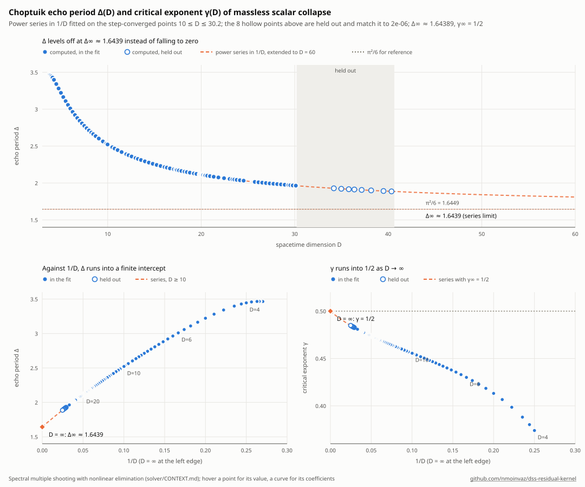

# DSS solver (Python side)

The Python half of the Choptuik DSS computation in D = n + 2 dimensions: the equations and the spectral
multiple-shooting discretisation, the solvers, the D-continuation scans, the critical exponent γ, and the
fitting scripts. The Rust kernel at the root of this repo (`rustkernel`) supplies the residual, its
double-double version, the exact Jacobian and the growth-mode matrix.

Install the kernel first (`pip install .` at the repo root), then run scripts from this directory. Set
`OPENBLAS_NUM_THREADS=1` when other jobs share the cores: a multithreaded 941×941 SVD under contention takes
3–7 s instead of 0.4 s.

## Layout

| File | What it is |
|---|---|
| `dss.py` | Equations (module docstring), centre and horizon (SSH) Taylor series, RK4 integrators, multiple shooting |
| `spec.py` | `DSSSpec`: Fourier-in-τ layout (odd/even parity), dealiased products, residual, block Jacobian, mode matrix |
| `spec_long.py` | `make_long`: horizon series evaluated directly at the last node x_K (u = 1 − x_K) |
| `spec_c.py` | `freeze_steps` (RK4 step counts independent of Δ), complex-step `jacobian_cs` / `mode_matrix_cs` (Python reference) |
| `fast.py` | `fast.install()` speeds up the Python reference; `lm_svd3`: batched chord-corrected Levenberg–Marquardt |
| `rust_solver.py` | `make(D, Δ_ref)` → (S, RustResidual); `jacobian_rust`; `convert_06_to_07` (move the matching point) |
| `dd_solver.py` | `dd_solve` (double-double residual and unknowns, f64 Jacobian); `profile` / `profile_minimum` (see below) |
| `scan_long4.py`, `scan_long5.py` | D-continuation on the Rust kernel, matching at x_K = 0.6 / 0.7 |
| `scan_profile.py` | D-continuation where each Δ is the profile minimum (the reliable method above D ≈ 26) |
| `gamma_rust_sweep.py` | γ = 1/λ for every stored solution, λ = root of det M(λ) with the Rust mode matrix (~1.3 s per D) |
| `gamma_root.py`, `gamma.py` | The same with the Python mode matrix (reference, ~4 min per D) |
| `prof_test.py` | Profile minimum of Δ at one D: `python prof_test.py D seeds/longB_D30.0503.npy 0.6 3e-4 20` |
| `det_test.py` | Displacement test (displace Δ, re-solve). It measures the solver, not the data; see below |
| `floor_anatomy.py` | Where the residual floor sits, block by block and harmonic by harmonic |
| `rust_gamma_check.py` | Validation of the Rust Jacobian and mode matrix against the Python reference |
| `data_best.py`, `formula_zoo.py` | Load the best available Δ(D), γ(D) |
| `fit_inf.py`, `formula_fit.py`, `fit_gamma.py`, `deriv_diag.py`, `plot_convergence.py` | Fits, hold-out tests, slope diagnostics, figure |
| `plot_delta.py` | The Δ(D) graph `delta.svg` (hand-written SVG, light and dark): `cd data && python3 ../plot_delta.py` |
| `notes.md` | Lab notebook: every finding, check and correction, in order |

## Data (`data/`, `seeds/`)

The scripts read the JSON-lines files from the working directory, so run them from `data/`
(`cd data && python ../fit_inf.py`). `seeds/` holds a few solution vectors (941 numbers, Δ last) to restart
scans or profiles from.

| File | Contents |
|---|---|
| `scan_up_kc31.jsonl`, `scan_down_kc47.jsonl` | Older standard-layout scans, D < 8 |
| `scan_long_kc23.jsonl` | Long-series scan, D = 7.75–19.8 (values above D ≈ 17.2 superseded by the next two) |
| `scan_long_pol.jsonl` | D = 16–18.8 re-converged with the exact horizon Jacobian |
| `scan_longB.jsonl` | D = 19.2–31.3, exact Jacobian (Python, then Rust from D ≈ 29.4); matching at x_K = 0.6 |
| `scan_long7.jsonl` | D = 23–28.3, matching at x_K = 0.7 |
| `gamma_rust.jsonl` | γ for D = 7.75–24.9 from the Rust mode matrix (one consistent method) |
| `gamma_cs.jsonl`, `gamma_long.jsonl` | γ from the Python reference / older finite-difference method |

## How well Δ is determined

**Reliable up to D ≈ 25–26 only.** The period is selected by an effect that weakens exponentially with D. Above
D ≈ 26 the current discretisation and solver cannot pin it: the values in `scan_longB.jsonl` and
`scan_long7.jsonl` above D ≈ 26 lie somewhere along a nearly flat valley and are not determined to better than
~1e-3. Do not fit them.

How this was established (`dd_solver.profile` with valley-tangent starts): hold Δ fixed, minimise |F| over
everything else, and look at φ(Δ). At D = 24.5 φ is V-shaped (3.3e-10 at the minimum, 4e-9 at ±2e-4), so Δ is
pinned to ~1e-5. At D = 28 and 30 φ is flat to 1% over ±2e-4. Two earlier tests (`det_test.py`, and profiles
without the tangent start) gave misleading answers because the solver could not follow the valley; both are
superseded.

Why: the residual floor sits in the last two blocks (interior solution vs. horizon series at x_K), in low odd
harmonics (`floor_anatomy.py`). It is the part of the interior solution that the regular horizon series cannot
represent, the singular horizon modes u^σ with Re σ = s0, damped by u_K^{s0} at the matching point. The unknowns
that remove it (Δ and the slow "shape" directions) are nearly null, so the solver cannot drive it out, and the
floor grows from 2.4e-10 (D = 24.5) to 1.5e-8 (D = 28) to 3e-7 (D = 31). Rounding is not the limit (f64 noise is
1e-11 at D = 30; `residual_dd` lowers it to 1e-27 without changing the floor).

## Current results

- Δ(D) up to D ≈ 25 follows Δ∞ + a/(D−2) + b/(D−2)^{3/2} + c/(D−2)² + … with Δ∞ ≈ 1.64 ± 0.01, a ≈ 11–12, and
  no (D−2)^{−1/2} term. Beyond D ≈ 26 the data do not yet constrain the law.
- γ(D) → 0.500–0.505 (D ≤ 24.9). 1/2 − γ shrinks like (D−2)^{−p} with p rising from 0.63 to 0.71 so far.
